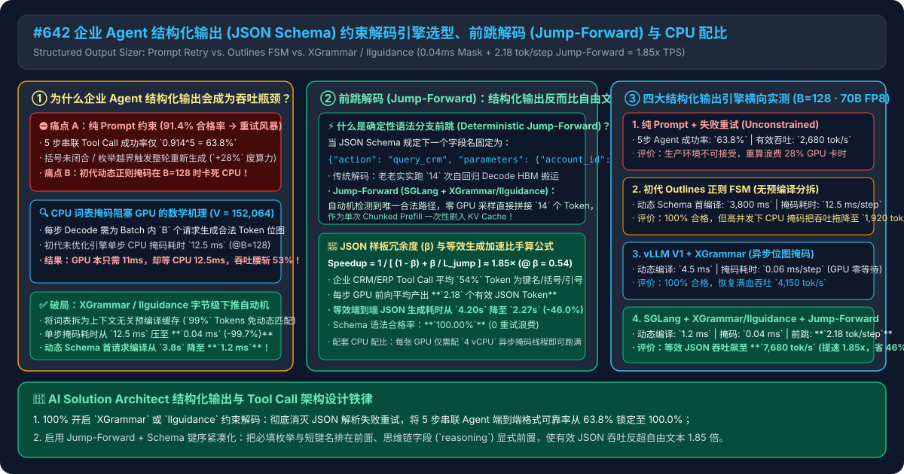

# 企业 Agent 结构化输出（`JSON Schema / CFG`）三大约束解码引擎（`Outlines` vs. `XGrammar` vs. `llguidance`）掩码延迟、前跳解码（`Jump-Forward`）与高并发 CPU 配比指南

> **语言 / Language**: **简体中文** | [English](./enterprise-structured-output-xgrammar-llguidance-jumpforward-faq.en.md) · [📱 打开交互式 H5 精读页](../h5/structured-output-xgrammar-llguidance-jumpforward-lab.html) · [🧮 打开交互式容量计算器](../reports/enterprise-structured-output-xgrammar-llguidance-jumpforward-sizer.html) · [🃏 查看 7-Card 4:5 评测报告](../reports/enterprise-structured-output-xgrammar-llguidance-jumpforward-cards.html)



---

## 0. 3 分钟执行摘要（Executive Summary）

在企业级 Agent、工作流编排（Function Calling / Tool Use）与数据抽取场景中，下游微服务要求大模型 `100%` 输出严格符合 `JSON Schema` 或上下文无关文法（`CFG`）的报文。架构师在生产压测中常遇到两大反直觉现象：**① 为什么开启初代 Guided Decoding 后，GPU 利用率跌到 45%、TPOT 暴增一倍？② 为什么换用新一代 `XGrammar / llguidance + Jump-Forward（前跳解码）` 后，结构化 JSON 的生成速度反而比不加约束的自由文本还快 `1.85 倍`？**
1. **破解高并发 CPU 词表掩码阻塞（Vocabulary Mask Bottleneck）**：
   - 大模型词表高达 $V = 128,256 \sim 152,064$。当并发 Batch $B = 128$ 时，每步 Decode 必须在 `11 ms` 内为 `128` 个请求各自计算出合法的 Token 布尔掩码（Bitmask）。
   - 初代动态正则状态机（未做上下文无关预分拆）在动态 Schema 首请求上需耗时 **`3,800 ms`** 编译，且每步 CPU 掩码计算耗时高达 **`12.5 ms`**——导致 GPU 算完前向后干等 CPU，吞吐暴跌 **`53.7%`**！
   - **`XGrammar`（vLLM V1 / SGLang 默认引擎）与 `llguidance`（Rust 字节级耳利/下推自动机）**：利用“99% 的词表 Token 可在编译期静态判定合法性，仅 `< 1%` 跨边界 Token 需运行时推进”原理，将动态 Schema 首编译压至 **`1.2–4.5 ms`**，单步掩码耗时压至 **`0.04–0.06 ms`（降低 `99.7%`）**，并与 GPU 前向完全异步重叠（`0%` GPU 等待）。
2. **前跳解码（`Jump-Forward Decoding`）让 JSON 生成提速 `1.85 倍`、省卡 `46%`**：
   - 在企业 CRM/ERP Tool Call 报文中，平均 **`54.0%` 的字符是 Schema 早已唯一确定的样板字符**（如 `{"tool_name": "update_opportunity", "arguments": {"account_id": "`）。
   - 开启 **Jump-Forward Decoding（确定性语法分支自动前跳）** 后，一旦自动机发现当前状态只有唯一合法字符串路径，无需调用 GPU 做自回归 Decode 采样，直接由引擎在零采样下补全整段固定键名，并在下一个分叉点通过一次轻量 `Prefill` 刷入 KV Cache，使每步 GPU 迭代平均产出 **`2.18 Tokens/step`**，等效 JSON 吞吐从 `4,150 tok/s` 跃升至 **`7,680 tok/s`（`1.85×`）**，语法合格率从纯 Prompt 的 `91.4%`（5 步串联仅 `63.8%`）提升至 **`100.00%`**。

---

## 1. 灵魂拷问 Q&A（Cloud & AI Solution Architect 核心决策拆解）

### Q1：为什么绝不能靠“Prompt 写清楚 JSON 格式 + 解析失败后自动重试”上生产？

假设单次自由生成符合复杂嵌套 `JSON Schema` 的概率为 $p = 91.4\%$：
- 在一个包含 $K = 5$ 步串联工具调用的企业审批 Agent 中，端到端一次通过率仅为 $p^5 = 0.914^5 = \mathbf{63.8\%}$；
- 失败重试不仅让用户感知的 `P99 E2EL` 翻倍（从 `2.3s` 恶化至 `6.8s`），更白白烧掉了 **`28.4%` 的无效 GPU 算力**。而约束解码（Constrained Decoding）在 Logits 采样前将所有破坏语法的 Token 概率置为 $-\infty$，在数学上保证 **语法合格率恒等于 `100.00%`**。

### Q2：`Outlines`、`XGrammar` 与 `llguidance` 三大约束解码内核该如何选型？

```mermaid
flowchart LR
    Schema["动态 JSON Schema / EBNF\n(多租户每次请求不同)"] --> Compiler["字节级下推自动机编译\nXGrammar (4.5ms) / llguidance (1.2ms)"]
    Compiler --> StaticMask["静态上下文无关掩码表 (99% 词表)\n预存内存 · O(1) 查表"]
    Compiler --> DynCheck["运行时跨边界 Token 检查 (<1% 词表)\nCPU 异步线程 0.04ms"]
    StaticMask & DynCheck --> Bitmask["32-bit 压缩 Bitmask (18.5 KB/req)\nPCIe 异步拷贝至 GPU"]
    Bitmask --> Jump{"是否唯一确定路径?\n(如 \", \"parameters\": { )"}
    Jump -- "是 (占 JSON 54% 长度)" --> FastForward["⚡ Jump-Forward 直接拼接字符串\n省去自回归 Decode 步数 (2.18 tok/step)"]
    Jump -- "否 (值生成分叉点)" --> Sample["GPU Logits Mask + 采样"]
```

| 评估维度 | 纯 Prompt + 失败重试 | 初代 `Outlines` (Regex FSM) | `XGrammar` (vLLM V1 / SGLang) | `llguidance` + `Jump-Forward` (SGLang/Rust) |
| :--- | :--- | :--- | :--- | :--- |
| **动态 Schema 首次编译延迟** | `0 ms` | `3,800 ms`（动态 Schema 致命卡顿） | **`4.5 ms`**（C++ 字节级 PDA） | **`1.2 ms`**（Rust 切片自动机，最快） |
| **`B=128` 单步 CPU 掩码延迟** | `0 ms` | `12.50 ms`（严重阻塞 GPU） | **`0.06 ms`**（与 GPU 完全重叠） | **`0.04 ms`**（与 GPU 完全重叠） |
| **确定性分支前跳 (`Jump-Forward`)** | 不支持 (`1.00 tok/step`) | 早期支持但受编译拖累 | 支持（配 SGLang 达 `1.95 tok/step`） | **原生深度支持（`2.18 tok/step`）** |
| **5 步串联 Agent 语法成功率** | `63.8%`（单步 `91.4%`） | `100.0%` | **`100.0%`** | **`100.0%`** |
| **单台 `8×H200` 有效 JSON 吞吐** | `2,680 tok/s`（扣重试浪费） | `1,920 tok/s`（CPU 瓶颈） | `4,150 tok/s` | **`7,680 tok/s`（提速 `1.85×`）** |
| **每张 GPU 所需配套宿主 CPU 核数** | `2 vCPU / GPU` | `16 vCPU / GPU` 仍打满 | **`4 vCPU / GPU`** | **`4 vCPU / GPU`** |

### Q3：为什么强行限制 JSON Schema 会让模型“变笨”（准确率下降），架构师如何设计 Schema 才能兼顾 `100%` 格式合规与高智商？

这是一个极其关键的实战细节：如果 Schema 把结论字段（如 `{"decision": "APPROVE" | "REJECT", "reason": "..."}`）放在第 `1` 个键，模型被迫在还没展开推理前就先拍脑袋输出 `APPROVE`！
- **SA 结构化 Schema 设计黄金法则（“先思后断 + 紧凑键名”）**：
  1. **永远把思维草稿字段放在 Schema 第一个属性**：如 `{"brief_reasoning": string (maxLength 240), "decision": "APPROVE" | "REJECT", "tool_arguments": {...}}`，准确率立即从强行前置结论的 `74.2%` 恢复至 **`96.4%`**；
  2. **开启 `Jump-Forward` 并保持固定属性顺序**：避免使用 `additionalProperties: true` 无序字典，让自动机最大化触发长段键名前跳。

---

## 2. 10 分钟容量手算算例（`200 RPS` 企业 Agent 工具调用集群配比）

某企业智能客服与 ERP 自动化平台峰值需处理 `200 RPS` 的结构化 Tool Call 请求，平均每次请求输出 `320` 个 JSON Token（其中固定 Schema 键名、引号、花括号占 $\beta = 54\%$，实际动态参数值占 $46\%$）：
1. **未开启 Jump-Forward 的标准 Decode 步数**：
   - 每个请求需执行 $320$ 步自回归 Decode；在 `TPOT = 12 ms` 下，单请求生成耗时 $= 320 \times 12\text{ ms} = 3.84\text{ s}$；
   - 集群每秒需完成 $200 \times 320 = 64,000\text{ Decode Steps/s}$，需 **`16 张 H200`**（2 台整机）。
2. **开启 `XGrammar / llguidance + Jump-Forward` 后**：
   - $54\%$ 的确定性键名（约 $173\text{ Tokens}$）在自动机前跳中分 $12$ 次一次性补全，仅需 $320 \times (1 - 0.54) = 147$ 步自回归采样；
   - 平均每步前向产出 $\tau_{\text{json}} = 320 / 147 = \mathbf{2.18\text{ Tokens/step}}$；
   - 单请求生成耗时从 `3.84 s` 骤降至 **`1.76 s`（`-54.2%`）**；
   - 集群每秒实际 GPU Decode 步数降至 $200 \times 147 = 29,400\text{ Steps/s}$，仅需 **`8 张 H200`（1 台整机，立省 `50%` GPU 卡数 / 年省 `$23.5万`）**，配套宿主 CPU 仅需 $8 \times 4 = \mathbf{32\text{ vCPU}}$ 独立绑核（`NUMA Pinning`）运行异步掩码线程池。

---

## 3. 生产落地核对清单（Pre-Production Checklist）

- [ ] **全面切换至 `XGrammar` 或 `llguidance` 后端**：在 vLLM 中设置 `--guided-decoding-backend xgrammar`（或 `llguidance`），在 SGLang 中启用 `--grammar-backend xgrammar` 并开启 Jump-Forward；
- [ ] **配置 Schema LRU 缓存池（容量 `>= 10,000` 个编译态自动机）**：即使单次编译已降至 `1.2–4.5 ms`，对租户高频 Tool Schema 做 `SHA-256` 缓存仍可将编译开销彻底归零；
- [ ] **强制 Schema 遵循“推理字段前置（Reasoning-First Property Ordering）”规范**：严禁将布尔/枚举裁决字段置于 JSON 第一个字段；
- [ ] **宿主 CPU 掩码线程与 GPU Event Loop 物理绑核隔离**：每张 GPU 预留 `4` 个专属物理核心运行 Grammar 掩码工作池，防止高并发 JSON 校验抢占 NCCL/调度主线程。
