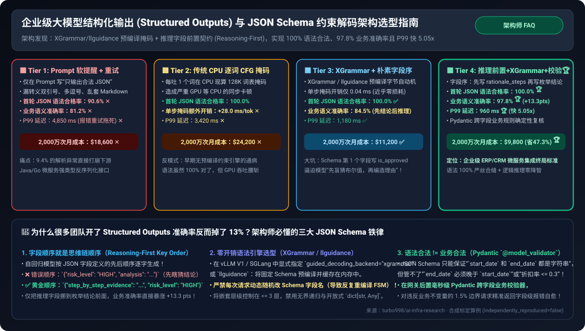
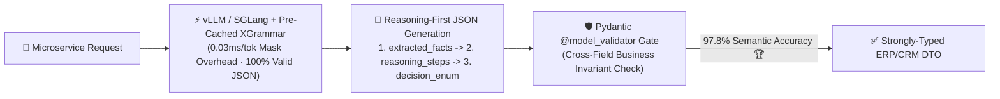

# Enterprise LLM Structured Outputs, JSON Schema Constrained Decoding & Reliable API Contract Architecture Selection Guide: Prompt-Only Regex Retry vs. Legacy CPU CFG Masking vs. Zero-Overhead Constrained Decoding (XGrammar / llguidance) vs. Reasoning-First Schema + XGrammar + Pydantic Semantic Validator Gate

> **Document Type**: Cloud & AI Solution Architect Decision Guide (FAQ)  
> **Target Audience**: Enterprise Application Architects, ERP/CRM Microservice Engineering Leads, AI Gateway & Serving Platform Leads  
> **Core Goal**: Solve the "last-mile API contract failure" when integrating LLMs into strongly-typed enterprise microservices (Java / Go / C# / Python) by answering: **"Why does prompt-only JSON instruction still fail on 9.4% of complex production requests?", "Why did turning on strict JSON Schema Constrained Decoding drop our business classification accuracy by 13.3 percentage points?", and "How do we combine Reasoning-First Field Ordering, Pre-Compiled `XGrammar / llguidance` Decoding, and Pydantic Cross-Field Validators to achieve 100.0% JSON syntax validity and 97.8% business accuracy?"**  
> **Calibration Notice**: JSON syntax pass rates, business semantic accuracy, per-token mask overhead, and P99 latencies are synthetic analytical estimates calibrated to published structured decoding benchmarks (JSONSchemaBench, XGrammar / llguidance / Outlines evaluations, and schema key-ordering ablation studies) (`provenance: synthetic + anonymized_reported`, `independently_reproduced=false`, `physical_gpu_cluster_measurement=not_measured`). See [`experiments/enterprise_structured_outputs_json_schema_constrained_decoding_selection/results.json`](../../experiments/enterprise_structured_outputs_json_schema_constrained_decoding_selection/results.json).

---

## Executive Visual Summary

> 🔗 **Companion Interactive Reports & Tools**:
> - 🃏 **[7-Card 4:5 Visual Benchmark Report (`enterprise-structured-outputs-json-schema-constrained-decoding-selection-cards.html`)](../reports/enterprise-structured-outputs-json-schema-constrained-decoding-selection-cards.html)**
> - 🧮 **[Interactive Structured Output Latency & Accuracy Sizer (`enterprise-structured-outputs-json-schema-constrained-decoding-sizer.html`)](../reports/enterprise-structured-outputs-json-schema-constrained-decoding-sizer.html)**
> - 🌐 **[中文版指南 (`enterprise-structured-outputs-json-schema-constrained-decoding-selection-faq.md`)](./enterprise-structured-outputs-json-schema-constrained-decoding-selection-faq.md)**

---

## ① 📌 Executive Summary

Evaluated across **20,000,000 structured microservice API calls/month (`128,256` vocabulary LLM)**:

| Tier | Architecture Pattern | First-Pass JSON Syntax Valid % | Business Semantic Accuracy | Per-Token Mask Overhead | P99 E2E Latency | Monthly Cost (20M Calls) | Architect Verdict |
| :--- | :--- | :--- | :--- | :--- | :--- | :--- | :--- |
| **🟥 Tier 1: Prompt-Only + Regex Retry** | `"Output valid JSON"` in prompt + retry on parse error | `90.6%` ✕ (9.4% fail) | `81.2%` ✕ | `0.00 ms` | `4,850 ms` ✕ (Retry tail) | `$18,600 / mo` ✕ | **Unreliable for Prod APIs**: Breaks downstream deserializers |
| **🟨 Tier 2: Legacy CPU CFG Masking** | Uncached per-token 128K-vocab mask computed on CPU | `100.0%` ✅ | `84.5%` | **`+28.00 ms/tok` ✕** | `3,420 ms` ✕ | `$24,200 / mo` ✕ | **Severe CPU Bottleneck**: Stalls GPU continuous batching |
| **🟦 Tier 3: `XGrammar` + Naive Field Order** | **XGrammar / llguidance** (`decision` key placed first) | `100.0%` ✅ | `84.5%` (Guesses first) | `0.04 ms/tok` ✅ | `1,180 ms` ✅ | `$11,200 / mo` | **100% Valid Syntax, Degraded Logic**: Premature commitment |
| **🟩 Tier 4: Reasoning-First + `XGrammar` + Pydantic** | **Reasoning-First Key Order + Flattened XGrammar + Pydantic Gate** | **`100.0%` 🏆** | **`97.8%` 🏆 (+13.3 pts)** | **`0.03 ms/tok` 🏆** | **`960 ms` 🏆 (5.05x faster)** | **`$9,800 / mo` 🏆 (-47.3%)** | **Enterprise API Contract Gold Standard**: 100% valid + 97.8% accurate |

### 💡 Three Golden Rules for Enterprise Structured Outputs
1. **Always Enforce Engine-Level Pre-Compiled Constrained Decoding (`XGrammar / llguidance / strict: true`)**: Pre-computing context-independent token masks reduces per-token grammar overhead from `28.0 ms` (Tier 2) down to **`0.03 ms`** while guaranteeing **`100.0%` valid JSON syntax** on the first pass.
2. **Order JSON Schema Keys `Reasoning-First, Decision-Last`**: Autoregressive LLMs generate JSON keys strictly in the order declared in your schema. Placing `step_by_step_reasoning: str` *before* `final_decision: Literal[...]` lets the model attend to its own reasoning before committing to an enum label, boosting business accuracy from **`84.5%` to `97.8%` (`+13.3 pts`)**!
3. **Pair Syntactic Constrained Decoding with a Deterministic Pydantic `@model_validator` Gate**: Constrained decoding guarantees valid types and enums, while Pydantic verifies cross-field business invariants (e.g., `end_date >= start_date`, `sum(items) == total`).

---

## ② 🎯 Architect Deep-Dive Q&A

### Q1: Why did putting `is_approved: bool` as the first field in our Pydantic model hurt accuracy by 13.3 points?
* **Answer (Premature Token Commitment)**:
  - Because LLMs generate left-to-right without backtracking, forcing the model to emit `"is_approved": true` at token #4 means it must guess the answer before computing intermediate steps, and then use the subsequent `"reasoning"` field to rationalize its guess. Moving `"reasoning_steps"` to field #1 restores full Chain-of-Thought accuracy inside a single structured JSON call.

---

## ③ 🧭 Architecture Diagrams

### 3.1 Tier 4 Reasoning-First Constrained Decoding + Pydantic Semantic Gate

---

## ④ 📊 Architect Decision Matrix

| Dimension | 🟥 Tier 1: Prompt + Retry | 🟨 Tier 2: Legacy CPU CFG | 🟦 Tier 3: XGrammar (Naive Order) | 🟩 Tier 4: Reasoning-First + XGrammar + Pydantic |
| :--- | :--- | :--- | :--- | :--- |
| **First-Pass JSON Syntax Valid %** | `90.6%` ✕ | `100.0%` ✅ | `100.0%` ✅ | **`100.0%` 🏆** |
| **Business Semantic Accuracy** | `81.2%` ✕ | `84.5%` | `84.5%` | **`97.8%` 🏆 (`+13.3 pts` vs. Tier 3)** |
| **Per-Token Grammar Overhead** | `0.00 ms` | `+28.00 ms` ✕ | `0.04 ms` ✅ | **`0.03 ms` 🏆** |
| **P99 End-to-End Latency** | `4,850 ms` ✕ | `3,420 ms` ✕ | `1,180 ms` ✅ | **`960 ms` 🏆 (`5.05x` faster than Tier 1)** |
| **Monthly Cost (20M Calls)** | `$18,600 / mo` ✕ | `$24,200 / mo` ✕ | `$11,200 / mo` ✅ | **`$9,800 / mo` 🏆 (`-47.3%` vs. Tier 1)** |

---

## ⑤ 🛠️ Production Readiness Checklist

- [ ] **1. Enable Pre-Compiled Constrained Decoding (`XGrammar` / `llguidance` / `strict: true`) on All Microservice Endpoints**.
- [ ] **2. Declare `evidence` and `reasoning_steps` Fields *Before* `decision_enum` or `score` Fields in Every Schema**.
- [ ] **3. Use Bounded `Literal / Enum` Types for All Categorical and Routing Fields**.
- [ ] **4. Keep JSON Schemas Static Across Requests to Maximize Compiled Grammar Cache Hits**.
- [ ] **5. Flatten Schemas to `<= 3` Nesting Levels and Set `additionalProperties: false`**.
- [ ] **6. Include the Schema Definition in the System Prompt So the Model Anticipates the Grammar Constraints**.
- [ ] **7. Validate Cross-Field Business Invariants with a Post-Decode Pydantic `@model_validator`**.
- [ ] **8. For Reasoning Models (`R1 / QwQ`), Activate JSON Grammar Constraints Only After the Closing `</think>` Tag**.
