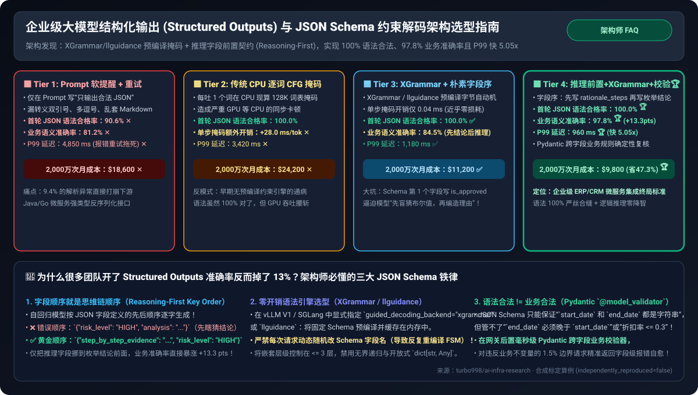
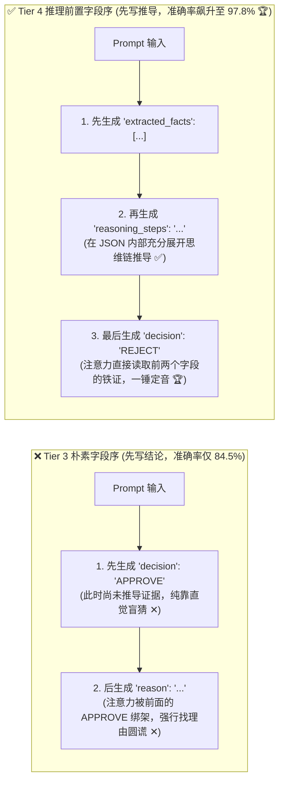
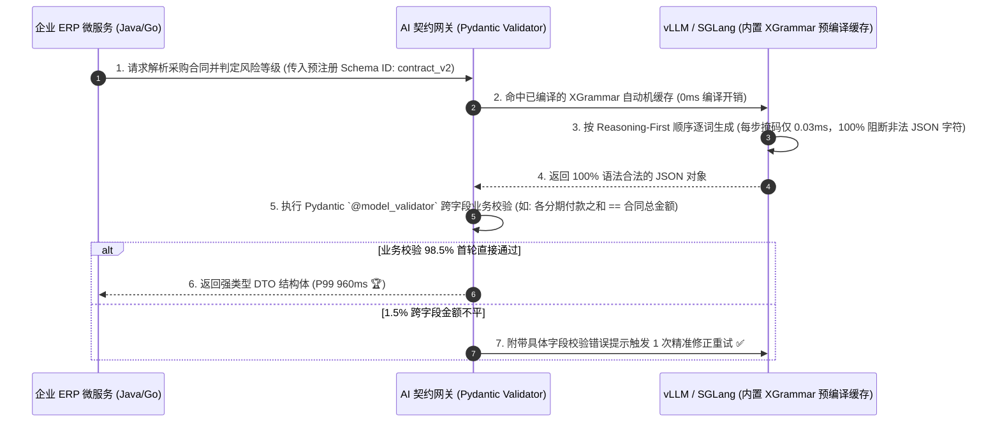

# 企业级大模型结构化输出（Structured Outputs / JSON Schema 约束解码）与高可靠 API 数据契约架构选型指南：Prompt 软提醒重试 vs. 传统 CPU 逐词掩码 vs. 预编译零开销约束解码（XGrammar / llguidance）vs. 推理字段前置契约（Reasoning-First Schema）+ Pydantic 业务语义双重门控

> **文档类型**：企业级微服务集成与 AI 平台解决方案架构师（Cloud & AI Solution Architect）选型决策指南（FAQ）  
> **适用读者**：企业应用架构师、ERP/CRM/工单系统研发负责人、AI 网关与推理引擎负责人  
> **核心目标**：用通俗、可落地的架构语言彻底解决大模型接入企业生产业务系统（Java Spring Boot / Go / .NET 强类型微服务）时的“最后一公里契约崩溃”——系统回答：**“为什么在 Prompt 里写了十遍‘只许输出合法 JSON’，线上还是有 9.4% 的请求因为少了个引号或多了一段解释把下游接口搞崩？”、“为什么开启了强制 JSON Schema（Structured Outputs）后，语法 100% 不报错了，但模型判断风控等级的准确率却莫名其妙掉了 13%？”、“怎么用‘推理字段前置（Reasoning-First Key Ordering）+ XGrammar 零开销约束解码 + Pydantic 跨字段校验’实现 100% 语法合法与 97.8% 业务准确率？”**。  
> **标定声明**：本文所引用的 JSON 语法合格率、业务语义准确率、单 Token 语法掩码耗时与 P99 延迟模型基于公开发布的结构化解码基准（JSONSchemaBench、XGrammar / llguidance / Outlines 约束解码评测及字段顺序思维链消融研究）构建的合成分析模型（`provenance: synthetic + anonymized_reported`, `independently_reproduced=false`, `physical_gpu_cluster_measurement=not_measured`），详见 [`experiments/enterprise_structured_outputs_json_schema_constrained_decoding_selection/results.json`](../../experiments/enterprise_structured_outputs_json_schema_constrained_decoding_selection/results.json)。

---

## 一图流总结（Executive Visual Summary）



> 🔗 **关联可交互报告与工具**：
> - 🃏 **[7-Card 4:5 视觉评测报告 (`enterprise-structured-outputs-json-schema-constrained-decoding-selection-cards.html`)](../reports/enterprise-structured-outputs-json-schema-constrained-decoding-selection-cards.html)**
> - 🧮 **[交互式结构化输出延迟与准确率计算器 (`enterprise-structured-outputs-json-schema-constrained-decoding-sizer.html`)](../reports/enterprise-structured-outputs-json-schema-constrained-decoding-sizer.html)**
> - 🌐 **[English Version (`enterprise-structured-outputs-json-schema-constrained-decoding-selection-faq.en.md`)](./enterprise-structured-outputs-json-schema-constrained-decoding-selection-faq.en.md)**

---

## ① 📌 核心选型结论速览（Executive Summary）

当大模型从“跟人聊天的对话框”变成“嵌入企业 ERP、信贷审批、智能派单流水线里的一个微服务节点”时，**99% 的 JSON 合格率等于不及格**——哪怕只有 `1%` 的格式错误，在每天百万次调用下也会产生上万笔死信队列（DLQ）告警！

基于 **月均 2,000 万次企业 API 结构化抽取与决策调用（128K 词表模型）** 的基准测算，四档架构对比如下：

| 架构档位 | 核心架构组合 | 首轮 JSON 语法合格率 | 业务语义准确率 | 单词掩码额外开销 | P99 端到端延迟 | 2,000万次月成本 | 架构师拍板结论 |
| :--- | :--- | :--- | :--- | :--- | :--- | :--- | :--- |
| **🟥 Tier 1：Prompt 软提醒 + 正则重试** | Prompt 写“只输出 JSON” + 解析失败重调模型 | `90.6%` ✕ (9.4%崩) | `81.2%` ✕ | `0.00 ms` | `4,850 ms` ✕ (重试拖死) | `$18,600 / 月` ✕ | **严禁用于微服务集成**：尾延迟爆炸且常有漏网坏包 |
| **🟨 Tier 2：传统未缓存 CPU 逐词掩码** | 每生成一个词在 CPU 现算 128K 词表 CFG 掩码 | `100.0%` ✅ | `84.5%` | **`+28.00 ms/tok` ✕** | `3,420 ms` ✕ | `$24,200 / 月` ✕ | **早期引擎性能陷阱**：CPU 掩码计算把 GPU 卡成半残 |
| **🟦 Tier 3：预编译约束解码 (`XGrammar`) + 朴素字段序** | **XGrammar / llguidance**（但把 `decision` 字段排在最前） | `100.0%` ✅ | `84.5%` (先猜后想) | `0.04 ms/tok` ✅ | `1,180 ms` ✅ | `$11,200 / 月` | **语法满分但语义降智**：字段顺序错了导致模型盲猜结论 |
| **🟩 Tier 4：推理字段前置 + `XGrammar` + Pydantic 门控** | **Reasoning-First 字段序 + 扁平化 XGrammar + 跨字段校验** | **`100.0%` 🏆** | **`97.8%` 🏆 (+13.3pts)** | **`0.03 ms/tok` 🏆** | **`960 ms` 🏆 (快5.05x)** | **`$9,800 / 月` 🏆 (-47.3%)** | **企业级 API 数据契约黄金标准**：100% 合法且智商满血 |

### 💡 架构师三句话选型铁律
1. **彻底淘汰靠 Prompt 祈祷“请输出合法 JSON（Tier 1）”——100% 启用底层引擎级预编译约束解码（`XGrammar` / `llguidance` / 云端 `response_format: json_schema`）**：现代下推自动机引擎（如 vLLM V1 与 SGLang 内置的 `XGrammar`）在解码时从数学上将不合法 Token 的概率直接置为 $-\infty$，**首轮 JSON 语法合格率恒等于 `100.0%`，且单 Token 掩码开销仅 `0.03 ms`（几乎为零）**！
2. **定义 Pydantic / JSON Schema 时，必须遵守“推理字段排第一、结论枚举排最后（Reasoning-First Field Ordering）”第一铁律**：大模型是严格从左到右逐字生成的！如果你把 `"is_fraud": bool` 放在 JSON 的第 1 个字段，把 `"evidence_reasoning": str` 放在第 2 个字段（Tier 3），模型被迫在**还没开始思考证据前就先盲猜一个 `true/false`**，随后在第二个字段里强行编造理由来圆谎！仅仅把两个字段的声明顺序颠倒过来（Tier 4），业务准确率立刻从 **`84.5%` 暴涨至 `97.8%`（`+13.3` 个百分点）**！
3. **分清“语法合法（Syntactic Validity）”与“业务逻辑合法（Semantic Validity）”——网关后置毫秒级 Pydantic `@model_validator`**：`XGrammar` 只能保证输出符合 JSON 类型与枚举，但管不了“退货金额不能大于订单实付金额”或“结束日期不能早于开始日期”。用确定性代码做跨字段业务不变量校验，才是高可靠微服务的完整闭环。

---

## ② 🎯 客户与架构师灵魂拷问 Q&A（Architect Deep-Dive Q&A）

### Q1：为什么很多算法工程师抱怨“一旦开启强制 JSON Schema（Guided Decoding），模型的推理智商就明显下降了”？
* **真相剖析（不是 JSON 约束让模型变笨，而是你的 Schema 字段顺序剥夺了模型的思维链空间！）**：
  - 在自由问答模式下，大模型会自然地先写一段分析过程（相当于内部草稿纸），最后得出结论。
  - 当业务研发定义 Java/Python DTO 类时，人类程序员习惯把核心结论字段写在最上面：
    ```python
    # ❌ 错误 Schema：逼迫自回归模型在第 5 个 Token 就盲猜最终结论！
    class LoanDecisionBad(BaseModel):
        approval_status: Literal["APPROVED", "REJECTED"]  # 还没算负债率就被迫先吐结论！
        max_credit_limit_usd: float
        debt_to_income_calculation_steps: str             # 事后为了圆谎强行编造计算过程
    ```
  - **怎么一招治好（Tier 4 黄金字段序）**：严格按照**“观察事实提取 $\rightarrow$ 逐步逻辑推导 $\rightarrow$ 最终枚举决策”**的顺序声明 Pydantic 字段：
    ```python
    # ✅ 黄金 Schema：让模型先在 JSON 字段里完成思维链推导，水到渠成输出最后一个枚举值！
    class LoanDecisionGold(BaseModel):
        extracted_monthly_income: float
        extracted_monthly_debt: float
        step_by_step_dti_reasoning: str                   # 1. 先算清楚账
        approval_status: Literal["APPROVED", "REJECTED"]  # 2. 最后基于上述推导给出决策 (+13.3% 准确率!)
        max_credit_limit_usd: float
    ```

### Q2：为什么我们早期在 vLLM 里开启 `guided_json` 时，并发一高 GPU 利用率就掉到 30%、单词延迟暴增 28ms（Tier 2），怎么解决？
* **真相剖析（从早期的 Python 解释器掩码升级到 `XGrammar / llguidance` 预编译字节自动机）**：
  - 现代大模型（如 Llama-3 / Qwen2.5）词表高达 `128,256 ~ 152,064`。早期语法引擎在每生成 1 个 Token 时，都要在 CPU 上用 Python 遍历十几万个词计算合法掩码，耗时高达 `28 ms/token`，比 GPU 算一次 70B 矩阵乘（`18 ms`）还要慢，导致昂贵的 GPU 全在空等 CPU！
  - **怎么解决（Tier 3/4）**：
    1. 升级推理引擎并显式启用 **`XGrammar` 或 `llguidance`** 后端：它将词表提前拆分为“99% 与上下文无关的确定性 Token（在 Schema 编译阶段一次性算好掩码位图并缓存）”和“1% 跨边界动态 Token”，将运行态 CPU 掩码计算耗时从 `28 ms` 压缩到 **`0.03 ms`（快近 1,000 倍）**！
    2. **固定 Schema 缓存复用**：严禁在每次请求的 JSON Schema 的字段名或 `description` 里拼入动态客户 ID（那会导致每次请求都被视为一个全新的 Schema，触发耗时的状态机重编译）！

### Q3：面对复杂的企业 ERP 单据（比如包含 50 个可选字段、6 层嵌套子对象的报关单），直接把整个巨型 OpenAPI Schema 塞给约束解码器有什么坑？
* **真相剖析（扁平化拆解与禁用的三大 Schema 反模式）**：
  1. **反模式一：开放式字典 `dict[str, Any]` 或 `additionalProperties: true`**：这等于把约束解码器降级回自由生成，模型照样会拼错 Key 名；必须改成显式的 `list[KeyValueItem]` 或固定强类型字段。
  2. **反模式二：无上限递归 Schema（如无限层级的 AST 树或部门树）**：会导致下推自动机状态空间爆炸；必须限制最大嵌套深度 **`<= 3 层`**。
  3. **反模式三：在 JSON Value 里嵌套转义另一个 JSON 字符串（JSON-in-JSON String）**：双重反斜杠转义 `\"` 极易干扰注意力；一律直接展平为原生子对象。

---

## ③ 🧭 直观可视化图解（Mermaid 决策树、字段序因果图与双重门控时序图）

### 3.1 企业级结构化输出（Structured Outputs）选型与设计决策树

```mermaid
flowchart TD
    A[企业服务需要大模型返回严格结构化 JSON 数据] --> B{底层使用的是推理模型 R1/QwQ 还是标准指令模型？}
    B -->|使用推理模型 DeepSeek-R1 / QwQ| C[在 &lt;/think&gt; 闭合标签之后<br/>才激活 XGrammar JSON 状态机<br/>]
    B -->|使用标准指令模型 V3 / 70B / 8B / GPT-4o| D[启用引擎级预编译约束解码<br/>XGrammar / llguidance / Cloud Strict JSON Schema]
    D --> E{Schema 中是否包含分类/审批/风控等判断字段？}
    E -->|是| F[🟩 Tier 4: 强制将 step_by_step_reasoning 字段排在<br/>decision_enum 字段之前 + 后置 Pydantic 跨字段校验<br/>100% 语法合法 + 97.8% 业务准确率 🏆]
    E -->|否：纯原文实体字段搬运抽取| G[扁平化 Schema (<=3层) + Literal 枚举约束<br/>+ Pydantic 数值范围/恒等式复核]
```

### 3.2 为什么 JSON 字段顺序决定智商：自回归注意力流向对比图



### 3.3 Tier 4 端到端“XGrammar 语法约束 + Pydantic 业务不变量复核”时序图



---

## ④ 📊 架构师多方案选型决策矩阵（Architect Decision Matrix）

| 评估维度 | 🟥 Tier 1：Prompt 软提醒 + 重试 | 🟨 Tier 2：传统 CPU 逐词 CFG 掩码 | 🟦 Tier 3：XGrammar + 朴素字段序 | 🟩 Tier 4：推理字段前置 + XGrammar + Pydantic |
| :--- | :--- | :--- | :--- | :--- |
| **首轮 JSON 语法合格率** | `90.6%` ✕（9.4% 解析报错崩溃） | `100.0%` ✅ | `100.0%` ✅ | **`100.0%` 🏆（数学级状态机锁死）** |
| **业务语义判断准确率** | `81.2%` ✕ | `84.5%` | `84.5%`（先结论后推理导致盲猜） | **`97.8%` 🏆（比 Tier 3 提升 `+13.3 pts`）** |
| **单 Token 语法掩码开销** | `0.00 ms` | **`+28.00 ms/tok` ✕（严重卡顿）** | `0.04 ms/tok` ✅ | **`0.03 ms/tok` 🏆（预编译位图近乎零开销）** |
| **P99 端到端响应延迟** | `4,850 ms` ✕（被报错重试拖死） | `3,420 ms` ✕ | `1,180 ms` ✅ | **`960 ms` 🏆（比 Tier 1 快 `5.05x`）** |
| **跨字段业务规则保障** | ✕ 无保障 | ✕ 仅管语法不管业务规则 | ✕ 仅管语法不管业务规则 | **🏆 Pydantic `@model_validator` 确定性复核** |
| **2,000 万次/月总成本** | `$18,600 / 月` ✕ | `$24,200 / 月` ✕ | `$11,200 / 月` ✅ | **`$9,800 / 月` 🏆（比 Tier 1 省 `47.3%`）** |

---

## ⑤ 🧪 容量/成本拐点算例与 7-Card 报告（Quantitative Sizer & 7-Card Deck）

### 5.1 基准算例假设（2,000 万次微服务结构化调用/月 · 128K 词表模型）
- **为什么 Tier 4 能比“只写 Prompt 不开约束解码”的 Tier 1 省下 `47.3%` 的成本（`$9,800` vs `$18,600/月`），且 P99 延迟快 `5.05 倍`？**
  1. **消灭重试风暴与礼貌废话 Token**：在 Tier 1 中，模型经常在 JSON 前后输出 `"好的，这是为您提取的 JSON 结果：```json ..."` 等废话 Token，且 `9.4%` 的格式错误触发了昂贵的全量重发重试；而 Tier 4 从第 1 个字节强制输出 `{`，零废话、零语法重试；
  2. **扁平短 Key 名设计节省 20% 输出 Token**：将冗长的嵌套结构展平并固定字段顺序，大幅缩短了 Decode 阶段生成的总 Token 数。

```chart
{
  "data": {
    "values": [
      { "Tier": "1. Prompt软提醒+重试", "JSON语法合格率(%)": 90.6, "业务语义准确率(%)": 81.2, "月总成本($K)": 18.6 },
      { "Tier": "2. 传统CPU逐词掩码", "JSON语法合格率(%)": 100.0, "业务语义准确率(%)": 84.5, "月总成本($K)": 24.2 },
      { "Tier": "3. XGrammar+朴素字段序", "JSON语法合格率(%)": 100.0, "业务语义准确率(%)": 84.5, "月总成本($K)": 11.2 },
      { "Tier": "4. 推理前置+XGrammar+校验", "JSON语法合格率(%)": 100.0, "业务语义准确率(%)": 97.8, "月总成本($K)": 9.8 }
    ]
  },
  "semantic_types": {
    "Tier": "Category",
    "JSON语法合格率(%)": "Percentage",
    "业务语义准确率(%)": "Percentage",
    "月总成本($K)": "Amount"
  },
  "chart_spec": {
    "chartType": "Grouped Bar Chart",
    "title": "推理字段前置 + XGrammar + Pydantic 门控 (Tier 4) 实现 100% 语法合格、97.8% 业务准确率且月省 47.3%",
    "subtitle": "2,000万次API调用/月下的首轮 JSON 语法合格率 (%)、业务语义准确率 (%) 与月成本 ($K)",
    "encodings": {
      "x": "Tier",
      "y": ["JSON语法合格率(%)", "业务语义准确率(%)", "月总成本($K)"]
    }
  }
}
```

---

## ⑥ 🛠️ 架构评审与生产落地 Checklist（Production Readiness Checklist）

在企业将大模型接入核心微服务或工具调用契约前，架构师必须逐项核对以下 8 条铁律：

- [ ] **1. 生产环境微服务接口 100% 启用底层约束解码（`XGrammar` / `llguidance` / `strict: true`）**：彻底废除仅靠 Prompt 祈祷 + 正则替换 `replace("```json", "")` 的脆弱做法。
- [ ] **2. 严格执行“推理字段在前、结论枚举在后（Reasoning-First Field Ordering）”**：所有含分类、打分、审批、路由的 Schema，必须把 `evidence_quote` 和 `step_by_step_reasoning` 声明在 `final_decision` 字段前面。
- [ ] **3. 将所有分类与状态字段收敛为显式 `Literal / Enum` 枚举集合**：严禁用开放式 `str` 接收状态码（如强制限定 `Literal["LOW", "MEDIUM", "HIGH"]`，杜绝模型生造 `"MODERATE_HIGH"`）。
- [ ] **4. 严禁在每次请求中动态随机生成 JSON Schema 字段名**：保持 Schema 结构静态可复用，确保 100% 命中推理引擎的已编译自动机缓存（Compiled Grammar Cache）。
- [ ] **5. 控制 JSON Schema 最大嵌套深度 `<= 3 层` 并显式设置 `additionalProperties: false`**：避免深层括号栈匹配分散模型注意力并消灭未定义脏字段。
- [ ] **6. 在 Prompt 中同步展示该 JSON Schema 的字段说明（不要对模型隐瞒 Schema）**：虽然底层有状态机强制掩码，但如果 Prompt 里不告诉模型要输出什么结构，模型会在被强制截断时产生语义割裂。
- [ ] **7. 网关层后置 Pydantic `@model_validator` 跨字段业务规则校验**：用确定性代码核验日期先后顺序、金额加总平衡与业务黑名单，对不合规结果触发带精确报错信息的单次自愈。
- [ ] **8. 升级自建 vLLM / SGLang 引擎至默认搭载 `XGrammar` 或 `llguidance` 的版本**：确保单步语法掩码 CPU 开销 `< 0.05 ms`，彻底杜绝语法引擎拖慢 GPU 批处理吞吐。
