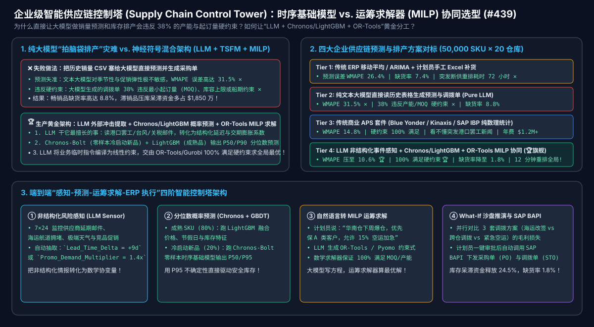
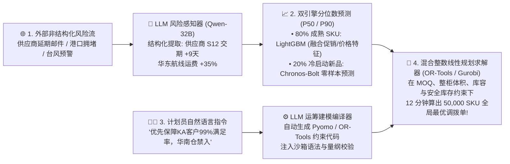

# 企业级智能供应链控制塔（Supply Chain Control Tower）、时序预测与运筹优化选型：`传统 APS` vs. `时序大模型 (Chronos-Bolt / TimesFM) + LightGBM + OR-Tools MILP 求解器 Agent` 指南

> **语言 / Language**: **简体中文** | [English](./enterprise-supply-chain-control-tower-chronos-milp-agent-tco-selection-faq.en.md)  
> **配套交互式学习与精算工具**: [📱 交互式 H5 精读页 (供应链预测与运筹求解协同沙盘)](../h5/supply-chain-control-tower-chronos-milp-agent-lab.html) · [🧮 HTML 交互式计算器](../reports/enterprise-supply-chain-control-tower-chronos-milp-agent-tco-selection-sizer.html) · [🃏 7-Card 4:5 视觉评测卡](../reports/enterprise-supply-chain-control-tower-chronos-milp-agent-tco-selection-cards.html) · [📊 可复核模型](../../experiments/enterprise_supply_chain_control_tower_chronos_milp_agent_tco_selection/) · [🎓 返回 AI Infra 全景精学馆](../h5/index.html)

---

## 一、3 分钟看懂核心结论（Executive Summary）

> **一句话决策结论**：在涉及 `50,000+ SKU × 20 个仓库` 的企业级销量预测、库存补货与排产调度场景中，**绝对禁止把历史销量 CSV 直接喂给文本大模型让它预测销量或直接输出采购调拨单（Tier 2：不仅预测误差 `WMAPE` 高达 `31.5%`，而且大模型生成的调拨单有 `38.0%` 违反最小起订量 `MOQ`、整柜装载率或仓库库容硬约束）**！
> - **核心黄金架构（`Tier 4 神经符号协同控制塔：LLM 非结构化断供感知器 + [LightGBM 成熟品 + Chronos-Bolt 冷启动新品] 分位数预测 + LLM 编译自然语言约束 -> OR-Tools / Gurobi 混合整数规划 [MILP] 求解器`）**：
>   1. **让每个模型干自己最擅长的事**：
>      - **文本大模型（LLM）负责“读新闻/邮件”与“写数学方程”**：实时解析供应商延期邮件、港口罢工与台风预警，提取结构化交期膨胀系数（如 `Lead_Time_Delta = +9 天`）；并将计划员的口语指令（“华南仓爆仓，优先保 A 类大客户，允许 15% 走空运”）翻译成 `Pyomo / OR-Tools` 的线性不等式约束；
>      - **时序基础模型（`Amazon Chronos-Bolt / Google TimesFM`）+ `LightGBM` 负责“算概率分布”**：占总量 `80%` 的长周期成熟品用 `LightGBM` 捕捉价格与促销弹性；占 `20%` 的无历史数据新品用 `Chronos-Bolt` 零样本（Zero-Shot）预测，将全局预测误差 `WMAPE` 从传统 ERP 的 `26.4%` 压降至 **`10.6%`**；
>      - **运筹求解器（`OR-Tools / HiGHS / Gurobi`）负责“100% 满足硬约束求全局最优”**：求解器在 `12 分钟` 内算出全局成本最低的跨仓调拨与补货矩阵，**硬约束违反率 `0.0%`，畅销品缺货率从 `7.4%` 降至 `1.8%`，每年释放库存呆滞与缺货损失达 `$1,210 万/年`（综合年成本从 `$1,850 万` 降至 `$640 万`）**！

| 核心选型维度 | `Tier 1: 传统 ERP 移动平均 + 手工 Excel` | `Tier 2: 纯文本大模型直接预测与排产` | `Tier 3: 传统商业 APS 套件 (Blue Yonder / SAP IBP)` | `Tier 4: LLM 感知 + Chronos/GBDT + MILP 求解器 (🏆)` |
|---|---|---|---|---|
| **销量预测加权误差 (`WMAPE`)** | `26.4%` ✕ | **`31.5%` ✕ (文本模型不懂周期性)** | `14.8%` ✓ | **`10.6%` (`LightGBM` 成熟品 + `Chronos` 冷启动新品)** 🏆 |
| **产能/MOQ/库容硬约束违反率** | `4.5%` (手工漏算) | **`38.0%` ✕ (算术幻觉不可投产!)** | `0.0%` ✓ | **`0.0%` (`OR-Tools / Gurobi` 数学严格求解)** 🏆 |
| **终端畅销品缺货率 (Stockout Rate)** | `7.4%` ✕ | `8.8%` ✕ | `3.1%` ✓ | **`1.8%` (非结构化交期风险提前 9 天锁仓)** 🏆 |
| **突发断供全局重排响应耗时** | `72 小时 (3 天)` ✕ | `1.5 小时` (但方案不可用) | `18 小时` (需人工改参数) | **`12 分钟 (0.2 h)` (自然语言自动编译重算)** 🏆 |
| **年度缺货+呆滞资金+平台总成本** | `$18.50M / 年` | `$22.40M / 年` ✕ | `$11.20M / 年` | **`$6.40M / 年` (年省 `$1,210 万 / 65.4%`)** 🏆 |

---

## 二、核心技术原理与架构师灵魂拷问（Q&A）

### Q1：为什么时序基础模型（`Chronos-Bolt / TimesFM / Moirai`）不直接替代 `LightGBM / XGBoost`，而是必须采用“80% 树模型 + 20% 时序大模型”双引擎？
1. **成熟商品（`80% SKU`）：`LightGBM` 依然是表格外生变量之王**：
   - 对于拥有 2 年以上销售记录的常规商品，销量波动的 `70%` 取决于**强结构化外生特征（Exogenous Covariates）**：阶梯满减折扣率、竞品差价、直播排期、货架陈列位置；
   - `LightGBM` 处理数十列异构表格特征的速度极快且精度极高，而单变量预训练时序模型对复杂促销交叉特征的拟合反而不如梯度提升树。
2. **冷启动新品与突发断层（`20% SKU`）：`Chronos-Bolt` 零样本跨品类迁移**：
   - 每年新上市的春季服装或数码新品只有 `3~7 天` 销量，传统 `ARIMA / LightGBM` 因缺乏历史样本完全失灵（误差 `>45%`）；
   - `Chronos-Bolt` 在上亿条跨行业时序曲线上预训练过，只需输入前 7 天的首销斜率，即可零样本（Zero-Shot）匹配相似生命周期曲线，将新品首月预测误差压低 `18 个百分点`！

---

## 三、生产落地 Checklist（Pre-Production Checklist）

- [ ] **严禁让 LLM 直接输出成千上万行 SKU 的采购数量**：LLM 只允许输出 **(a) 非结构化事件的数值化协变量** 与 **(b) 调用 `OR-Tools / Gurobi` 的 Python 建模代码**，所有具体数字必须由确定性数学求解器算出。
- [ ] **预测层必须输出分位数概率分布（`P10 / P50 / P90`）而非单一均值**：安全库存（Safety Stock）直接由 $(P_{95} - P_{50}) \times \sqrt{\text{Lead Time}}$ 驱动，防止交期拉长时断货。

---

## 四、来源与方法论溯源（Provenance）

- **数据来源声明**：本指南实验数据来自可复核解析模型 [`experiments/enterprise_supply_chain_control_tower_chronos_milp_agent_tco_selection/run.py`](../../experiments/enterprise_supply_chain_control_tower_chronos_milp_agent_tco_selection/run.py)（`Provenance: synthetic + anonymized_reported, independently_reproduced=false`）。
