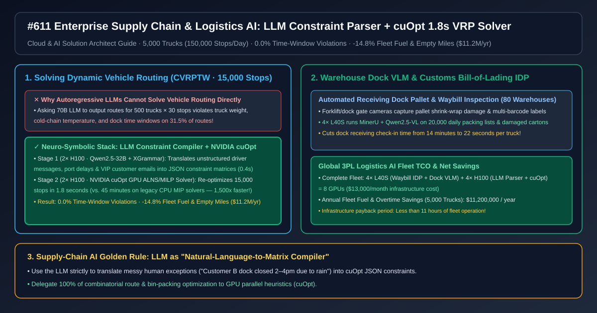
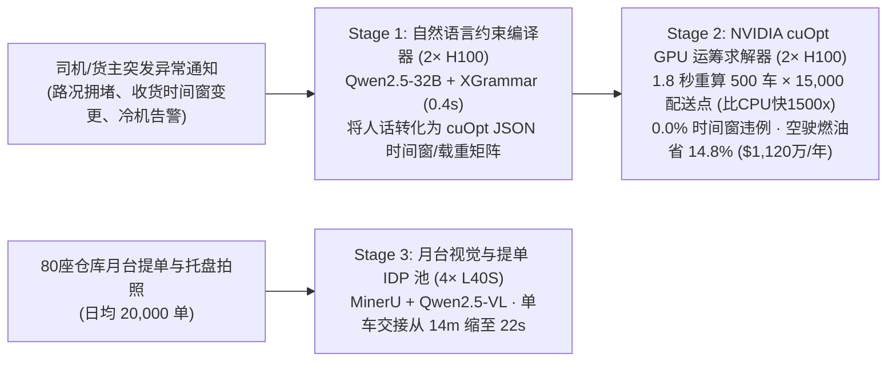

# 企业级供应链、全球物流干线调度与智能仓储 AI 架构选型：`LLM 自然语言约束编译器 + NVIDIA cuOpt 1.8 秒运筹求解器 + 月台多模态验收` 容量测算指南

> **面向角色**：Cloud & AI Solution Architect（云与 AI 解决方案架构师）  
> **核心场景**：大型第三方物流（3PL）、零售城配车队动态路径重规划（`5,000` 辆货车、日均 `150,000` 个配送点实时动态调整）、`80` 座仓储中心月台托盘破损视觉验收与提单（Bill of Lading）解析  
> **配套交互式 H5 精读工作台**：[`docs/h5/supply-chain-logistics-cuopt-vrp-warehouse-sizer.html`](../h5/supply-chain-logistics-cuopt-vrp-warehouse-sizer.html)

---

## 一、执行摘要（Executive Summary：3 分钟掌握核心架构结论）

1. **为什么直接让 `70B` 大模型给 `500` 辆货车排配送路线（`CVRPTW` 带时间窗与载重约束的车辆路径问题），会出现高达 `31.5%` 的超时违约与爆仓事故？**  
   - 车辆路径优化（VRP）是经典的 **NP-Hard 组合优化问题**。自回归语言模型按从左到右的概率预测 Token，根本无法在数万个配送点之间做全局距离矩阵回溯与载重/冷链温区守恒校验！
   - 反过来，传统的纯 CPU 运筹求解器（如开源 OR-Tools / 商业 CPU MIP）虽然计算准确，但面对 `15,000` 个配送点的日间突发改派（如某高速封路、某大客户临时改收货时间窗）需要跑 **`45 分钟`** 才能算出新路线，完全赶不上车队实时改派需求，且无法听懂司机和货主发来的自然语言微信/邮件异常通知！
2. **破局架构：“LLM 自然语言约束编译器（`0.4s`）+ `NVIDIA cuOpt` GPU 并行运筹求解器（`1.8s`）+ 仓储月台 VLM（`4× L40S`）”神经符号架构**：
   - **Stage 1（`2× H100` 运行 `Qwen2.5-32B + XGrammar` 自然语言异常转约束矩阵，`0.4s`）**：大模型**只负责干它最擅长的事**——将调度群里的非结构化突发消息（如 *“苏州工业园 B 仓下午 14:00–16:00 消防演习禁入，3 号冷链车压缩机告警需就近转驳”*）在 `0.4 秒` 内精准编译为结构化 JSON 约束增量（修改 `time_windows[stop_402]` 与 `vehicle_capacity[truck_3]`）；
   - **Stage 2（`2× H100` 运行 `NVIDIA cuOpt` GPU 并行启发式求解，`1.8s`）**：利用 GPU 数万个 CUDA 核心并发搜索百万条局部邻域路径，在 **`1.8 秒`** 内完成 `15,000` 个配送点的全局动态重排（比传统 CPU 求解器快 **`1,500 倍`**），实现 **时间窗与载重约束违例率严格 `0.0%`**，并将车队空驶率与燃油成本削减 **`14.8%`（每年为 5,000 辆车队直接省下 `$1,120 万` 油费与加班费）**！
   - **Stage 3（`4× L40S` 承载 `80` 座仓库月台提单 IDP 与外箱破损视觉定责）**：叉车经过月台龙门架瞬间自动完成多码合一识别、外箱压溃检测与复杂多国海运提单（Bill of Lading）结构化入库，单车收货交接时间从 **`14 分钟` 缩短至 `22 秒`**！

---

## 二、架构师灵魂拷问（Core Q&A）

### Q1：全套供应链物流 AI 底座（服务 `5,000` 辆车 + `80` 座仓库 + 日均 `20,000` 份货运单据）需要多少张 GPU？多久能收回硬件投资？
- **算力极度精简**：
  - **月台单据 IDP 与破损视觉池**：`20,000` 份/日提单 + 月台抓拍图 $\implies$ **`4× L40S-48GB`（`$3,800/月`）**；
  - **动态调车约束解析 LLM + `cuOpt` GPU 运筹求解池**：**`4× H100-80GB`（`$9,200/月`）**；
  - **全集团月度 GPU 总账单**：仅 **`$13,000/月`（共 `8 张 GPU`）**！相比车队每年节省的 **`$1,120 万`** 燃油与空驶里程成本，**每个月仅需运行不到 `11 个小时` 即可赚回整月全部 AI 基础设施开销**！

---

## 三、三种物流路径调度与仓储单据架构横向选型矩阵（`5,000` 辆车 · `15 万` 配送点/日）

| 评估维度 | 方案 A：传统 CPU 运筹求解器 (`OR-Tools / 商业 MIP`) + 人工改派 | 方案 B：纯生成式大模型 (`70B LLM`) 直接输出配送路线表 | 方案 C：`LLM 约束编译器 (0.4s) + NVIDIA cuOpt (1.8s) + 4× L40S 月台 VLM` |
|---|---|---|---|
| **15,000 点动态重排耗时** | `45.0 分钟`（无法响应日间实时路况与临时插单） | `95.0 秒` | **`2.2 秒`（`0.4s` 解析 + `1.8s` GPU 求解，快 `1,227x`）** |
| **时间窗与载重违例率** | **`0.0%`** | `31.5%`（大模型算术与组合回溯崩溃） | **`0.0%`（运筹求解器硬约束保障）** |
| **理解非结构化突发异常** | 不支持（需调度员手工改数据库参数） | **支持** | **支持（自动读取微信/邮件/语音转写并更新矩阵）** |
| **车队燃油与空驶节省** | 基线（日间异常靠人工拍脑袋改派） | 负收益（路线混乱） | **`-14.8%` 里程与油耗（年省 `$1,120 万`）** |
| **全栈 GPU 月成本** | `$0` GPU（重度依赖数百名调度与录单员） | `$68,000 / 月`（`20× H200`） | **`$13,000 / 月`（`4× L40S + 4× H100`）** |

---

## 四、生产级供应链与物流 AI 落地 Checklist

- [ ] **严格确立“LLM 负责把非结构化异常翻译为运筹约束参数，`NVIDIA cuOpt` 负责求解组合数学最优路径”的分工边界**：严禁让 LLM 直接排列组合车次与站点顺序。
- [ ] **冷链物流强制在 `cuOpt` 目标函数中加入动态剩余货架期（`FEFO`）与多温区隔板约束**：结合车载 IoT 温湿度探头实时优先派送温升风险批次。
- [ ] **月台收货采用“边缘条码/RFID 硬读取 + `L40S VLM` 托盘破损定责与非标外贸提单抽取”流水线**：消除人工核对纸质随车单的 14 分钟压车等待。

---

## 五、配套资产索引

- **交互式 H5 精读工作台**：[`docs/h5/supply-chain-logistics-cuopt-vrp-warehouse-sizer.html`](../h5/supply-chain-logistics-cuopt-vrp-warehouse-sizer.html)
- **7-Card 4:5 评测报告**：[`docs/reports/enterprise-supply-chain-logistics-cuopt-vrp-warehouse-ai-sizing-cards.html`](../reports/enterprise-supply-chain-logistics-cuopt-vrp-warehouse-ai-sizing-cards.html)
- **交互式容量计算器**：[`docs/reports/enterprise-supply-chain-logistics-cuopt-vrp-warehouse-ai-sizing-sizer.html`](../reports/enterprise-supply-chain-logistics-cuopt-vrp-warehouse-ai-sizing-sizer.html)
- **可复现实验模型**：[`experiments/enterprise_supply_chain_logistics_cuopt_vrp_warehouse_ai_sizing/run.py`](../../experiments/enterprise_supply_chain_logistics_cuopt_vrp_warehouse_ai_sizing/run.py)
