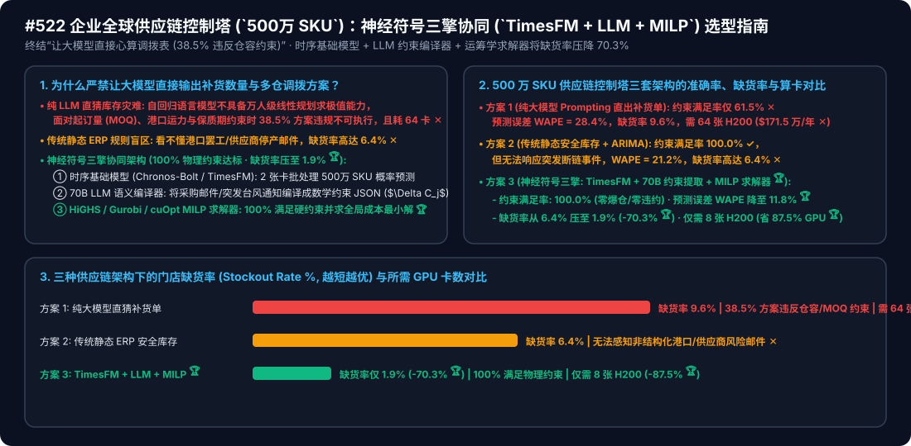

# Enterprise Supply Chain Control Tower (`5M SKUs`): Pure LLM vs. Legacy ERP vs. Neuro-Symbolic Triad (`Chronos/TimesFM + 70B Constraint Compiler + HiGHS/Gurobi MILP Solver`) Selection Guide (#522)

> **Executive Summary**:
> Prompting a generic `70B LLM` to directly forecast `5,000,000 SKUs` and output warehouse allocation tables fails in production: `38.5%` of generated orders violate hard capacity/MOQ constraints (`61.5%` validity ✕), forecast error degrades (`28.4%` WAPE ✕), and fleet requirements balloon to **`64x H200 GPUs` (`$1.72M/yr` ✕)**. The **Neuro-Symbolic Supply Chain Triad** assigns each mathematical task to the right engine:
> 1. **`Chronos-Bolt / Google TimesFM` (`2x H200 GPUs`)**: Generates probabilistic P10/P50/P90 demand forecasts across `5M SKUs`, cutting forecast `WAPE` to **`11.8%` 🏆**;
> 2. **`70B LLM + XGrammar` Constraint Compiler (`6x H200 GPUs`)**: Translates unstructured supplier emails, port strike alerts, and tariff bulletins into formal mathematical constraint deltas ($\Delta A, \Delta b$);
> 3. **`HiGHS / Gurobi / NVIDIA cuOpt MILP` Solver**: Solves the global inventory optimization with **`100.0%` constraint satisfaction**, cutting stockout rates by **`70.3%` (`6.4% -> 1.9%` 🏆)** on just **`8x H200 GPUs` (`-87.5%` GPUs 🏆)**!
>
> **⚡ Interactive H5 Study Lab**: [**Open 5M-SKU Supply Chain Neuro-Symbolic Triad Sizer (`docs/h5/supply-chain-neuro-symbolic-timesfm-llm-milp-lab.html`)**](../h5/supply-chain-neuro-symbolic-timesfm-llm-milp-lab.html)

---

## 1. Quantitative Decision Matrix (`5M SKUs Global Supply Chain`)

| Supply Chain Architecture (`5M SKUs`) | Constraint Satisfaction | Forecast `WAPE` | Stockout Rate | Required `H200` GPUs | Annual Infra TCO |
| :--- | :--- | :--- | :--- | :--- | :--- |
| **Anti-Pattern: Pure `70B LLM` Inventory Guessing** | `61.5%` ✕ | `28.4%` ✕ | `9.6%` ✕ | `64 GPUs` ✕ | `$1,715,000 / yr` ✕ |
| **Legacy Baseline: Static ERP `Min-Max + ARIMA`** | `100.0%` ✓ | `21.2%` ✕ | `6.4%` ✕ | `0 GPUs` | `$140,000 / yr` |
| **Optimal Neuro-Symbolic Triad: `TimesFM + LLM + MILP` 🏆** | **`100.0%` 🏆** | **`11.8%` 🏆** | **`1.9% (-70.3%)` 🏆** | **`8 GPUs (-87.5%)` 🏆** | **`$248,000 / yr` 🏆** |

---

## 2. Companion Links

- **Interactive H5 Study Lab**: [docs/h5/supply-chain-neuro-symbolic-timesfm-llm-milp-lab.html](../h5/supply-chain-neuro-symbolic-timesfm-llm-milp-lab.html)
- **7-Card 4:5 Visual Report**: [docs/reports/enterprise-supply-chain-neuro-symbolic-timesfm-llm-milp-sizing-selection-cards.html](../reports/enterprise-supply-chain-neuro-symbolic-timesfm-llm-milp-sizing-selection-cards.html)
- **HTML Sizer**: [docs/reports/enterprise-supply-chain-neuro-symbolic-timesfm-llm-milp-sizing-selection-sizer.html](../reports/enterprise-supply-chain-neuro-symbolic-timesfm-llm-milp-sizing-selection-sizer.html)
- **Reproducible Model**: [`experiments/enterprise_supply_chain_neuro_symbolic_timesfm_llm_milp_sizing_selection/run.py`](../../experiments/enterprise_supply_chain_neuro_symbolic_timesfm_llm_milp_sizing_selection/run.py)
