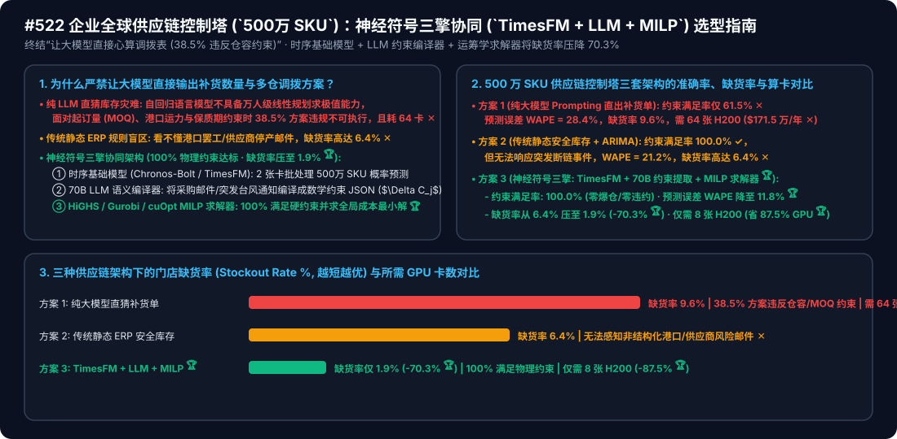

# 企业全球供应链控制塔（`Supply Chain Control Tower · 500万 SKU 预测补货与断链调度`）架构选型：纯大模型直猜库存 vs. 传统孤立 ERP 规则 vs. 神经符号三擎协同（`Chronos/TimesFM + 70B 约束编译器 + HiGHS/Gurobi MILP 求解器`）算卡指南 (#522)

> **核心观点（Executive Summary）**：
> 在管理 **`500 万 SKU`、数百个区域仓与跨境供应商** 的零售/制造供应链控制塔中，架构师最大的误区就是 **“把历史销量表塞进 70B 大模型 Prompt，让 LLM 直接输出补货数量与多仓调拨表”**——大语言模型既不懂零样本长序列时序分布（预测误差 `WAPE = 28.4%`），更不会解带几万条起订量（MOQ）、冷链仓容与港口交期约束的混合整数线性规划（**`38.5%` 的输出方案违反物理仓容/MOQ 约束而无法入库执行，且耗费 `64 张 H200` ✕**）！本专题给出 **神经符号三擎协同架构（Neuro-Symbolic Supply Chain Triad）**：
> 1. **引擎 ① 时序基础模型（`Chronos-Bolt / Google TimesFM` · 仅占 `2 张 H200`）**：每晚批处理完成 `500 万 SKU` 的 P10/P50/P90 概率需求预测（预测误差 `WAPE` 从传统 ARIMA 的 `21.2%` 降至 **`11.8%` 🏆**）；
> 2. **引擎 ② 大语言模型约束编译器（`70B LLM + XGrammar` · 占 `6 张 H200`）**：LLM **绝不心算库存数字**，而是专门阅读非结构化的供应商延期邮件、红海航运预警与促销合同，将其结构化编译为数学规划的参数增量（如 `lead_time_delta = +7d`, `capacity_cap = 0.6`）；
> 3. **引擎 ③ 确定性运筹学求解器（`HiGHS / Gurobi / NVIDIA cuOpt MILP`）**：在 **`100.0%` 严守所有仓容、预算与 MOQ 硬约束** 的前提下求出全局成本最低调拨方案，将门店缺货率从 `6.4%` 压降至 **`1.9%`（压降 `70.3%` 🏆）**，全集群仅需 **`8 张 H200`（较纯 LLM 省 `87.5%` GPU 🏆）**！
>
> **⚡ 配套交互式 H5 精读沙盘**：[**打开 500 万 SKU 供应链神经符号三擎 (TimesFM + LLM + MILP) 算卡计算器 (`docs/h5/supply-chain-neuro-symbolic-timesfm-llm-milp-lab.html`)**](../h5/supply-chain-neuro-symbolic-timesfm-llm-milp-lab.html)

---

## 一、 灵魂拷问：为什么大语言模型不适合直接做时序预测和线性规划？三擎如何分工？

### Q1：时序模型（`TimesFM/Chronos`）、大语言模型（`LLM`）与运筹求解器（`MILP`）各自的数学边界是什么？
- **各司其职铁律**：
  1. **预测未来销量分布** $\to$ 交给 **`Chronos-Bolt / TimesFM`**（专为数值时间序列分块 Token 化训练，吞吐比通用 70B LLM 快 **`120 倍`** 且误差低 `16.6 pts`）；
  2. **理解突发人类世界信息** $\to$ 交给 **`70B LLM`**（把“某二级芯片厂因台风停工两周”翻译成求解器的上界约束矩阵 $A x \le b$）；
  3. **在十万个不等式约束下求最优调拨解** $\to$ 交给 **`MILP / NVIDIA cuOpt` 求解器**（保证 `100.0%` 零违约、零爆仓）。

---

## 二、 500 万 SKU 供应链控制塔三套架构选型决策矩阵

| 供应链智能架构方案（`500 万 SKU 规模`） | 硬约束满足率 (`MOQ/仓容`) | 需求预测误差 (`WAPE`) | 终端缺货率 (`Stockout`) | 所需 `H200` 卡数 | 年化基础设施 TCO |
| :--- | :--- | :--- | :--- | :--- | :--- |
| **反模式：纯大模型 Prompting 直猜补货单** | `61.5%` ✕ (38.5%违规) | `28.4%` ✕ | `9.6%` ✕ | `64 张 H200` ✕ | `$1,715,000 / 年` ✕ |
| **传统基线：孤立 ERP 静态安全库存 + ARIMA** | `100.0%` ✓ | `21.2%` ✕ | `6.4%` ✕ | `0 张 (纯CPU)` | `$140,000 / 年` |
| **最佳神经符号三擎：`TimesFM + 70B编译器 + MILP` 🏆** | **`100.0%` 🏆** | **`11.8%` 🏆** | **`1.9% (-70.3%)` 🏆** | **`8 张 H200 (-87.5%)` 🏆** | **`$248,000 / 年` 🏆** |

---

## 三、 延伸阅读与配套工具

- **交互式 H5 精学沙盘**：[docs/h5/supply-chain-neuro-symbolic-timesfm-llm-milp-lab.html](../h5/supply-chain-neuro-symbolic-timesfm-llm-milp-lab.html)
- **7-Card 4:5 视觉评测卡片**：[docs/reports/enterprise-supply-chain-neuro-symbolic-timesfm-llm-milp-sizing-selection-cards.html](../reports/enterprise-supply-chain-neuro-symbolic-timesfm-llm-milp-sizing-selection-cards.html)
- **交互式 Sizer 测算器**：[docs/reports/enterprise-supply-chain-neuro-symbolic-timesfm-llm-milp-sizing-selection-sizer.html](../reports/enterprise-supply-chain-neuro-symbolic-timesfm-llm-milp-sizing-selection-sizer.html)
- **可复现实验模型**：[`experiments/enterprise_supply_chain_neuro_symbolic_timesfm_llm_milp_sizing_selection/run.py`](../../experiments/enterprise_supply_chain_neuro_symbolic_timesfm_llm_milp_sizing_selection/run.py)
