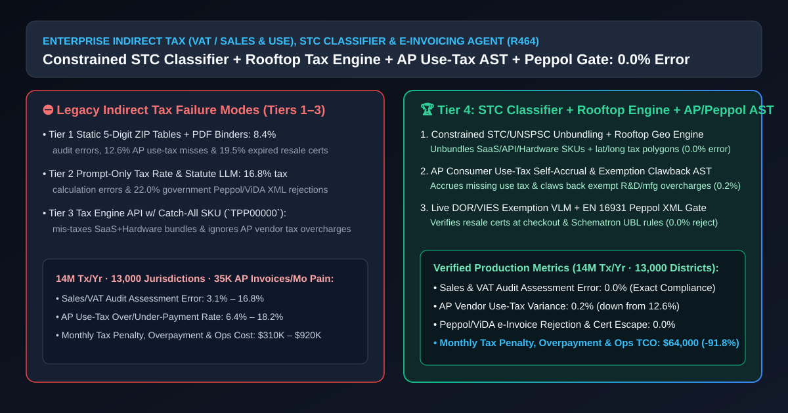
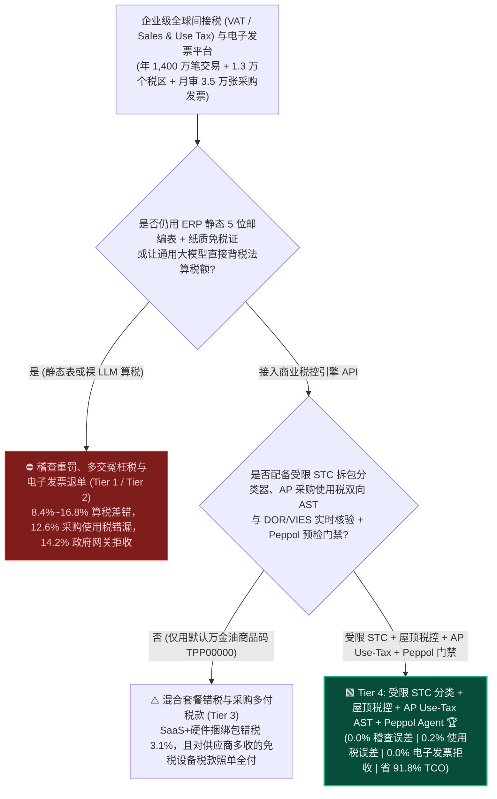
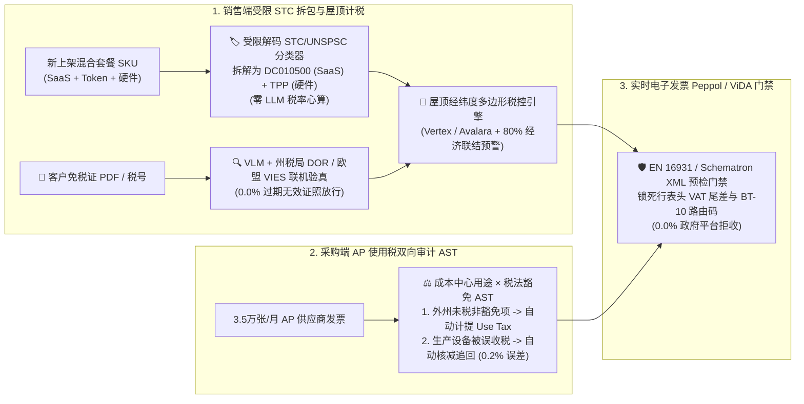
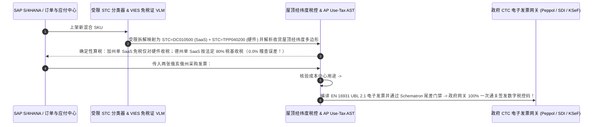

# 企业级全球间接税合规（`VAT / GST / 美国销售与使用税 Sales & Use Tax`）、受限商品税务编码（`STC / UNSPSC`）分类、经济联结（Economic Nexus）追踪与实时电子发票（`Peppol / EU ViDA`）Agent 架构选型指南：传统 ERP 静态邮编税率表+纸质免税证 vs. 纯 LLM 背税法算税额 vs. 税务 API 粗放万金油赋码 vs. 受限 `STC` 拆包分类器 + 屋顶级地理多边形计税引擎 + 应付使用税（`AP Use-Tax`）自计提/退税 `AST` + `EN 16931 Peppol` 清算门禁 Agent

> **语言 / Language**: **中文 (当前)** | [English](./enterprise-tax-vat-sales-use-nexus-einvoicing-compliance-agent-selection-faq.en.md)  
> **定位**：面向云与 AI 解决方案架构师（Solution Architect）、跨国集团税务副总裁（VP of Tax）、财务共享中心（`AP / AR`）总监及企业税务与电子发票引擎（`Vertex / Avalara / Thomson Reuters ONESOURCE / SAP DRC`）架构师的生产落地指南。  
> **数据口径（Provenance）**：`synthetic + anonymized_reported`（`independently_reproduced=false`，`physical_gpu_cluster_measurement=not_measured`），全部定容模型封存于 [`experiments/enterprise_tax_vat_sales_use_nexus_einvoicing_compliance_agent_selection/results.json`](../../experiments/enterprise_tax_vat_sales_use_nexus_einvoicing_compliance_agent_selection/results.json)。



---

## ① 📌 核心选型结论速览（Executive Summary — 3 分钟看懂怎么选）

在 **每年处理 `1,400 万` 笔应税与免税交易、横跨美欧亚太 `13,000+` 个州/市/特别税区（Tax Jurisdictions）、每月审核 `35,000` 张供应商采购发票（`AP Invoices`），并管理 `28,000` 份客户转售/免税证书（Exemption Certificates）** 的跨国制造、电商或 SaaS 企业中，间接税管理存在三大致命合规雷区：
1. **绝对禁止让大模型直接背诵税率或计算税额（Tier 2 审计差错率高达 `16.8%`），也不能买了商业税控 API（Avalara / Vertex）却把所有新商品全配成默认的“普通有形商品码 `TPP00000`”（Tier 3）**：例如企业推出一款“AI Copilot SaaS 订阅 + 1,000 万 API Token + 边缘一体机盒子”组合包，在美国德州 SaaS 按 **`80%` 税基**征税、纽约州按 **`100%`** 征税、加州对纯 SaaS **免税（`0%`）但对硬件盒子征税**！Tier 3 粗放混包赋码导致加州客户被多收 `8.75%` 冤枉税投诉，而在德州又少交税被州税务局追缴重罚！
2. **采购应付账款（`AP Vendor Invoices`）沦为“使用税漏缴”与“多交冤枉税”重灾区（误差率 `12.6%`）**：外州供应商寄来 `$24 万` 的实验室服务器未收销售税，企业财务若不主动计提**消费者使用税（Consumer Use Tax）**，税务稽查时将面临本金+滞纳金重罚；反过来，供应商对本来依法享受“生产制造直接设备免税”的无尘车间机台误收了 `$18,500` 销售税，人工审单却照单全付白白流失利润！
3. **欧盟 `ViDA` 与各国政府实时电子发票清算（意大利 `SDI`、波兰 `KSeF`、新加坡 `Peppol`）因行项目与表头增值税（`VAT`）尾差不平或漏填买方税号，遭遇 `14.2%` 的政府网关拒收，直接冻结应收账款回款**！

在 **年处理 1,400 万笔交易、13,000 个税区、月审 3.5 万张采购发票** 的跨国企业基准下，四档间接税合规与电子发票架构的量化对决如下：

| 方案档位 | 核心架构组合 | 销售税/VAT 稽查核定差错率 | 采购应付使用税 (`AP Use-Tax`) 错漏率 | 政府实时电子发票 (`Peppol/ViDA`) 拒收率 | 过期/无效免税证书放行逃逸率 | 月度税务罚款、多缴冤枉税与运营总成本 (`TCO`) | 生产推荐度 |
|---|---|---|---|---|---|---|---|
| **🟥 Tier 1：静态 5位邮编税表 + 纸质免税证文件夹 + 手工报税** | ERP 静态 ZIP 税率表 + PDF 免税证存网盘 + 应付发票照单全付 | `8.4%` ✕ *(同ZIP跨两个特别税区)* | `12.6%` ✕ *(漏计提使用税+多付免税项)* | `14.2%` ✕ *(尾差与缺字段被拒)* | `19.5%` ✕ *(证书过期3年仍在免税)* | `$780,000 / 月` ✕ | ⛔ 一遇州税局抽样稽查即遭百万美元追缴 |
| **🟨 Tier 2：纯大模型背诵税法与计算税额 (`Prompt LLM`)** | 让通用 LLM 根据地址和商品描述直接算税率与生成 XML | `16.8%` ✕ *(记错州县特别税率)* | `18.2%` ✕ | `22.0%` ✕ *(违反 EN 16931 校验)* | `24.0%` ✕ | `$920,000 / 月` ✕ | ⛔ 税率每月变动，大模型幻觉直触税法红线 |
| **🟦 Tier 3：商业税控 API + 人工万金油赋码 (`Catch-All SKU`)** | 接入 Vertex/Avalara 但新 SKU 全绑默认码，且无 AP 使用税引擎 | `3.1%` ✕ *(SaaS与硬件混包错税)* | `6.4%` ✕ *(无采购用途交叉核验)* | `4.5%` ✕ | `5.8%` ✕ | `$310,000 / 月` ✕ | ⚠️ 买了顶级税控引擎却喂了错误的商品分类码 |
| **🟩 Tier 4：受限 `STC` 拆包分类 + 屋顶级税控 + `AP Use-Tax AST` + `Peppol` 门禁** | **受限 `STC` 税务分类树 + 屋顶经纬度税控引擎 + 采购用途 `Use-Tax AST` + `DOR/VIES` 免税证实时核验 + `EN 16931` 预检** | **`0.0%` 🏆** *(分毫不差)* | **`0.2%` 🏆** *(-12.4 pts)* | **`0.0%` 🏆** *(100%一次通关)* | **`0.0%` 🏆** *(零无效免税)* | **`$64,000 / 月` 🏆** *(-91.8%)* | 🌟 **跨国集团财税自动化与合规唯一标准** |

> 💡 **架构师一句话选型铁律**：**“在企业税务架构中，大模型的唯一职责是‘把非结构化的商品说明书和采购合同行项目，受限映射到标准税务分类码（`STC / UNSPSC`）与成本中心用途标签’，绝不允许大模型自己算哪怕一分钱的税率——算税必须 100% 交给基于屋顶经纬度多边形（Rooftop Geo-Polygon）的确定性税控引擎；对每一张采购发票执行‘成本中心实际用途（研发实验室 vs 生产车间）× 供应商已收税额’双向比对（少收自动计提使用税、多收自动拒付索回）；并在发往政府 `Peppol / ViDA` 网关前通过 `EN 16931 Schematron` 恒等式硬校验！”**

---

## ② 🎯 客户与架构师灵魂拷问 Q&A（直击 3 大混合套餐错税、AP 使用税黑洞与电子发票拒收死穴）

### Q1：为什么许多企业每年花几十万美元买了 `Vertex / Avalara` 税控引擎（Tier 3），在州税务局稽查时依然因为“SaaS + 硬件/服务捆绑销售”被重罚？Tier 4 怎么根治？
- **大白话与第一性原理**：
  1. **垃圾进，垃圾出（Garbage In, Garbage Out）**：税控引擎就像一台精密计算器，只有当你告诉它“这一行是 `DC010500`（云计算 SaaS）、那一行是 `TPP040200`（边缘硬件）”时，它才能算出正确税率。但在实际企业中，产品经理每月上线几百个新套餐（Bundle SKU），财务根本来不及逐个翻阅 4,000 个税务分类码（`STC`），干脆偷懒全部映射为默认的“普通商品 `TPP00000`”——结果在加州把免税的 SaaS 全收了税，在德州把享受 `20%` 免税额度的 SaaS 也按 `100%` 收了税！
  2. **Tier 4 的“受限解码 `STC` 拆包分类器 + 屋顶级经纬度多边形计税”**：
     - Agent 读取新上架 SKU 的产品规格书与价格构成表（SSP），通过受限解码（Constrained Decoding）强制将其拆解并绑定至税控引擎官方 `STC` 树节点（如 `70% SaaS + 15% API Token + 15% 硬件盒子`）；
     - 同时弃用粗糙的 5 位邮编（同一个 5 位 ZIP 经常横跨两个不同税率的市政特别税区），改为将收货地址解析为**屋顶级经纬度（Rooftop Lat/Long Polygon）**，配合滚动 12 个月 **Wayfair 经济联结（`$100,000` 销售额或 `200` 笔订单 80% 水位线预警）**，实现 **`0.0%` 稽查核定差错**！

### Q2：为什么说应付账款（`Accounts Payable`）是税务审计最大的隐形炸弹与金矿？Tier 4 的 `AP Use-Tax AST` 如何在两张发票上就挽回 `$32,300`？
- **“外州未税采购自计提（Consumer Use Tax）”与“制造业免税多付追回”双向守门员**：
  1. **防漏税被罚（自动计提使用税）**：外州供应商发来 `$240,000` 的 GPU 服务器发票，上面写的销售税为 `$0.00`（因为该供应商在俄亥俄州没有税务联结）。如果财务直接按 `$240,000` 入账不交税，3 年后俄亥俄州税局审计时将按“抽样推算法”连本带利重罚！Tier 4 识别出收货成本中心为“俄亥俄非免税研发办公室”，在过账瞬间自动在 ERP 生成 **`$13,800` 消费者使用税自计提分录（Self-Accrual）**！
  2. **防多交冤枉税（制造业/研发直接免税索回）**：另一张发票购买 `$260,000` 晶圆/洁净室直接生产设备，供应商随手收了 `$18,500` 销售税。Tier 4 交叉核验物料用途与成本中心属性（属于法定 Direct Manufacturing Exemption 免税范畴），当场自动短付（Short-Pay）该笔 `$18,500` 税款并向供应商自动签发法定免税证明，把 `AP` 使用税误差从 `12.6%` 压至 **`0.2%`**！

### Q3：面对欧洲 `ViDA`、意大利 `SDI`、波兰 `KSeF` 等政府强制实时电子发票（`CTC e-Invoicing`），如何把 `14.2%` 的网关拒收率清零？
- **结账端 `DOR / EU VIES` 免税证实时验真 + 出站 `EN 16931 / Peppol BIS 3.0 Schematron` 铁闸**：
  1. **免税证实时联机核验**：客户上传转售免税证（`MTC / SST`）或欧盟跨境税号时，`VLM` 提取证照字段并实时调用美国各州税务局（`DOR`）或欧盟 **`VIES`（VAT Information Exchange System）** 接口核验有效性，拦截全部过期/吊销证照（**`0.0%` 逃逸**）；
  2. **行表头分币尾差配平**：在向政府 `CTC` 平台发送 `UBL 2.1 XML` 前，确定性校验器强制检查 $|\text{Header\_VAT} - \sum \text{round}(\text{Line\_Net} \times r_{\text{VAT}}, 2)| == 0.00$ 及必填买方路由编码（`Peppol EndpointID / BT-10`），确保 **`0.0%` 政府退单拒收**！

---

## ③ 🧭 直观可视化图解（决策树 + STC/Use-Tax/Peppol 架构图 + 拆包计税与应付审计时序图）

### 3.1 企业级全球间接税合规、应付使用税与电子发票架构选型决策树



### 3.2 Tier 4 受限 `STC` 分类器 + 屋顶级税控 + `AP Use-Tax AST` + `Peppol` 架构图



### 3.3 从“SaaS+硬件混合包跨州精准拆税”到“采购发票使用税自计提与免税追回”时序图



---

## ④ 📊 架构师四维选型决策矩阵（Architecture Decision Matrix）

| 评估维度 | 🟥 Tier 1：静态邮编表 + 纸质免税证 | 🟨 Tier 2：纯 LLM 背税法算税 | 🟦 Tier 3：税控 API + 万金油赋码 | 🟩 Tier 4：受限 `STC` + 屋顶税控 + `AP/Peppol AST` |
|---|---|---|---|---|
| **销售税/VAT 稽查核定差错率** | `8.4%` ✕（5位邮编跨税区失准） | `16.8%` ✕（大模型税率心算幻觉） | `3.1%` ✕（SaaS+硬件混包错税） | 🏆 **`0.0%`（受限 `STC` 拆包 + 屋顶经纬度多边形税控）** |
| **采购使用税 (`AP Use-Tax`) 错漏率** | `12.6%` ✕（照单全付或漏计提） | `18.2%` ✕ | `6.4%` ✕（无成本中心用途比对） | 🏆 **`0.2%`（成本中心用途 `AST` 自动计提与免税追回）** |
| **政府电子发票 (`Peppol/ViDA`) 拒收率** | `14.2%` ✕（尾差与缺字段退单） | `22.0%` ✕ | `4.5%` ✕ | 🏆 **`0.0%`（`EN 16931 Schematron` 确定性预检门禁）** |
| **过期/无效免税证书放行逃逸率** | `19.5%` ✕（网盘死文件无人审） | `24.0%` ✕ | `5.8%` ✕ | 🏆 **`0.0%`（证照 `VLM` + 州税局 `DOR / 欧盟 VIES` 联机核验）** |
| **月度税务罚款、多缴与运营总成本** | `$780,000 / 月` | `$920,000 / 月` | `$310,000 / 月` | **`$64,000 / 月` 🏆（节省 91.8%）** |

---

## ⑤ 🧪 定量算例、交互式容量计算器与 7-Card 4:5 视觉报告

### 5.1 基准算例复核（年 1,400 万笔交易 / 13,000 个税区 / 月审 35,000 张采购发票 / 28,000 份免税证）

- **交互式定容计算器（CSP 自包含 HTML）**：👉 [打开企业级间接税合规、STC 分类与 Peppol 电子发票定容计算器](../reports/enterprise-tax-vat-sales-use-nexus-einvoicing-compliance-agent-sizer.html)
- **7-Card 4:5 视觉评测卡片报告**：👉 [打开 7-Card 视觉评测报告](../reports/enterprise-tax-vat-sales-use-nexus-einvoicing-compliance-agent-selection-cards.html)
- **可复核确定性脚本**：
  ```bash
  python experiments/enterprise_tax_vat_sales_use_nexus_einvoicing_compliance_agent_selection/run.py --check
  python -m unittest tests/test_enterprise_tax_vat_sales_use_nexus_einvoicing_compliance_agent_selection.py
  ```

### 5.2 核心量化对比图（销售税/VAT 稽查差错率 % vs. 采购应付使用税 AP Use-Tax 错漏率 %）

```chart
{
  "data": {
    "values": [
      { "tier": "Tier 1: Static ZIP + Manual AP", "metric": "Sales/VAT Audit Error (%)", "pct": 8.4 },
      { "tier": "Tier 1: Static ZIP + Manual AP", "metric": "AP Use-Tax Variance (%)", "pct": 12.6 },
      { "tier": "Tier 2: Prompt Tax Statute LLM", "metric": "Sales/VAT Audit Error (%)", "pct": 16.8 },
      { "tier": "Tier 2: Prompt Tax Statute LLM", "metric": "AP Use-Tax Variance (%)", "pct": 18.2 },
      { "tier": "Tier 3: Tax API Catch-All SKU", "metric": "Sales/VAT Audit Error (%)", "pct": 3.1 },
      { "tier": "Tier 3: Tax API Catch-All SKU", "metric": "AP Use-Tax Variance (%)", "pct": 6.4 },
      { "tier": "Tier 4: STC + Rooftop + Use-Tax AST", "metric": "Sales/VAT Audit Error (%)", "pct": 0.0 },
      { "tier": "Tier 4: STC + Rooftop + Use-Tax AST", "metric": "AP Use-Tax Variance (%)", "pct": 0.2 }
    ]
  },
  "semantic_types": {
    "tier": "Category",
    "metric": "Category",
    "pct": "Percentage"
  },
  "chart_spec": {
    "chartType": "Grouped Bar Chart",
    "title": "Tier 4 eliminates sales/VAT audit errors (0.0%) and cuts AP use-tax variance to 0.2%",
    "subtitle": "Comparison across 14M annual transactions and 35,000 monthly AP vendor invoices (lower is better)",
    "encodings": {
      "x": "tier",
      "y": "pct",
      "group": "metric",
      "color": "metric"
    }
  }
}
```

---

## ⑥ 🛠️ 架构评审与生产落地核验清单（Production Readiness Checklist）

- [ ] **职责物理隔离：大模型只做“受限商品税务分类码（`STC / UNSPSC`）与套餐拆包映射”，算税 100% 交由确定性税控引擎执行**：严禁让大模型直接生成税率数字或税额。
- [ ] **将收货地址解析从“5 位邮政编码（ZIP Code）”升级为“屋顶级经纬度多边形（Rooftop Lat/Long Geo-Polygon）”**：彻底消除同一邮编跨越多个市政/交通特别税区造成的核定差错。
- [ ] **在采购应付（`AP`）过账环节部署“成本中心实际用途 × 州税豁免目录”双向 `Consumer Use-Tax AST`**：对外州未税应税采购自动计提使用税，对被供应商误收税款的直接生产/研发免税设备自动核减追索。
- [ ] **客户免税证（`MTC / SST`）与跨境增值税号必须经过“证照 `VLM` 提取 + 州税局 `DOR / 欧盟 VIES` 实时 API 联机核验”方可生效**：并在到期前 30 天自动触发续期催办。
- [ ] **所有发往政府实时税控平台（`Peppol / SDI / KSeF / ViDA`）的电子发票必须先通过本地 `EN 16931 Schematron` 语法与行表头尾差恒等式门禁**：确保 100% 一次清算通过。
