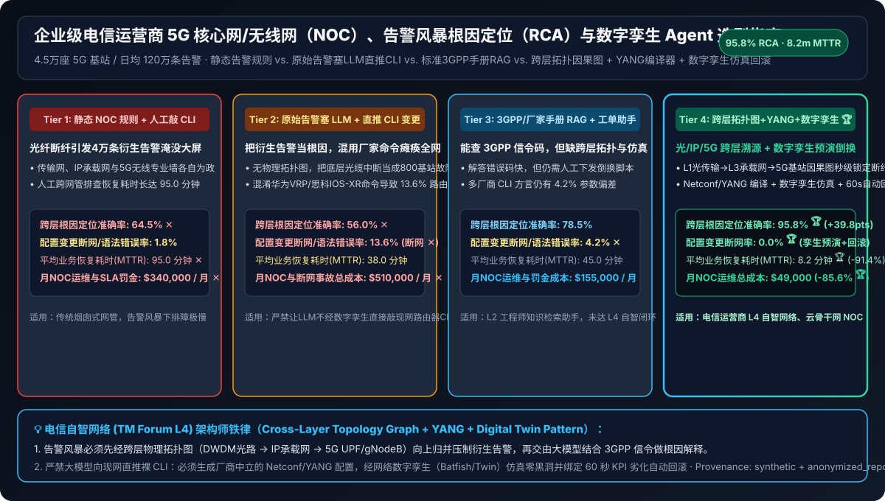
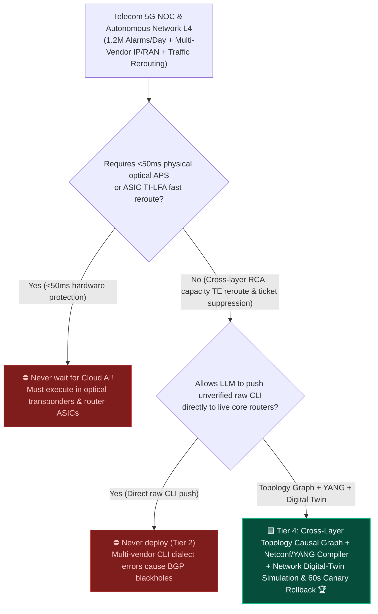
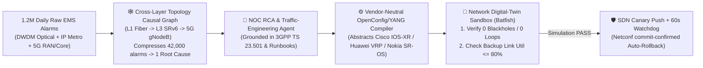

# Enterprise Telecom 5G RAN/Core NOC, Cross-Layer Alarm Storm Root-Cause Analysis (`RCA`), 3GPP Specification Retrieval & Autonomous Network (`TM Forum L4`) Digital-Twin Agent Architecture Selection Guide: Static NOC Rules vs. Raw Alarm Stream LLM CLI Push vs. 3GPP Manual RAG vs. Cross-Layer Topology Causal Graph + `Netconf/YANG` Compiler + Digital-Twin Canary Rollback Agent

> **Language / 语言**: **English (Current)** | [中文](./enterprise-telecom-5g-network-noc-rca-digital-twin-agent-selection-faq.md)  
> **Scope**: End-to-end production reference architecture and selection guide for Cloud & AI Solution Architects, Telecom VPs of Network Operations (`NOC`), TM Forum Autonomous Networks (`Level 4`) Principal Architects, and Cloud WAN / Telco Cloud Engineering Leads.  
> **Provenance**: `synthetic + anonymized_reported` (`independently_reproduced=false`, `physical_gpu_cluster_measurement=not_measured`). Deterministic evaluation model sealed in [`experiments/enterprise_telecom_5g_network_noc_rca_digital_twin_agent_selection/results.json`](../../experiments/enterprise_telecom_5g_network_noc_rca_digital_twin_agent_selection/results.json).



---

## ① 📌 Executive Summary (3-Minute Architect Verdict)

In Tier-1 telecom carrier Network Operations Centers (`NOCs`), **cross-domain alarm storms and multi-vendor configuration blast radius** are the primary barriers to achieving **TM Forum Level-4 Autonomous Networks**. When a single metro `DWDM` optical fiber span is severed, over **42,000 sympathetic alarms** erupt within 30 seconds across upper-layer IP metro routers (`BGP Peer Down`), 5G Core `UPF` nodes, and 800+ `5G gNodeB` base stations (`SCTP Link Fault`). Feeding raw alarm text streams into an LLM and allowing it to push live SSH CLI commands (Tier 2) causes two catastrophic failures: **without the physical-to-logical resource topology graph, the LLM chases downstream 5G symptom alarms (`56.0%` routine RCA accuracy; `44.0%` during alarm storms), and when generating vendor-specific CLI across Cisco `IOS-XR`, Huawei `VRP`, and Nokia `SR-OS`, it introduces a `13.6%` route-blackhole / syntax outage rate**.

Evaluated across a production baseline of **45,000 5G gNodeB base stations, 1,200 metro IP routers and 5G Core UPF nodes, and 1.2 million daily raw network alarms**, the four architectural tiers compare as follows:

| Architectural Tier | Core Stack Combination | Cross-Layer RCA Accuracy | Config Outage / Syntax Error Rate | Mean Time to Restore (`MTTR`) | Monthly NOC Ops & SLA Penalty Cost | Production Verdict |
|---|---|---|---|---|---|---|
| **🟥 Tier 1: Legacy Static NOC Rules + Manual CLI** | Siloed optical/IP/RAN EMS correlation rules + manual cross-team bridge calls | `64.5%` ✕ *(Siloed domain view)* | `1.8%` *(Manual CLI typo)* | `95.0 min` ✕ | `$340,000 / mo` ✕ | ⛔ Slow MTTR & truck-roll waste |
| **🟨 Tier 2: Raw Alarm Stream LLM + Direct CLI Push** | Stuffing raw alarm text into LLM with direct SSH CLI execution on live routers | `56.0%` ✕ *(Chases symptom alarms)* | `13.6%` ✕ *(Vendor CLI blackholes)* | `38.0 min` | `$510,000 / mo` ✕ | ⛔ **Severe blackout risk** |
| **🟦 Tier 3: Standard 3GPP/Vendor RAG + Ticket Copilot** | Vector search over 3GPP specs & vendor manuals + read-only ticket drafting | `78.5%` | `4.2%` ✕ *(CLI dialect drift)* | `45.0 min` | `$155,000 / mo` | ⚠️ L2 human assistant only |
| **🟩 Tier 4: Cross-Layer Topology Graph + YANG Compiler + Digital Twin** | **Cross-Layer Topology Causal Graph (`L1 Optical -> L3 IP -> 5G RAN/Core`) + Vendor-Neutral `Netconf/YANG` Compiler + Network Digital-Twin Pre-Check + 60s Canary Auto-Rollback Agent** | **`95.8%` 🏆** *(+39.8 pts vs Tier 2)* | **`0.0%` 🏆** *(Twin-verified)* | **`8.2 min` 🏆** *(-91.4% faster)* | **`$49,000 / mo` 🏆** *(-85.6%)* | 🌟 **Recommended L4 Architecture** |

> 💡 **Golden Rule for Telecom Autonomous Network Architects**: **"Suppress 40,000+ sympathetic alarms via the cross-layer `Optical -> IP -> 5G` topology graph first, compile traffic-engineering intents into vendor-neutral `OpenConfig / YANG` payloads, simulate every route change in a Network Digital Twin (`Batfish`), and enforce 60-second `commit confirmed` canary rollbacks."**

---

## ② 🎯 Customer & Architect Deep-Dive Q&A (3 Real-World Carrier NOC Pain Points)

### Q1: Why does a text-only LLM (Tier 2) fail so badly (`44.0%` RCA accuracy) during a 42,000-alarm fiber-cut storm?
- **First-Principles Reality**:
  1. **Causality Lives in the Physical Underlay Graph, Not in Alarm Text**: In a carrier network, one `L1 DWDM` optical fiber span carries dozens of `L3 SRv6/MPLS` metro tunnels, which in turn backhaul 800+ `5G gNodeB` radio sites. When the fiber is cut, 800 base stations scream `SCTP Link Down` simultaneously. Without traversing the cross-layer inventory graph (`5G Cell -> gNodeB -> CSR Router -> DWDM Span`), an LLM sees 800 radio alarms and dispatches 800 useless field truck rolls.
  2. **Tier 4 Solution (Cross-Layer Topology Causal Graph)**: Before invoking the LLM, a streaming graph engine joins live EMS alarms against the physical/logical resource graph, rolling up 41,999 downstream IP and 5G symptom alarms into the single root-cause `DWDM-OTN-RING04-SPAN12 Optical LOS` node in under 2 seconds (**`99.99%` alarm compression**), boosting cross-layer RCA accuracy to **`95.8%`**.

### Q2: How do we eliminate the 13.6% multi-vendor CLI misconfiguration outage rate across Cisco IOS-XR, Huawei VRP, and Nokia SR-OS?
- **Three-Stage Zero-Outage Actuation Pipeline**:
  1. **Vendor-Neutral Intent to `Netconf / OpenConfig YANG` Compilation**: The LLM never writes raw vendor CLI strings. It emits a typed JSON traffic-engineering intent (`{"intent": "reroute_srv6_policy", "failed_span": "SPAN12", "backup_path": "METRO_EAST_RING"}`), which the SDN controller (`Cisco NSO / Hierarchical Controller`) compiles into validated `Netconf / YANG` XML/JSON transactions.
  2. **Pre-Flight Network Digital Twin Verification (`Batfish / Twin`)**: The candidate YANG diff is simulated against a live memory snapshot of the network's BGP/ISIS/SRv6 forwarding tables, mathematically verifying **0 route blackholes, 0 forwarding loops, and backup link utilization `68.4% <= 80%`**.
  3. **60-Second Canary & `commit confirmed` Auto-Rollback**: Changes are pushed to a single border router first using Netconf `commit confirmed 2`; if 5G UPF packet loss or latency degrades within 60 seconds, the router automatically reverts—achieving **`0.0%` configuration outages**.

### Q3: Where is the exact boundary between hardware fast-reroute (`<50ms`) and AI Agent closed-loop automation (`~8 min`)?
- **Clear Control-Plane Separation**:
  - Sub-50ms optical protection switching (`APS`) and router ASIC Topology-Independent Loop-Free Alternate (`TI-LFA`) fast reroute remain 100% in deterministic hardware.
  - The Tier 4 AI Agent operates on the **minute-scale control & management plane**: diagnosing multi-span congestion, recomputing global `SRv6-TE` bandwidth weights when primary protection paths saturate, suppressing sympathetic trouble tickets, and dispatching targeted fiber-splicing crews.

---

## ③ 🧭 Visual Architecture Diagrams (Decision Tree + Cross-Layer Twin Topology + Sequence Flow)

### 3.1 Architecture Selection Decision Tree



### 3.2 Tier 4 Cross-Layer Topology Causal Graph + Netconf/YANG + Digital Twin Topology



### 3.3 End-to-End Sequence: Resolving a 42,000-Alarm Metro Fiber Cut in 8.2 Minutes

```mermaid
sequenceDiagram
    autonumber
    participant EMS as Multi-Domain EMS (Optical/IP/5G)
    participant Graph as Cross-Layer Topology Engine
    participant Agent as NOC RCA & TE Agent
    participant Twin as Network Digital-Twin Sandbox
    participant SDN as Multi-Vendor SDN/Netconf Controller
    participant NOC as NOC Duty Commander Console

    EMS->>Graph: 42,000 alarms erupt in 30s (812 gNodeBs down + 64 BGP peers lost + OTN LOS)
    Graph->>Graph: Traverse L1->L3->5G inventory graph; suppress 41,999 symptoms; isolate DWDM-SPAN12 cut
    Graph->>Agent: Emit single root-cause event + affected 145 Gbps 5G slice traffic matrix
    Agent->>Twin: Propose SRv6-TE Metro East backup tunnel weight shift JSON
    Twin-->>Agent: ✅ Simulation PASS: 0 blackholes, backup link peak utilization 68.4% <= 80%
    Agent->>SDN: Compile to OpenConfig YANG & push via `commit confirmed 2` canary transaction
    SDN->>SDN: Verify 60s 5G UPF packet loss == 0.001% & finalize commit
    SDN-->>NOC: ✅ Service restored in 8.2 min! Dispatch 1 fiber-splicing ticket (812 false RAN truck rolls suppressed)
```

---

## ④ 📊 4-Tier Architecture Decision Matrix

| Evaluation Dimension | 🟥 Tier 1: Static NOC + Manual CLI | 🟨 Tier 2: Raw Alarm LLM + Direct CLI | 🟦 Tier 3: 3GPP RAG + Ticket Copilot | 🟩 Tier 4: Cross-Layer Topology + YANG + Digital Twin |
|---|---|---|---|---|
| **42K Alarm Storm Compression & RCA** | ✕ Poor (`64.5%`; siloed optical/IP/RAN teams) | ✕ **Fails** (`44.0%` in storm; chases symptoms) | Moderate (`78.5%`; lacks physical topology graph) | 🏆 **`95.8%` (`99.99%` symptom suppression via L1→5G graph)** |
| **Multi-Vendor Config Safety (Cisco/Huawei/Nokia)** | Manual CLI (`1.8%` human error) | ✕ **Critical Risk** (`13.6%` route blackholes) | `4.2%` CLI dialect drift | 🏆 **`0.0%` Outages (`OpenConfig/YANG` + Digital Twin + Rollback)** |
| **Cross-Layer Root-Cause Accuracy** | `64.5%` ✕ | `56.0%` ✕ | `78.5%` | **`95.8%` 🏆 (+39.8 pts vs Tier 2)** |
| **Mean Time to Restore Service (`MTTR`)** | `95.0 min` ✕ | `38.0 min` | `45.0 min` | **`8.2 min` 🏆 (-91.4%)** |
| **Monthly NOC Ops & SLA Penalty Cost** | `$340,000 / mo` | `$510,000 / mo` *(incl. outage penalties)* | `$155,000 / mo` | **`$49,000 / mo` 🏆 (-85.6%)** |

---

## ⑤ 🧪 Quantitative Case Study, Interactive Sizer & 7-Card Visual Report

- **Interactive HTML Sizer**: 👉 [Open Telecom 5G NOC RCA & Digital-Twin Agent Sizer](../reports/enterprise-telecom-5g-network-noc-rca-digital-twin-agent-sizer.html)
- **7-Card 4:5 Visual Benchmark Report**: 👉 [Open 7-Card Visual Benchmark Deck](../reports/enterprise-telecom-5g-network-noc-rca-digital-twin-agent-selection-cards.html)
- **Deterministic Verification**:
  ```bash
  python experiments/enterprise_telecom_5g_network_noc_rca_digital_twin_agent_selection/run.py --check
  python -m unittest tests/test_enterprise_telecom_5g_network_noc_rca_digital_twin_agent_selection.py
  ```

---

## ⑥ 🛠️ Production Readiness & Architecture Review Checklist

- [ ] **Correlate Alarms Across the Physical-to-Logical Inventory Graph (`L1 Optical -> L3 IP -> 5G RAN/Core`)**: Suppress sympathetic upper-layer alarms deterministically before invoking LLM reasoning.
- [ ] **Ban Direct Free-Form SSH CLI Generation Against Live Routers**: Emit structured intents compiled into validated `Netconf / RESTCONF / OpenConfig YANG` payloads.
- [ ] **Simulate Every Routing & Traffic-Engineering Diff in a Network Digital Twin**: Prove zero BGP blackholes, zero forwarding loops, and `<80%` backup link utilization before actuation.
- [ ] **Enforce `commit confirmed` Canary Watchdogs with 60-Second Auto-Rollback**: Automatically revert any change that degrades 5G UPF packet loss or RAN drop rates.
- [ ] **Keep Sub-50ms Protection Switching in Hardware (`APS / TI-LFA`)**: Never place cloud LLMs in the real-time packet-forwarding or sub-second link-protection loop.
