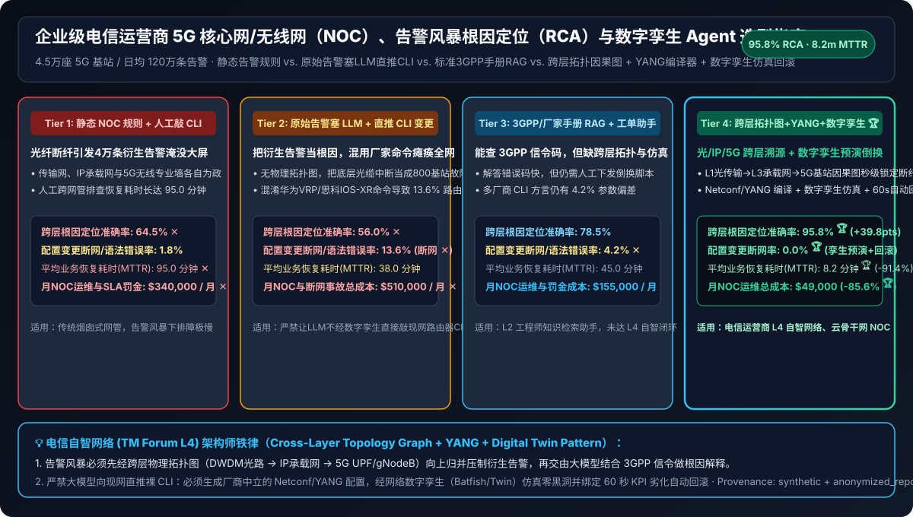
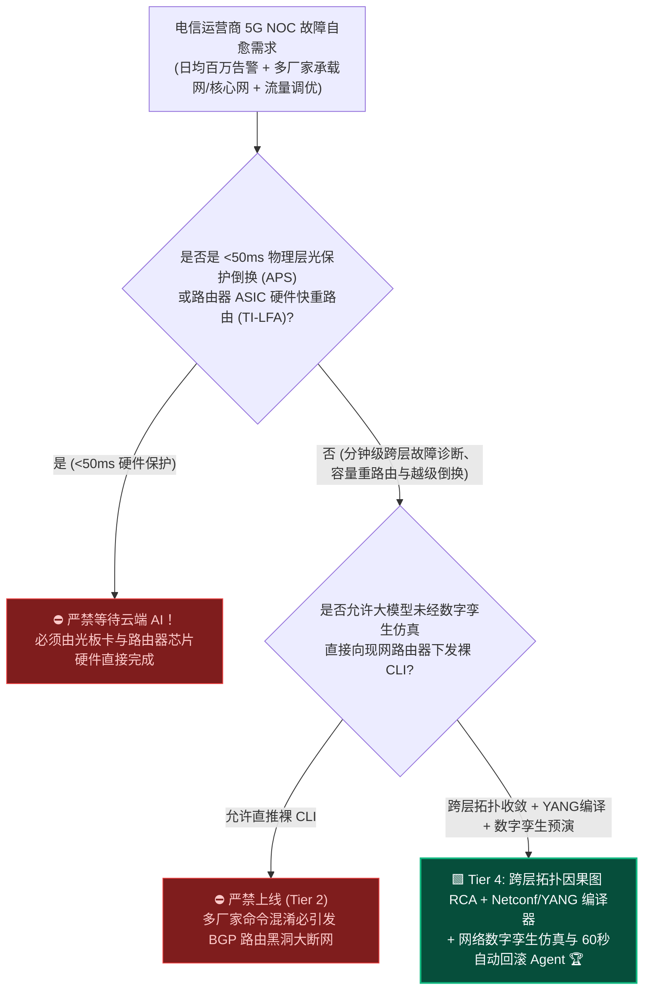
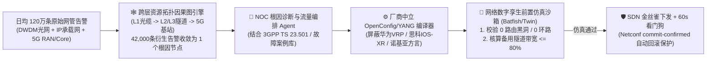

# 企业级电信运营商 5G 核心网/无线网（NOC）、告警风暴跨层拓扑根因定位（RCA）、3GPP/设备商规范检索与自智网络（TM Forum L4）数字孪生变更仿真 Agent 架构选型指南：静态 NOC 规则 + 人工 CLI vs. 原始告警塞 LLM 直推 CLI vs. 3GPP 手册 RAG vs. 跨层拓扑因果图 + Netconf/YANG 编译 + 数字孪生预演与金丝雀自动回滚 Agent

> **语言 / Language**: **中文 (当前)** | [English](./enterprise-telecom-5g-network-noc-rca-digital-twin-agent-selection-faq.en.md)  
> **定位**：面向云与 AI 解决方案架构师（Solution Architect）、电信运营商网络运维部总经理（Head of Carrier NOC）、自智网络（TM Forum Autonomous Networks L4）总工与云骨干网架构师的生产落地指南。  
> **数据口径（Provenance）**：`synthetic + anonymized_reported`（`independently_reproduced=false`，`physical_gpu_cluster_measurement=not_measured`），全部定容模型封存于 [`experiments/enterprise_telecom_5g_network_noc_rca_digital_twin_agent_selection/results.json`](../../experiments/enterprise_telecom_5g_network_noc_rca_digital_twin_agent_selection/results.json)。



---

## ① 📌 核心选型结论速览（Executive Summary — 3 分钟看懂怎么选）

在省级/国家级电信运营商与大型跨国云骨干网的网络监控中心（NOC），**跨专业层级的“告警风暴（Alarm Storm）”与多厂家现网配置变更风险**是迈向 **TM Forum L4 高阶自智网络（Autonomous Networks Level 4）** 的最大拦路虎。当市政施工挖断一根城域 DWDM 波分复用光缆时，30 秒内上层 IP 承载网路由器与 800 多座 5G 基站（gNodeB）会瞬间爆出 **42,000+ 条衍生告警**（如 `BGP Peer Down`、`SCTP Link Fault`、`Cell Out of Service`）。如果直接把原始告警文本流喂给大模型并授权它通过 SSH 下发 CLI 变更指令（Tier 2），大模型不仅会**把上层衍生告警误判为 800 起独立基站故障（根因准确率跌至 `56.0%`，风暴压测下仅 `44.0%`），更会在华为 VRP、思科 IOS-XR、诺基亚 SR-OS 多厂家命令方言之间张冠李戴，引发高达 `13.6%` 的现网路由黑洞与大面积断网事故**！

在 **45,000 座 5G gNodeB 基站、1,200 台城域 IP 路由器与 5G UPF 核心网元、日均 1,200,000 条原始网管告警** 的基准规模下，四档电信 NOC 与自智网络 Agent 架构的量化对决如下：

| 方案档位 | 核心架构组合 | 跨层根因定位准确率 (`RCA`) | 配置变更断网 / 语法错误率 | 平均业务恢复耗时 (`MTTR`) | 月度 NOC 运维与 SLA 罚金总成本 | 生产推荐度 |
|---|---|---|---|---|---|---|
| **🟥 Tier 1：传统静态 NOC 规则 + 人工敲 CLI** | 传输/承载/无线烟囱式网管静态规则 + 工程师跨部门电话核对与手工敲命令 | `64.5%` ✕ *(专业墙割裂)* | `1.8%` *(人工敲错命令)* | `95.0 分钟` ✕ | `$340,000 / 月` ✕ | ⛔ 排障慢、无效派单多 |
| **🟨 Tier 2：原始告警塞 LLM + 直推现网 CLI** | 将原始告警流塞进 LLM Prompt 并允许其直接 SSH 登录网元下发 CLI 脚本 | `56.0%` ✕ *(误追衍生告警)* | `13.6%` ✕ *(厂家语法混淆断网)* | `38.0 分钟` | `$510,000 / 月` ✕ | ⛔ **重大通信事故隐患，严禁上线** |
| **🟦 Tier 3：标准 3GPP/厂家手册 RAG + 工单助手** | 向量检索 3GPP 协议与设备商手册 + 辅助生成排障建议工单（人工执行） | `78.5%` | `4.2%` ✕ *(CLI 方言参数漂移)* | `45.0 分钟` | `$155,000 / 月` | ⚠️ 仅达 L2 辅助问答水平 |
| **🟩 Tier 4：跨层拓扑因果图 + YANG 编译 + 数字孪生预演与自动回滚** | **跨层资源拓扑因果图（`L1 光传输 -> L3 IP 承载 -> 5G RAN/Core`）压制衍生告警 + 厂商中立 `Netconf/YANG` 编译器 + 网络数字孪生（Batfish/Twin）仿真预演 + 60 秒 KPI 金丝雀自动回滚 Agent** | **`95.8%` 🏆** *(+39.8 pts vs Tier 2)* | **`0.0%` 🏆** *(孪生预演零黑洞)* | **`8.2 分钟` 🏆** *(-91.4% 极速自愈)* | **`$49,000 / 月` 🏆** *(-85.6%)* | 🌟 **L4 自智网络首选参考架构** |

> 💡 **架构师一句话选型铁律**：**“万条衍生告警靠跨层物理拓扑图（光→IP→无线）向上溯源收敛、多厂家配置走 OpenConfig/YANG 强类型编译、任何切流操作先过数字孪生（Digital Twin）零黑洞仿真并绑定 `commit confirmed` 60 秒自动回滚”**——绝不让大模型直接对着现网核心路由器敲自由文本 CLI。

---

## ② 🎯 客户与架构师灵魂拷问 Q&A（直击 3 大电信运营商 NOC 痛点）

### Q1：为什么一根光纤断了报出 4.2 万条告警时，纯文本大模型（Tier 2）完全找不准根因？
- **大白话与第一性原理**：
  1. **通信网的因果关系不在告警文字里，而在“下层承载上层”的物理拓扑图里**：在电信网络中，1 条 `DWDM 波分复用光路（L1）` 承载着几十条 `IP 城域网 SRv6/MPLS 隧道（L2/L3）`，而每条 IP 隧道又挂着几十座 `5G gNodeB 基站与 UPF 会话（L4/5G）`。当底层光缆被挖断时，上层 800 个基站在同一秒失去回传链路，网管大屏瞬间被 4.2 万条无线与 IP 告警刷屏。
  2. **没有拓扑图的大模型只会“头痛医头”**：Tier 2 看到满屏都是“5G 基站 SCTP 断连”，就傻傻地生成 800 张基站外线抢修工单，根因定位准确率在告警风暴下暴跌至 **`44.0%`**。
  3. **Tier 4 破局方案（跨层资源拓扑因果图 Cross-Layer Topology Causal Graph）**：先由流式图计算引擎实时对齐管线资源库（Inventory Graph），沿着 `5G Cell -> gNodeB -> CSR/ASR Router -> OTN/DWDM Span` 向下游溯源，在 2 秒内自动将 41,999 条上层症状告警挂接为底层 `DWDM-OTN-RING04-SPAN12 光功率丢失（LOS -38dBm）` 的衍生子告警（压制率 **99.99%**），大模型只需对唯一下沉的根因节点做诊断与切流规划，准确率高达 **`95.8%`**！

### Q2：运营商现网混跑着华为、思科、诺基亚、中兴、爱立信等多厂家设备，如何杜绝大模型写错 CLI 命令把网络搞瘫痪？
- **工程真相**：
  - 不同设备商的命令行（CLI）语法极其相似却暗藏杀机：思科 `IOS-XR` 的 `route-policy`、华为 `VRP` 的 `route-policy` 与诺基亚 `SR-OS` 的 `policy-statement` 在通配符、默认拒绝行为（Implicit Deny）与提交机制上截然不同。让 LLM 直接生成文本 CLI（Tier 2/3）会导致 **`13.6%` / `4.2%`** 的语法报错或 BGP 全网路由泄露/黑洞！
  - **Tier 4 的三道零断网防线**：
    1. **厂商中立意图与 `Netconf / OpenConfig YANG` 强类型编译**：大模型只输出结构化流量工程意图 JSON（如 `{"action": "shift_srv6_te_weight", "from_span": "SPAN12", "to_tunnel": "TUNNEL_EAST_BACKUP"}`），由 SDN 控制器（NSO / 层次化控制器）根据目标设备型号编译为经 XSD 校验的 `Netconf/YANG` 报文。
    2. **网络数字孪生（Network Digital Twin / Batfish）前置仿真**：在真正下发前，先在内存数字孪生拓扑中预演该配置变更，数学证明 **0 路由环路、0 BGP 黑洞、且备用隧道峰值利用率 `68.4% <= 80%` 安全水位**。
    3. **金丝雀下发与 `commit confirmed` 60 秒自动回滚看门狗**：利用 Netconf 原生事务机制，若下发后 60 秒内 5G UPF 丢包率或时延劣化，设备底层自动回滚至变更前快照，现网断网事故率严格为 **`0.0%`**！

### Q3：这套架构能为运营商带来多大的 SLA 违约减免与外线派单成本节约？
- **FinOps 与运维效益量化**：
  - 在 Tier 1 传统模式下，每次光缆闪断或拥塞不仅需要传输、IP、无线三个部门开长达 **`95.0 分钟`** 的电话会对齐，还会误派大量代维人员去跑基站现场（月均运维与政企专网 SLA 违约成本 **`$340,000`**）。
  - Tier 4 将跨层流量自愈恢复时间（MTTR）压缩至 **`8.2 分钟`（提速 `11.6 倍`）**，仅派发 1 张精准光缆熔接工单，将月度 NOC 运维与罚金总成本降至 **`$49,000`（立省 `85.6%`）**。

---

## ③ 🧭 直观可视化图解（决策树 + 跨层拓扑与数字孪生架构图 + 自愈时序图）

### 3.1 电信 5G NOC 与自智网络 Agent 选型决策树



### 3.2 Tier 4 跨层拓扑因果图 + Netconf/YANG + 数字孪生预演回滚架构图



### 3.3 从“城域光缆断纤 4.2 万条告警风暴”到“8.2 分钟数字孪生倒换自愈”时序图

```mermaid
sequenceDiagram
    autonumber
    participant EMS as 光网/IP/5G 多域网管 (EMS)
    participant Graph as 跨层拓扑因果图引擎
    participant Agent as NOC 诊断与重路由 Agent
    participant Twin as 网络数字孪生仿真器
    participant SDN as 多厂商 SDN/Netconf 控制器
    participantNOC as NOC 值班长工作台

    EMS->>Graph: 30秒涌入 42,000 条告警 (812座 5G基站脱网 + 64条 BGP 邻居断 + OTN 光丢失)
    Graph->>Graph: 沿物理承载拓扑向下归并，压制 41,999 条上层症状，锁定根因 DWDM-SPAN12 断纤
    Graph->>Agent: 上报唯一根因事件 + 受影响 145 Gbps 5G 专网流量矩阵
    Agent->>Twin: 提交 SRv6-TE 东环备用隧道切流意图 JSON 进行预演仿真
    Twin-->>Agent: ✅ 仿真通过：0 路由黑洞，东环峰值利用率 68.4% (安全水位内)
    Agent->>SDN: 编译为 OpenConfig YANG 事务并以 `commit confirmed 2` 下发边界路由器
    SDN->>SDN: 监测 60 秒内 5G UPF 丢包率降至 0.001%，确认提交事务
    SDN-->>NOC: ✅ 8.2 分钟完成 812 座基站业务自愈！仅向光缆代维队派发 1 张 SPAN12 熔接工单
```

---

## ④ 📊 架构师四维选型决策矩阵（Architecture Decision Matrix）

| 评估维度 | 🟥 Tier 1：静态 NOC 规则 + 人工 CLI | 🟨 Tier 2：原始告警塞 LLM 直推 CLI | 🟦 Tier 3：3GPP 手册 RAG + 工单助手 | 🟩 Tier 4：跨层拓扑图 + YANG + 数字孪生预演 |
|---|---|---|---|---|
| **跨光/IP/无线告警风暴收敛能力** | ✕ 差（烟囱网管各报各的，人工电话对齐） | ✕ **极差**（风暴下准确率仅 `44.0%`，狂派假单） | 中等（仅文本语义相似，无物理拓扑链接） | 🏆 **99.99% 衍生告警压制（L1→L3→5G 物理拓扑溯源）** |
| **多厂家设备配置安全性（华为/思科/诺基亚）** | 人工敲 CLI 偶有笔误 (`1.8%`) | ✕ **灾难级**（`13.6%` 方言混淆导致路由黑洞） | 人工复制脚本仍有 `4.2%` 参数错误 | 🏆 **`0.0%` 断网事故（YANG 编译 + 数字孪生预演 + 自动回滚）** |
| **跨层根因定位准确率 (`RCA`)** | `64.5%` ✕ | `56.0%` ✕ | `78.5%` | **`95.8%` 🏆（+39.8 pts vs Tier 2）** |
| **平均业务恢复耗时 (`MTTR`)** | `95.0 分钟` ✕ | `38.0 分钟` | `45.0 分钟` | **`8.2 分钟` 🏆（缩短 91.4%）** |
| **月度 NOC 运维与 SLA 罚金总成本** | `$340,000 / 月` | `$510,000 / 月` *(含现网断网事故)* | `$155,000 / 月` | **`$49,000 / 月` 🏆（节省 85.6%）** |

---

## ⑤ 🧪 定量算例、交互式容量计算器与 7-Card 4:5 视觉报告

### 5.1 基准算例复核（4.5 万座 5G 基站 / 日均 120 万条网管告警）

- **交互式定容计算器（CSP 自包含 HTML）**：👉 [打开电信运营商 5G NOC 根因定位与数字孪生 Agent 定容计算器](../reports/enterprise-telecom-5g-network-noc-rca-digital-twin-agent-sizer.html)
- **7-Card 4:5 视觉评测卡片报告**：👉 [打开 7-Card 视觉评测报告](../reports/enterprise-telecom-5g-network-noc-rca-digital-twin-agent-selection-cards.html)
- **可复核确定性脚本**：
  ```bash
  python experiments/enterprise_telecom_5g_network_noc_rca_digital_twin_agent_selection/run.py --check
  python -m unittest tests/test_enterprise_telecom_5g_network_noc_rca_digital_twin_agent_selection.py
  ```

### 5.2 核心量化对比图（跨层根因定位准确率 vs. 配置变更断网事故率）

```chart
{
  "data": {
    "values": [
      { "tier": "Tier 1: Manual NOC", "rca_acc_pct": 64.5, "outage_rate_pct": 1.8 },
      { "tier": "Tier 2: Raw LLM CLI", "rca_acc_pct": 56.0, "outage_rate_pct": 13.6 },
      { "tier": "Tier 3: 3GPP RAG", "rca_acc_pct": 78.5, "outage_rate_pct": 4.2 },
      { "tier": "Tier 4: Topology + Twin", "rca_acc_pct": 95.8, "outage_rate_pct": 0.0 }
    ]
  },
  "semantic_types": {
    "tier": "Category",
    "rca_acc_pct": "Percentage",
    "outage_rate_pct": "Percentage"
  },
  "chart_spec": {
    "chartType": "Bar Chart",
    "title": "Tier 4 reaches 95.8% cross-layer RCA accuracy with 0.0% config outage rate",
    "subtitle": "Cross-layer root-cause localization accuracy (%) across 45,000 5G base stations",
    "encodings": {
      "x": "tier",
      "y": "rca_acc_pct",
      "color": "tier"
    }
  }
}
```

---

## ⑥ 🛠️ 架构评审与生产落地核验清单（Production Readiness Checklist）

- [ ] **实时打通光传输（OTN）、IP 承载网与 5G 核心/无线跨层资源拓扑图**：在将告警送入大模型前，必须先按物理承载关系完成上下游衍生告警归并，禁止把数万条症状告警原样塞入上下文。
- [ ] **严禁大模型直接通过 SSH 向现网路由器/基站推送自由文本 CLI**：所有网络配置变更必须抽象为结构化 `Netconf / RESTCONF / OpenConfig YANG` 数据模型。
- [ ] **100% 现网重路由与参数变更强制前置网络数字孪生（Digital Twin）校验**：在孪生沙箱中验证无路由环路、无 BGP 黑洞且备份链路不超载后方可放行。
- [ ] **强制启用事务级自动回滚看门狗（`commit confirmed`）**：下发变更后实时监测 60 秒内 5G 掉话率、时延与丢包率，一旦指标劣化自动触发秒级事务回滚。
- [ ] **亚百毫秒级保护倒换归硬件，分钟级跨域协同归 Agent**：明确划分硬件 TI-LFA/APS 与云端自智网络 Agent 的职责边界，严禁将大模型放入控制面毫秒级信令环路。
