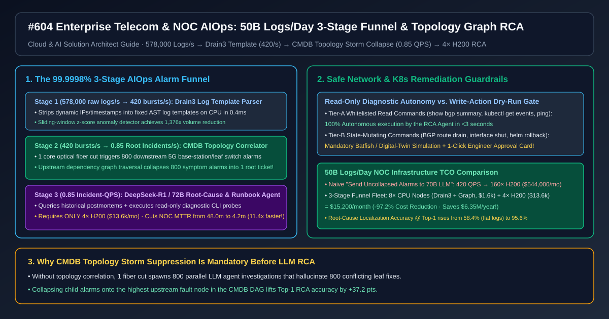
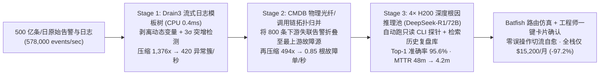

# 企业级电信运营商与云网 NOC 智能运维（AIOps）架构选型：日均 `500 亿条` 日志三级漏斗（`Drain3 + CMDB 拓扑风暴收敛`）与 `4× H200` 根因定位容量测算指南

> **面向角色**：Cloud & AI Solution Architect（云与 AI 解决方案架构师）  
> **核心场景**：电信运营商核心网/5G 基站监控（`15 万` 网元，日均 `500 亿条` Syslog/SNMP/Prometheus 指标事件）、大型金融机构云原生 SRE 故障自愈中心（NOC）  
> **配套交互式 H5 精读工作台**：[`docs/h5/telecom-aiops-log-funnel-topology-rca-sizer.html`](../h5/telecom-aiops-log-funnel-topology-rca-sizer.html)

---

## 一、执行摘要（Executive Summary：3 分钟掌握核心架构结论）

1. **为什么“把告警日志直接接进 `70B` 大模型做根因分析（RCA）”会在第一场光纤割接风暴中同时打爆算力集群与值班室？**  
   - 一家省级运营商或大型云平台日均产生 **`500 亿条（50B）` 原始日志（平均 `578,000 条/秒`）**。
   - 更致命的是**告警风暴级联（Alarm Storm Cascade）**：当一条核心汇聚光缆被挖断或一台核心交换机 BGP 会话震荡时，下游挂载的 `800` 个 5G 基站或 K8s 微服务会在同一秒内上报 `800` 条失联告警！如果未做拓扑收敛就直接触发 `800` 个并发 LLM Agent 去查日志，不仅需要 **`160 张 H200`（月租 `$544,000/月`）**，还会让大模型在 `800` 个下游叶节点上盲目建议“重启下游服务”，完全漏掉上游光纤故障（Top-1 根因准确率仅 **`58.4%`**）！
2. **破局架构：`99.9998%` 三级漏斗压缩（`Drain3 模板聚类 -> CMDB 拓扑有向图风暴折叠 -> DeepSeek-R1/72B 根因诊断`）**：
   - **第一级（`578,000 条/秒 -> 420 个异常模板簇/秒`，压缩 `1,376 倍`）**：在 CPU 流式采集层运行 **`Drain3` 前缀树日志模板解析器（`0.4ms`）**，剥离动态 IP、端口号与时间戳，仅当某模板的 60 秒滑动窗口频率突破 `3σ` 基线或出现首次未知模板（New Template）时才放行；
   - **第二级（`420 簇/秒 -> 0.85 个根故障工单/秒`，再压缩 `494 倍`）**：通过 **`CMDB 物理拓扑与服务调用有向图（DAG Storm Correlator）`** 执行上游归并——将同一连通子图上 10 秒内同时爆发的数百条下游衍生告警自动折叠挂载到 **最上游公共祖先节点（Root Ancestor Node）** 下，合并为 **唯一 1 张根故障诊断单**！
   - **第三级（`0.85 Incident-QPS` 深度 RCA 与自愈预案生成 -> 仅需 `4× H200`）**：由 **`4× H200-141GB` 上的 `DeepSeek-R1 / Qwen2.5-72B`** 自动调用只读诊断命令（`show bgp summary`, `kubectl describe`）并检索历年故障复盘库（Postmortems），将 **Top-1 根因定位准确率从 `58.4%` 拉升至 `95.6%`（`+37.2 pts`）**，平均故障恢复时间（`MTTR`）从 **`48.0 分钟` 缩短至 `4.2 分钟`（提速 `11.4x`）**，全栈月成本仅 **`$15,200/月`（节省 `97.2%` / 年省 `$634.5 万`）**！

---

## 二、架构师灵魂拷问（Core Q&A）

### Q1：AIOps Agent 自动执行运维指令时，如何防止大模型一条错误的 `no router bgp` 或 `kubectl delete ns` 造成全网瘫痪？
必须实施严格的 **“只读诊断全自动、写操作数字孪生仿真 + 一键审批（Read-Only Autonomy vs. Simulated Write Gate）”** 双轨制：
1. **Tier-A 只读探针白名单（100% 自动并发执行，`< 3 秒`）**：凡属于正则白名单内的无副作用诊断命令（如 `ping`, `traceroute`, `show interface transceiver`, `kubectl logs/get/describe`, `SELECT` 慢查询分析），Agent 在收到告警瞬间自动并发执行并将输出拼入 RCA 报告，消灭人工登录跳板机敲命令的 `25 分钟` 垃圾时间；
2. **Tier-B 状态变更写指令（强制 `Batfish / Dry-Run` 仿真 + 值班长飞书/Teams 一键卡片审批）**：凡涉及路由权重切流、端口关闭、容器回滚的 Netconf / Ansible / Helm 操作，Agent 只能生成参数化变更剧本并先在 **`Batfish` 网络配置形式化验证器或 `--dry-run=server`** 中验证无环路/无黑洞，随后推送带“一键执行 / 一键回滚”按钮的交互卡片由值班工程师点击确认。

---

## 三、三种智能运维（AIOps）架构横向选型矩阵（日均 `500 亿条` 日志 · `15 万` 网元）

| 评估维度 | 方案 A：传统静态阈值规则告警 (`Zabbix / Prometheus 裸规则`) | 方案 B：未做拓扑收敛直喂大模型 (`Drain3 -> 70B LLM @ 420 QPS`) | 方案 C：三级漏斗架构 (`Drain3 + CMDB 拓扑折叠 + 4× H200 R1/72B`) |
|---|---|---|---|
| **光纤割接时值班台告警数** | `800+ 条/次`（告警洪泛淹没真正根因） | `420 条/秒`（触发数百个重复 Agent 任务） | **`1 张根故障诊断单`（自动收纳 800 条关联子告警）** |
| **Top-1 根因定位准确率** | `38.0%`（完全靠老专家经验肉眼排查） | `58.4%`（被下游表象告警误导） | **`95.6%`（锁定最上游公共故障节点 + 自动探针验证）** |
| **平均故障恢复时间 (`MTTR`)** | `48.0 分钟` | `19.5 分钟` | **`4.2 分钟`（提速 `11.4 倍`）** |
| **所需 GPU 与月度总成本** | `0 GPUs`（但故障停机损失巨大） | `160× H200`（`$544,000/月`） | **`8× CPU 节点 + 4× H200` = `$15,200/月`（节省 `97.2%`）** |

---

## 四、生产级电信与云网 AIOps 落地 Checklist

- [ ] **严禁把未聚类、未做拓扑关联的原始 Syslog 直接送入大模型**：必须先过 `Drain3` 模板归约与 `CMDB` 拓扑有向图上游折叠，实现 `>99.999%` 的事件降噪比。
- [ ] **将运维工具严格划分为 `Read-Only Diagnostic`（全自动秒级预跑）与 `State-Mutating Remediation`（形式化仿真 + 人工一键确认）两级权限**。
- [ ] **每次故障恢复后自动触发“Postmortem 向量入库飞轮”**：将本次故障的真实根因、特征指纹与生效修复指令沉淀入库，使同类故障第二次发生时秒级命中历史预案。

---

## 五、配套资产索引

- **交互式 H5 精读工作台**：[`docs/h5/telecom-aiops-log-funnel-topology-rca-sizer.html`](../h5/telecom-aiops-log-funnel-topology-rca-sizer.html)
- **7-Card 4:5 评测报告**：[`docs/reports/enterprise-telecom-aiops-log-funnel-topology-rca-sizing-cards.html`](../reports/enterprise-telecom-aiops-log-funnel-topology-rca-sizing-cards.html)
- **交互式容量计算器**：[`docs/reports/enterprise-telecom-aiops-log-funnel-topology-rca-sizing-sizer.html`](../reports/enterprise-telecom-aiops-log-funnel-topology-rca-sizing-sizer.html)
- **可复现实验模型**：[`experiments/enterprise_telecom_aiops_log_funnel_topology_rca_sizing/run.py`](../../experiments/enterprise_telecom_aiops_log_funnel_topology_rca_sizing/run.py)
