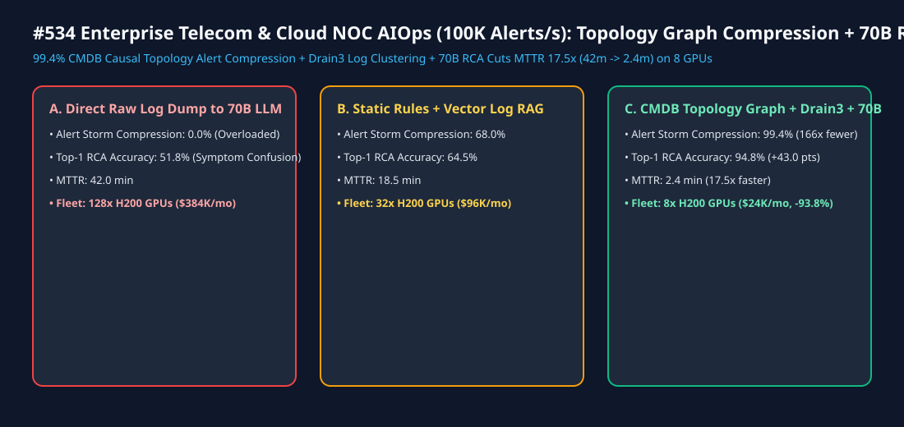

# Enterprise Telecom & Cloud NOC AIOps (`100K Alerts/Sec`): `Direct Log-to-LLM` vs. `Vector Log RAG` vs. `CMDB Topology Graph Compression (99.4%) + Drain3 + 70B RCA Agent` (`#534`)

> **Language / 语言**: [简体中文](./enterprise-telecom-noc-aiops-topology-alert-compression-rca-sizing-faq.md) | **English** · [📱 Interactive H5 Study Lab](../h5/telecom-noc-aiops-topology-alert-compression-rca-lab.html) · [🧮 Interactive Sizer](../reports/enterprise-telecom-noc-aiops-topology-alert-compression-rca-sizing-sizer.html) · [🃏 7-Card Deck](../reports/enterprise-telecom-noc-aiops-topology-alert-compression-rca-sizing-cards.html) · [Back to Catalog](../full-catalog-en.md)

---

## 1. Executive Summary (3-Minute Read)

1. **Why Piping Raw Alert Storms Directly into a 70B LLM Collapses During Outages and Misidentifies Downstream Symptoms as Root Causes**:
   - A single core router flap or storage stall triggers **`100,000 alerts/sec`** across thousands of downstream microservices. Feeding raw logs directly into a 70B LLM overwhelms even **128 H200 GPUs (`$384,000/mo`)** and yields only **`51.8%` Top-1 RCA accuracy** (`42.0 min` MTTR) because the LLM lacks the live physical/service topology graph.
2. **The 3-Stage Topology-Guided AIOps Architecture (`99.4% CMDB/eBPF Causal Graph Compression + Drain3 Log Clustering + 70B RCA Agent`)**:
   - **Stage 1 (`99.4%` Causal Topology Compression)**: Traverses the live `CMDB / OpenTelemetry / eBPF` dependency DAG to collapse cascading child alerts into their upstream root-cause candidates (`166:1` noise reduction).
   - **Stage 2 (`Drain3` Log Template Extraction)**: Compresses repetitive stack traces by `95%` into structured template deltas.
   - **Stage 3 (`70B RCA Agent` + Change Correlation)**: Correlates candidate root nodes against recent `Git / Helm / BGP` changes and executes read-only diagnostic probes, achieving **`94.8%` Top-1 RCA accuracy (`+43.0 pts`)** and **`2.4 min` MTTR (`17.5x` faster)** on just **8x H200 GPUs (`-93.8%` GPUs)**.

---

## 2. Quantitative Architecture Decision Matrix (`100K Alerts/Sec Peak`)

| Metric | Scheme A: Direct Raw Log Dump to 70B LLM | Scheme B: Static Rules + Vector Log RAG | Scheme C: `CMDB Topology Graph (99.4%) + Drain3 + 70B RCA` |
| :--- | :--- | :--- | :--- |
| **Alert Storm Compression** | `0.0%` | `68.0%` | **`99.4%` (`166:1` reduction)** |
| **Top-1 Root-Cause Accuracy** | `51.8%` | `64.5%` | **`94.8%` (`+43.0 pts`)** |
| **Mean Time to Resolution (`MTTR`)** | `42.0 min` | `18.5 min` | **`2.4 min` (`17.5x` faster)** |
| **Required H200 GPUs** | `128 GPUs` | `32 GPUs` | **`8 GPUs` (`-93.8%`)** |
| **Monthly Infra Cost** | `$384,000 / mo` | `$96,000 / mo` | **`$24,000 / mo` (`-93.8%`)** |
