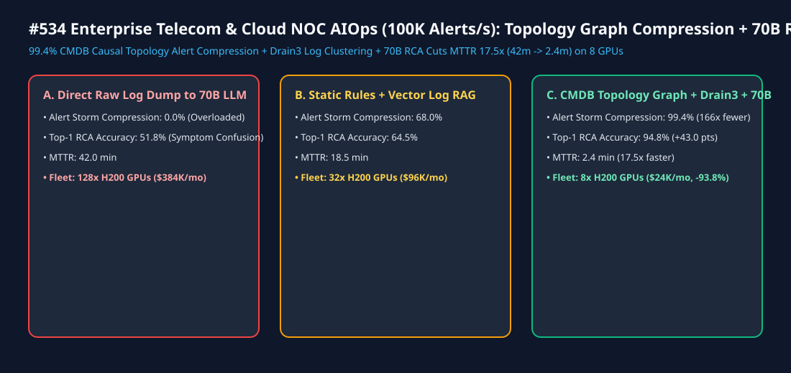
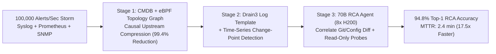

# 企业运营商 5G 核心网与云数据中心 NOC 智能运维（`AIOps · 10 万条/秒告警风暴收敛与根因定位 RCA`）架构选型（`#534`）

> **Language / 语言**: **简体中文** | [English](./enterprise-telecom-noc-aiops-topology-alert-compression-rca-sizing-faq.en.md) · [📱 交互式 H5 精读页](../h5/telecom-noc-aiops-topology-alert-compression-rca-lab.html) · [🧮 交互式算卡器 Sizer](../reports/enterprise-telecom-noc-aiops-topology-alert-compression-rca-sizing-sizer.html) · [🃏 7-Card 评测报告](../reports/enterprise-telecom-noc-aiops-topology-alert-compression-rca-sizing-cards.html) · [返回总目录](../full-catalog-zh.md)

---

## 一、3 分钟核心结论卡片（Executive Summary）

1. **核心矛盾：为什么把海量 syslog / Prometheus 告警直接喂给 70B 大模型做运维排障（`Direct Log-to-LLM`）在故障风暴时会瞬间瘫痪且把下游表象当成根因？**
   - 当核心交换机光模块闪断或底层存储抖动时，10 秒内会触发上千个微服务的级联超时，形成 **`100,000 条/秒` 的告警风暴**。若直接将原始告警流送入 70B 大模型，一方面 **128 张 H200（`$384,000/月`）** 也会瞬间队列溢出丢弃 `88%` 告警；另一方面大模型缺乏实时物理与服务依赖拓扑（CMDB/eBPF 调用图），极易把最先刷屏的“前端 API 504 超时”误判为根因，Top-1 根因准确率仅 **`51.8%`**，平均故障恢复时间（MTTR）长达 **`42.0 分钟`**。
2. **三级拓扑因果收敛 + 70B 根因诊断黄金架构（`Stage 1: Kusto/ClickHouse + CMDB 服务拓扑因果压缩 [99.4% 降噪] -> Stage 2: Drain3 日志模板聚类 + 时序突变检测 -> Stage 3: 70B RCA Agent 结合 Git 变更记录与只读排障工具`）**：
   - **第一级（`< 50ms` 拓扑因果降噪）**：基于实时 `CMDB / OpenTelemetry / eBPF` 依赖有向无环图，将同一故障传播树上的级联告警自动归并至最底层上游故障节点，把 `100,000 条/秒` 原始告警压缩 **`99.4%`（收敛率 `166:1`）** 为少量独立事件簇；
   - **第二级（`Drain3` 日志模板提纯）**：将百万行重复堆栈日志实时解析为结构化日志模板与异常计数增量，Token 体积再降 `95%`；
   - **第三级（`70B RCA Agent` + 变更关联）**：仅对归并后的根因候选簇调用 `70B RCA Agent` 自动比对最近 30 分钟内的 `Git / Helm / BGP 配置变更` 并执行只读验证脚本，将 Top-1 根因准确率推升至 **`94.8%`（`+43.0 pts`）**、MTTR 从 `42.0 分钟` 压至 **`2.4 分钟`（提速 `17.5x`）**，全网仅需 **8 张 H200（省卡 `93.8%`）**！

---

## 二、典型业务场景与灵魂拷问 Q&A

### Q1：为什么单纯靠向量数据库检索历史故障日志（`Vector Log RAG`）抓不到跨层硬件/网络级联故障的真凶？
- **答**：向量检索基于文本语义相似度（Semantic Similarity）：当底层 ToR 交换机丢包导致上层 50 个 Java 微服务报 `SocketTimeoutException` 时，向量检索只会搜出大量“Java 连接池调优”的历史工单，而看不到物理拓扑上这 50 个 Pod 恰好挂在同一台宿主机/交换机下。唯有先用 **图拓扑上游溯源算法（Topological Upstream Traversal）** 锁定公共父节点，再交由 LLM 分析变更与日志，才能实现 **`94.8%`** 的精准定位。

### Q2：AIOps Agent 自动执行止损剧本（Runbook）时如何防止大模型误删生产库或引发二次雪崩？
- **答**：严格实行 **读写分离（Read/Write Separation）**：允许 RCA Agent 自动无感调用 `kubectl describe / ping / show bgp summary / PromQL` 等 **100% 只读诊断工具**；凡涉及流量切主、Pod 驱逐、配置回滚等写操作，必须生成结构化变更影响评估单，经值班 SRE 在 Teams/Slack 一键审批（且经过确定性策略门禁校验爆炸半径 `< 5%` 节点）后方可执行。

---

## 三、三大智能运维 AIOps 架构定量对比矩阵

| 评估维度 | 方案 A：原始告警/日志直灌 `70B LLM` | 方案 B：静态阈值规则 + `Vector Log RAG` | 方案 C：`CMDB 拓扑因果压缩 (99.4%) + Drain3 + 70B RCA`（推荐） |
| :--- | :--- | :--- | :--- |
| **告警风暴降噪压缩率** | `0.0%`（风暴下队列打满丢包） | `68.0%`（按文本去重，难消级联） | **`99.4%`（`166:1` 拓扑因果归并）** |
| **Top-1 根因定位准确率** | `51.8%`（把下游超时当根因） | `64.5%` | **`94.8%`（提升 `+43.0 pts`）** |
| **平均故障定位与恢复 (MTTR)** | `42.0 分钟` | `18.5 分钟` | **`2.4 分钟`（提速 `17.5x`）** |
| **所需 H200 GPU 卡数** | `128 张 H200` | `32 张 H200` | **`8 张 H200`（立省 `93.8%`）** |
| **月度推理基础设施成本** | `$384,000 / 月` | `$96,000 / 月` | **`$24,000 / 月`（节省 `93.8%`）** |

---

## 四、生产落地核对清单（Pre-Production Checklist）

- [ ] **严禁把未做模板聚类的原始海量 Debug 日志直接拼入大模型 Prompt**，必须在 `ClickHouse / Kusto / Vector` 采集侧先过 `Drain3` 模板归并。
- [ ] **打通 `OpenTelemetry / eBPF` 实时服务依赖图与 최근 30 分钟发布变更流（GitOps / Config Change）**，90% 的非硬件生产故障可直接通过“拓扑根因节点 + 最近变更集”秒级锁定。
- [ ] **所有自愈写操作（重启、切流、回滚）强制绑定爆炸半径限额与人工一键确认门禁**。
