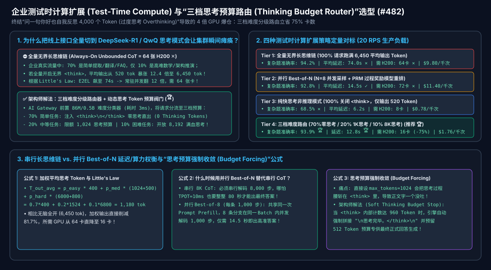

# Enterprise Test-Time Compute Scaling (`Always-On Long-CoT` vs. `Best-of-N PRM` vs. `3-Band Adaptive Thinking Budget Router`) Sizing Guide (#482)

> **Executive Summary**:
> Enabling unbounded `<think>` Chain-of-Thought reasoning across 100% of enterprise traffic triggers severe **Overthinking capacity inflation**: simple translation, extraction, and FAQ queries (70% of enterprise traffic) emit **`4,000–8,000` unnecessary thinking tokens**, inflating average output from `520` to `6,450` tokens ($12.4\times$), pushing average `E2EL` to **`74.0s`**, and requiring **`64 H200 GPUs`** at `20 RPS` (`$9.80 / 1k queries`). For **Cloud & AI Solution Architects**, the production standard is a **`3-Band Complexity Router + Soft Thinking Budget Forcing`** (`70%` Fast `0-Think` via `<think></think>` prefill, `20%` Medium `1,024-Think` with soft `</think>` injection, and `10%` Hard `8,192-Think` or `Best-of-8`). This retains **`93.9%` complex reasoning accuracy** while cutting average `E2EL` to **`12.8s` ($5.78\times$ faster)**, reducing required GPUs by **75% (`16 H200 GPUs`)**, and slashing cost by **82.0% (`$1.76 / 1k queries`)**.
>
> **⚡ Interactive H5 Study Lab**: [**Open the Test-Time Compute & 3-Band Thinking Budget Router Sizer (`docs/h5/test-time-compute-reasoning-router-budget-sizer-lab.html`)**](../h5/test-time-compute-reasoning-router-budget-sizer-lab.html)

---

## 1. Core Q&A: Soft Thinking Budget Forcing and Stripping Historical `<think>` Traces

### Q1: Why must `max_thinking_tokens` be enforced separately from `max_tokens`, and why must multi-turn chat strip prior `<think>` blocks?
1. **Soft Thinking Budget Stop**: Setting a raw `max_tokens = 1024` truncates generation mid-thought before `</think>` closes, returning an empty final answer. Instead, inject `"\nConcluding analysis.</think>\n"` at token `960` and reserve `512` tokens exclusively for the final visible answer.
2. **Multi-Turn `<think>` Stripping**: Never feed previous turns' `<think>...</think>` traces back into subsequent multi-turn prompts; stripping them saves 80%+ of multi-turn KV Cache and preserves Prefix Cache hit rates.

---

## 2. Quantitative Decision Matrix (`20 RPS Enterprise Workload`)

| Test-Time Compute Strategy | Avg Output + Thinking Tokens | Complex Task Accuracy (%) | Avg `E2EL` (sec) | H200 GPUs Needed (20 RPS) | Cost / 1k Queries ($/1k) |
| :--- | :--- | :--- | :--- | :--- | :--- |
| **Tier 1: Always-On Unbounded Long-CoT (`100%` Full Thinking)** | `6,450 tok` ✕ | `94.2%` | `74.0 s` ✕ | `64 GPUs` ✕ | `$9.80` |
| **Tier 2: Parallel `Best-of-8` Sampling + `PRM` Reranking** | `8,192 tok` ✕ | `92.8%` | `14.5 s` ✓ | `72 GPUs` ✕ | `$11.40` |
| **Tier 3: Non-Thinking Fast Instruct Only (`0-Think`)** | `520 tok` | `68.5%` ✕ | `6.2 s` | `8 GPUs` | `$0.78` |
| **Tier 4: `3-Band Complexity Router` (`70% 0 / 20% 1K / 10% 8K` 🏆)** | **`1,180 tok` (-81.7% 🏆)** | **`93.9%` 🏆** | **`12.8 s` (5.8x 🏆)** | **`16 GPUs` (-75% 🏆)** | **`$1.76` (-82.0% 🏆)** |
