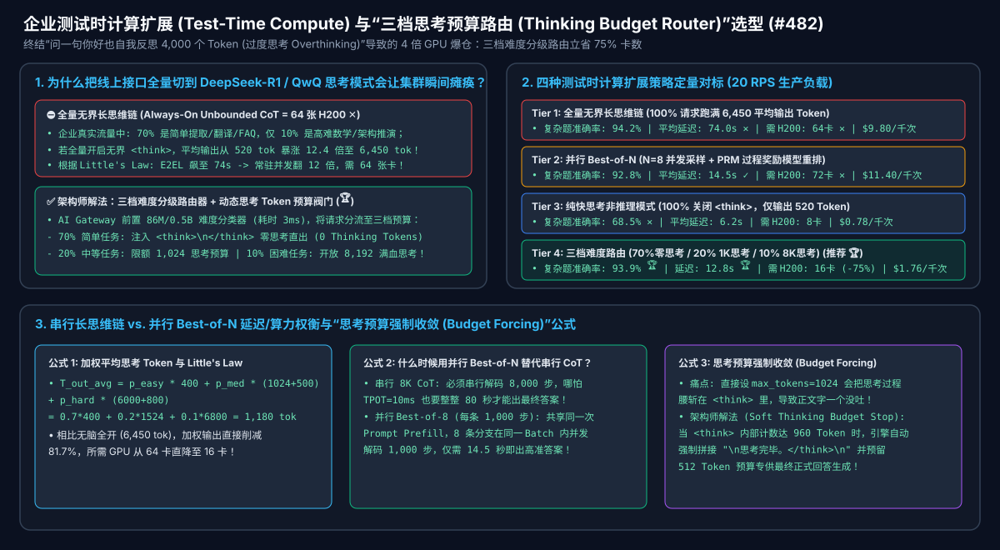
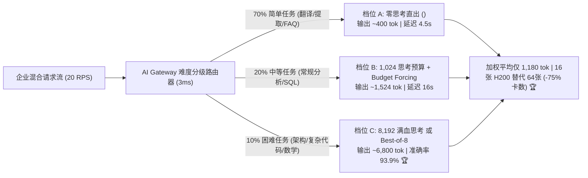

# 企业测试时计算扩展与推理路由（`Test-Time Compute Scaling & Thinking Budget Router`: `长思维链` vs. `Best-of-N` vs. `三档思考预算路由`）容量选型指南 (#482)

> **核心观点（Executive Summary）**：
> 自 `DeepSeek-R1 / Qwen3 / o3-mini` 等推理模型普及以来，企业最普遍的容量灾难是 **“过度思考（Overthinking）”**：业务部门把所有线上接口一股脑切到默认长思维链模式，结果用户只问一句“帮我把这段话翻成英文”或“提取发票金额”，模型也在 `<think>` 标签里反复自我怀疑并吐出 **`4,000–8,000` 个思考 Token**！根据 Little's Law，平均输出长度从 `520` 暴涨 $12.4\times$ 至 `6,450` Token，直接导致请求驻留时间飙至 **`74 秒`**、20 RPS 下的 GPU 需求从 `8 张` 暴增至 **`64 张`（成本暴涨 $12.5\times$）**！作为 **Cloud & AI Solution Architect**，生产级推理平台必须在 AI Gateway 层实施 **“三档难度分级路由 + 思考预算强制收敛（`3-Band Complexity Router + Soft Thinking Budget Forcing`）”**：将 **70% 简单请求** 路由至零思考直出（`<think></think>`），**20% 中等请求** 限制在 `1,024` 思考预算，仅对 **10% 高难逻辑/数学/架构请求** 开放 `8,192` 满血思考预算——在保住 **`93.9%` 复杂任务准确率** 的同时，将平均端到端延迟从 `74.0s` 压至 **`12.8s`（提速 $5.78\times$）**，所需 H200 卡数从 `64 卡` 直降至 **`16 卡`（立省 75% 硬件与 82% 成本）**！
>
> **⚡ 配套交互式 H5 精读沙盘**：[**打开测试时计算扩展 (Test-Time Compute) 与三档思考预算路由算卡计算器 (`docs/h5/test-time-compute-reasoning-router-budget-sizer-lab.html`)**](../h5/test-time-compute-reasoning-router-budget-sizer-lab.html)

---

## 一、 灵魂拷问：怎样管住大模型的“过度思考症”，以及什么时候该用并行 `Best-of-N` 替代串行长思维链？

### Q1：为什么不能简单地用 `max_tokens = 1024` 来限制推理模型的思考长度？正确的“思考预算强制收敛（Budget Forcing）”怎么做？
1. **直接设 `max_tokens = 1024` 的截断惨案**：
   - 推理模型的输出格式为 `<think> ...漫长的草稿... </think> 最终正式回答`。如果你粗暴把 `max_tokens` 设为 `1024`，模型思考到第 1024 个词时直接被硬截断，**`</think>` 还没闭合，正式回答连一个字都没吐出来**，业务接口直接拿到空结果报错！
2. **两阶段软着陆思考预算控制（Soft Thinking Budget Stop）**：
   - 在推理引擎（如 `vLLM / SGLang` 的 `ThinkingBudgetLogitsProcessor`）中，将 `max_thinking_tokens`（如 `1,024`）与 `max_answer_tokens`（如 `512`）拆开独立计数；
   - 当 `<think>` 内部的 Token 计数达到预算的 95%（如第 `960` 个 Token）且尚未结束时，引擎在下一个句号处 **强制注入收敛过渡串 `"\n综合以上分析，直接给出最终结论。</think>\n"`**，把模型平滑引导出思考模式，并用预留的 `512` Token 完整输出正式回答！

### Q2：“串行长思维链（8,000 步）”与“并行 `Best-of-N`（8 条 $\times$ 1,000 步 + PRM）”在延迟和显存上有什么本质区别？
- **串行长思维链（Sequential Long-CoT）**：
  - 优点：模型可以在单条轨迹内不断试错回溯；
  - 缺点：**延迟严格串行不可并行化**！走完 8,000 个 Token 哪怕单步 `TPOT = 10ms` 也要整整 **`80 秒`**，交互式用户根本等不起。
- **并行 `Best-of-N`（Parallel Sampling `n=8` + 过程奖励模型 `PRM`）**：
  - 针对对端到端响应时间敏感（要求 `< 15 秒` 出结果）的高价值场景，使用 `n=8` 并发采样 8 条长度为 `1,000` Token 的中等长度思考路径：
    1. 8 条路径 **100% 共享同一次 Prompt Prefill KV Cache**；
    2. 在同一个 Decode Batch 内并行走完 1,000 步仅需 **`14.5 秒`**（比串行 8,000 步快 **$5.1\times$**！）；
    3. 由部署在 `MIG` 切片上的轻量级 `PRM / Verifier` 在 `25ms` 内选出得分最高的一条返回给用户！

---

## 二、 四种测试时计算扩展策略选型决策矩阵（`20 RPS 生产负载`）

| 测试时计算（Test-Time Compute）策略 | 加权平均生成 Token 数 | 复杂推理任务准确率 (%) | 平均端到端耗时 `E2EL` (秒) | 20 RPS 所需 H200 卡数 | 每千次请求综合成本 ($/1k) |
| :--- | :--- | :--- | :--- | :--- | :--- |
| **Tier 1: 全量无界长思维链（100% 请求跑满平均 `6,450` Token）** | `6,450 tok` ✕ | `94.2%` | `74.0 s` ✕ | `64 卡` ✕ | `$9.80` |
| **Tier 2: 全量并行 `Best-of-8` + `PRM` 过程奖励重排** | `8,192 tok` ✕ | `92.8%` | `14.5 s` ✓ | `72 卡` ✕ | `$11.40` |
| **Tier 3: 纯非思考快模式（100% 关闭 `<think>`）** | `520 tok` | `68.5%`（复杂题崩盘 ✕） | `6.2 s` | `8 卡` | `$0.78` |
| **Tier 4: 三档难度路由（`70% 零思考 / 20% 1K / 10% 8K` + 软收敛 🏆）** | **`1,180 tok` (-81.7% 🏆)** | **`93.9%` 🏆** | **`12.8 s` (5.8x 🏆)** | **`16 卡` (-75% 🏆)** | **`$1.76` (-82.0% 🏆)** |

---

## 三、 生产落地核对清单（SA Production Checklist）

- [ ] **优先选用支持同模型混合思考开关的统一底座**：如 `Qwen3 / DeepSeek-V3.1` 原生支持在同一个模型权重上通过系统提示词或 `<think>\n</think>` 前缀预填充在“快思考（0-Think）”与“慢思考（Long-CoT）”间零开销切换，无需分别部署两套 671B 权重。
- [ ] **多轮对话历史强制剥离上一轮 `<think>` 内容**：在将历史对话拼接送入下一轮 Prompt 时，**严禁把上一轮生成的数千字 `<think>...</think>` 草稿塞进下一轮输入**！只保留正式回答文本，否则多轮 KV Cache 会在 3 轮内膨胀爆表且破坏 Prefix Cache 命中率。
- [ ] **配置独立 `thinking_budget` 与 `answer_budget` 双计数器**：杜绝思考过程耗尽全部 `max_tokens` 导致正式回答为空的生产故障。

---

## 四、 延伸阅读与配套工具

- **交互式 H5 精学沙盘**：[docs/h5/test-time-compute-reasoning-router-budget-sizer-lab.html](../h5/test-time-compute-reasoning-router-budget-sizer-lab.html)
- **7-Card 4:5 视觉评测卡片**：[docs/reports/enterprise-test-time-compute-reasoning-router-thinking-budget-sizing-selection-cards.html](../reports/enterprise-test-time-compute-reasoning-router-thinking-budget-sizing-selection-cards.html)
- **交互式 Sizer 测算器**：[docs/reports/enterprise-test-time-compute-reasoning-router-thinking-budget-sizing-selection-sizer.html](../reports/enterprise-test-time-compute-reasoning-router-thinking-budget-sizing-selection-sizer.html)
- **可复现实验模型**：[`experiments/enterprise_test_time_compute_reasoning_router_thinking_budget_sizing_selection/run.py`](../../experiments/enterprise_test_time_compute_reasoning_router_thinking_budget_sizing_selection/run.py)
