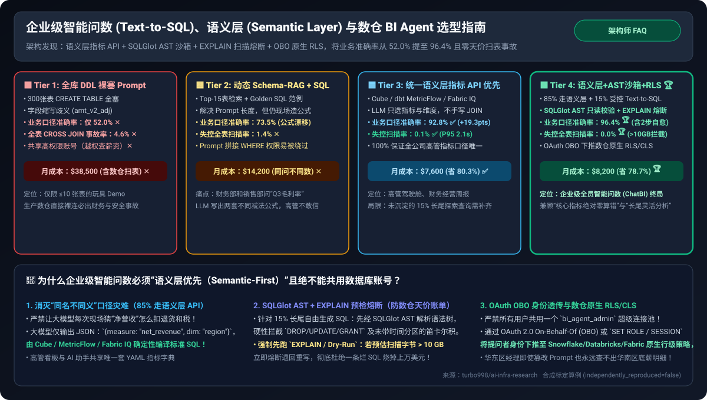
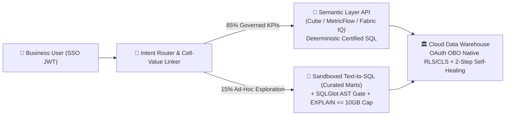

# Enterprise Text-to-SQL, Semantic Layer & Cloud Data Warehouse BI Agent Architecture Selection Guide: Full-DDL Prompt Stuffing vs. Dynamic Schema-RAG vs. Semantic Layer Metric API First (Cube / MetricFlow / Fabric IQ) vs. Semantic Layer + SQLGlot AST Gate + EXPLAIN Circuit Breaker + Native RLS Architecture

> **Document Type**: Cloud & AI Solution Architect Decision Guide (FAQ)  
> **Target Audience**: Chief Data Officers (CDOs), Data Warehouse & BI Leads, Finance/Retail Analytics Directors, Enterprise AI Platform Architects  
> **Core Goal**: Answer the three hardest questions in enterprise "ChatBI / Text-to-SQL" deployments — **"Why does the LLM generate syntactically valid SQL whose Gross Margin number is 15% off the CFO's report?", "How do we prevent an intern's natural-language question from triggering an unbounded CROSS JOIN that scans 50TB in Snowflake/BigQuery and burns $12,000?", and "How do we guarantee an East Region manager cannot query West Region executive salaries?"** — with a concrete architecture matrix and checklist.  
> **Calibration Notice**: Metric accuracy, P95 latency, runaway scan incident rates, and monthly cost models are synthetic analytical estimates calibrated to published enterprise Text-to-SQL benchmarks (Spider 2.0 / BIRD-SQL enterprise warehouse evaluations, dbt MetricFlow / Cube / Microsoft Fabric IQ semantic layer architectures, and cloud data warehouse FinOps practices) (`provenance: synthetic + anonymized_reported`, `independently_reproduced=false`, `physical_gpu_cluster_measurement=not_measured`). See [`experiments/enterprise_text_to_sql_semantic_layer_bi_agent_selection/results.json`](../../experiments/enterprise_text_to_sql_semantic_layer_bi_agent_selection/results.json).

---

## Executive Visual Summary

> 🔗 **Companion Interactive Reports & Tools**:
> - 🃏 **[7-Card 4:5 Visual Benchmark Report (`enterprise-text-to-sql-semantic-layer-bi-agent-architecture-selection-cards.html`)](../reports/enterprise-text-to-sql-semantic-layer-bi-agent-architecture-selection-cards.html)**
> - 🧮 **[Interactive ChatBI & Warehouse Cost Sizer (`enterprise-text-to-sql-semantic-layer-bi-agent-architecture-sizer.html`)](../reports/enterprise-text-to-sql-semantic-layer-bi-agent-architecture-sizer.html)**
> - 🌐 **[中文版指南 (`enterprise-text-to-sql-semantic-layer-bi-agent-architecture-selection-faq.md`)](./enterprise-text-to-sql-semantic-layer-bi-agent-architecture-selection-faq.md)**

---

## ① 📌 Executive Summary

Enterprise cloud data warehouses (Snowflake, Databricks, Microsoft Fabric, BigQuery, StarRocks) routinely contain **300+ tables**, cryptic legacy column names (`amt_v2_adj_ex_vat`), and strict financial metric definitions. **Raw Text-to-SQL over hundreds of uncurated tables fails in production.**

Evaluated on a **300-table enterprise data warehouse serving 500,000 analytical queries/month**:

| Tier | Architecture Pattern | Business Metric Accuracy | P95 E2E Latency | Runaway Full-Scan Incident Rate | Monthly Total Cost (LLM + Warehouse) | Architect Verdict |
| :--- | :--- | :--- | :--- | :--- | :--- | :--- |
| **🟥 Tier 1: Full-DDL Prompt Stuffing** | Stuff all 300 `CREATE TABLE` DDLs into prompt + shared DB account | `52.0%` ✕ | `9.8 s` ✕ | `4.6%` ✕ (Runaway scans) | `$38,500 / mo` ✕ | **Unusable in Production**: Wrong formulas, $10K+ scan bills, cross-tenant leaks |
| **🟨 Tier 2: Dynamic Schema-RAG + Few-Shot** | Top-15 table vector retrieval + cell value LSH + Golden SQL examples | `73.5%` | `4.2 s` | `1.4%` ✕ | `$14,200 / mo` | **Internal SQL Copilot Only**: Suffers from cross-department metric formula drift |
| **🟦 Tier 3: Semantic Layer Metric API First** | **Cube / dbt MetricFlow / Fabric IQ** (LLM selects measures/dimensions) | `92.8%` ✅ | `2.1 s` ✅ | `0.1%` ✅ | `$7,600 / mo` (-80.3%) | **Executive KPI Standard**: 100% deterministic, certified metric formulas |
| **🟩 Tier 4: Semantic Layer + AST Gate + Native RLS** | **85% Semantic API + 15% Sandboxed SQL + SQLGlot AST + EXPLAIN Cap + OBO RLS** | **`96.4%` 🏆** | **`2.3 s` 🏆** | **`0.0%` 🏆** | **`$8,200 / mo` 🏆 (-78.7%)** | **Enterprise ChatBI Gold Standard**: Certified KPIs + safe ad-hoc exploration |

### 💡 Three Golden Rules for Enterprise ChatBI Architects
1. **Adopt "Semantic-First" for Governed KPIs — Never Let an LLM Invent Financial Formulas on the Fly**: For core business metrics (`85%` of queries), the LLM maps natural language to governed Semantic Layer measures and dimensions (`Cube`, `dbt MetricFlow`, `Microsoft Fabric IQ`), which deterministically compile certified SQL.
2. **Enforce a Deterministic `SQLGlot` AST Gate + `EXPLAIN` Byte-Scan Circuit Breaker**: For the `15%` ad-hoc exploratory queries that fall back to Text-to-SQL, parse the AST via `SQLGlot` (block mutations, enforce partition filters) and run warehouse `EXPLAIN / Dry-Run` first — **abort any query estimated to scan `> 10 GB`**.
3. **Never Share a Single Database Service Account Across Users**: Pass the user's identity via **OAuth 2.0 On-Behalf-Of (OBO)** or session role impersonation so native warehouse **Row-Level Security (RLS) and Column-Level Security (CLS)** are enforced by the database engine itself.

---

## ② 🎯 Architect Deep-Dive Q&A

### Q1: Why does Dynamic Schema-RAG (Tier 2) still lose executive trust even when the generated SQL executes without syntax errors?
* **Answer (Syntax Validity $\neq$ Business Metric Correctness)**:
  - Without a Semantic Layer, asking "What was Q3 Net Revenue?" twice in slightly different phrasing causes the LLM to write two slightly different `WHERE` clauses or refund deduction joins.
  - **Semantic Layer Resolution (Tier 3/4)**: The formula for `net_revenue` is defined once in version-controlled YAML (`dbt MetricFlow` / `Cube`). The LLM only selects `measure="net_revenue"` and `dimension="quarter"`, raising business accuracy from `73.5%` to `92.8%–96.4%`.

### Q2: How do we prevent an LLM-generated query from scanning 50TB of unpartitioned data and blowing up our cloud warehouse bill?
* **Answer (Two-Stage Deterministic Guardrail)**:
  1. **SQLGlot AST Inspection (`< 2 ms`)**: Reject any non-`SELECT` statement, verify that fact tables include a partition key predicate (`dt >= ...`), and inject `LIMIT 1000`.
  2. **Warehouse `EXPLAIN / Dry-Run` Byte Cap (`30–80 ms`)**: Query the warehouse planner before execution; if estimated bytes scanned exceed `10 GB`, block execution and ask the user/agent to narrow the date filter. This drives runaway scan incidents from `4.6%` down to `0.0%`.

---

## ③ 🧭 Architecture Diagrams

### 3.1 Tier 4 Hybrid Semantic Layer + Sandboxed Text-to-SQL Reference Architecture

---

## ④ 📊 Architect Decision Matrix

| Dimension | 🟥 Tier 1: Full-DDL Stuffing | 🟨 Tier 2: Schema-RAG + Few-Shot | 🟦 Tier 3: Semantic Layer API First | 🟩 Tier 4: Semantic + AST Gate + Native RLS |
| :--- | :--- | :--- | :--- | :--- |
| **Business Metric Accuracy** | `52.0%` ✕ | `73.5%` (Metric drift) | `92.8%` ✅ | **`96.4%` 🏆** |
| **P95 End-to-End Latency** | `9.8 s` ✕ | `4.2 s` | `2.1 s` ✅ | **`2.3 s` 🏆** |
| **Runaway Full-Scan Rate** | `4.6%` ✕ | `1.4%` ✕ | `0.1%` ✅ | **`0.0%` 🏆 (`EXPLAIN > 10GB` blocked)** |
| **Security & RLS Isolation** | ✕ Shared Admin Account | ⚠️ Prompt `WHERE` (Bypassable) | ✅ Semantic Security Context | **🏆 Native Warehouse OAuth OBO RLS/CLS** |
| **Monthly Total Cost (500K Q)** | `$38,500 / mo` ✕ | `$14,200 / mo` | `$7,600 / mo` ✅ | **`$8,200 / mo` 🏆 (`-78.7%` vs. Tier 1)** |

---

## ⑤ 🛠️ Production Readiness Checklist

- [ ] **1. Never Expose Raw Staging (`ODS / Bronze`) Tables to Text-to-SQL**: Expose only curated, documented Gold/Mart tables (`dws_* / ads_*`) or Semantic Views.
- [ ] **2. Route All Core KPIs Through a Semantic Layer (`Cube / dbt MetricFlow / Fabric IQ`)**.
- [ ] **3. Index High-Cardinality Dimension Cell Values (`Cell Value Linking`)** so entity names map to exact database literals before SQL generation.
- [ ] **4. Enforce `SQLGlot` AST Read-Only & Partition-Key Validation at the Gateway**.
- [ ] **5. Run Warehouse `EXPLAIN / Dry-Run` and Abort Queries Scanning `> 10 GB`**.
- [ ] **6. Enforce Per-User OAuth OBO Identity Passthrough for Native Warehouse RLS & CLS**.
- [ ] **7. Cap Execution-Guided Error Self-Healing at `2` Retries**.
- [ ] **8. Display a Transparent Metric Lineage & SQL Verification Card in the UI**.
