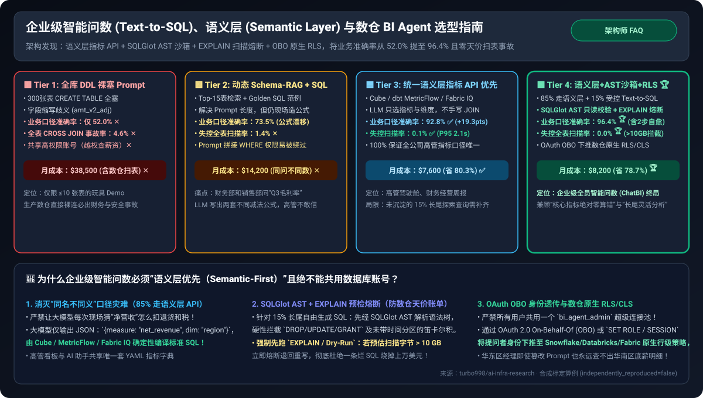
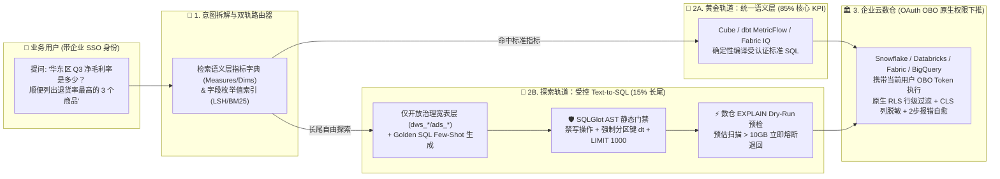
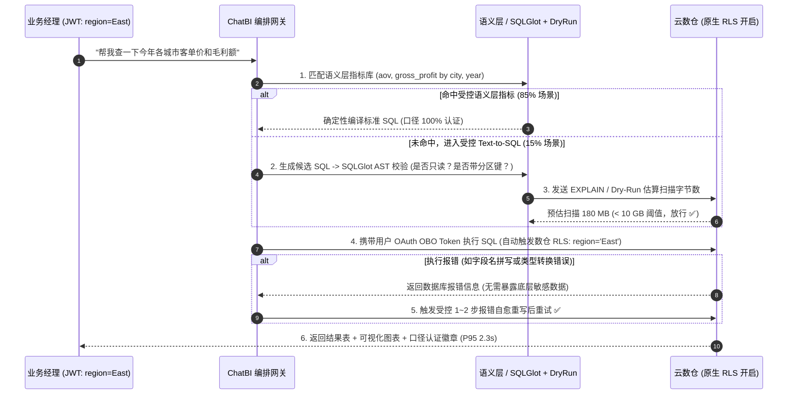

# 企业级智能问数（Text-to-SQL）、语义层（Semantic Layer）与数仓 BI 分析 Agent 架构选型指南：全库 DDL 裸塞 Prompt vs. 动态 Schema-RAG vs. 语义层指标 API 优先（Cube / MetricFlow / Fabric IQ）vs. 语义层 + SQLGlot AST 沙箱 + EXPLAIN 扫描熔断 + 原生 RLS 权限下推架构

> **文档类型**：企业级数据智能与云端 AI 解决方案架构师（Cloud & AI Solution Architect）选型决策指南（FAQ）  
> **适用读者**：企业 CDO（首席数据官）、BI 与数仓负责人、财务/零售经营分析负责人、AI 平台架构师  
> **核心目标**：用通俗、可落地的架构语言回答企业建设“智能问数 / ChatBI（自然语言查数仓）”最常踩的三大深坑——**“为什么大模型生成的 SQL 语法没错，算出来的毛利率却和财务报表差了 15%？”、“为什么一个实习生向 AI 问了一句‘去年各门店商品交叉对比’，直接扫爆 Snowflake/BigQuery 50TB 数据烧掉 $12,000？”、“怎么防止华东区销售经理通过 AI 查出全国高管薪资？”**，并给出可量化的架构选型矩阵与生产级落地清单。  
> **标定声明**：本文所引用的业务口径准确率、P95 延迟、天价扫表事故率与月度成本模型基于公开发布的企业级智能问数基准（Spider 2.0 / BIRD-SQL 企业数仓评测、dbt MetricFlow / Cube / Microsoft Fabric IQ 语义层实践及云数仓 FinOps 规范）构建的合成分析模型（`provenance: synthetic + anonymized_reported`, `independently_reproduced=false`, `physical_gpu_cluster_measurement=not_measured`），详见 [`experiments/enterprise_text_to_sql_semantic_layer_bi_agent_selection/results.json`](../../experiments/enterprise_text_to_sql_semantic_layer_bi_agent_selection/results.json)。

---

## 一图流总结（Executive Visual Summary）



> 🔗 **关联可交互报告与工具**：
> - 🃏 **[7-Card 4:5 视觉评测报告 (`enterprise-text-to-sql-semantic-layer-bi-agent-architecture-selection-cards.html`)](../reports/enterprise-text-to-sql-semantic-layer-bi-agent-architecture-selection-cards.html)**
> - 🧮 **[交互式智能问数架构与数仓成本计算器 (`enterprise-text-to-sql-semantic-layer-bi-agent-architecture-sizer.html`)](../reports/enterprise-text-to-sql-semantic-layer-bi-agent-architecture-sizer.html)**
> - 🌐 **[English Version (`enterprise-text-to-sql-semantic-layer-bi-agent-architecture-selection-faq.en.md`)](./enterprise-text-to-sql-semantic-layer-bi-agent-architecture-selection-faq.en.md)**

---

## ① 📌 核心选型结论速览（Executive Summary）

企业级生产数据仓库（Snowflake / Databricks / Microsoft Fabric / BigQuery / StarRocks）动辄拥有 **300+ 张星型/雪花模型表**、晦涩的历史缩写字段（如 `amt_v2_adj_ex_vat`）以及极其严苛的财务口径定义。**“把表结构塞给大模型直接生成 SQL（裸写 Text-to-SQL）”在超过 20 张表的企业级场景中必败无疑！**

基于 **300 张企业数仓表、每月 500,000 次经营分析提问** 的基准测算，四类主流架构对比如下：

| 架构档位 | 核心架构组合 | 业务口径准确率 | P95 端到端延迟 | 失控全表扫描事故率 | 月均总成本 (LLM+数仓) | 架构师拍板结论 |
| :--- | :--- | :--- | :--- | :--- | :--- | :--- |
| **🟥 Tier 1：全库 DDL 裸塞 Prompt** | 300 张表 `CREATE TABLE` 全塞入上下文 + 共享账号直跑 SQL | `52.0%` ✕ | `9.8 s` ✕ | `4.6%` ✕ (扫爆数仓) | `$38,500 / 月` ✕ | **严禁上生产**：口径乱算、天价扫表账单、越权查数 |
| **🟨 Tier 2：动态 Schema-RAG + 范例 SQL** | 向量召回 Top-15 表 + 字段值索引 + 历史 Golden SQL 少样本 | `73.5%` | `4.2 s` | `1.4%` ✕ | `$14,200 / 月` | **仅限内部数据分析师辅助写 SQL**：无法消除跨部门口径漂移 |
| **🟦 Tier 3：统一语义层指标 API 优先** | **Cube / dbt MetricFlow / Fabric IQ**（LLM 只选指标与维度） | `92.8%` ✅ | `2.1 s` ✅ | `0.1%` ✅ | `$7,600 / 月` (-80.3%) | **高管看板与核心经营指标首选**：100% 保证指标公式唯一 |
| **🟩 Tier 4：语义层 + AST 沙箱 + 原生 RLS 混合** | **85% 语义层 API + 15% 受控 SQL + SQLGlot AST + EXPLAIN 熔断 + OBO RLS** | **`96.4%` 🏆** | **`2.3 s` 🏆** | **`0.0%` 🏆** | **`$8,200 / 月` 🏆 (-78.7%)** | **全员智能问数 (ChatBI) 终局标准**：兼顾零算错与长尾灵活探索 |

### 💡 架构师三句话选型铁律
1. **核心经营指标必须“语义层优先（Semantic-First）”，严禁让大模型现场发明计算公式**：对于毛利率、净留存率（NRR）、坪效等高频核心指标（占企业问数 85%），大模型只负责把自然语言解析为结构化请求（`measures: ["net_margin_pct"], dimensions: ["region"]`），由语义层（Cube / dbt MetricFlow / Microsoft Fabric IQ）确定性编译出经过财务认证的标准 SQL。
2. **任何生成的 SQL 落库前必须过“SQLGlot AST 语法树校验 + `EXPLAIN` 字节扫描上限熔断”**：针对 15% 未在语义层定义的自由探索查询，必须先用 `SQLGlot` 解析 AST（拦截写操作、强制注入分区过滤条件），再调用数仓 `EXPLAIN / Dry-Run` 估算扫描量——**一旦预估扫描超过 `10 GB` 立即熔断拦截**，彻底杜绝一条烂 SQL 烧掉几万美元数仓账单。
3. **绝对禁止整个 AI 应用共用一个数据库超级账号**：必须使用 **OAuth 2.0 On-Behalf-Of (OBO) 身份透传** 或会话级角色切换（`EXECUTE AS USER` / `USE ROLE`），利用数仓原生的**行级安全（RLS）与列级脱敏（CLS）**，确保用户通过 AI 能查到的数据与他直接登录 BI 报表看到的权限 100% 一致。

---

## ② 🎯 客户与架构师灵魂拷问 Q&A（Architect Deep-Dive Q&A）

### Q1：我们已经用向量库检索 Top-15 张表和历史 SQL 范例（Tier 2）了，生成的 SQL 也没报语法错，为什么 CFO 还是骂 AI 算出来的数字全是错的？
* **真相剖析（语法正确 $\neq$ 业务逻辑正确，即“口径漂移灾难”）**：
  - 在真实企业数仓中，一张订单表往往同时存在 `total_amount`、`pay_amount`、`settle_amount_ex_tax`，订单状态有 `status IN (1, 2, 5, 9)`，且还需要关联退货表 `fact_refunds` 和渠道返点表。
  - 当业务员问“上季度华东区净销售额是多少？”时，如果没有语义层（Tier 2），大模型今天可能用 `SUM(pay_amount) WHERE status = 1`，明天换个问法就写成了 `SUM(settle_amount_ex_tax) WHERE is_deleted = 0`。**两条 SQL 都能跑通、都不报错，但算出来的金额相差几千万元！**
  - **怎么破局（Tier 3 & Tier 4 语义层收口）**：将“净销售额（Net Revenue）”的 JOIN 路径、过滤条件和扣减公式固化在语义层 YAML（如 dbt MetricFlow 或 Cube）中。大模型不再拼接底层物理表字段，而是调用语义层 API——**无论谁问、怎么换措辞问，底层编译出的 SQL 永远 100% 唯一且经过财务部签字背书**，业务准确率从 `73.5%` 跃升至 `92.8%~96.4%`。

### Q2：如果全部走语义层（Tier 3），那老板临时想看一个还没在语义层里定义过的长尾交叉分析怎么办？
* **真相剖析（85/15 混合双轨路由架构，Tier 4）**：
  - 语义层虽好，但只能覆盖已建模的 `85%` 标准指标与维度；剩下的 `15%` 临时长尾探索（如“帮我看看上周退货原因备注里提到包装破损最多的前 5 个物流承运商”）确实需要回退到动态 Text-to-SQL。
  - **Tier 4 混合双轨设计**：
    1. **优先走黄金轨道（85% 流量）**：意图路由器先匹配受控语义层指标库，命中则直接返回 `🏅 经财务认证口径（Certified Metric）` 结果。
    2. **受控回退探索轨道（15% 流量）**：若语义层未覆盖，则路由至 **受控 Text-to-SQL 沙箱**（仅开放经治理的宽表层 `dws_* / ads_*`，禁止直接访问杂乱的原始贴源层 `ods_*`），并在 UI 上显著标注 `🧪 AI 探索性估算（给出了完整 SQL 口径供核对）`，同时包含 **最多 2 步数据库报错自动修复（Execution-Guided Self-Healing）**。

### Q3：怎么防止大模型写出笛卡尔积（CROSS JOIN）或漏写日期分区条件，一口气把我们 Snowflake / BigQuery 的预算刷爆？
* **真相剖析（三大确定性数仓防刷爆熔断器）**：
  1. **第一关：SQLGlot AST 语法树静态拦截（耗时 `< 2 ms`）**：
     - 在网关层用 Python `sqlglot` 将大模型生成的 SQL 解析为抽象语法树（AST）：
     - 凡是包含非 `SELECT` 语句（`DROP / DELETE / UPDATE / GRANT / COPY`）一律拒绝；
     - 扫描 AST 中的所有大表（如 `fact_orders`），若 AST 的 `WHERE` 子句中未包含分区键（如 `dt` 或 `order_date`），自动报错让模型补齐时间范围，或强制注入最近 30 天分区限制。
  2. **第二关：数仓 `EXPLAIN` / Dry-Run 字节扫描预检熔断（耗时 `30~80 ms`）**：
     - 在真正执行 SQL 前，先向 BigQuery (`dryRun=true`) / Snowflake (`EXPLAIN USING JSON`) / Postgres 发送执行计划预检。
     - 若预估扫描数据量 **`> 10 GB`**（或预估行数超过 5,000 万行），网关直接熔断拦截，提示用户缩小查询时间跨度。**这一招将天价扫表事故率从 `4.6%` 归零（`0.0%`）！**
  3. **第三关：独立只读资源池与超时强杀（Resource Monitor & Query Timeout）**：
     - 为 AI 问数分配独立的低配只读计算集群（如 Snowflake `X-Small Warehouse` + `STATEMENT_TIMEOUT_IN_SECONDS = 15`），物理隔离核心生产 ETL 批处理队列。

---

## ③ 🧭 直观可视化图解（Mermaid 决策树、混合语义层架构与安全时序图）

### 3.1 企业级智能问数（ChatBI）架构选型决策树

```mermaid
flowchart TD
    A[企业计划建设自然语言智能问数 / ChatBI 系统] --> B{目标用户与数仓表规模？}
    B -->|仅内部数据工程师个人辅助写 SQL<br/>且生成后由人工审核再执行| C[🟨 Tier 2: 动态 Schema-RAG + Golden SQL<br/>Top-15 表召回 + 历史范例参考<br/>准确率 73.5% / $14.2K/月]
    B -->|面向高管、财务、业务部门直接出数<br/>数仓 > 30 张表，要求口径零误差| D{查询场景是否 100% 限于固定经营指标？}
    D -->|是：仅查固定 KPI 驾驶舱与标准周报| E[🟦 Tier 3: 统一语义层指标 API 优先<br/>Cube / dbt MetricFlow / Fabric IQ<br/>准确率 92.8% / $7,600/月]
    D -->|否：既要 85% 核心指标绝对准确<br/>又要支持 15% 临时长尾探索分析| F[🟩 Tier 4: 语义层 + AST 沙箱 + EXPLAIN 熔断 + 原生 RLS<br/>85% 走语义层 + 15% 受控 SQL (SQLGlot + 10GB 熔断)<br/>准确率 96.4% / 0% 扫表事故 / $8,200/月 🏆]
```

### 3.2 Tier 4 端到端“语义层 + 受控 Text-to-SQL + 原生 RLS”参考架构图



### 3.3 请求级 AST 校验、EXPLAIN 熔断与报错自愈时序图（Sequence Diagram）



---

## ④ 📊 架构师多方案选型决策矩阵（Architect Decision Matrix）

| 评估维度 | 🟥 Tier 1：全库 DDL 裸塞 Prompt | 🟨 Tier 2：动态 Schema-RAG + 范例 | 🟦 Tier 3：统一语义层指标 API 优先 | 🟩 Tier 4：语义层 + AST 沙箱 + RLS 混合 |
| :--- | :--- | :--- | :--- | :--- |
| **适用业务场景** | `≤ 10` 张表的小型单库 PoC | 数据分析师内部 SQL 编写助手 | 高管经营驾驶舱、财务标准报表问数 | **全企业级自助智能问数 (ChatBI) 平台** |
| **业务指标口径准确率** | `52.0%` ✕（经常漏关联退货/税率表） | `73.5%`（语法对，但跨部门公式不一致） | `92.8%` ✅（核心指标公式 100% 锁定） | **`96.4%` 🏆（核心指标锁定 + 长尾 2 步自愈）** |
| **P95 端到端响应延迟** | `9.8 s` ✕（超长 Prompt + 慢查询） | `4.2 s` | `2.1 s` ✅ | **`2.3 s` 🏆** |
| **失控全表扫描事故率** | `4.6%` ✕（极易刷爆数仓账单） | `1.4%` ✕ | `0.1%` ✅ | **`0.0%` 🏆（SQLGlot + EXPLAIN 10GB 熔断）** |
| **跨部门/跨区域权限隔离** | ✕ 共享高权限账号（极高越权风险） | ⚠️ Prompt 软拼接 `WHERE`（易被注入绕过） | ✅ 语义层 Security Context 过滤 | **🏆 数仓原生 OAuth OBO 行列级权限 (RLS/CLS)** |
| **字段枚举行值匹配能力** | ✕ 不知道“华东”在库里存的是 `'EC'` 还是 `'East'` | ✅ 字段高基数枚举值 LSH/向量索引 | ✅ 语义层维度字典映射 | **🏆 语义维度字典 + 实时字段值模糊对齐** |
| **50 万次查询/月总成本** | `$38,500 / 月` ✕ | `$14,200 / 月` | `$7,600 / 月` ✅ | **`$8,200 / 月` 🏆（比 Tier 1 省 `78.7%`）** |

---

## ⑤ 🧪 容量/成本拐点算例与 7-Card 报告（ Quantitative Sizer & 7-Card Deck）

### 5.1 基准算例假设（300 张表企业数仓 · 50 万次问数/月）
- **数仓与查询规模**：企业云数仓包含 `300` 张生产表，月均 `500,000` 次自然语言数据分析请求（其中 `85%` 为核心经营指标查询，`15%` 为临时长尾交叉探索）。
- **为什么 Tier 4 能把总成本从 `$38,500/月` 砍到 `$8,200/月`（立省 `78.7%`）？**
  1. **Prompt Token 缩减 `90%+`**：不再把 300 张表的冗长 DDL（约 `45,000 Tokens`）塞进每次提问，而是只传匹配到的 `5~8` 个语义层指标定义或精选宽表 Schema（约 `2,500 Tokens`）。
  2. **彻底消灭天价慢查询账单**：Tier 1 中 `4.6%` 的失控全表扫描查询消耗了数仓近 `70%` 的按量计算积分（Credits/Slots）；Tier 4 通过 **语义层预聚合路由（Cube Pre-aggregations / 物化视图）+ SQLGlot 分区强制检查 + `EXPLAIN > 10GB` 预检熔断**，将数仓无效全表扫描降为 **`0.0%`**。

```chart
{
  "data": {
    "values": [
      { "Tier": "1. 全库DDL裸塞", "业务口径准确率(%)": 52.0, "全表扫爆事故率(%)": 4.6, "月总成本($K)": 38.5 },
      { "Tier": "2. 动态Schema-RAG", "业务口径准确率(%)": 73.5, "全表扫爆事故率(%)": 1.4, "月总成本($K)": 14.2 },
      { "Tier": "3. 语义层指标API", "业务口径准确率(%)": 92.8, "全表扫爆事故率(%)": 0.1, "月总成本($K)": 7.6 },
      { "Tier": "4. 语义层+AST+RLS", "业务口径准确率(%)": 96.4, "全表扫爆事故率(%)": 0.0, "月总成本($K)": 8.2 }
    ]
  },
  "semantic_types": {
    "Tier": "Category",
    "业务口径准确率(%)": "Percentage",
    "全表扫爆事故率(%)": "Percentage",
    "月总成本($K)": "Amount"
  },
  "chart_spec": {
    "chartType": "Grouped Bar Chart",
    "title": "语义层 + SQLGlot AST + EXPLAIN 熔断 (Tier 4) 将口径准确率提至 96.4% 且月成本省 78.7%",
    "subtitle": "500,000 次问数/月 (300张数仓表) 下的业务口径准确率 (%) vs. 月度 LLM+数仓总成本 ($K)",
    "encodings": {
      "x": "Tier",
      "y": ["业务口径准确率(%)", "月总成本($K)"]
    }
  }
}
```

---

## ⑥ 🛠️ 架构评审与生产落地 Checklist（Production Readiness Checklist）

在企业智能问数（ChatBI / Text-to-SQL）项目上线前，架构师必须逐项核对以下 8 条铁律：

- [ ] **1. 严禁向大模型直接暴露未治理的原始贴源层（ODS）表**：只允许向智能问数开放命名规范、带完整中文业务注释与口径说明的 **公共汇总宽表层（DWS / ADS / Gold Layer）** 或 **语义层视图**。
- [ ] **2. 核心 KPI 100% 收口至统一语义层（Cube / dbt MetricFlow / Fabric IQ）**：将毛利率、复购率、GMV、客单价等核心指标固化为受版本控制的 YAML 指标定义，禁止大模型每次手写 `JOIN` 和分子分母公式。
- [ ] **3. 建立高基数维度枚举值索引（Cell Value Linking）**：针对“门店名称、商品品牌、省市缩写”等过滤字段，建立轻量 BM25/向量枚举索引，确保用户说“魔都旗舰店”时能先精准对齐到数据库真实枚举值 `'上海南京东路001店'` 再生成查询。
- [ ] **4. 网关层强制集成 `SQLGlot` AST 静态语法树门禁**：100% 拦截任何非只读语句（`INSERT / UPDATE / DELETE / DROP / ALTER / GRANT`），强制校验大表是否携带分区键过滤条件（如 `dt >= ...`），并自动追加 `LIMIT 1000` 保护。
- [ ] **5. 执行前必跑 `EXPLAIN / Dry-Run` 字节扫描上限熔断**：在向数仓提交真实查询前，先调用执行计划估算扫描字节数；凡预估扫描量 `> 10 GB` 的慢查询立即熔断拦截，防止刷爆云数仓账单。
- [ ] **6. 严禁共用数据库连接池账号，强制启用 OAuth OBO 与原生 RLS/CLS**：将当前登录用户的身份令牌透传至 Snowflake / Databricks / Fabric / PostgreSQL，由数据库内核强制执行行级安全策略（RLS）与敏感列掩码（CLS）。
- [ ] **7. 启用受控的 2 步执行报错自愈闭环（Execution-Guided Self-Healing）**：当生成的 SQL 发生方言函数错误（如日期函数在 Postgres 与 Snowflake 语法差异）时，捕获脱敏后的编译器报错自动重写，最多重试 `2` 次。
- [ ] **8. 结果界面透明展示“数据口径溯源卡片”**：在返回的图表下方明确展示本次统计所依据的**指标定义、数据截止时间、过滤条件与展开可看的 SQL**，让财务与业务高管敢看、敢信、敢用。
