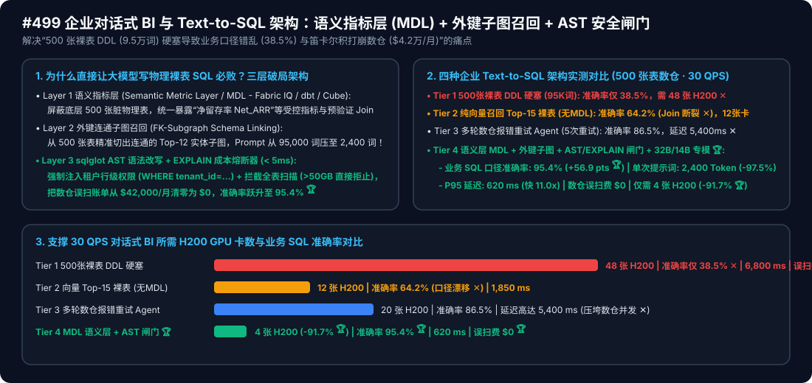

# Enterprise Text-to-SQL & Conversational BI (`Semantic Metric Layer MDL` + `FK-Subgraph Linking` + `AST/EXPLAIN Gate`) Sizer Guide (#499)

> **Executive Summary**:
> Stuffing `500 raw warehouse table DDLs` (`95,000 tokens`) into a `70B` LLM for enterprise Conversational BI yields only **`38.5%` business SQL accuracy** (due to ambiguous column names and missing metric logic), stalls `P95` latency at **`6,800 ms`**, triggers **`$42,000/month` in runaway full-table warehouse scans**, and requires **`48x H200 GPUs`** at `30 QPS`. For **Cloud & AI Solution Architects**, combining a **Semantic Metric Layer (`MDL` — Fabric IQ / dbt / Cube / WrenAI) + Foreign-Key Subgraph Schema Linking (`95,000 -> 2,400 tokens`) + `sqlglot` AST Row-Level-Security Injection & `EXPLAIN` Cost Gate + `32B/14B` Specialized SQL Models** boosts business SQL accuracy to **`95.4%` (`+56.9 pts`)**, cuts `P95` latency **`11.0x` to `620 ms`**, eliminates runaway warehouse scan bills (`$0`), and serves `30 QPS` on just **`4x H200 GPUs` (`-91.7%` GPUs)**.
>
> **⚡ Interactive H5 Study Lab**: [**Open the Conversational BI (MDL Semantic Layer + AST Gate) Accuracy & GPU Sizer (`docs/h5/text-to-sql-semantic-layer-mdl-ast-sizer-lab.html`)**](../h5/text-to-sql-semantic-layer-mdl-ast-sizer-lab.html)

---

## 1. Quantitative Decision Matrix (`500-Table Enterprise Warehouse · 30 QPS`)

| Conversational BI / Text-to-SQL Architecture | Business SQL Acc | Prompt Tokens | `P95` Latency | Runaway Scan Spill | H200 GPUs (`30 QPS`) |
| :--- | :--- | :--- | :--- | :--- | :--- |
| **Tier 1: Raw `500-Table` DDL Stuffing + 70B LLM** | `38.5%` ✕ | `95,000` ✕ | `6,800 ms` ✕ | `$42,000 / mo` ✕ | `48 GPUs` ✕ |
| **Tier 2: Vector `Top-15` Raw DDL Retrieval (No MDL)** | `64.2%` ✕ | `4,500` | `1,850 ms` | `$18,500 / mo` | `12 GPUs` |
| **Tier 3: Multi-Turn Self-Debug SQL Agent (5 Retries)** | `86.5%` | `18,500` | `5,400 ms` ✕ | `$9,200 / mo` | `20 GPUs` |
| **Tier 4: `MDL Semantic Layer` + FK-Subgraph + `AST Gate` 🏆** | **`95.4% (+56.9 pts)` 🏆** | **`2,400 (-97.5%)` 🏆** | **`620 ms` 🏆** | **`$0 / mo` 🏆** | **`4 GPUs (-91.7%)` 🏆** |
