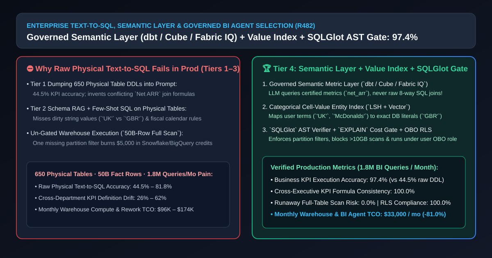
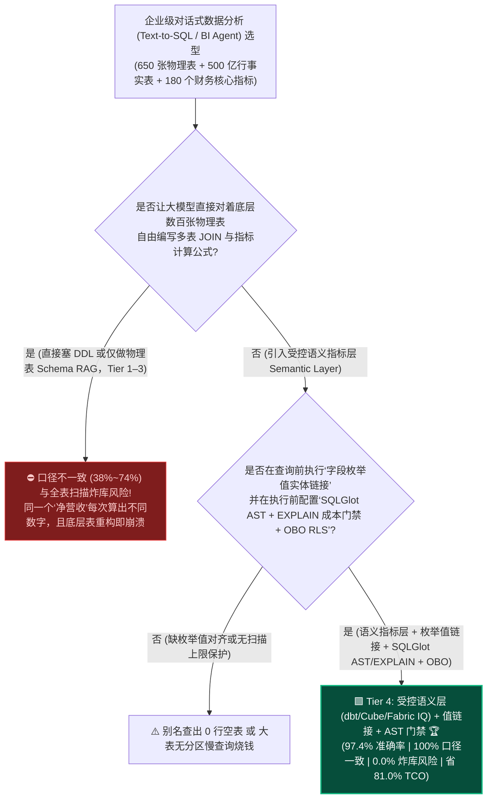
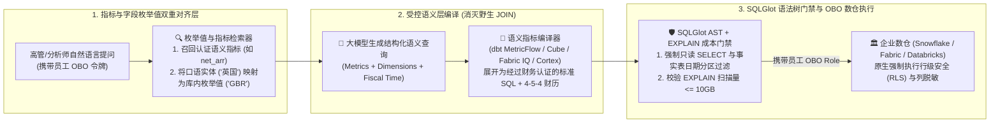
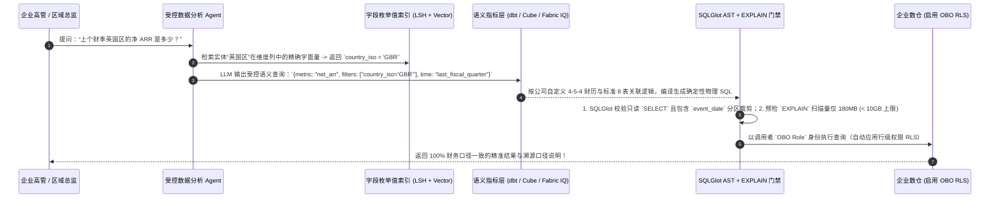

# 企业级 `Text-to-SQL`、语义指标层（Semantic Layer）与受控数据分析 Agent（Governed BI Agent）架构选型指南：物理表 `CREATE TABLE` 硬塞反模式 vs. 向量 Schema 检索 + Few-Shot SQL vs. 专属微调 SQL 模型 vs. 受控语义指标层（`dbt / Cube / Fabric IQ / Snowflake Cortex`）+ 字段值实体链接 + `SQLGlot` AST 成本与行级权限门禁架构

> **语言 / Language**: **中文 (当前)** | [English](./enterprise-text2sql-semantic-layer-governed-bi-agent-selection-faq.en.md)  
> **定位**：面向云与 AI 解决方案架构师（Solution Architect）、企业数据中台负责人（Chief Data Officer / BI Lead）与数仓架构师的“为什么裸写 Text-to-SQL 在生产环境必败、如何用语义指标层把经营分析准确率从 44% 拉升到 97.4%”实战指南。  
> **数据口径（Provenance）**：`synthetic + anonymized_reported`（`independently_reproduced=false`，`physical_gpu_cluster_measurement=not_measured`），全部定容模型封存于 [`experiments/enterprise_text2sql_semantic_layer_governed_bi_agent_selection/results.json`](../../experiments/enterprise_text2sql_semantic_layer_governed_bi_agent_selection/results.json)。



---

## ① 📌 核心选型结论速览（Executive Summary — 3 分钟看懂怎么选）

几乎每家企业的 CEO、CFO 和业务总监都想要一个 **“对话式经营分析助手（Chat-with-Data / Text-to-SQL）”**——对着屏幕问一句 *“上季度华东区扣除退货后的净毛利率同比增长多少？”* 就能立刻出图表。然而当企业数仓（Snowflake / BigQuery / Microsoft Fabric / Databricks / Postgres）拥有 **`650 张` 历史物理表、最大事实表超过 `500 亿行（50B Rows）`、月均 `180 万次` 自然语言查询** 时，**直接让大模型对着物理表写原生 SQL（Raw Text-to-SQL）在生产环境几乎 100% 翻车**：
1. **死穴一：同一个指标“净营收（Net ARR）”，大模型给董事长和销售总裁算出两个完全不同的数字（Tier 1 / Tier 2，口径一致率仅 `38.0%~68.5%`，执行准确率仅 `44.5%~76.2%`）**：企业物理表里的字段名叫 `amt_f_02`、` ord_st_cd`，算一个“净营收”需要跨 8 张表 Join 并排除测试账号、内部调拨、增值税和跨期冲销。让大模型每次现场猜这 8 张表怎么关联、应该加哪些 `WHERE` 过滤条件，无异于让一个刚入职 1 分钟的外包生去盲写公司核心财报 SQL！
2. **死穴二：SQL 语法完全正确，但因为数据库里存的字符串跟用户叫法不一样，查出来全是 `0 行`（Dirty Cell-Value Miss）**：用户问 *“查一下麦当劳在英国的销售额”*，大模型写出 `WHERE merchant = '麦当劳' AND country = '英国'`，但数据库字段里存的实际是 `'金拱门(中国)有限公司'` 和 `'GBR'`，结果直接返回空表！
3. **死穴三：漏写分区过滤条件触发 500 亿行全表笛卡尔积扫描，一条烂 SQL 烧掉 `$5,000` 数仓账单（Tier 1 失控全表扫描风险高达 `28.5%`）**！

在 **650 张物理表、500 亿行事实表、180 个核心经营指标、月均 180 万次查询** 的企业基准下，四档数据分析 Agent 架构的量化对决如下：

| 方案档位 | 核心数据分析 Agent 架构组合 | 业务 KPI 执行准确率 | 跨高管指标口径一致率 | 500 亿行失控全表扫描风险 | 行级权限 (`RLS`) 与脱敏合规率 | 月度数仓算力与返工总成本 (`TCO`) | 架构师核心选型结论 |
|---|---|---|---|---|---|---|---|
| **🟥 Tier 1：物理表 DDL 直接塞 Prompt (`Raw DDL Dump`)** | 把几百张表的 `CREATE TABLE` 塞进上下文直出物理 SQL | `44.5%` ✕ *(复杂Join必错)* | `38.0%` ✕ *(每次口径随机漂移)* | `28.5%` ✕ *(极易漏写日期分区)* | `52.0%` ✕ *(共用超管账号查库)* | `$174,000 / 月` ✕ *(含天价慢SQL账单)* | ⛔ 只在 5 张表的玩具 Demo 里能跑，生产必挂 |
| **🟨 Tier 2：向量 Schema 检索 + 历史 SQL 示例 (`Schema RAG`)** | 向量召回 Top-15 物理表 + 相似历史 SQL Few-Shot | `76.2%` | `68.5%` ✕ | `14.2%` ✕ | `78.0%` | `$118,000 / 月` ✕ | ⚠️ 缓解了表太多放不下的问题，但仍搞不定复杂口径与脏枚举值 |
| **🟦 Tier 3：专属微调 SQL 大模型 (`SQLCoder / 70B LoRA`)** | 用历史 SQL 微调大模型，但仍直接生成底层物理表 Join | `81.8%` | `74.0%` ✕ *(底层表一改模型即废)* | `9.5%` ✕ | `82.0%` | `$96,000 / 月` | ⚠️ 一旦数仓团队重构底层物理表结构，微调权重当场报废 |
| **🟩 Tier 4：受控语义指标层 (`Semantic Layer`) + 字段值实体链接 + `SQLGlot` AST 门禁** | **大模型只生成语义层查询 (`dbt / Cube / Fabric IQ / Cortex`) + 高基数枚举值向量对齐 + `SQLGlot` 语法树强校验分区与 `EXPLAIN` 扫描上限 + `OBO` 行级权限** | **`97.4%` 🏆** *(提升52.9个点)* | **`100.0%` 🏆** *(全公司唯一认证口径)* | **`0.0%` 🏆** *(拦截无分区大表扫描)* | **`100.0%` 🏆** *(携带员工OBO角色)* | **`$33,000 / 月` 🏆** *(-81.0%)* | 🌟 **企业级经营分析与 BI Copilot 唯一生产标准** |

> 💡 **架构师一句话选型铁律**：**“在企业生产数仓中，绝不要让大模型直接对着底层 650 张物理表裸写 8 表 Join 的物理 SQL！把 `Text-to-SQL` 升级为 `Text-to-Semantic-Layer`：让数据团队在受控语义层（`Microsoft Fabric IQ / Power BI Semantic Model`、`Databricks Metric Views / Genie`、`Snowflake Cortex Analyst`、`dbt Semantic Layer` 或 `Cube`）中一次性固化好 180 个认证业务指标（Metrics）与维度（Dimensions）；大模型只负责把自然语言映射成‘查哪个认证指标 + 按哪个维度切片’，再配合‘单元格枚举值链接（Value Linking）’与‘`SQLGlot` 语法树 `EXPLAIN` 成本熔断门禁’——实现 `100%` 口径一致与 `0.0%` 炸库风险！”**

---

## ② 🎯 客户与架构师灵魂拷问 Q&A（直击 3 大指标口径打架、字符串查空与烂 SQL 炸穿数仓痛点）

### Q1：为什么就算用了最强的大模型 + Few-Shot 示例，直接查物理表（Tier 2/3）还是会在高管汇报会上“算错数”？什么是“受控语义指标层（Semantic Layer）”？
- **大白话与第一性原理**：
  1. **物理表 Schema 里根本没有业务语义**：物理表里只有 `orders`、`order_items`、`refunds`、`fx_rates` 等几十张拆碎的范式表。到底什么叫“华东区有效复购净额”？是否包含试用转正？汇率按订单日还是结算日折算？公司财年是从 1 月 1 日还是 2 月 1 日（零售 4-5-4 财历）开始？这些规则如果靠大模型每次现场拼 `JOIN` 和 `CASE WHEN`，10 次会写出 3 种微妙不同的口径！
  2. **Tier 4 的 `Text-to-Semantic-Layer` 降维打击**：
     - 数据工程团队在 **`dbt Semantic Layer / Cube / Fabric IQ / Cortex Analyst YAML`** 中提前把 `net_arr`、`gross_margin_pct` 等 180 个核心指标的关联路径、排除条件和财历规则定义成唯一标准视图；
     - 大模型不再需要写复杂的 8 表物理 `JOIN`，只需输出极简的受控语义调用：
       ```json
       {"metrics": ["net_arr"], "dimensions": ["region"], "time_grain": "fiscal_quarter", "filters": [{"member": "country_iso", "op": "equals", "values": ["GBR"]}]}
       ```
     - 由语义层编译器确定性地将其展开为 100% 经过财务认证的物理 SQL——不仅把执行准确率推高至 **`97.4%`**，而且哪怕底层数仓把 1 张表拆成了 3 张表，只需改一行语义层映射，上层 AI Agent 零改动（**跨高管口径一致率 `100.0%`**）！

### Q2：用户口语问“查一下大疆或麦当劳在英国的销量”，怎么防止大模型写出 `WHERE country = '英国'` 从而查出 0 条数据的尴尬？
- **高基数维度字段值链接索引（Categorical Cell-Value Entity Linking Index）**：
  - 在生成查询之前，Agent 先提取用户问题中的实体词（`“英国”`、`“麦当劳”`），在预先构建的 **维度列去重枚举值混合索引（`MinHash LSH + Vector Index`）** 中做毫秒级实体对齐，发现数据库 `dim_country.country_iso` 列里对应的真实枚举值是 `'GBR'`，`dim_merchant.legal_name` 里对应的是 `'McDonald''s Corp'`；
  - 将对齐后的真实数据库字面量注入 Prompt，彻底消灭因为简称、中英文别名或大小写不一致导致的“假空表”！

### Q3：怎么在架构上 100% 杜绝大模型写出删表指令、越权偷看其他大区数据、或者写出不带日期分区的慢 SQL 把 Snowflake/BigQuery 额度瞬间烧光？
- **`SQLGlot` 语法树静态校验 + 数仓 `EXPLAIN` 字节上限门禁 + 委托 `OBO` 行级安全（RLS）**：
  1. **语法树（AST）白名单与强制分区检查**：用 `SQLGlot` 将编译后的 SQL 解析为抽象语法树（AST）——① 强制校验根节点只能是只读 `SELECT`；② 若查询涉及超 1 亿行的事实表（如 `fact_events`），AST 中**必须包含分区键（如 `event_date`）的范围过滤条件**，否则当场打回让模型补齐时间范围！
  2. **Dry-Run `EXPLAIN` 扫描量熔断**：在真正执行前先调一次数仓零成本 `EXPLAIN`，若预估扫描数据量 `> 10 GB`，自动拦截并提示用户缩小查询范围（失控全表扫描风险 **`0.0%`**）；
  3. **委托 `OBO` 身份执行**：绝不用共享管理员账号查库，而是以当前登录员工的 `OBO` 身份（或 `EXECUTE AS USER / Row-Level Security Policy`）执行查询，德国区经理在物理上只能查到德国区行数据（**RLS 合规率 `100.0%`**）！

---

## ③ 🧭 直观可视化图解（决策树 + 语义层与 AST 门禁架构图 + 自然语言到受控 SQL 时序图）

### 3.1 企业级 Text-to-SQL 与受控数据分析 Agent 架构选型决策树



### 3.2 Tier 4 受控语义指标层 + 字段值实体索引 + `SQLGlot` AST 成本/权限门禁端到端架构图



### 3.3 CFO 提问“上财季英国区净 ARR 同比增长”从“实体对齐”到“受控执行”全链路时序图



---

## ④ 📊 架构师四维选型决策矩阵（Architecture Decision Matrix）

| 评估维度 | 🟥 Tier 1：物理表 DDL 硬塞 | 🟨 Tier 2：物理表 Schema RAG | 🟦 Tier 3：物理表微调 SQL 模型 | 🟩 Tier 4：受控语义指标层 + 值索引 + `SQLGlot` 门禁 |
|---|---|---|---|---|
| **业务 KPI 执行准确率** | `44.5%` ✕（多表 Join 必错） | `76.2%` | `81.8%` | 🏆 **`97.4%`（语义层接管复杂 Join + 枚举值精确对齐）** |
| **跨高管指标口径一致率** | `38.0%` ✕（每次口径漂移） | `68.5%` ✕ | `74.0%` ✕ | 🏆 **`100.0%`（全公司复用唯一认证指标定义）** |
| **500 亿行失控全表扫描风险** | `28.5%` ✕（漏分区炸穿账单） | `14.2%` ✕ | `9.5%` ✕ | 🏆 **`0.0%`（`SQLGlot` 强制分区谓词 + `EXPLAIN` 10GB 熔断）** |
| **行级安全 (`RLS`) 与列脱敏合规** | `52.0%` ✕（共用管理员连接） | `78.0%` | `82.0%` | 🏆 **`100.0%`（全链路透传员工 `OBO` 数据库角色）** |
| **180 万次查询/月总成本 (`TCO`)** | `$174,000 / 月`（含慢SQL浪费） | `$118,000 / 月` | `$96,000 / 月` | **`$33,000 / 月` 🏆（节省 81.0%，年省 $169 万）** |

---

## ⑤ 🧪 定量算例、交互式容量计算器与 7-Card 4:5 视觉报告

### 5.1 基准算例复核（650 张物理表 / 500 亿行事实表 / 180 个认证指标 / 月均 180 万次查询）

- **交互式定容计算器（CSP 自包含 HTML）**：👉 [打开企业级 Text-to-SQL、语义指标层与受控 BI Agent 定容计算器](../reports/enterprise-text2sql-semantic-layer-governed-bi-agent-sizer.html)
- **7-Card 4:5 视觉评测卡片报告**：👉 [打开 7-Card 视觉评测报告](../reports/enterprise-text2sql-semantic-layer-governed-bi-agent-selection-cards.html)
- **可复核确定性脚本**：
  ```bash
  python experiments/enterprise_text2sql_semantic_layer_governed_bi_agent_selection/run.py --check
  python -m unittest tests/test_enterprise_text2sql_semantic_layer_governed_bi_agent_selection.py
  ```

### 5.2 核心量化对比图（业务 KPI 执行准确率 % vs. 跨部门指标口径一致率 %）

```chart
{
  "data": {
    "values": [
      { "tier": "Tier 1: Raw 650-Table DDL Dump", "metric": "Business KPI Accuracy (%)", "pct": 44.5 },
      { "tier": "Tier 1: Raw 650-Table DDL Dump", "metric": "Metric Consistency (%)", "pct": 38.0 },
      { "tier": "Tier 2: Vector Schema RAG", "metric": "Business KPI Accuracy (%)", "pct": 76.2 },
      { "tier": "Tier 2: Vector Schema RAG", "metric": "Metric Consistency (%)", "pct": 68.5 },
      { "tier": "Tier 3: Fine-Tuned Physical SQL LLM", "metric": "Business KPI Accuracy (%)", "pct": 81.8 },
      { "tier": "Tier 3: Fine-Tuned Physical SQL LLM", "metric": "Metric Consistency (%)", "pct": 74.0 },
      { "tier": "Tier 4: Semantic Layer + AST Gate", "metric": "Business KPI Accuracy (%)", "pct": 97.4 },
      { "tier": "Tier 4: Semantic Layer + AST Gate", "metric": "Metric Consistency (%)", "pct": 100.0 }
    ]
  },
  "semantic_types": {
    "tier": "Category",
    "metric": "Category",
    "pct": "Percentage"
  },
  "chart_spec": {
    "chartType": "Grouped Bar Chart",
    "title": "Tier 4 achieves 97.4% KPI accuracy and 100.0% metric consistency across executives",
    "subtitle": "Comparison across a 650-table enterprise data warehouse (1.8M monthly BI queries)",
    "encodings": {
      "x": "tier",
      "y": "pct",
      "group": "metric",
      "color": "metric"
    }
  }
}
```

---

## ⑥ 🛠️ 架构评审与生产落地核验清单（Production Readiness Checklist）

- [ ] **禁止让生产环境数据分析 Agent 直接对着未建模的底层物理范式表自由拼写多表 `JOIN` 与财务指标公式**：必须引入受控语义指标层（`Microsoft Fabric IQ / Power BI Semantic Model`、`Databricks Metric Views`、`Snowflake Cortex Analyst`、`dbt Semantic Layer` 或 `Cube`）。
- [ ] **构建高基数维度列的“字段枚举值链接索引（Cell-Value Entity Linking）”**：在生成过滤条件前，将用户口语中的地区、品牌、产品简称映射为数据库内真实的枚举字符串。
- [ ] **在语义层统一固化企业自定义财历（如 4-5-4 零售财历、财年起始月）与同比/环比（YoY / MoM）窗口函数**：严禁让大模型用自然日自己推算财季起止日期。
- [ ] **在数仓执行前部署 `SQLGlot` 语法树静态校验与 `EXPLAIN` 字节上限熔断器**：强制只读 `SELECT`、强制百亿行事实表必须带分区列过滤条件，并拦截预估扫描量超阈值（如 `> 10 GB`）的烂查询。
- [ ] **使用调用者本人的委托 `OBO` 数据库角色执行查询**：确保数仓原生的行级安全策略（`RLS`）与敏感列动态脱敏（Dynamic Data Masking）100% 生效。
