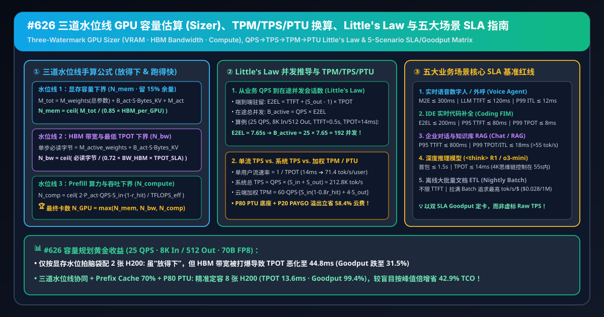

# Enterprise LLM GPU Capacity Sizing (`Three-Watermark Sizer`), `TPM / TPS / Cloud PTU` Exact Conversion, `Little's Law` In-Flight Concurrency & 5-Scenario (`Voice / Coding FIM / Chat RAG / Reasoning / Batch`) `TTFT·TPOT·ITL·E2EL·Goodput` Playbook (`#626`)

> **Language / 语言**: [简体中文](./enterprise-three-watermark-gpu-sizer-tpm-tps-ptu-littles-law-faq.md) | **English** · [📱 Interactive H5 Study Lab (with 3-Watermark Waterfall + Little's Law Calculator)](../h5/three-watermark-gpu-sizer-tpm-tps-ptu-littles-law-lab.html) · [🧮 Interactive Sizer](../reports/enterprise-three-watermark-gpu-sizer-tpm-tps-ptu-littles-law-sizer.html) · [🃏 7-Card Visual Report](../reports/enterprise-three-watermark-gpu-sizer-tpm-tps-ptu-littles-law-cards.html) · [Back to Catalog](../full-catalog-en.md)

---

## 1. 3-Minute Executive Summary

1. **Bottom-Line Recommendation**:
   - Sizing an enterprise LLM cluster solely by checking whether weights fit in GPU HBM (**Watermark 1 only**) is the single most common cause of production SLA failures: fitting `70B FP8` + `192` concurrent sessions onto `2× H200 GPUs` causes HBM bandwidth saturation that pushes `P99 TPOT` to **`45.1 ms`** and collapses SLA-compliant **`Goodput` to `31.5%`**. Conversely, naive peak over-provisioning without accounting for `Prefix Caching` wastes **`42.9%`** of GPUs (`14× H200`).
   - Solution Architects must size clusters using the **Three-Watermark Formula** paired with **Little's Law**:
     $$N_{\text{GPU}} = \max\left(N_{\text{mem}},\ N_{\text{bw}},\ N_{\text{compute}}\right)$$
     where active concurrency is $B_{\text{active}} = \lceil \text{QPS} \times [\text{TTFT} + (S_{\text{out}} - 1)\cdot\text{TPOT}] \rceil$. For `25 QPS (8,192 In / 512 Out · 70% Prefix Cache)`, this sizes exactly **`8× H200 GPUs` (`P99 TPOT = 13.6 ms`, `99.4% Goodput`, `$0.092 / 1M compliant tokens`, saving `42.9%` vs. uncached peak sizing)**!

---

## 2. Three-Watermark + Little's Law + TPM/TPS/PTU Formulas

1. **Step 0 — Little's Law Active Batch Size ($B_{\text{active}}$)**:
   $$\text{E2EL} = \text{TTFT} + (S_{\text{out}} - 1)\times\text{TPOT}, \qquad B_{\text{active}} = \lceil \text{QPS} \times \text{E2EL} \rceil$$
   - Worked example (`25 QPS, TTFT = 0.50s, OSL = 512, TPOT = 14ms`): $\text{E2EL} = 7.65\text{ s} \implies B_{\text{active}} = \mathbf{192\text{ concurrent requests}}$.
2. **Watermark ① — HBM Capacity Lower Bound ($N_{\text{mem}}$, with `15%` runtime headroom)**:
   $$N_{\text{mem}} = \left\lceil \frac{M_{\text{weights}}(\text{total}) + B_{\text{active}}\cdot S_{\text{ctx}}\cdot\text{Bytes}_{\text{KV/tok}} + M_{\text{act+graph}}}{0.85 \times M_{\text{HBM}}} \right\rceil$$
3. **Watermark ② — HBM Bandwidth & `TPOT` Lower Bound ($N_{\text{bw}}$)**:
   $$N_{\text{bw}} = \left\lceil \frac{M_{\text{weights}}(\text{active}) + B_{\text{active}}\cdot S_{\text{ctx}}\cdot\text{Bytes}_{\text{KV/tok}}}{\eta_{\text{bw}} \cdot \text{BW}_{\text{HBM}} \cdot \text{TPOT}_{\text{SLA}}} \right\rceil$$
4. **Watermark ③ — Prefill Compute & `TTFT` Lower Bound ($N_{\text{compute}}$)**:
   $$N_{\text{compute}} = \left\lceil \frac{2 \cdot P_{\text{active}} \cdot \text{QPS} \cdot S_{\text{in}} \cdot (1 - r_{\text{cache}})}{\eta_{\text{MFU}} \cdot \text{TFLOPS}_{\text{GPU}}} \right\rceil$$
5. **Single-Stream TPS vs. System TPS vs. Cloud Weighted TPM / PTU**:
   - **Single-User Stream TPS**: $1 / \text{TPOT}$ (`13.6 ms` $\implies \mathbf{73.5\text{ tok/s/user}}$).
   - **System Total TPS**: $\text{QPS} \times (S_{\text{in}} + S_{\text{out}}) = 25 \times 8,704 = \mathbf{217,600\text{ tok/s}}$ (`13.06M Raw TPM`).
   - **Cloud PTU Weighted Equivalent TPM**: $60 \cdot \text{QPS} \cdot [S_{\text{in}}(1 - 0.80 r_{\text{cache}}) + 4.0 S_{\text{out}}] = \mathbf{8.48\text{M Weighted TPM}}$ (`-46.1%` PTUs needed via `70%` prefix caching).

---

## 3. Five Enterprise Scenarios SLA & Sizing Benchmark Matrix

| Scenario | Typical `ISL / OSL` | `P95 TTFT` SLA | `P99 ITL / TPOT` SLA | `P95 E2EL` SLA | Primary Bottleneck & SA Lever |
| :--- | :--- | :--- | :--- | :--- | :--- |
| **1. Real-Time Voice Agent** | `1.5K / 80` | **`<= 120 ms`** (`<=300ms` M2E) | **`<= 12 ms`** (`>83 tok/s`) | First audio `<= 300ms` | HBM bandwidth → Dedicated Decode pool + 4-tok TTS |
| **2. IDE Coding FIM** | `2K / 48` | **`<= 80 ms`** | **`<= 8 ms`** (`>125 tok/s`) | **`<= 200 ms`** | Latency → 250ms debounce + `7B/14B FP8 + EAGLE-3` |
| **3. Enterprise Chat / RAG** | `8K–16K / 512` | **`<= 800 ms`** | **`<= 18 ms`** (`>55 tok/s`) | `<= 8.5 s` | Prefill FLOPS & KV → PD Disagg + `70%` Prefix Cache |
| **4. Deep Reasoning (`<think>`)** | `2K / 4,096` | `<= 1,500 ms` | **`<= 14 ms`** (`>70 tok/s`) | `<= 58 s` | Long `E2EL` KV residency → `<think>` budget router + MTP |
| **5. Nightly Batch ETL** | `4K / 512` | Relaxed (`<= 30s`) | Relaxed (`<= 80ms`) | Batch window | Cost (`$/1M`) → Radix prefix sorting + tidal GPU backfill |

---

## 4. Pre-Production Sizing Checklist

- [ ] **1. Always Evaluate All Three Watermarks**: Never size by VRAM capacity alone; check HBM bandwidth against `TPOT` and Tensor FLOPS against `TTFT`.
- [ ] **2. Size Active KV by Little's Law (`QPS × E2EL`)**: Account for multi-second reasoning residency inflation on active batch size $B_{\text{active}}$.
- [ ] **3. Gate Acceptance on Dual-SLO `Goodput` (`P95 TTFT` + `P99 ITL`)**: Measure per-step `ITL` percentiles rather than request-averaged `TPOT` alone.
