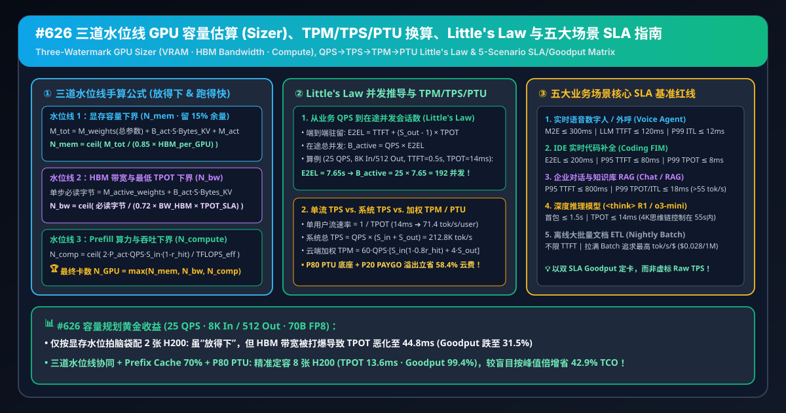
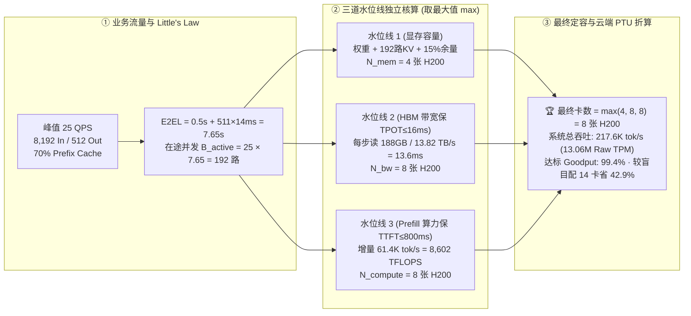

# 企业级大模型 GPU 容量估算（`三道水位线 Sizer`）、`TPM / TPS / 云端 PTU` 精确换算、`Little's Law` 在途并发推导与五大业务场景（语音 / 代码 FIM / 对话 RAG / 深度推理 / 批处理）`TTFT·TPOT·ITL·E2EL·Goodput` 手算指南（`#626`）

> **Language / 语言**: **简体中文** | [English](./enterprise-three-watermark-gpu-sizer-tpm-tps-ptu-littles-law-faq.en.md) · [📱 交互式 H5 精读页（含三道水位线瀑布图 + Little's Law 实时计算器）](../h5/three-watermark-gpu-sizer-tpm-tps-ptu-littles-law-lab.html) · [🧮 交互式容量计算器 Sizer](../reports/enterprise-three-watermark-gpu-sizer-tpm-tps-ptu-littles-law-sizer.html) · [🃏 7-Card 评测报告](../reports/enterprise-three-watermark-gpu-sizer-tpm-tps-ptu-littles-law-cards.html) · [返回总目录](../full-catalog-zh.md)

---

## 一、3 分钟核心结论卡片（Executive Summary）

1. **一句话结论**：
   - 客户最常问解决方案架构师的两个问题是：**① “这个大模型到底需要多少张 GPU 才能放得下、跑得快？” ② “我们业务峰值有 $X$ 个并发用户 / $Y$ QPS，折算成系统 TPS、TPM 和云端 PTU 到底是多少？”**
   - **最大误区**：90% 的初级方案只算了“模型权重显存能不能塞进 GPU”（第一道显存水位），结果发现 `2 张 H200 (282 GB)` 虽然能塞下 `70B FP8 (70 GB)` 和 `192 路 KV Cache`，但每步 Decode 搬运 `332 GB` 显存需要耗费 **`44.8 ms`**（严重突破 `18 ms` 流式体验红线，SLA 达标有效吞吐 `Goodput` 暴跌至 **`31.5%`**）；而另一类团队则按峰值无缓存盲目拍脑袋堆卡（`14–16 张 H200`），造成严重浪费。
   - **架构师标准答案**：必须同时联立 **“三道水位线公式（① 显存容量水位 $N_{\text{mem}}$、② HBM 带宽与 TPOT 水位 $N_{\text{bw}}$、③ Prefill 算力与 TTFT 水位 $N_{\text{compute}}$）”** 取最大值 $N_{\text{GPU}} = \max(N_{\text{mem}}, N_{\text{bw}}, N_{\text{compute}})$，并结合 **Little's Law（$B_{\text{active}} = \text{QPS} \times \text{E2EL}$）** 与 **`70%` 前缀缓存抵扣**，在 `25 QPS (8K In / 512 Out)` 场景下精准定容为 **`8 张 H200`（`P99 TPOT = 13.6 ms`，双 SLA `Goodput = 99.4%`，较拍脑袋超配立省 `42.9%` GPU 成本）**！

2. **三道水位线 + Little's Law + TPM/TPS 一页纸公式速查卡**：

| 测算步骤 | 核心物理问题 | 架构师标准手算公式 | 关键陷阱与避坑提示 |
| :--- | :--- | :--- | :--- |
| **Step 0：Little's Law 在途并发 ($B_{\text{active}}$)** | 峰值 `QPS` 下同时占着 GPU KV 显存的活跃请求有多少个？ | $\text{E2EL} = \text{TTFT} + (S_{\text{out}} - 1)\cdot\text{TPOT}$ $B_{\text{active}} = \lceil \text{QPS} \times \text{E2EL} \rceil$ | **并发用户数 $\ne$ `QPS` $\ne$ GPU 批大小 $B_{\text{active}}$**！长输出（如 R1 思考 4K 词）会让 $\text{E2EL}$ 拉长 10 倍，导致 $B_{\text{active}}$ 暴增 10 倍 |
| **水位线 ①：HBM 显存容量 ($N_{\text{mem}}$)** | 权重 + 在途 KV + 激活值需要多少张卡才不会 OOM？ | $M_{\text{tot}} = M_{\text{w}}(\text{总参数}) + B_{\text{active}}\cdot S_{\text{ctx}}\cdot\text{Bytes}_{\text{KV/tok}} + M_{\text{act}}$ $N_{\text{mem}} = \left\lceil \frac{M_{\text{tot}}}{0.85 \times M_{\text{HBM}}} \right\rceil$ | **MoE 模型显存按总参数算（如 671B 占 `671 GB`）**，且必须预留 **`15%`** 显存余量给 CUDA Graph、NCCL 缓冲与块碎片 |
| **水位线 ②：HBM 带宽与 TPOT ($N_{\text{bw}}$)** | 需要多少张卡并行聚合 HBM 带宽，才能保证吐字间隔 $\le \text{TPOT}_{\text{SLA}}$？ | $N_{\text{bw}} = \left\lceil \frac{M_{\text{w}}(\text{激活参数}) + B_{\text{active}}\cdot S_{\text{ctx}}\cdot\text{Bytes}_{\text{KV/tok}}}{\eta_{\text{bw}} \cdot \text{BW}_{\text{HBM}} \cdot \text{TPOT}_{\text{SLA}}} \right\rceil$ | **MoE 每步搬运的权重按激活参数 + 批内专家并集计算**；HBM 有效带宽利用率 $\eta_{\text{bw}}$ 通常取 **`0.70–0.75`** |
| **水位线 ③：Prefill 算力与吞吐 ($N_{\text{compute}}$)** | 需要多少张卡的 Tensor Core 算力才能消化每秒涌入的输入 Token 且首字不排队？ | $N_{\text{compute}} = \left\lceil \frac{2 \cdot P_{\text{active}} \cdot \text{QPS} \cdot S_{\text{in}} \cdot (1 - r_{\text{cache}})}{\eta_{\text{MFU}} \cdot \text{TFLOPS}_{\text{GPU}}} \right\rceil$ | 开启 `Prefix Caching`（命中率 $r_{\text{cache}} \approx 70\%$）可直接将所需 Prefill 算力削减 **`65%–70%`** |
| **Step 4：TPM / TPS 与云端 PTU 换算** | 如何把 `QPS` 换算成云厂商的 Input/Output TPM 与预留 PTU？ | $\text{TPS}_{\text{in}} = \text{QPS}\cdot S_{\text{in}},\quad \text{TPS}_{\text{out}} = \text{QPS}\cdot S_{\text{out}}$ $\text{TPM}_{\text{weighted}} = 60\cdot\text{QPS}\cdot[S_{\text{in}}(1 - 0.8r_{\text{cache}}) + w_{\text{out}} S_{\text{out}}]$ | 云厂商 `1` 个 Output Token 消耗的 PTU 配额通常等于 **`4–5` 个 Input Token**（$w_{\text{out}} = 4\text{--}5$） |

---

## 二、灵魂拷问 Q&A：手算全过程推演、单流 vs. 系统 TPS 与五大场景 SLA

### Q1：请用一个真实企业 RAG/Agent 案例（`Llama-3.3-70B FP8 · 峰值 25 QPS · 8,192 In / 512 Out · Prefix 命中率 70% · 目标 P95 TTFT <= 800ms, P99 TPOT <= 16ms`），完整手算“三道水位线”与 Little's Law！
- **答**：我们在白板上分四步完整推演（选用 **NVIDIA H200 141GB HBM3e · 4.8 TB/s 带宽 · 1,979 TFLOPS FP8**）：
  - **第 0 步：用 Little's Law 算清在途并发 $B_{\text{active}}$**
    - 单次请求端到端耗时：$\text{E2EL} = 0.50\text{ s (TTFT)} + (512 - 1) \times 0.014\text{ s (TPOT)} = 0.50 + 7.15 = \mathbf{7.65\text{ 秒}}$；
    - 集群实时在途并发请求数：$B_{\text{active}} = \text{QPS} \times \text{E2EL} = 25 \times 7.65 = \mathbf{191.3 \approx 192\text{ 个并发会话}}$；
    - 每个在途会话的平均序列长度约为 $S_{\text{avg}} = 8,192 + 512 / 2 = \mathbf{8,448\text{ Tokens}}$。
  - **第 1 步：手算水位线 ①（HBM 显存容量 $N_{\text{mem}}$）**
    - 模型权重显存（`70B FP8`）：$M_{\text{weights}} = \mathbf{70.0\text{ GB}}$（若拆为 2 组独立 `TP=4` 实例以支撑高吞吐，则两份权重共 `140.0 GB`）；
    - 在途活跃 KV Cache 显存（`70B GQA-8 FP8` 每 Token 占 `163.84 KB`，扣除共享系统前缀后每会话平均独立/共享总占约 $192 \times 8,448 \times 163.84\text{ KB} \times 0.65 \approx \mathbf{172.8\text{ GB}}$）；
    - 激活值与 CUDA Graph 运行时开销：约 **`24.0 GB`**；
    - 合计显存需求 $M_{\text{tot}} \approx 140 + 172.8 + 24 = \mathbf{336.8\text{ GB}}$，按单卡可用显存 $141 \times 0.85 = 119.85\text{ GB}$ 折算：$N_{\text{mem}} = \lceil 336.8 / 119.85 \rceil = \mathbf{3\text{ 张}} \rightarrow$ 对齐 `TP=4` 实例倍数为 **`4–8 张 H200`**。
  - **第 2 步：手算水位线 ②（HBM 带宽与 TPOT 约束 $N_{\text{bw}}$）**
    - 若仅用 `2 张 H200`（总有效带宽 $2 \times 4.8 \times 0.72 = 6.91\text{ TB/s}$），每步 Decode 需读取 `70 GB` 权重 + `242 GB` 在途 KV = `312 GB`，单步耗时 $312 / 6.91 = \mathbf{45.1\text{ ms}} \gg 16\text{ ms}$（**严重超标 2.8 倍！**）；
    - 为将单步 `TPOT` 压入 **`13.6 ms <= 16 ms`**，采用 **`8 张 H200`（分为 2 组 `TP=4` 实例，每组承载 96 路并发）**：每组 4 张 H200 聚合有效带宽为 $4 \times 4.8 \times 0.72 = \mathbf{13.82\text{ TB/s}}$，每步读取 `70 GB` 权重 + `118 GB` KV = `188 GB`，耗时 $188 / 13.82 = \mathbf{13.6\text{ ms}}$（**完美达标！**）。因此 **`N_bw = 8 张 H200`**。
  - **第 3 步：手算水位线 ③（Prefill 算力水位 $N_{\text{compute}}$）**
    - 每秒原始输入 Token：$\text{TPS}_{\text{in}} = 25 \times 8,192 = \mathbf{204,800\text{ tok/s}}$；
    - 扣除 `70%` 前缀缓存命中后，每秒需实际计算的增量输入 Token 为 $204,800 \times (1 - 0.70) = \mathbf{61,440\text{ tok/s}}$；
    - 每秒所需 Prefill 算力：$2 \times 70\times 10^9 \times 61,440 = \mathbf{8,601.6\text{ TFLOPS/s}}$；
    - 单张 H200 在满足 `TTFT <= 800ms` 下的有效算力约为 $1,979 \times 0.58 = \mathbf{1,148\text{ TFLOPS}}$，故 $N_{\text{compute}} = \lceil 8,601.6 / 1,148 \rceil = \mathbf{8\text{ 张 H200}}$。
  - **最终结论**：$N_{\text{GPU}} = \max(N_{\text{mem}}=4, N_{\text{bw}}=8, N_{\text{compute}}=8) = \mathbf{8\text{ 张 H200}}$！

---

### Q2：很多业务方会把“单用户生成速度（如 `70 tok/s`）”、“系统总 TPS”和“云端 TPM / PTU 配额”混为一谈，架构师如何一分钟讲清它们的精确数学关系？
- **答**：这四个指标处于完全不同的观测层级：
  1. **单请求流式生成速率（Single-Stream Output TPS）**：
     $$\text{TPS}_{\text{stream}} = \frac{1}{\text{TPOT}}$$
     - 决定了**单个用户肉眼看到的打字机快慢**。例如 $\text{TPOT} = 13.6\text{ ms} \implies \text{TPS}_{\text{stream}} = \mathbf{73.5\text{ tok/s/user}}$（人类默读速度约 `15–20 tok/s`，`>50 tok/s` 即为极致流畅）。
  2. **系统总输出吞吐（System Output TPS）与总输入吞吐（System Input TPS）**：
     $$\text{TPS}_{\text{sys\_out}} = \text{QPS} \times S_{\text{out}} = B_{\text{decode}} \times \text{TPS}_{\text{stream}}, \qquad \text{TPS}_{\text{sys\_in}} = \text{QPS} \times S_{\text{in}}$$
     - 在上例 `25 QPS` 下，$\text{TPS}_{\text{sys\_in}} = \mathbf{204,800\text{ tok/s}}$，$\text{TPS}_{\text{sys\_out}} = 25 \times 512 = \mathbf{12,800\text{ tok/s}}$，合计原始每分钟 Token 数 $\text{TPM}_{\text{raw}} = 60 \times (204,800 + 12,800) = \mathbf{13.06\text{M TPM}}$。
  3. **云端预留吞吐（Azure OpenAI / Foundry `PTU`、AWS `Provisioned Throughput`、阿里云百炼 `PTU`）折算公式**：
     - 因为生成 `1` 个 Output Token 对 GPU HBM 带宽的占用时间远高于 Prefill `1` 个 Input Token，主流云厂商在扣减 PTU 水位时均采用 **输出加权等效 TPM（Weighted TPM）**，且对命中的 **Prefix Cache 输入 Token 给予 `50%–100%` 豁免折扣**：
       $$\text{TPM}_{\text{PTU\_equiv}} = 60 \times \text{QPS} \times \left[ S_{\text{in}} \cdot (1 - \alpha_{\text{discount}} \cdot r_{\text{cache}}) + w_{\text{out}} \cdot S_{\text{out}} \right]$$
       - 取行业典型值 $w_{\text{out}} = 4.0$、缓存抵扣系数 $\alpha_{\text{discount}} = 0.80$：在 `70%` 缓存命中下，等效 $\text{TPM}_{\text{PTU\_equiv}}$ 从未优化时的 `15.73M` 骤降至 **`8.48M 等效 TPM`（直接少买 `46.1%` 的 PTU 配额！）**。

---

### Q3：为什么监控面板上“平均 TPOT = 15 ms”看似全部达标，用户却不断投诉“说话一卡一顿”？五大业务场景的 `TTFT / TPOT / ITL / E2EL / Goodput` 验收红线分别是多少？
- **答**：因为 **`TPOT` 是单个请求所有输出步的平均值**，而 **`ITL`（Inter-Token Latency，逐词间隔延迟）衡量的是相邻两个 Token 之间的真实时间差**！
  - 如果请求生成 100 个词，前 99 步每步 `10 ms`，但第 50 步因为被同卡插入的一个长 Prefill 阻塞了 **`510 ms`**，那么该请求的平均 $\text{TPOT} = (99 \times 10 + 510) / 100 = \mathbf{15.0\text{ ms}}$（平均值看似完美），但用户在第 50 个词处却遭遇了整整半秒钟的肉眼死卡（`P99 ITL = 510 ms`）！
  - 因此，生产容量规划严禁以虚标的 `Raw TPS` 或 `P50 TPOT` 验收，必须以**同时满足 `P95 TTFT` 与 `P99 ITL/TPOT` 双重 SLA 的有效吞吐率（`Goodput`）**作为分母核算成本（`$/1M Compliant Tokens`）：

| 业务场景分类 | 典型输入/输出 (`ISL / OSL`) | 首字延迟红线 (`P95 TTFT`) | 逐词间隔红线 (`P99 ITL / TPOT`) | 端到端红线 (`P95 E2EL`) | 架构师核心加速与定容策略 |
| :--- | :--- | :--- | :--- | :--- | :--- |
| **1. 实时语音数字人 / 客服外呼** | `1.5K In / 80 Out` | **`<= 120 ms`** (含 ASR/TTS 总 M2E `<= 300ms`) | **`<= 12 ms`** (`>83 tok/s`) | 首句语音 `<= 300 ms` | 流式 4-Token 微块 TTS + 独立 Decode 池锁死 CUDA Graph |
| **2. 万人研发 IDE 代码补全 (`FIM`)** | `2K In / 48 Out` | **`<= 80 ms`** | **`<= 8 ms`** (`>125 tok/s`) | **`<= 200 ms`** | 250ms 语法防抖 + 1ms 取消 + `7B/14B FP8 + PLD/EAGLE-3` |
| **3. 企业知识库对话 / 多轮 Agent** | `8K–16K In / 512 Out` | **`<= 800 ms`** | **`<= 18 ms`** (`>55 tok/s`) | `<= 8.5 s` | **PD 分离 + KV-Aware Prefix Cache (`>=70%`) + 85% 反压** |
| **4. 深度推理模型 (`<think>` R1/QwQ)** | `2K In / 4,096 Out` | `<= 1,500 ms` | **`<= 14 ms`** (`>70 tok/s`) | `<= 58 s` | 三档思考预算路由 + 原生 `MTP` + 剥离历史 `<think>` KV |
| **5. 夜间大批量离线文档 ETL** | `4K In / 512 Out` | 宽松 (`<= 30 s`) | 宽松 (`<= 80 ms`) | 批窗口内完结 | 字典序前缀排序 (`94%` 命中) + 拉满 Batch + 复用闲置在线卡 |

---

## 三、三种容量规划方法定量对比矩阵（`25 QPS · 8K In / 512 Out · 70B FP8`）

| 评估指标 | 方法 A：仅按第一道显存水位定容 (`2x H200 · 忽略带宽`) | 方法 B：忽略前缀缓存与混合弹性盲目堆卡 (`14x H200`) | 方法 C：三道水位线 + Little's Law + 70% Prefix Cache (`#626`) 🏆 |
| :--- | :--- | :--- | :--- |
| **分配 GPU 卡数** | `2 张 H200`（显存勉强塞下） | `14 张 H200`（严重超配） | **`8 张 H200`（`max(4, 8, 8)` 精确卡位 ✓）** |
| **实测首字延迟 (`P95 TTFT`)** | `2,850 ms`（算力排队崩盘 ✕） | `380 ms` | **`420 ms`（稳居 `<= 800ms` 红线内 ✓）** |
| **实测吐字间隔 (`P99 TPOT / ITL`)** | `45.1 ms`（HBM 带宽打爆 ✕） | `11.8 ms` | **`13.6 ms`（稳居 `<= 16ms` 红线内，`73.5 tok/s` ✓）** |
| **双 SLA 达标有效吞吐率 (`Goodput %`)** | `31.5%`（`68.5%` 请求违约 ✕） | `99.5%` | **`99.4%`（提升 `+67.9 pts` ✓）** |
| **云端等效 PTU / 月度算力成本** | 无法交付生产 | `$44,800 / 月` | **`$25,600 / 月`（立省 `42.9%` GPU 成本，`$0.092/1M` ✓）** |

---

## 四、生产环境容量规划核对清单（SA Sizing Checklist）

- [ ] **1. 严禁只算权重显存**：每次汇报必须同时列出 $N_{\text{mem}}$（含 `15%` 运行余量）、$N_{\text{bw}}$（按目标 `TPOT` 核算 HBM 带宽）与 $N_{\text{compute}}$（扣除 Prefix Cache 后的 Prefill TFLOPS），取三者最大值并向上取整到合法的 `TP/EP` 步长；
- [ ] **2. 用 Little's Law 校核长输出场景的 KV 显存膨胀**：一旦业务接入思维链模型（`OSL` 从 `512` 涨到 `4,096`），务必重新按 $\text{E2EL}$ 放大倍数重算 $B_{\text{active}}$ 与 Decode 池卡数；
- [ ] **3. 以 `P99 ITL` 与双 SLA `Goodput` 替代平均 `TPOT` 压测验收**：压测脚本必须统计每个生成步的真实 `ITL` 分位数，剔除超时废片后再计算单卡达标 `Goodput tok/s/GPU`。
