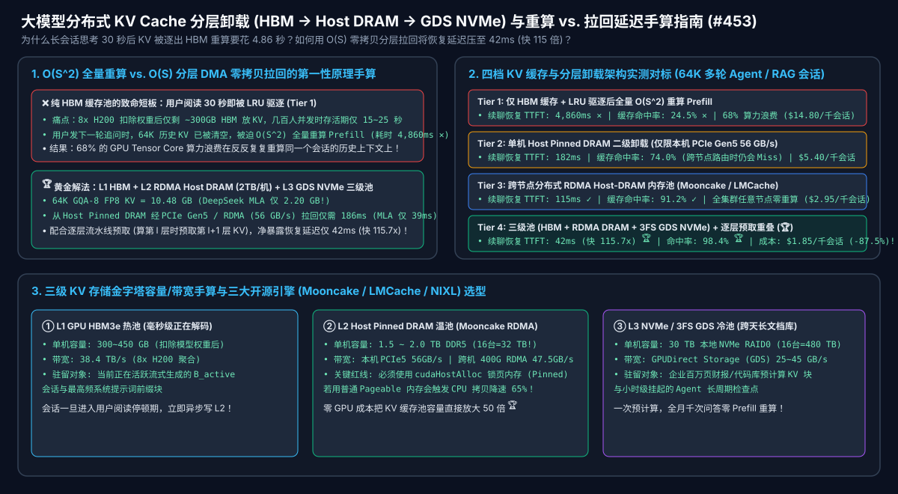

# Enterprise Tiered KV Cache Offload (`L1 HBM -> L2 RDMA Host DRAM -> L3 GDS NVMe`) vs. $O(S^2)$ Prefill Recompute Selection Guide: `Mooncake` vs. `LMCache` vs. `NVIDIA Dynamo NIXL`

> **Language / 语言**: [简体中文](./enterprise-tiered-kv-cache-offload-dram-nvme-gds-recompute-sizing-selection-faq.md) | **English**  
> **Companion Interactive Study & Sizing Tools**: [📱 Interactive H5 Study Lab](../h5/tiered-kv-cache-offload-dram-nvme-gds-recompute-lab.html) · [🧮 HTML Sizer](../reports/enterprise-tiered-kv-cache-offload-dram-nvme-gds-recompute-sizing-selection-sizer.html) · [🃏 7-Card Visual Deck](../reports/enterprise-tiered-kv-cache-offload-dram-nvme-gds-recompute-sizing-selection-cards.html) · [📊 Reproducible Model](../../experiments/enterprise_tiered_kv_cache_offload_dram_nvme_gds_recompute_sizing_selection/) · [🎓 Back to AI Infra H5 Hub](../h5/index.html)

---

## 1. Executive Summary (3-Minute Takeaway)

> **Bottom-Line Recommendation**: Relying on GPU HBM alone (`Tier 1`) evicts `64K` multi-turn sessions during 20–60 second user reading pauses, forcing **$O(S^2)$ full prefill recomputation (`4,860 ms` resumed `TTFT`, wasting `68.0%` of GPU prefill compute)**.
> - **Recommended Production Architecture (`Tier 4: 3-Tier Hierarchical KV Pool [L1 GPU HBM + L2 Distributed RDMA Host Pinned DRAM via Mooncake/NIXL + L3 3FS/WEKA GDS NVMe] + Layer-Wise Pipelined Prefetch`)**:
>   1. Aggregates `1.5–2.0 TB/node` of idle host DDR5 memory (`32 TB` across 16 nodes) into a cluster-wide zero-copy L2 KV pool;
>   2. Replaces $O(S^2)$ recomputation (`4,860 ms`) with $O(S)$ pipelined DMA prefetch (**`42.0 ms` exposed `TTFT`, `115.7x` faster**), raises effective cache hit rate to **`98.4%`**, and lowers cost per 1,000 long sessions by **`87.5%` (`$1.85` vs. `$14.80`)**.

| Dimension | `Tier 1: HBM-Only + O(S^2) Recompute` | `Tier 2: Single-Node Host Pinned DRAM` | `Tier 3: Distributed RDMA Host-DRAM Pool` | `Tier 4: 3-Tier (HBM+RDMA DRAM+GDS NVMe) + Pipelined Prefetch (🏆)` |
|---|---|---|---|---|
| **Resumed 64K Turn `TTFT`** | **`4,860.0 ms` ✕** | `182.0 ms` (`26.7x`) | `115.0 ms` (`42.3x`) ✓ | **`42.0 ms` (`115.7x` faster)** 🏆 |
| **Effective Multi-Turn Cache Hit** | `24.5%` ✕ | `74.0%` | `91.2%` ✓ | **`98.4%`** 🏆 |
| **GPU Prefill Recompute Waste** | **`68.0%` ✕** | `18.5%` | `6.4%` ✓ | **`1.2%`** 🏆 |
| **Cost per 1K Long Sessions** | `$14.80 / 1K` ✕ | `$5.40 / 1K` | `$2.95 / 1K` ✓ | **`$1.85 / 1K` (-87.5%)** 🏆 |

---

## 2. Provenance & Reproducibility

- **Provenance**: `synthetic + anonymized_reported (independently_reproduced=false)` — verified via [`experiments/enterprise_tiered_kv_cache_offload_dram_nvme_gds_recompute_sizing_selection/run.py`](../../experiments/enterprise_tiered_kv_cache_offload_dram_nvme_gds_recompute_sizing_selection/run.py).
