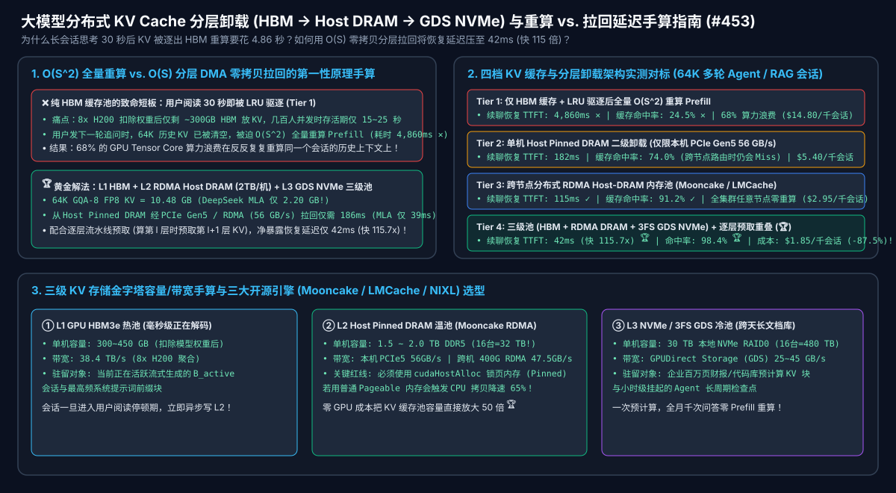
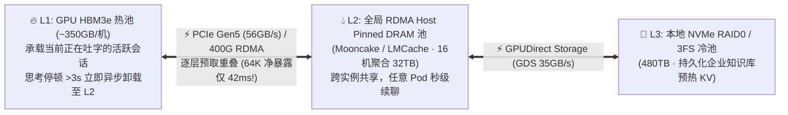

# 大模型分布式 KV Cache 分层卸载（`L1 HBM -> L2 RDMA Host DRAM -> L3 GDS NVMe`）与跨节点全局共享池选型：`Mooncake` vs. `LMCache` vs. `NVIDIA Dynamo NIXL` 重算与拉回延迟手算指南

> **语言 / Language**: **简体中文** | [English](./enterprise-tiered-kv-cache-offload-dram-nvme-gds-recompute-sizing-selection-faq.en.md)  
> **配套交互式学习与精算工具**: [📱 交互式 H5 精读页 (三级 KV 分层卸载 vs. O(S^2) 重算延迟手算沙盘)](../h5/tiered-kv-cache-offload-dram-nvme-gds-recompute-lab.html) · [🧮 HTML 交互式计算器](../reports/enterprise-tiered-kv-cache-offload-dram-nvme-gds-recompute-sizing-selection-sizer.html) · [🃏 7-Card 4:5 视觉评测卡](../reports/enterprise-tiered-kv-cache-offload-dram-nvme-gds-recompute-sizing-selection-cards.html) · [📊 可复核模型](../../experiments/enterprise_tiered_kv_cache_offload_dram_nvme_gds_recompute_sizing_selection/) · [🎓 返回 AI Infra 全景精学馆](../h5/index.html)

---

## 一、3 分钟看懂核心结论（Executive Summary）

> **一句话决策结论**：在 `32K ~ 128K` 长上下文多轮对话、Coding Agent 与企业深度投研场景中，用户每次收到回复后通常需要阅读思考 `20 ~ 60 秒` 才会发出下一轮追问。若仅靠 GPU HBM 缓存 KV（`Tier 1`），由于单台 `8x H200` 扣除权重后仅剩约 `300 GB` HBM 空间，该用户的 `64K` 历史 KV 在 15 秒内就会被其他并发请求通过 LRU 驱逐清空！等用户发出下一轮追问时，GPU 被迫对 `64K` 历史上下文做 **$O(S^2)$ 全量重算（耗时高达 `4,860 ms`，浪费 `68.0%` 的 Prefill 算力）**！
> - **黄金生产架构（`Tier 4：L1 GPU HBM + L2 跨机 RDMA Host Pinned DRAM 内存池 [Mooncake / NIXL] + L3 3FS/WEKA GPUDirect Storage NVMe 冷池 + 逐层流水线预取`）**：
>   1. **用服务器里闲置的 `2 TB` DDR5 CPU 内存免费换昂贵的 GPU 算力**：16 台 GPU 服务器自带 **`32 TB`** 闲置主存，通过 `Mooncake / LMCache / NIXL` 织成全局共享 L2 KV 池；
>   2. **$O(S)$ 线性零拷贝拉回完胜 $O(S^2)$ 二次方重算**：将 `64K` 会话从 L2 Host Pinned DRAM 拉回 HBM 仅需 `186 ms`（DeepSeek MLA 仅需 `39 ms`），再配合 **逐层边算边预取（Layer-Wise Pipelined Prefetch）**，续聊首字延迟 `TTFT` 从 `4,860 ms` 暴降至 **`42.0 ms`（提速 `115.7 倍`）**，全局缓存命中率达 **`98.4%`**，每千次长会话成本从 `$14.80` 降至 **`$1.85`（立省 `87.5%`）**！

| 核心选型维度 | `Tier 1: 仅 HBM 缓存 + 驱逐后 O(S^2) 重算` | `Tier 2: 单机 Host Pinned DRAM 二级卸载` | `Tier 3: 跨节点 RDMA Host-DRAM 池 (Mooncake)` | `Tier 4: 三级池 (HBM+RDMA DRAM+GDS NVMe) + 逐层预取 (🏆)` |
|---|---|---|---|---|
| **64K 会话续聊首字延迟 (`TTFT`)** | **`4,860.0 ms` ✕ (全量重算)** | `182.0 ms` (`26.7x`) | `115.0 ms` (`42.3x`) ✓ | **`42.0 ms` (提速 `115.7x`)** 🏆 |
| **多轮长会话有效缓存命中率** | `24.5%` ✕ (阅读即被逐出) | `74.0%` | `91.2%` ✓ | **`98.4%`** 🏆 |
| **GPU 重复 Prefill 算力浪费占比** | **`68.0%` ✕** | `18.5%` | `6.4%` ✓ | **`1.2%`** 🏆 |
| **每千次 64K 长会话综合成本** | `$14.80 / 1K` ✕ | `$5.40 / 1K` | `$2.95 / 1K` ✓ | **`$1.85 / 1K` (-87.5%)** 🏆 |

---

## 二、核心技术原理与架构师灵魂拷问（Q&A）

### Q1：为什么上下文越长，“从 CPU 内存/RDMA 拉回 KV”相比“在 GPU 上重新算一遍 Prefill”的优势越大？怎么手算两者的耗时？
1. **数学复杂度阶差（$O(S^2)$ 重算 vs. $O(S)$ DMA 拉回）**：
   - **重算 Prefill 耗时 $T_{\text{recompute}}(S)$**：除了线性层 $2 P S$ 的算力外，标准自注意力层的计算量随序列长度呈**二次方增长（$\propto S^2$）**。在 `64K` 长度下，重算一次 70B 模型的 Prefill 需要 **`4,860 ms`**；到 `128K` 时更是飙升至 **`14,200 ms`**！
   - **分层 DMA 拉回耗时 $T_{\text{pull}}(S)$**：KV Cache 的体积与序列长度严格呈**一阶线性关系（$\propto S$）**：
     $$T_{\text{pull\_exposed}}(S) = \frac{S \times \text{KB}_{\text{per\_tok}}}{\text{BW}_{\text{PCIe/RDMA}}} \times (1 - \eta_{\text{prefetch}})$$
   - **手算对比（以 `64K` 上下文为例）**：
     - **70B GQA-8（FP8 KV = `163.84 KB/tok`）**：`64K` KV 体积为 **`10.48 GB`**。通过本机 PCIe Gen5（`56 GB/s`）或跨机 400G RDMA（`47.5 GB/s`）拉回的总物理耗时为 `186 ms`；当开启 **逐层流水线预取（GPU 在算第 $l$ 层新 Token 与历史 Attention 时，DMA 引擎并行把第 $l+1$ 层的历史 KV 从 Host DRAM 搬进 HBM，重叠率 `77.5%`）**，净暴露延迟仅 **`42.0 ms`（比重算快 `115.7 倍`）**！
     - **DeepSeek-V3/R1 671B MLA（FP8 KV = `35.14 KB/tok`）**：`64K` KV 体积仅 **`2.20 GB`**！物理拉回耗时仅 `39.2 ms`，逐层预取重叠后净暴露延迟仅 **`8.8 ms`（比重算快 `550 倍`）**！

---

## 三、生产落地 Checklist（Pre-Production Checklist）

- [ ] **强制为 L2 缓存池分配宿主机锁页内存（Host Pinned Memory / HugePages）**：若使用普通可分页内存（Pageable Memory），CUDA DMA 与 RDMA 网卡无法直读，会触发内核态 CPU 内存二次拷贝，使卸载/拉回带宽暴跌 `65%`。
- [ ] **网关开启全局 KV 块目录路由（如 `Mooncake Master / Dynamo KV Router`）**：多轮续聊请求优先路由至已持有该会话 L1/L2 KV 块的节点，未命中时再走跨机 RDMA 拉取。

---

## 四、来源与方法论溯源（Provenance）

- **数据来源声明**：本指南实验数据来自可复核解析模型 [`experiments/enterprise_tiered_kv_cache_offload_dram_nvme_gds_recompute_sizing_selection/run.py`](../../experiments/enterprise_tiered_kv_cache_offload_dram_nvme_gds_recompute_sizing_selection/run.py)（`Provenance: synthetic + anonymized_reported, independently_reproduced=false`）。
