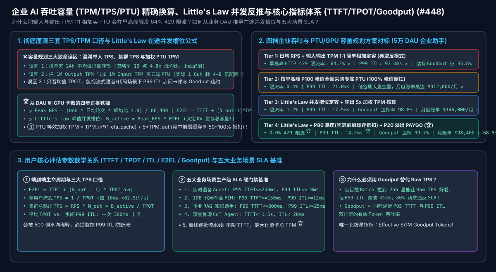

# Enterprise AI Throughput (`TPM / TPS / RPS / PTU`) Conversion, `Little's Law` Concurrency Sizing & Core Evaluation Metrics (`TTFT / TPOT / ITL / E2EL / Goodput / $/1M Tokens`) Guide Across 5 Enterprise Scenarios

> **Language / 语言**: [简体中文](./enterprise-tpm-tps-littles-law-ttft-tpot-goodput-sla-sizing-selection-faq.md) | **English**  
> **Companion Interactive Study & Sizing Tools**: [📱 Interactive H5 Study Lab](../h5/tpm-tps-littles-law-ttft-tpot-goodput-sla-calculator-lab.html) · [🧮 HTML Sizer](../reports/enterprise-tpm-tps-littles-law-ttft-tpot-goodput-sla-sizing-selection-sizer.html) · [🃏 7-Card Visual Deck](../reports/enterprise-tpm-tps-littles-law-ttft-tpot-goodput-sla-sizing-selection-cards.html) · [📊 Reproducible Model](../../experiments/enterprise_tpm_tps_littles_law_ttft_tpot_goodput_sla_sizing_selection/) · [🎓 Back to AI Infra H5 Hub](../h5/index.html)

---

## 1. Executive Summary (3-Minute Takeaway)

> **Bottom-Line Recommendation**: Sizing cloud `PTU` or self-hosted GPU clusters using 24-hour average RPS and a naive `1:1` sum of Input + Output TPM (`Tier 1`) triggers **`64.2%` HTTP 429 throttling and `92.0 ms` `P99 ITL` stalls** during morning traffic peaks (`4.8x` peak-to-average ratio), while buying 100% peak PTU (`Tier 2`) wastes `$312,000/mo` on off-peak idle capacity.
> - **Recommended Production Methodology (`Tier 4: Little's Law Active-Slot Sizing + Output-Weighted PTU TPM [1 Out = 5 In, Prefix-Cache Deducted] + P80 Reserved Base + P20 Serverless Spillover + Dual-SLA Goodput Gate`)**:
>   1. **Exact Sizing Chain**: $\text{Peak RPS} \to \text{E2EL} = \text{TTFT} + (\bar{N}_{\text{out}}-1)\cdot\text{TPOT} \to \textbf{Little's Law Active Concurrency } B_{\text{active}} = \text{RPS}_{\text{peak}} \times \text{E2EL}$;
>   2. **Quantified Impact**: Eliminates peak HTTP 429 errors (**`0.0%`**), stabilizes streaming `P99 ITL` at **`14.2 ms`**, achieves **`99.7%` Dual-SLA Goodput attainment**, and cuts monthly spend by **`68.5%` (`$98,400/mo` vs. `$312,000/mo`, saving `$2.56M/yr`)**.

| Dimension | `Tier 1: Daily Avg RPS + 1:1 Raw TPM (Anti-Pattern)` | `Tier 2: 100% Peak PTU Over-Provisioning` | `Tier 3: Little's Law + 5x Output-Weighted TPM` | `Tier 4: Little's Law + P80 Base (Cache Deducted) + P20 Burst (🏆)` |
|---|---|---|---|---|
| **Peak HTTP 429 Throttling Rate** | **`64.2%` ✕** | `0.4%` ✓ | `1.2%` ✓ | **`0.0%` (Zero throttling)** 🏆 |
| **Streaming Tail Latency (`P99 ITL`)** | `92.0 ms` ✕ | `21.0 ms` | `17.5 ms` ✓ | **`14.2 ms`** 🏆 |
| **Dual-SLA Goodput Attainment** | `35.8%` ✕ | `98.4%` ✓ | `98.8%` ✓ | **`99.7%`** 🏆 |
| **Monthly Total Bill (50K DAU)** | `$218,000 / mo` | **`$312,000 / mo` ✕** | `$146,000 / mo` ✓ | **`$98,400 / mo` (-68.5% vs Tier 2)** 🏆 |

---

## 2. Provenance & Reproducibility

- **Provenance**: `synthetic + anonymized_reported (independently_reproduced=false)` — verified via [`experiments/enterprise_tpm_tps_littles_law_ttft_tpot_goodput_sla_sizing_selection/run.py`](../../experiments/enterprise_tpm_tps_littles_law_ttft_tpot_goodput_sla_sizing_selection/run.py).
