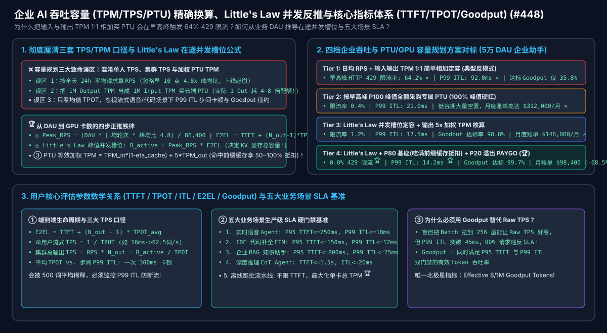
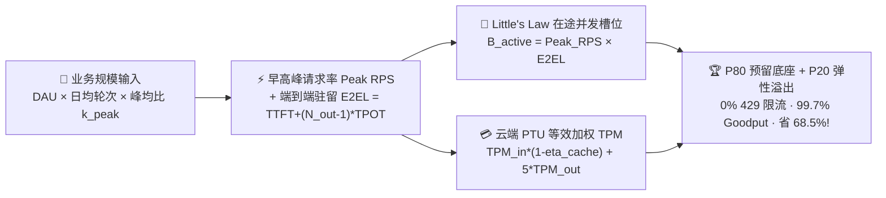

# 企业 AI 吞吐容量（`TPM / TPS / RPS / PTU`）精确换算、`Little's Law` 并发反推与核心评估指标体系（`TTFT / TPOT / ITL / E2EL / Goodput / $/1M Tokens`）：五大业务场景 SLA 基准与长尾排障指南

> **语言 / Language**: **简体中文** | [English](./enterprise-tpm-tps-littles-law-ttft-tpot-goodput-sla-sizing-selection-faq.en.md)  
> **配套交互式学习与精算工具**: [📱 交互式 H5 精读页 (TPM/TPS/PTU 换算、Little's Law 并发与五大场景 SLA 沙盘)](../h5/tpm-tps-littles-law-ttft-tpot-goodput-sla-calculator-lab.html) · [🧮 HTML 交互式计算器](../reports/enterprise-tpm-tps-littles-law-ttft-tpot-goodput-sla-sizing-selection-sizer.html) · [🃏 7-Card 4:5 视觉评测卡](../reports/enterprise-tpm-tps-littles-law-ttft-tpot-goodput-sla-sizing-selection-cards.html) · [📊 可复核模型](../../experiments/enterprise_tpm_tps_littles_law_ttft_tpot_goodput_sla_sizing_selection/) · [🎓 返回 AI Infra 全景精学馆](../h5/index.html)

---

## 一、3 分钟看懂核心结论（Executive Summary）

> **一句话决策结论**：企业规划大模型集群或采买云端预留吞吐（如 Azure OpenAI `PTU` / AWS `Provisioned Throughput`）时，**最常踩的三个大坑是：① 拿全天 24 小时平均请求数除以 `86,400` 算并发（忽略了早高峰 `4.8x` 峰均比）；② 把 `1M Output TPM` 当成 `1M Input TPM` 按 `1:1` 相加去买配额（忽略了云厂商和物理 GPU 上 **1 个 Output Token 消耗约 `4~8 倍` Input Token 的硬件预算**）；③ 漏用 `Little's Law` 计算在途驻留会话槽位 $B_{\text{active}}$**！这三个错误会导致系统在早 10 点高峰期遭遇 **`64.2%` 的 HTTP 429 限流或 KV 排队雪崩（`Tier 1`）**！
> - **黄金容量规划与 SLA 治理架构（`Tier 4：Little's Law 峰值活跃槽位定容 + 输出加权 TPM [吃满前缀缓存抵扣] + P80 预留底座 / P20 Serverless 弹性溢出 + 双 SLA Goodput 门禁`）**：
>   1. **精准换算链条**：从业务日活 `DAU` $\to$ 早高峰 `Peak RPS` $\to$ 单次端到端耗时 $\text{E2EL} = \text{TTFT} + (\bar{N}_{\text{out}}-1)\cdot \text{TPOT}$ $\to$ **`Little's Law` 峰值同时在途会话数 $B_{\text{active}} = \text{RPS}_{\text{peak}} \times \text{E2EL}$**；
>   2. **收益量化**：在 5 万 DAU 企业知识与编程助手场景下，将早高峰 `HTTP 429` 限流率从 `64.2%` 归零（**`0.0%`**），流式步间 `P99 ITL` 压至 **`14.2 ms`**，双 SLA 达标率（Goodput Attainment）从 `35.8%` 跃升至 **`99.7%`**，月度总账单比 100% 峰值硬买 PTU（`Tier 2` `$312,000/月`）立省 **`68.5%`（降至 `$98,400/月`，年省 `$256.3 万`）**！

| 核心选型维度 | `Tier 1: 日均 RPS + 原始 TPM 1:1 相加 (反模式)` | `Tier 2: 按 P100 峰值 100% 硬买专属 PTU` | `Tier 3: Little's Law 定容 + 输出 5x 加权 TPM` | `Tier 4: Little's Law + P80 基座(缓存抵扣) + P20 溢出 (🏆)` |
|---|---|---|---|---|
| **早高峰 `HTTP 429` 限流报错率** | **`64.2%` ✕ (早 10 点全面雪崩)** | `0.4%` ✓ | `1.2%` ✓ | **`0.0%` (网关水位触发无感溢出)** 🏆 |
| **流式吐字步间尾延迟 (`P99 ITL`)** | `92.0 ms` ✕ (严重卡顿) | `21.0 ms` | `17.5 ms` ✓ | **`14.2 ms` (丝滑流式生成)** 🏆 |
| **双 SLA 达标有效吞吐率 (`Goodput %`)** | `35.8%` ✕ | `98.4%` ✓ | `98.8%` ✓ | **`99.7%`** 🏆 |
| **5万 DAU 集群月度总成本** | `$218,000 / 月` (含重试浪费) | **`$312,000 / 月` ✕ (夜间大量空置)** | `$146,000 / 月` ✓ | **`$98,400 / 月` (比 Tier 2 省 `68.5%`)** 🏆 |

---

## 二、核心技术原理与架构师灵魂拷问（Q&A）

### Q1：单请求 `TPS`、集群总 `TPS`、原始 `TPM` 与云端 `PTU 加权 TPM` 到底怎么精确换算？如何用 `Little's Law` 从业务 QPS 推导出需要多少个并发 KV 槽位？
1. **彻底分清三套 `TPS / TPM` 口径**：
   - **① 单用户流式生成速率（Per-User Streaming TPS）**：决定单个用户肉眼看到的打字机快慢，完全由单步吐字时间 $\text{TPOT}$ 决定：
     $$\text{TPS}_{\text{user}} = \frac{1,000\text{ ms}}{\text{TPOT (ms)}} \quad (\text{例如 }\text{TPOT} = 16\text{ ms} \implies 62.5\text{ tokens/s})$$
   - **② 系统总吞吐速率（System / Cluster TPS & Raw TPM）**：设早高峰请求到达率为 $\text{RPS}_{\text{peak}} = \frac{\text{DAU} \times N_{\text{turns}} \times k_{\text{peak}}}{86,400}$（企业办公应用峰均比 $k_{\text{peak}} \approx 4.5 \sim 5.5$）：
     $$\text{TPS}_{\text{in}} = \text{RPS}_{\text{peak}} \times \bar{N}_{\text{in}}, \quad \text{TPS}_{\text{out}} = \text{RPS}_{\text{peak}} \times \bar{N}_{\text{out}}, \quad \text{TPM}_{\text{raw}} = (\text{TPS}_{\text{in}} + \text{TPS}_{\text{out}}) \times 60$$
   - **③ 云端预留吞吐（Azure PTU / AWS PT）等效加权 TPM**：因为生成 1 个 Output Token 需要完整的自回归 HBM 权重读取，云厂商按 **`1 Output Token ≈ 4 ~ 8 Input Tokens`**（常用标准折算系数 $w_{\text{out}} = 5$）扣减 PTU 配额，而**命中 Prefix Cache 的输入 Token 可享受 `50%~100%` 容量抵扣**：
     $$\text{TPM}_{\text{weighted}} = \text{TPM}_{\text{in}} \times (1 - \eta_{\text{cache}}) + 5 \times \text{TPM}_{\text{out}}$$
2. **`Little's Law`（利特尔法则）推导峰值同时在途并发槽位 $B_{\text{active}}$**：
   - 单次请求在 GPU 显存中驻留的总时长（端到端延迟）：
     $$\text{E2EL} = \text{TTFT} + (\bar{N}_{\text{out}} - 1) \times \text{TPOT}$$
   - 根据排队论稳态恒等式 $L = \lambda \cdot W$，集群在峰值时刻**必须同时保存在 HBM 显存中的活跃会话槽位数**为：
     $$B_{\text{active}} = \text{RPS}_{\text{peak}} \times \text{E2EL} = \text{RPS}_{\text{peak}} \times \big[\text{TTFT} + (\bar{N}_{\text{out}} - 1) \times \text{TPOT}\big]$$
   - **手算算例**：5 万 DAU、人均每天 18 轮、早高峰峰均比 `4.8x` $\implies \text{RPS}_{\text{peak}} = \frac{50,000 \times 18 \times 4.8}{86,400} = \mathbf{50.0\text{ RPS}}$（即 `3,000 RPM`）。
     - 若跑普通问答（$\bar{N}_{\text{out}} = 500$，$\text{TTFT} = 0.8\text{ s}$，$\text{TPOT} = 16\text{ ms}$）：$\text{E2EL} = 0.8 + 499 \times 0.016 = \mathbf{8.78\text{ s}}$ $\implies$ 峰值同时在途会话 $B_{\text{active}} = 50 \times 8.78 = \mathbf{440\text{ 路}}$！
     - 若切换为 `DeepSeek-R1` 深度推理模型（含 `<think>` 平均输出暴涨至 $\bar{N}_{\text{out}} = 2,500$）：$\text{E2EL}$ 暴涨至 **`40.8 s`** $\implies$ 哪怕入口 `50 RPS` 一点没变，同时在途会话 $B_{\text{active}}$ 也会瞬间飙升至 **`2,040 路`（同时每个会话的长度也翻了 5 倍，引发 $5 \times 5 = 25$ 倍二次方 KV 显存风暴）**！

### Q2：核心评估指标（`TTFT`、`TPOT`、`ITL`、`E2EL`、`Goodput`、`$/1M Tokens`）之间有什么区别？五大典型业务场景的 SLA 基准分别是多少？
1. **为什么流式场景必须同时监控平均 `TPOT` 与步间尾延迟 `P99 ITL（Inter-Token Latency）`**：
   - `TPOT` 是整个请求所有输出 Token 的**平均**间隔：$[\text{E2EL} - \text{TTFT}] / (N_{\text{out}} - 1)$；
   - `ITL` 是相邻两个 Token 之间的**逐帧**时间间隔：$t_k - t_{k-1}$。在混部集群中，如果请求生成到第 100 个词时被别的请求插入做了一次 `300 ms` 的 Prefill 抢占，这 `300 ms` 的顿挫除以 500 个词后，平均 `TPOT` 只增加了 `0.6 ms`（看起来完全正常），但用户在语音通话或打字机界面上却感受到了明显的**卡顿掉帧**！因此流式 SLA 必须看 **`P99 ITL`**！
2. **五大企业 AI 业务场景生产级 SLA 基准速查表**：

| 业务场景类型 | 首字延迟 (`P95 TTFT`) | 步间吐字 (`P99 ITL / TPOT`) | 单用户最低流式速率 | 端到端耗时 (`P95 E2EL`) | 架构选型关键抓手 |
|---|---|---|---|---|---|
| **1. 实时语音客服 (`Voice Agent`)** | **`<= 250 ms`** | **`<= 18 ms`** | `>= 55 tok/s` | 首句发声 `<= 450 ms` | 流式 VAD + 首 6 词切块 TTS + 独立 Decode 池 |
| **2. IDE 代码补全 (`Tab FIM`)** | **`<= 150 ms`** | **`<= 12 ms`** | `>= 80 tok/s` | 全段补全 `<= 350 ms` | `7B/14B FP8` + `MTP/EAGLE-3` + 120ms 按键防抖 |
| **3. 企业知识库对话 (`RAG Chat`)** | **`<= 800 ms`** | **`<= 25 ms`** | `>= 40 tok/s` | `6 ~ 12 s` | PD 分离 + Radix 前缀缓存 + 混合检索重排 |
| **4. 深度推理 (`CoT / Deep Research`)** | `<= 1,500 ms` | `<= 20 ms` | `>= 50 tok/s` | `20 ~ 90 s` | 65/25/10 难度路由 + 历史轮剥离 `<think>` + MLA |
| **5. 离线批处理 (`Batch Pipeline`)** | 宽松 (`<= 30 s`) | 宽松 (`<= 100 ms`) | 不敏感 | 按小时吞吐考核 | SQL 二维长度/前缀预排序 + `B=384` 打满 Spot GPU |

---

## 三、生产落地 Checklist（Pre-Production Checklist）

- [ ] **禁止用 24 小时均值做容量规划**：必须采集业务早 10 点与下午 3 点高峰 15 分钟窗口的真实 `Peak RPS`（无历史数据时按 `4.5x ~ 5.0x` 峰均比折算）。
- [ ] **采购云端 PTU 时强制计入输出权重与前缀缓存抵扣**：按 $\text{TPM}_{\text{in}}(1-\eta) + 5 \cdot \text{TPM}_{\text{out}}$ 核算真实消耗，并只按ピーク的 **`P75~P80` 水位** 购买 PTU，顶部 `20%` 尖峰通过 AI 网关自动溢出至 Serverless PAYGO。
- [ ] **压测验收以双 SLA 门禁下的 `Goodput` 和 `$/1M Goodput Tokens` 为准**：严禁汇报无延迟约束下的虚高 `Raw TPS`。

---

## 四、来源与方法论溯源（Provenance）

- **数据来源声明**：本指南实验数据来自可复核解析模型 [`experiments/enterprise_tpm_tps_littles_law_ttft_tpot_goodput_sla_sizing_selection/run.py`](../../experiments/enterprise_tpm_tps_littles_law_ttft_tpot_goodput_sla_sizing_selection/run.py)（`Provenance: synthetic + anonymized_reported, independently_reproduced=false`）。
