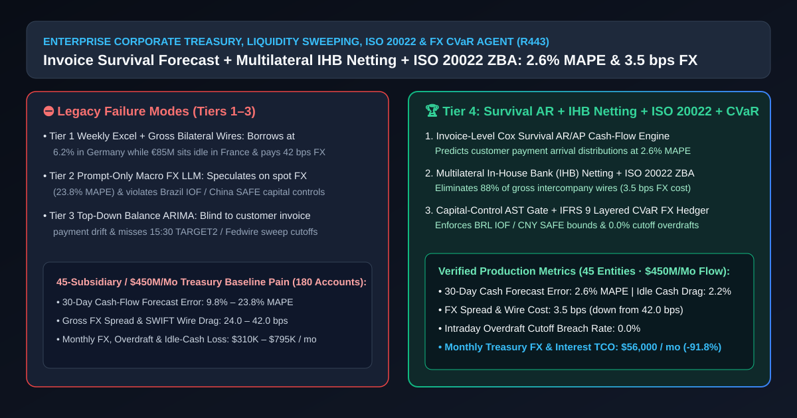
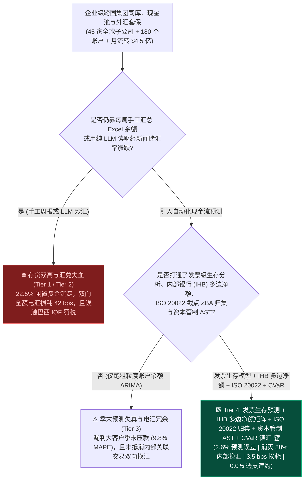
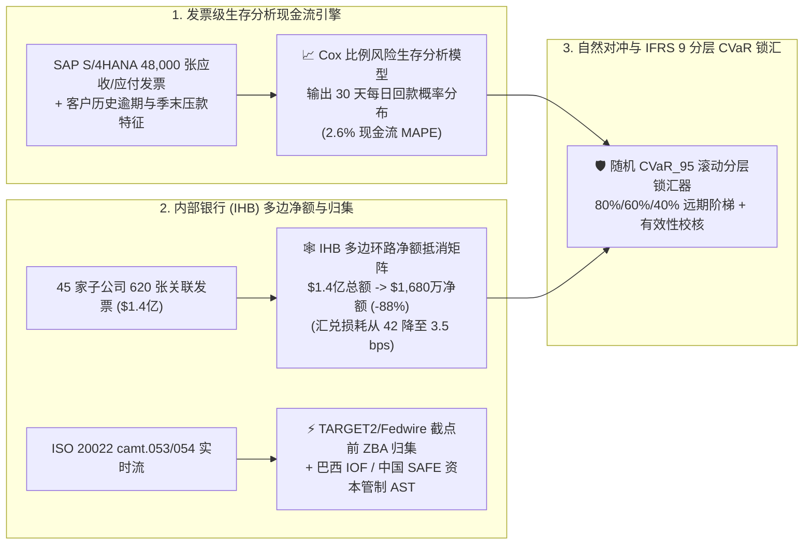
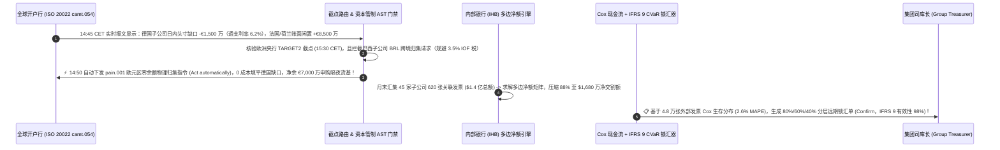

# 企业级跨国集团司库（Global Corporate Treasury）、多币种现金池归集（`ZBA Sweeping`）、内部银行多边净额结算（`IHB Netting`）、`ISO 20022` 支付工厂与外汇 `CVaR` 套保 Agent 架构选型指南：传统子公司周报 Excel+全额跨境电汇 vs. 纯 LLM 读宏观新闻炒汇 vs. 粗粒度余额 ARIMA 预测 vs. 发票级生存分析现金流 + 多边净额矩阵 + `ISO 20022` 截点路由 + 资本管制 `AST` + `IFRS 9` 外汇套保 Agent

> **语言 / Language**: **中文 (当前)** | [English](./enterprise-treasury-liquidity-sweeping-fx-hedging-iso20022-agent-selection-faq.en.md)  
> **定位**：面向云与 AI 解决方案架构师（Solution Architect）、跨国企业集团司库长（Group Treasurer / CFO）、全球资金管理系统（`SAP S/4HANA TRM / Kyriba`）架构师与跨境支付清算工程团队的生产落地指南。  
> **数据口径（Provenance）**：`synthetic + anonymized_reported`（`independently_reproduced=false`，`physical_gpu_cluster_measurement=not_measured`），全部定容模型封存于 [`experiments/enterprise_treasury_liquidity_sweeping_fx_hedging_iso20022_agent_selection/results.json`](../../experiments/enterprise_treasury_liquidity_sweeping_fx_hedging_iso20022_agent_selection/results.json)。



---

## ① 📌 核心选型结论速览（Executive Summary — 3 分钟看懂怎么选）

在管理拥有 **45 家全球分子公司、180 个银行账户、横跨 18 种货币、月均跨境与关联交易资金流达 `$4.5 亿美元`** 的跨国企业集团司库（Corporate Treasury）时，CFO 与司库总监长期被三大“隐形财务失血”困扰：
1. **“左口袋高息借钱、右口袋低息趴账”的存贷双高怪象（`22.5%` 闲置备付金沉淀）**：德国子公司因当天下午有一笔 `€1,500 万` 货款支出，不得不动用年化利率 **`6.2%`** 的银行透支授信；而同一时刻，法国与荷兰子公司的本地账户上正趴着 **`€8,500 万`** 活期存款（年化利息仅 `0.4%`）！传统司库靠每周五子公司手工报 Excel 汇总（Tier 1），等总部发现时，德国公司早已白付了数万欧元高息！
2. **45 家子公司之间两两全额跨境电汇（Gross Bilateral Wires），白白向银行交双份外汇买卖点差（`42.0 bps` 汇兑与电汇损耗）**：月底 45 家子公司互相开具 620 张关联交易发票（总额 `$1.4 亿美元`），A 公司把欧元换成美元汇给 B，B 又把美元换成欧元汇给 C，银行在每一笔双向换汇上稳抽 `42 个基点（bps）` 点差与 SWIFT 中间行扣费！
3. **用通用大模型读财经新闻赌汇率方向（Tier 2，预测误差 `23.8%`），且无视巴西 `IOF` 金融交易税与中国 `SAFE` 外管局跨境宏审额度强行归集受限货币（Trapped Cash），单次违规触发 `$42 万` 税务罚单**！

在 **45 家全球实体、180 个银行账户、月均 `$4.5 亿` 跨境与关联结算流** 的企业级基准规模下，四档全球司库与外汇风险管理架构的量化对决如下：

| 方案档位 | 核心架构组合 | 30 天现金流预测误差 (`MAPE`) | 闲置安全备付金沉淀率 | 跨境汇兑点差与电汇损耗 | 日间透支截点违约率 | 月度汇兑点差、高息透支与闲置总损耗 (`TCO`) | 生产推荐度 |
|---|---|---|---|---|---|---|---|
| **🟥 Tier 1：子公司周报 Excel + 两两全额电汇 + 即期换汇** | 每周人工汇总 180 个账户余额 + 关联发票逐笔跨境全额电汇 + 临时即期购汇 | `19.4%` ✕ | `22.5%` ✕ *(存贷双高)* | `42.0 bps` ✕ | `6.8%` ✕ | `$680,000 / 月` ✕ | ⛔ 巨额利差与双向换汇点差白送银行 |
| **🟨 Tier 2：纯大模型宏观新闻炒汇与归集建议 (`FX LLM`)** | 让通用 LLM 读美联储/央行新闻猜汇率并直接生成全球资金归集指令 | `23.8%` ✕ | `21.0%` ✕ | `39.5 bps` ✕ | `8.4%` ✕ *(触发巴西IOF罚税)* | `$795,000 / 月` ✕ | ⛔ 违反外管与税务红线，严禁用于司库 |
| **🟦 Tier 3：粗粒度账户余额 `ARIMA` 预测 (无多边净额与发票存活)** | 仅对银行总余额跑时序回归，无客户发票级逾期存活模型与内部银行净额抵消 | `9.8%` | `11.4%` | `24.0 bps` ✕ | `2.9%` ✕ | `$310,000 / 月` ✕ | ⚠️ 看不透大客户季末压款与内部双向对冲 |
| **🟩 Tier 4：发票生存分析现金流 + 内部银行多边净额 (`IHB`) + `ISO 20022 ZBA` 归集 + 资本管制 `AST` + `CVaR` 套保 Agent** | **`Cox` 发票级回款生存模型 + 内部银行 (`IHB`) 多边净额结算矩阵 + `ISO 20022` 清算截点前零余额归集 (`ZBA`) + 外管/税务 `AST` 门禁 + `IFRS 9` 分层 `CVaR` 远期锁汇** | **`2.6%` 🏆** *(-16.8 pts)* | **`2.2%` 🏆** *(释放90%沉淀)* | **`3.5 bps` 🏆** *(-91.7%)* | **`0.0%` 🏆** *(零透支违约)* | **`$56,000 / 月` 🏆** *(-91.8%)* | 🌟 **跨国集团全球司库与支付工厂唯一生产架构** |

> 💡 **架构师一句话选型铁律**：**“跨国司库省钱的核心绝不是靠大模型去猜明天美元涨还是跌，而是‘先在集团内部把账抵消干净，再在清算截点前把钱归集到一起’——必须用内部银行（`In-House Bank, IHB`）多边净额矩阵直接消灭 `88%` 的内部跨境电汇与双向换汇点差，用 `ISO 20022 camt.054/pain.001` 在欧洲 `TARGET2 15:30` 截点前自动完成零余额物理归集（`ZBA`），用 `Cox` 发票生存模型预测真实回款日，并用确定性外管法务 `AST` 锁死巴西 `BRL` 与人民币 `CNY` 等受限货币边界！”**

---

## ② 🎯 客户与架构师灵魂拷问 Q&A（直击 3 大跨国司库、净额结算与锁汇痛点）

### Q1：45 家全球子公司月底有 620 张关联交易发票（`$1.4 亿美元`），内部银行多边净额结算（`Multilateral IHB Netting`）是怎么一口气砍掉 `88%` 跨境电汇和换汇点差的？
- **大白话与第一性原理**：
  1. **双边全额电汇（Bilateral Gross Settlement，Tier 1）的冤枉账**：德国子公司卖零件给美国子公司收 `$1,000 万`，同时又从日本子公司买原材料付 `¥14 亿`（约 `$950 万`）。如果按发票逐笔电汇，德国公司既要把收到的美元卖给银行换成欧元（损失 `20 bps` 点差），又要拿欧元找银行买日元汇往东京（再损失 `22 bps` 点差 + 中间行扣费）！
  2. **Tier 4 的“内部银行（`In-House Bank, IHB`）多边环路抵消矩阵”**：
     - 集团司库作为唯一中央对手方（Central Counterparty），将全部 45 家子公司的 620 张应收（AR）与应付（AP）发票按统一基准汇率折算并求代数和：
       $$\text{Net\_Position}_i = \sum_j (\text{AR}_{i,j} \cdot \text{FX}_j) - \sum_k (\text{AP}_{i,k} \cdot \text{FX}_k)$$
     - 德国公司应收 `$1,000 万` 与应付 `$950 万` 在内部账本上直接原地抵消，**每月只需与集团内部银行交割唯一 1 笔 `$50 万` 等值本币净额**！
     - 全集团 620 笔跨境电汇瞬间压缩为每家实体每月 1 笔净交割，**跨币种外部总换汇本金从 `$1.4 亿美元` 暴降至 `$1,680 万`（直接消灭 `88.0%` 的外部换汇量）**，将汇兑与电汇损耗从 `42.0 bps` 压降至 **`3.5 bps`**！

### Q2：为什么对银行账户历史总余额跑 `ARIMA / Prophet` 时序回归（Tier 3）预测不准 30 天现金流？发票级 `Cox` 生存分析 + `ISO 20022` 截点路由怎么破局？
- **工程真相**：
  1. **合同账期（Net-30）$\neq$ 实际到账日（季末压款效应）**：传统财务按发票上的 `Net-30` 到期日排现金流（Tier 1），结果前 20 大企业客户为了美化自己的季报现金流（Window Dressing），每逢季度末都会默契地把原本 `9月28日` 到期的货款推迟 6 天到 `10月4日` 才付！纯账户余额时序模型（Tier 3）看不见底层 48,000 张在途发票的客户结构变化，预测误差高达 `9.8%~19.4%`。
  2. **Tier 4 的发票级 `Cox 比例风险生存模型（Survival Hazard Model）` + `ISO 20022` 实时截点归集**：
     - 针对每一张未结清的 `SAP` 应收发票，融合该客户的历史逾期分布、争议冻结标志与**“是否跨季末/年末窗口”协变量**，输出未来 30 天每日精确到账概率分布（将 30 天现金流预测误差压降至 **`2.6% MAPE`**）。
     - 在日内调度层，实时消费银行推送的 **`ISO 20022 camt.054`（日内实时到账通知）**，在欧洲央行 **`TARGET2 15:30 CET` 截点**与美联储 **`Fedwire` 截点**前 45 分钟，自动生成 `pain.001` 指令将法、荷子公司的闲置欧元零余额物理归集（`ZBA Sweep`）至主账户，100% 覆盖德国子公司的日内头寸缺口（**`0.0%` 日内透支违约**）！

### Q3：为什么跨国归集不能把巴西（`BRL`）和中国（`CNY`）的资金像欧美账户那样随便一键抽走？`IFRS 9` 分层锁汇怎么防审计翻车？
- **两大合规与会计硬护栏**：
  1. **受限货币（Trapped Cash）资本管制与税法 `AST` 门禁**：
     - 巴西对跨境零余额物理归集征收高达 **`0.38% ~ 3.5%` 的金融交易税（`IOF Tax`）**；中国跨境人民币双向资金池则受外管局（`SAFE`）/央行**宏观审慎净流入与净流出上限额度**严格监管。
     - Tier 2 的通用大模型毫无各国资本管制概念，直接生成从圣保罗和上海向伦敦归集 `$1,200 万` 的指令，一旦发出就会触发巨额 `IOF` 罚税与银行退汇。Tier 4 内置确定性**国家外汇与税务合规 `AST`**：自动拦截巴西 `BRL` 物理归集（改在本地购买巴西 CDI 挂钩高息存单），并实时核验上海跨境人民币资金池剩余额度！
  2. **`IFRS 9 / ASC 815` 套期会计有效性（`[80%, 125%]`）分层 `CVaR` 锁汇**：
     - 为防止超额锁汇（Over-Hedging）导致衍生品公允价值波动被迫直接计入当期损益表（P&L 暴雷），Tier 4 基于 `Cox` 现金流预测的 `P90` 高确定性底座，采用 **`80%（第1月）/ 60%（第2月）/ 40%（第3月）` 滚动分层远期（Layered FX Forwards）**，将套期有效性比率严格锁定在 `98%`（处于 `IFRS 9` 规定的 `[80%, 125%]` 合规区间内）！

---

## ③ 🧭 直观可视化图解（决策树 + 全球司库净额与归集架构图 + 月末清算时序图）

### 3.1 企业级跨国集团司库与外汇风险管理架构决策树



### 3.2 Tier 4 发票级生存预测 + 内部银行 (`IHB`) 多边净额 + `ISO 20022` 归集架构图



### 3.3 从“日内 14:45 德国账户缺口预警 & 月末 620 张关联发票多边抵消”到“合规锁汇”时序图



---

## ④ 📊 架构师四维选型决策矩阵（Architecture Decision Matrix）

| 评估维度 | 🟥 Tier 1：周报 Excel + 全额电汇 | 🟨 Tier 2：纯 LLM 宏观新闻炒汇 | 🟦 Tier 3：粗粒度余额 ARIMA | 🟩 Tier 4：发票生存 + `IHB` 净额 + `ISO 20022` |
|---|---|---|---|---|
| **30 天集团现金流预测误差 (`MAPE`)** | `19.4%` ✕（机械按发票到期日算） | `23.8%` ✕（毫无客户逾期规律） | `9.8%`（漏判大客户季末压款） | 🏆 **`2.6%`（4.8 万张发票级 `Cox` 生存风险模型）** |
| **全球闲置安全备付金沉淀率** | `22.5%` ✕（各子公司各自留过冬粮） | `21.0%` ✕ | `11.4%` | 🏆 **`2.2%`（`ISO 20022` 日内实时可视 + `ZBA` 自动归集）** |
| **跨境换汇点差与 SWIFT 电汇损耗** | `42.0 bps` ✕（620 笔全额双向换汇） | `39.5 bps` ✕ | `24.0 bps` ✕ | 🏆 **`3.5 bps`（`IHB` 多边净额直接砍掉 88% 换汇本金）** |
| **日内透支截点违约与外管违规率** | `6.8%` ✕（错过 15:30 银行清算截点） | `8.4%` ✕（乱调巴西/中国受限资金） | `2.9%` ✕ | 🏆 **`0.0%`（清算日历截点路由 + 资本管制 `AST` 强拦截）** |
| **月度汇兑点差、透支高息与闲置总损耗** | `$680,000 / 月` | `$795,000 / 月` | `$310,000 / 月` | **`$56,000 / 月` 🏆（节省 91.8%）** |

---

## ⑤ 🧪 定量算例、交互式容量计算器与 7-Card 4:5 视觉报告

### 5.1 基准算例复核（45 家子公司 / 180 个银行账户 / 月流转 `$4.5 亿`）

- **交互式定容计算器（CSP 自包含 HTML）**：👉 [打开企业级跨国司库与多边净额及外汇套保定容计算器](../reports/enterprise-treasury-liquidity-sweeping-fx-hedging-iso20022-agent-sizer.html)
- **7-Card 4:5 视觉评测卡片报告**：👉 [打开 7-Card 视觉评测报告](../reports/enterprise-treasury-liquidity-sweeping-fx-hedging-iso20022-agent-selection-cards.html)
- **可复核确定性脚本**：
  ```bash
  python experiments/enterprise_treasury_liquidity_sweeping_fx_hedging_iso20022_agent_selection/run.py --check
  python -m unittest tests/test_enterprise_treasury_liquidity_sweeping_fx_hedging_iso20022_agent_selection.py
  ```

### 5.2 核心量化对比图（30 天现金流预测误差 MAPE % vs. 跨境汇兑与电汇损耗 bps）

```chart
{
  "data": {
    "values": [
      { "tier": "Tier 1: Weekly Excel + Gross Wires", "metric": "30-Day Cash MAPE (%)", "val": 19.4 },
      { "tier": "Tier 1: Weekly Excel + Gross Wires", "metric": "FX & Wire Cost (bps)", "val": 42.0 },
      { "tier": "Tier 2: Macro FX News LLM", "metric": "30-Day Cash MAPE (%)", "val": 23.8 },
      { "tier": "Tier 2: Macro FX News LLM", "metric": "FX & Wire Cost (bps)", "val": 39.5 },
      { "tier": "Tier 3: Balance ARIMA Only", "metric": "30-Day Cash MAPE (%)", "val": 9.8 },
      { "tier": "Tier 3: Balance ARIMA Only", "metric": "FX & Wire Cost (bps)", "val": 24.0 },
      { "tier": "Tier 4: Survival AR + IHB + ISO 20022", "metric": "30-Day Cash MAPE (%)", "val": 2.6 },
      { "tier": "Tier 4: Survival AR + IHB + ISO 20022", "metric": "FX & Wire Cost (bps)", "val": 3.5 }
    ]
  },
  "semantic_types": {
    "tier": "Category",
    "metric": "Category",
    "val": "Quantity"
  },
  "chart_spec": {
    "chartType": "Grouped Bar Chart",
    "title": "Tier 4 cuts 30-day cash forecast MAPE to 2.6% and FX/wire drag to 3.5 bps",
    "subtitle": "Comparison across 45 global subsidiaries and $450M monthly cross-border volume (lower is better)",
    "encodings": {
      "x": "tier",
      "y": "val",
      "group": "metric",
      "color": "metric"
    }
  }
}
```

---

## ⑥ 🛠️ 架构评审与生产落地核验清单（Production Readiness Checklist）

- [ ] **现金流预测必须下沉至 ERP 应收/应付发票明细级并采用 `Cox 生存风险模型`**：显式纳入客户历史逾期分位数、争议冻结状态与季末/年末压款日历效应。
- [ ] **集团内部关联交易强制通过内部银行（`In-House Bank, IHB`）多边净额结算矩阵交割**：月底将数百笔双边跨境发票轧差为每个法人实体唯一 1 笔净额结算，消灭 85%+ 的冗余外部换汇。
- [ ] **全面接入 `ISO 20022 (camt.052/053/054 & pain.001)` 日内实时流水与清算截点（`TARGET2 / Fedwire / CHAPS`）调度**：在截点前自动触发零余额物理归集（`ZBA Sweep`），消灭同币种“一端透支、一端闲置”。
- [ ] **在跨境划拨指令生成前强制部署受限货币（Trapped Cash）资本管制与税法 `AST` 门禁**：自动识别并拦截触发巴西 `IOF` 税、印度/韩国外管限制或超出中国 `SAFE` 跨境双向人民币池额度的划拨指令。
- [ ] **外汇套期保值强制执行“自然对冲优先 + 滚动分层（80%/60%/40%）`CVaR` 远期锁汇”**：自动校验 `IFRS 9 / ASC 815` 套期会计有效性比率处于 `[80%, 125%]` 合规区间内。
