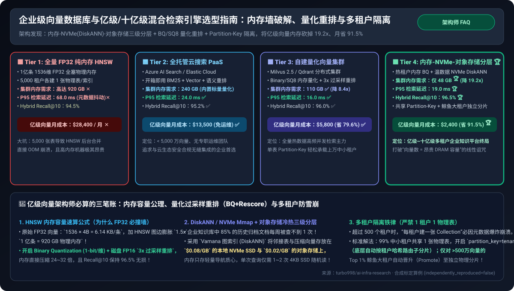

# Enterprise Vector Database & Billion-Scale Hybrid Search Architecture Selection Guide: Uncompressed FP32 In-Memory HNSW vs. Managed Cloud Search PaaS (Azure AI Search / Elastic) vs. Quantized Vector Clusters (Milvus / Qdrant) vs. Tiered RAM-NVMe(DiskANN)-Object Storage & Partition-Key Multi-Tenancy

> **Document Type**: Cloud & AI Solution Architect Decision Guide (FAQ)  
> **Target Audience**: Enterprise Knowledge Platform Architects, Cloud Data & Infrastructure Leads, Multi-Tenant SaaS Engineering Directors, FinOps Architects  
> **Core Goal**: Help architects overcome the **"920GB RAM Cost Wall"** and **"5,000-Tenant Index Sprawl OOM"** when scaling from a 100K-vector PoC to a **100M–1B vector production platform**, answering: **"When should we use `pgvector` vs. `Azure AI Search` vs. `Milvus / Qdrant / DiskANN`?", "How does Binary Quantization (32x compression) + 3x Oversampling Rescore preserve 96.5% Recall@10?", and "How do we isolate 5,000 enterprise tenants without creating 5,000 physical HNSW tables?"**  
> **Calibration Notice**: Cluster RAM footprints, Hybrid Recall@10, P95 query latencies, and 100M-vector monthly infrastructure costs are synthetic analytical estimates calibrated to published vector search benchmarks (ANN-Benchmarks, VectorDBBench, Microsoft DiskANN papers, Milvus 2.5 / Qdrant quantization evaluations, and cloud instance pricing) (`provenance: synthetic + anonymized_reported`, `independently_reproduced=false`, `physical_gpu_cluster_measurement=not_measured`). See [`experiments/enterprise_vector_database_billion_scale_hybrid_search_selection/results.json`](../../experiments/enterprise_vector_database_billion_scale_hybrid_search_selection/results.json).

---

## Executive Visual Summary



> 🔗 **Companion Interactive Reports & Tools**:
> - 🃏 **[7-Card 4:5 Visual Benchmark Report (`enterprise-vector-database-billion-scale-hybrid-search-selection-cards.html`)](../reports/enterprise-vector-database-billion-scale-hybrid-search-selection-cards.html)**
> - 🧮 **[Interactive Vector RAM & Multi-Tenant TCO Sizer (`enterprise-vector-database-billion-scale-hybrid-search-sizer.html`)](../reports/enterprise-vector-database-billion-scale-hybrid-search-sizer.html)**
> - 🌐 **[中文版指南 (`enterprise-vector-database-billion-scale-hybrid-search-selection-faq.md`)](./enterprise-vector-database-billion-scale-hybrid-search-selection-faq.md)**

---

## ① 📌 Executive Summary

Evaluated on a production workload of **100,000,000 vectors (`1536-dim`), 5,000 enterprise tenants, and 300 QPS peak hybrid search (Dense Vector + Sparse BM25)**:

| Tier | Architecture Pattern | Cluster RAM Footprint | Hybrid Recall@10 | P95 Query Latency | Monthly Infra Cost (100M Vectors) | Architect Verdict |
| :--- | :--- | :--- | :--- | :--- | :--- | :--- |
| **🟥 Tier 1: Uncompressed FP32 RAM HNSW** | Raw FP32 in-memory HNSW + 1 physical table per tenant | `920 GB` ✕ | `94.5%` | `68.0 ms` ✕ | `$28,400 / mo` ✕ | **Hits Memory Cost Wall**: Metadata thrashing & massive RAM bill |
| **🟦 Tier 2: Managed Cloud Search PaaS** | **Azure AI Search / Elastic Cloud** (SQ8/BQ + Semantic Ranker) | `240 GB` | `95.2%` ✅ | `24.0 ms` ✅ | `$13,500 / mo` | **Best Zero-Ops Choice (`<50M` vectors)**: Turnkey hybrid search & RBAC |
| **🟪 Tier 3: Quantized Dedicated Cluster** | **Milvus 2.5 / Qdrant** (`BQ/SQ8` + `3x` Rescore + Partition-Key) | `110 GB` ✅ | `96.0%` ✅ | `16.0 ms` ✅ | `$5,800 / mo` (-79.6%) | **High-QPS All-Hot Standard**: 8.4x less RAM, zero index sprawl |
| **🟩 Tier 4: Tiered RAM + NVMe DiskANN + Object Store** | **Hot RAM BQ + Warm NVMe DiskANN + Cold S3/Blob + Whale Shards** | **`48 GB` 🏆 (19.2x less)** | **`96.5%` 🏆** | **`19.0 ms` 🏆** | **`$2,400 / mo` 🏆 (-91.5%)** | **100M–1B Scale TCO Gold Standard**: Decouples scale from RAM |

### 💡 Three Golden Rules for Enterprise Vector Search Architects
1. **Right-Size the Engine by Scale**:
   - **`< 5M` vectors with existing Postgres**: Use **`pgvector / pgvectorscale (StreamingDiskANN)`**;
   - **`5M–50M` vectors with lean ops**: Use **`Azure AI Search` or `Elastic Cloud`** (Tier 2);
   - **`50M–1B+` vectors**: Deploy **`Milvus 2.5 / Qdrant / Turbopuffer`** with quantization + NVMe DiskANN + Object Storage tiering (Tier 3/4).
2. **Never Store Uncompressed FP32 Vectors in RAM — Pair In-Memory Binary/Scalar Quantization (`BQ/SQ8`) with NVMe `3x` Oversampling Rescore**: Compress in-RAM vectors by `4x–32x`, fetch top `3×K` candidates via CPU `POPCNT`, and rescore the final `K` using full-precision FP16 vectors on NVMe SSD — retaining **`96.5%` Recall@10** at a fraction of the RAM.
3. **Eliminate "1-Table-Per-Tenant" Sprawl via Shared `partition_key` + Whale-Tenant Promotion**: Keep 99% of small/medium tenants in a single physical collection keyed by `partition_key = tenant_id`, and automatically promote only the top 1% whale tenants (`> 5M` vectors) to dedicated physical shards.

---

## ② 🎯 Architect Deep-Dive Q&A

### Q1: How do we calculate the exact RAM required for 100M vectors in 30 seconds?
* **Answer**:
  - Raw `1536-dim` FP32 vector = `1536 × 4B = 6.14 KB`. With `1.5x` HNSW graph edge overhead, **100M vectors require `920 GB` of RAM per replica** (`1.84 TB` for HA).
  - Switching to **1-bit Binary Quantization (`192 Bytes/vector` in RAM) + NVMe DiskANN / Mmap (`FP16` on SSD)** + offloading inactive archival tenants to S3/Blob drops cluster RAM to **`48 GB` (`19.2x` reduction)**.

---

## ③ 🧭 Architecture Diagrams

### 3.1 Tier 4 Tiered Storage (`RAM + NVMe DiskANN + S3/Blob`) & Multi-Tenant Routing

```mermaid
flowchart LR
    Q["🔍 Hybrid Query (Dense + BM25)<br/>JWT tenant_id"] --> R["🧭 Tenant Router"]
    R -->|99% Standard Tenants| PK["🗂️ Shared Collection<br/>(partition_key = tenant_id)"]
    R -->|1% Whale Tenants (>5M vecs)| DED["🏛️ Dedicated Physical Shard"]
    PK & DED --> L1["🔥 L1 Hot RAM (48 GB)<br/>1-Bit Binary Quantization (Top-30)"]
    L1 <--> L2["⚡ L2 Warm Local NVMe SSD<br/>DiskANN Vamana Graph + FP16 Rescore (Top-10)"]
    L2 <--> L3["❄️ L3 Cold Object Storage (S3/Blob)<br/>On-Demand Tenant Shard Hydration"]
```

---

## ④ 📊 Architect Decision Matrix

| Dimension | 🟥 Tier 1: Uncompressed FP32 RAM | 🟦 Tier 2: Managed Cloud PaaS | 🟪 Tier 3: Quantized Milvus/Qdrant | 🟩 Tier 4: Tiered RAM-NVMe-Object |
| :--- | :--- | :--- | :--- | :--- |
| **Cluster RAM Required (100M)** | `920 GB` ✕ | `240 GB` | `110 GB` ✅ (`8.4x` less) | **`48 GB` 🏆 (`19.2x` less than Tier 1)** |
| **Hybrid Recall@10** | `94.5%` | `95.2%` ✅ | `96.0%` ✅ | **`96.5%` 🏆 (`3x` Oversampling Rescore)** |
| **P95 Query Latency** | `68.0 ms` ✕ | `24.0 ms` ✅ | `16.0 ms` ✅ | **`19.0 ms` 🏆** |
| **Monthly Infra Cost (100M)** | `$28,400 / mo` ✕ | `$13,500 / mo` | `$5,800 / mo` ✅ (`-79.6%`) | **`$2,400 / mo` 🏆 (`-91.5%` vs. Tier 1)** |

---

## ⑤ 🛠️ Production Readiness Checklist

- [ ] **1. Never Run Uncompressed FP32 In-Memory HNSW Above 10M Vectors; Enable `SQ8` or `Binary Quantization`**.
- [ ] **2. Pair Quantized RAM Search with `2x–3x` NVMe FP16 Oversampling Rescore to Preserve `>= 96%` Recall**.
- [ ] **3. Use Matryoshka Representation Learning (MRL) Dimension Truncation (`1024-dim`) Where Supported**.
- [ ] **4. Consolidate Multi-Tenant SaaS Data Using `partition_key = tenant_id` Instead of Per-Tenant Tables**.
- [ ] **5. Promote Only Whale Tenants (`> 5M` vectors) to Dedicated Physical Shards**.
- [ ] **6. Offload Warm/Cold Vectors to Local NVMe (`DiskANN`) and Object Storage (`S3 / Azure Blob`)**.
- [ ] **7. Separate Background Index-Build Compute Nodes from Online Query Serving Nodes**.
- [ ] **8. Version Every Collection with `embedding_model_id` for Blue/Green Model Upgrades**.
