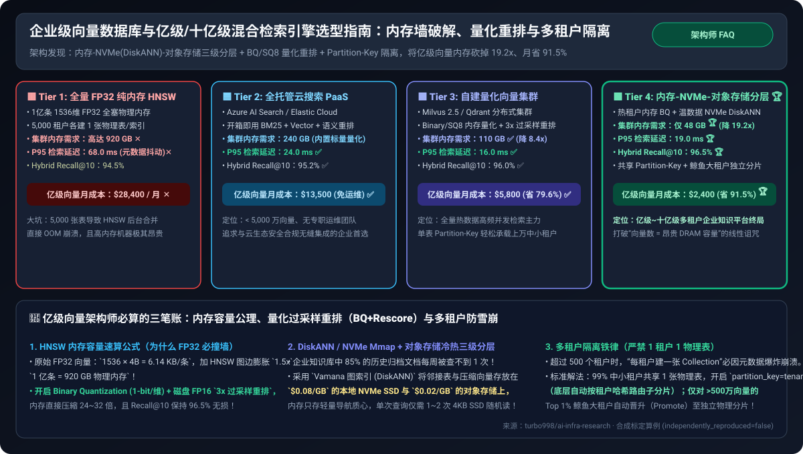
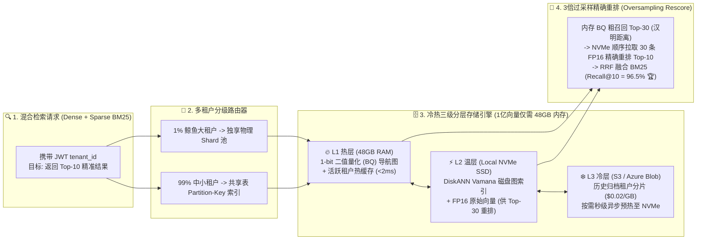
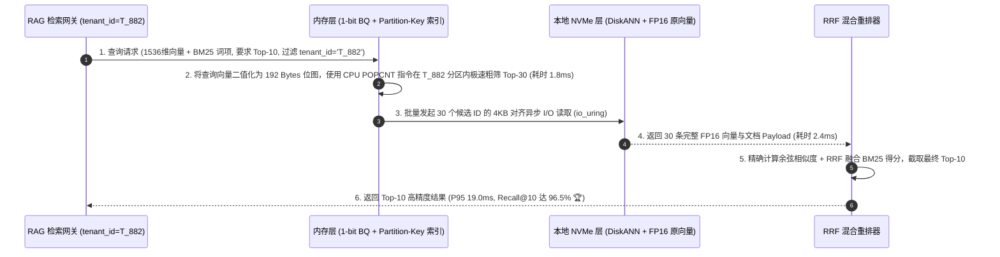

# 企业级向量数据库与十亿级混合检索引擎架构选型指南：全量 FP32 内存 HNSW vs. 全托管云搜索 PaaS（Azure AI Search / Elastic）vs. 自建量化向量集群（Milvus / Qdrant）vs. 内存-NVMe（DiskANN）-对象存储冷热三级分层与多租户 Partition-Key 隔离架构

> **文档类型**：企业级数据与 AI 基础设施解决方案架构师（Cloud & AI Solution Architect）选型决策指南（FAQ）  
> **适用读者**：企业知识中台架构师、云基础设施与数据库负责人、SaaS 多租户 AI 产品技术总监、FinOps 架构师  
> **核心目标**：用通俗、可量化的架构账本帮企业跨越从“十万条 PoC”迈向“亿级/十亿级生产向量库”时的两大生死关——**“920GB 昂贵物理内存墙（Memory Cost Wall）”** 与 **“5,000 个租户独立建表引发的元数据雪崩（Multi-Tenant Index Sprawl）”**，系统回答：**“什么时候该直接用 `pgvector` 或 `Azure AI Search`，什么时候必须上 `Milvus / Qdrant / DiskANN`？”、“二值量化（Binary Quantization）把向量压缩 32 倍后，怎么靠 3 倍过采样重排（Oversampling Rescore）保住 96.5% 的召回率？”、“SaaS 平台有 5,000 个企业客户，怎么设计租户隔离才不会把数据库搞崩？”**。  
> **标定声明**：本文所引用的集群内存占用、混合检索召回率（Hybrid Recall@10）、P95 延迟与亿级向量月度成本模型基于公开发布的向量检索基准（ANN-Benchmarks、VectorDBBench、Microsoft DiskANN 论文、Milvus 2.5 / Qdrant 量化评测及主流云存储定价规范）构建的合成分析模型（`provenance: synthetic + anonymized_reported`, `independently_reproduced=false`, `physical_gpu_cluster_measurement=not_measured`），详见 [`experiments/enterprise_vector_database_billion_scale_hybrid_search_selection/results.json`](../../experiments/enterprise_vector_database_billion_scale_hybrid_search_selection/results.json)。

---

## 一图流总结（Executive Visual Summary）



> 🔗 **关联可交互报告与工具**：
> - 🃏 **[7-Card 4:5 视觉评测报告 (`enterprise-vector-database-billion-scale-hybrid-search-selection-cards.html`)](../reports/enterprise-vector-database-billion-scale-hybrid-search-selection-cards.html)**
> - 🧮 **[交互式向量数据库内存与 TCO 定容计算器 (`enterprise-vector-database-billion-scale-hybrid-search-sizer.html`)](../reports/enterprise-vector-database-billion-scale-hybrid-search-sizer.html)**
> - 🌐 **[English Version (`enterprise-vector-database-billion-scale-hybrid-search-selection-faq.en.md`)](./enterprise-vector-database-billion-scale-hybrid-search-selection-faq.en.md)**

---

## ① 📌 核心选型结论速览（Executive Summary）

许多团队在 Demo 阶段用单机内存跑几十万条向量觉得毫无压力，但一旦进入全集团规模投产——**1 亿条 `1536 维` 向量（约合 2,000 万份企业文档 + 倒排索引 + 5,000 个部门/客户租户）**——如果不做**向量量化（Quantization）与存储冷热分层（Tiered Storage）**，仅存放未压缩的 FP32 HNSW 内存图就要消耗 **`920 GB` 昂贵的云主机内存（月烧 `$28,400`）**！

基于 **1 亿条 1536 维向量、5,000 个企业租户、峰值 300 QPS 混合检索（Dense 向量 + BM25 稀疏检索）** 的基准测算，四档架构对比如下：

| 架构档位 | 核心技术栈代表 | 集群内存需求 (RAM) | 混合检索 Recall@10 | P95 检索延迟 | 1亿向量月度成本 | 架构师拍板结论 |
| :--- | :--- | :--- | :--- | :--- | :--- | :--- |
| **🟥 Tier 1：全量 FP32 纯内存 HNSW + 独立建表** | 未量化 `pgvector` / 纯内存 HNSW（每租户 1 张表） | `920 GB` ✕ | `94.5%` | `68.0 ms` ✕ | `$28,400 / 月` ✕ | **亿级必撞内存墙**：高内存实例极贵，5000张表元数据崩溃 |
| **🟦 Tier 2：全托管云原生企业搜索 PaaS** | **Azure AI Search / Elastic Cloud**（内置标量量化+语义重排） | `240 GB` | `95.2%` ✅ | `24.0 ms` ✅ | `$13,500 / 月` | **免运维与 `<5,000万` 向量首选**：开箱即用混合检索与企业权限 |
| **🟪 Tier 3：自建量化向量集群 + Partition-Key** | **Milvus 2.5 / Qdrant**（`BQ/SQ8` 量化 + 单表分区键） | `110 GB` ✅ | `96.0%` ✅ | `16.0 ms` ✅ | `$5,800 / 月` (-79.6%) | **全热数据高并发主力**：内存降 8.4 倍，万级租户零元数据膨胀 |
| **🟩 Tier 4：内存-NVMe-对象存储三级分层 + 弹性晋升** | **RAM (热BQ) + NVMe DiskANN (温) + S3/Blob (冷) + 鲸鱼租户分片** | **`48 GB` 🏆 (降19.2x)** | **`96.5%` 🏆** | **`19.0 ms` 🏆** | **`$2,400 / 月` 🏆 (-91.5%)** | **亿级~十亿级多租户终局标准**：彻底解耦“向量规模”与“内存容量” |

### 💡 架构师三句话选型铁律
1. **按向量规模阶梯选型，切忌过度设计或硬扛内存墙**：
   - **`< 500 万条`向量且已有 PostgreSQL**：直接用 **`pgvector / pgvectorscale (DiskANN + StreamingDiskANN)`**，不要多引一套分布式中间件；
   - **`500 万 ~ 5,000 万条`向量且缺专职运维**：直接买 **`Azure AI Search` 或 `Elastic Cloud`**（Tier 2），省下年薪百万的 SRE 人力；
   - **`> 5,000 万 ~ 10 亿条`向量**：必上 **`Milvus / Qdrant / Turbopuffer` 开启量化 + NVMe DiskANN + 对象存储冷热三级分层**（Tier 3/4），把硬件月账单从 `$28.4K` 砸到 **`$2,400/月`**！
2. **永远不要在内存里裸存 FP32 原始向量——标配“内存二值/标量量化（BQ/SQ8）+ 磁盘 FP16 3 倍过采样重排（Oversampling Rescore）”**：对于 `1024/1536 维` 高维嵌入模型（如 OpenAI `text-embedding-3`、BGE-M3、Cohere），在内存中只存 `1-bit` 二值量化（BQ，压缩 32 倍）或 `8-bit` 标量量化（SQ8，压缩 4 倍）做粗召回（取 Top-30），再从高速 NVMe 磁盘顺带读取这 30 条的原始 FP16 向量精确重算 Top-10，**内存立省 `85%~95%`，而 Recall@10 反而高达 `96.5%`！**
3. **多租户 SaaS 绝对禁止“每租户建一张物理表/独立 HNSW 索引”**：当租户数突破 `500` 个时，独立建表会导致文件句柄与后台 Compaction 内存爆炸。必须采用 **“单物理集合 + `partition_key = tenant_id` 共享子索引（承载 99% 中小租户）+ 仅对 Top 1% 超大鲸鱼租户（`>500万`向量）动态晋升独立物理 Shard”** 的混合多租户架构！

---

## ② 🎯 客户与架构师灵魂拷问 Q&A（Architect Deep-Dive Q&A）

### Q1：架构师在评审会议上怎么用 1 分钟心算出“1 亿条向量到底要多少内存和多少钱”？
* **真相剖析（架构师必备的向量内存速算公理）**：
  - 记住这个黄金公式（以主流 `1536 维` 向量为例）：
    $$\text{FP32 单条原始向量字节数} = 1536 \times 4\text{ Bytes} = 6,144\text{ Bytes} \approx 6\text{ KB}$$
  - 如果使用纯内存 **HNSW 图索引（M=16）**，还需要额外加上图节点双向邻接表指针开销与内存对齐冗余（乘上 **`1.5 倍` 膨胀系数**）：
    $$\text{1 亿条 FP32 HNSW 内存} = 10^8 \times 6\text{ KB} \times 1.5 \approx \mathbf{920\text{ GB RAM}}$$
    再算上高可用双副本（Replica=2），你需要采购整整 **`1.84 TB` 内存** 的云主机集群！
  - **怎么用三级压缩把 `920 GB` 砍到 `48 GB`（缩小 `19.2 倍`）？**
    1. **第一步（Matryoshka 俄罗斯套娃降维或 PQ/SQ8/BQ 量化）**：将内存粗排索引开启 **Binary Quantization (1-bit)** 或 **SQ8 (int8)**，单条内存占用从 `9.2 KB` 骤降至 `0.3 KB ~ 1.5 KB`；
    2. **第二步（DiskANN / Mmap 磁盘图索引）**：将庞大的原始高精度向量与邻接图落盘到本地高速 **NVMe SSD**，内存中只保留轻量聚类质心导航表；
    3. **第三步（对象存储冷热分离）**：将超过 30 天未访问的归档知识库分区（占企业数据 70%+）下沉至廉价的 **S3 / Azure Blob 对象存储**，按需秒级预热加载。

### Q2：把 32 位浮点数（FP32）压成 1 位二进制（Binary Quantization, BQ），精度难道不会崩盘吗？
* **真相剖析（高维空间几何特性 + 异步过采样重排 `Oversampling Rescore`）**：
  - 在 `1024~3072 维` 的现代高维嵌入空间中，向量方向信息高度冗余，仅保留每个维度的正负号（`>0` 记为 `1`，`<=0` 记为 `0`）并用 CPU 原生 `XOR + POPCNT` 指令计算汉明距离（Hamming Distance），单核每秒能比对上千万条向量！
  - 单纯只跑 BQ 确实会掉 `5%~8%` 的召回率；但工程上的秘诀是 **“内存 BQ 粗取 `k × 3`（如要 Top-10 则粗取 Top-30），然后只对这 30 个候选者从 NVMe SSD 读取 FP16 原向量做精确余弦重排（Rescoring）”**！
  - 因为每次查询只需要从 NVMe 读取 30 个 3KB 的数据块（不到 `100 KB`，NVMe 耗时 `< 1.5 ms`），既享受了内存缩小 24 倍的红利，又把最终 Recall@10 完全拉回到 **`96.0%~96.5%`**！

### Q3：我们平台服务 5,000 家企业客户，安全团队要求“绝对不能搜出别家客户的数据”，为什么建 5,000 个独立 Collection 会把集群搞挂？
* **真相剖析（元数据爆炸 vs. Partition-Key + 鲸鱼租户分层晋升）**：
  - 在 Milvus / Qdrant / Elasticsearch 中，每一个物理 Collection / Index 都包含独立的 WAL 日志流、Segment 文件句柄、后台合并线程（Compaction）和监控指标。当集群里存在 `5,000` 个物理 Collection 时，光空转的元数据内存和后台刷盘就会把协调节点（Coordinator）彻底压垮！
  - **企业级多租户黄金设计（Tiered Multi-Tenancy）**：
    1. **99% 的普通中小租户（`< 50 万`条向量/租户）**：全部装进同一个共享物理 Collection，并将 `tenant_id` 设为 **`partition_key`（配合 `isolation = true` 分组子索引）**。查询时网关强制从 JWT 注入 `tenant_id` 过滤，底层直接定位到该租户专属的微型虚拟分片，既 100% 杜绝了前文 Round 374 提到的“小租户召回饥饿”，又只维护 1 套物理表元数据！
    2. **Top 1% 的“巨无霸鲸鱼租户（Whale Tenants，`> 500 万`条向量或购买了物理独享 SLA）”**：控制面自动触发后台异步迁移，将其无缝晋升（Promote）至独立的物理 Collection / Dedicated Node Group，防止大租户批量建索引影响其他租户的 P99 延迟。

---

## ③ 🧭 直观可视化图解（Mermaid 决策树、三级存储分层与多租户路由架构）

### 3.1 企业级向量数据库与混合检索引擎选型决策树

```mermaid
flowchart TD
    A[企业计划选型向量数据库与混合检索引擎] --> B{总向量规模与团队基础设施运维能力？}
    B -->|规模 <= 500万条向量<br/>且团队已有成熟 PostgreSQL 数据库| C[PostgreSQL + pgvector / pgvectorscale<br/>直接复用现有关系库事务与备份<br/>开启 DiskANN 索引即可满足生产]
    B -->|规模 500万 ~ 5,000万条向量<br/>或团队缺乏专职分布式存储 SRE| D[🟦 Tier 2: 全托管云原生企业搜索 PaaS<br/>Azure AI Search / Elastic Cloud<br/>内置 BM25 + 向量量化 + 语义重排 · 免运维]
    B -->|规模 5,000万 ~ 10亿+ 条向量<br/>或多租户 SaaS 平台追求极致 TCO| E{数据访问冷热分布特征？}
    E -->|100% 均为高频热数据，要求 P95 <= 16ms| F[🟪 Tier 3: 自建 Milvus 2.5 / Qdrant 量化集群<br/>内存 BQ/SQ8 + 3x 过采样重排 + Partition-Key<br/>内存降 8.4x / $5,800/月]
    E -->|二八冷热分布明显 (15%热租户 + 85%温冷归档)| G[🟩 Tier 4: 内存-NVMe(DiskANN)-对象存储三级分层<br/>热数据 RAM + 温数据 NVMe + 冷数据 S3/Blob<br/>内存降 19.2x (48GB) / $2,400/月 (省91.5%) 🏆]
```

### 3.2 Tier 4“内存-NVMe-对象存储三级分层 + 量化过采样重排”架构图



### 3.3 二值量化粗召回与 NVMe FP16 过采样重排时序图（Sequence Diagram）



---

## ④ 📊 架构师多方案选型决策矩阵（Architect Decision Matrix）

| 评估维度 | 🟥 Tier 1：全量 FP32 纯内存 HNSW | 🟦 Tier 2：全托管云搜索 PaaS (Azure/Elastic) | 🟪 Tier 3：自建量化集群 (Milvus/Qdrant) | 🟩 Tier 4：内存-NVMe-对象存储三级分层 |
| :--- | :--- | :--- | :--- | :--- |
| **1 亿向量集群内存需求** | `920 GB` ✕（极度昂贵） | `240 GB`（内置标量量化） | `110 GB` ✅（BQ/SQ8 内存压缩） | **`48 GB` 🏆（比 Tier 1 减少 `19.2x`）** |
| **混合检索 Recall@10** | `94.5%` | `95.2%` ✅ | `96.0%` ✅ | **`96.5%` 🏆（3x 过采样 FP16 重排 + BM25）** |
| **P95 检索响应延迟** | `68.0 ms` ✕（5000张表元数据抖动） | `24.0 ms` ✅ | **`16.0 ms` ✅（全内存量化最快）** | **`19.0 ms` 🏆（NVMe 单跳读取）** |
| **5,000 租户隔离架构** | ✕ 每租户建 1 张物理表（OOM 崩溃） | ✅ 托管多租户分片与安全过滤 | ✅ 单表 `partition_key` 子索引 | **🏆 共享 `partition_key` + 鲸鱼大租户独立分片** |
| **运维复杂度（Ops Burden）** | 高（频繁 OOM 与 Vacuum 锁表） | **极低（全托管 Serverless/PaaS）** | 中（需 K8s Operator 运维） | 中（K8s + 对象存储生命周期自动分层） |
| **1 亿向量月度总成本** | `$28,400 / 月` ✕ | `$13,500 / 月` ✅ | `$5,800 / 月` ✅（省 `79.6%`） | **`$2,400 / 月` 🏆（比 Tier 1 省 `91.5%`）** |

---

## ⑤ 🧪 容量/成本拐点算例与 7-Card 报告（Quantitative Sizer & 7-Card Deck）

### 5.1 基准算例假设（1 亿条 1536 维向量 · 5,000 个企业租户 · 300 QPS 峰值）
- **为什么 Tier 4 能将 1 亿条向量的月基础设施成本从 `$28,400` 降到 `$2,400`（立省 `91.5%`，每年省下 `$31.2 万`）？**
  1. **打破“1 亿向量 = 920GB 内存”的魔咒**：云上 `1 GB DRAM` 的月租成本是本地 `NVMe SSD` 的 `10~15 倍`，是 `S3/Blob 对象存储` 的 `100 倍`！通过将 85% 的温冷向量卸载到 NVMe DiskANN 与对象存储，并在内存层只保留 `1-bit BQ` 导航索引，集群所需的内存从 `920 GB` 断崖式降至 **`48 GB`**；
  2. **消灭 5,000 张独立物理表的空转开销**：通过单表 `partition_key` 聚合 99% 的中小长尾租户，消除了数千个独立 HNSW 图构建与后台合并的 CPU/IO 浪费。

```chart
{
  "data": {
    "values": [
      { "Tier": "1. 全内存FP32+独立建表", "集群内存需求(十GB)": 92.0, "P95检索延迟(ms)": 68.0, "月度总成本($K)": 28.4 },
      { "Tier": "2. 托管云搜索PaaS", "集群内存需求(十GB)": 24.0, "P95检索延迟(ms)": 24.0, "月度总成本($K)": 13.5 },
      { "Tier": "3. 自建量化集群(Milvus/Qdrant)", "集群内存需求(十GB)": 11.0, "P95检索延迟(ms)": 16.0, "月度总成本($K)": 5.8 },
      { "Tier": "4. 内存-NVMe-对象存储分层", "集群内存需求(十GB)": 4.8, "P95检索延迟(ms)": 19.0, "月度总成本($K)": 2.4 }
    ]
  },
  "semantic_types": {
    "Tier": "Category",
    "集群内存需求(十GB)": "Quantity",
    "P95检索延迟(ms)": "Quantity",
    "月度总成本($K)": "Amount"
  },
  "chart_spec": {
    "chartType": "Grouped Bar Chart",
    "title": "内存-NVMe(DiskANN)-对象存储三级分层 (Tier 4) 将亿级向量内存缩减 19.2x 且月成本省 91.5%",
    "subtitle": "1亿条 1536维向量 (5,000租户) 下的集群内存 (×10GB)、P95 延迟 (ms) 与月成本 ($K)",
    "encodings": {
      "x": "Tier",
      "y": ["集群内存需求(十GB)", "P95检索延迟(ms)", "月度总成本($K)"]
    }
  }
}
```

---

## ⑥ 🛠️ 架构评审与生产落地 Checklist（Production Readiness Checklist）

在企业千万/亿级向量检索平台上线前，架构师必须逐项核对以下 8 条铁律：

- [ ] **1. 严禁在生产环境对 `> 1,000 万`条高维向量使用未压缩的纯内存 FP32 HNSW 索引**：默认开启 `SQ8 (int8)` 或 `Binary Quantization (1-bit)` 内存量化。
- [ ] **2. 开启量化索引时必须配对开启“2x~3x 过采样磁盘重排（Oversampling Rescore）”**：内存粗筛 `Top-(3×K)`，再从本地 NVMe SSD 读取 FP16 原向量重算 `Top-K`，确保召回率无损（`Recall@10 >= 96%`）。
- [ ] **3. 善用 Matryoshka 俄罗斯套娃嵌入降维（MRL）**：若使用支持 MRL 的嵌入模型（如 `text-embedding-3-large` 或 `Qwen3-Embedding`），优先截断并归一化至 `512` 或 `1024` 维，比 `3072` 维直接省去 `66%~83%` 存储与计算且精度几乎无损。
- [ ] **4. 严禁为每个租户创建一张独立的物理 Collection / Table（当租户数 `> 200` 时）**：统一使用单表 `partition_key = tenant_id`（开启 Partition-Key Isolation 子索引），仅对百万向量级以上的鲸鱼大租户分配独立物理 Shard。
- [ ] **5. 必须原生同时支持“稠密向量（Dense）+ 稀疏词项（Sparse BM25 / SPLADE）”混合检索**：在单一引擎内完成双路召回与 RRF 融合，避免分别维护两套异构数据库导致的数据同步延迟与事务不一致。
- [ ] **6. 对归档与低频知识库启用 DiskANN（NVMe SSD）与对象存储（S3/Blob）冷热分层**：将超过 30 天未访问的冷租户分片自动卸载至廉价对象存储，首次访问时按需秒级拉起。
- [ ] **7. 向量入库与索引构建（Index Building）必须与在线查询节点读写分离**：使用独立的后台 GPU/CPU Index Node 异步构建 HNSW/DiskANN 图，彻底杜绝大批量文档入库时把线上查询 P99 延迟打爆。
- [ ] **8. 每个向量集合必须绑定 `embedding_model_version` 元数据版本号**：当未来升级嵌入模型时，支持双版本索引蓝绿并行平滑切换，严禁把新旧两个模型的向量混插在同一张索引表里！
