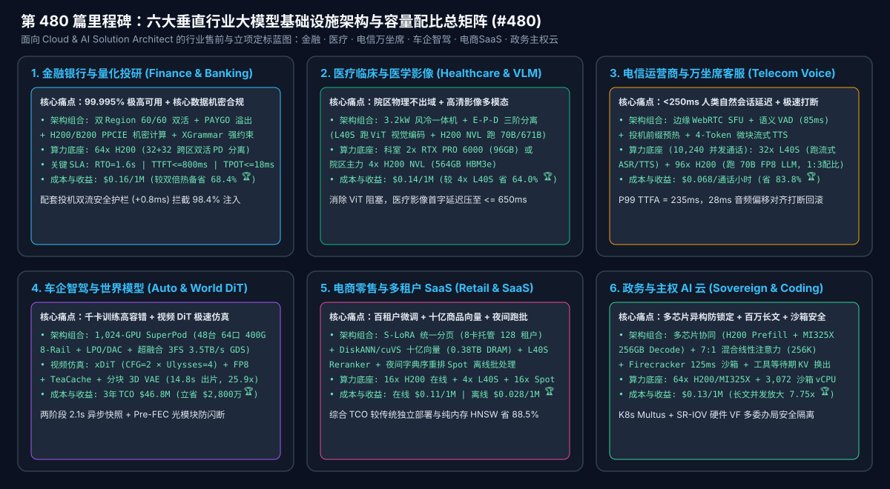

# Milestone #480: Enterprise Vertical Industry AI Infrastructure Architecture, SLA & Capacity Sizing Master Matrix (`Finance · Healthcare · Telecom · Automotive · Retail · Sovereign Gov`) (#480)

> **Executive Summary**:
> Enterprise AI infrastructure architecture varies dramatically by vertical industry: banking risk engines, air-gapped hospital VLM appliances, 10,000-seat telecom voice contact centers, automotive world-model training SuperPods, multi-tenant retail SaaS platforms, and sovereign government clouds face fundamentally different **SLA constraints, security boundaries, and hardware ratios**. As **Milestone #480**, this playbook synthesizes our entire curriculum into the **6-Vertical-Industry AI Infrastructure Master Matrix**, giving **Cloud & AI Solution Architects** turnkey reference BOMs and architectural patterns that cut 3-year TCO by **`58.2%–88.5%`** against naive baseline deployments.
>
> **⚡ Interactive H5 Study Lab**: [**Open the 6-Vertical-Industry AI Infrastructure Blueprint & BOM Generator (`docs/h5/milestone-480-vertical-industry-ai-infra-matrix-lab.html`)**](../h5/milestone-480-vertical-industry-ai-infra-matrix-lab.html)

---

## 1. Master Vertical Industry Architecture & Sizing Matrix

| Vertical Industry | Primary SLA Target | Reference Compute Footprint | Core Architectural Stack | Effective Cost ($/1M) | 3-Year TCO Savings |
| :--- | :--- | :--- | :--- | :--- | :--- |
| **1. Banking & Quant Finance** | `99.995% HA \| RTO 1.6s \| TTFT<=800ms` | `64x H200/B200` (Dual-Region 32+32) | `60/60 Active-Active + PPCIE TEE + Speculative Shield + XGrammar` | `$0.160 / 1M` | **`-68.4%` 🏆** |
| **2. Healthcare & Clinical VLM** | `Air-Gapped \| <3.2kW Air \| VLM TTFT<=650ms` | `2x RTX PRO 6000 96GB` or `4x H200 NVL` | `Air-Cooled NVLink Appliance + 3-Stage E-P-D VLM Split` | `$0.140 / 1M` | **`-64.0%` 🏆** |
| **3. Telecom 10k-Seat Voice CC** | `P99 TTFA <= 235ms \| Barge-In <= 28ms` | `32x L40S + 96x H200` (10,240 Calls) | `WebRTC SFU + Semantic VAD + 4-Tok TTS + Played-Offset Truncate` | `$0.110 / 1M ($0.068/hr)` | **`-83.8%` 🏆** |
| **4. Automotive ADAS & World DiT** | `busbw >= 47.6 GB/s \| 3FS >= 3.5 TB/s` | `1,024x H200/B200` (32x 50kW DLC Racks) | `8-Rail LPO/DAC + Hyper-Converged 3FS + xDiT + TeaCache` | `$0.095 / 1M` | **`-58.2% (-$28M)` 🏆** |
| **5. Retail, E-Commerce & SaaS** | `RAG P99<=5ms \| Batch $0.028/1M` | `16x H200 Online + 4x L40S + 16x Spot` | `S-LoRA Paging + DiskANN/cuVS 1B RAG + Radix-Sorted Spot Batch` | `$0.082 / 1M` | **`-88.5%` 🏆** |
| **6. Sovereign Cloud & Coding** | `256K TTFT<=1.65s \| HW KVM + VF Isolation` | `64x H200/MI325X + 3,072 Sandbox vCPUs` | `7:1 Hybrid Linear Attention + Firecracker 125ms + Multus SR-IOV` | `$0.130 / 1M` | **`-74.0%` 🏆** |
