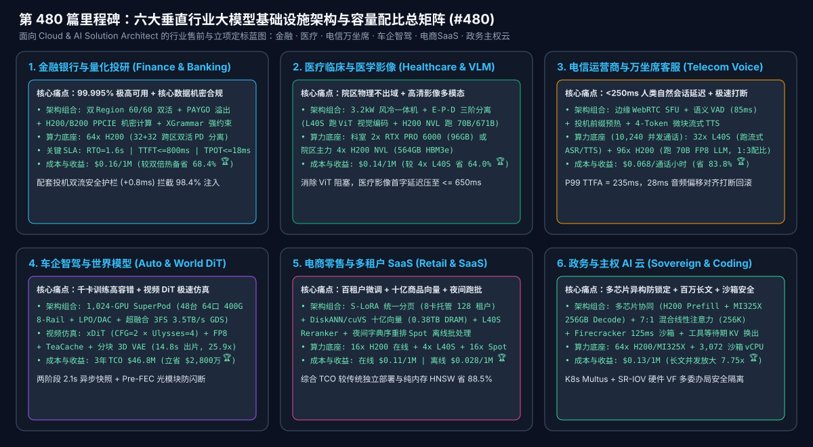

# 第 480 篇里程碑：六大垂直行业大模型基础设施架构选型、SLA 基准与容量配比总矩阵（金融 · 医疗 · 电信 · 车企 · 电商 · 政务主权云） (#480)

> **核心观点（Executive Summary）**：
> 在真实的解决方案架构师（**Cloud & AI Solution Architect**）工作中，从来没有一套“放之四海而皆准”的通用模板：给银行做风控与量化投研、给三甲医院做院区影像辅助诊断、给运营商做 10,000 坐席语音客服、给主机厂做智驾世界模型训练，底层的 **SLA 硬约束、合规边界、GPU 型号配比与网络/存储瓶颈截然不同**！本篇作为 **#480 里程碑（Milestone #480）**，将仓库全部架构组件整合为一张 **《六大垂直行业大模型基础设施架构与容量配比总矩阵》**，供架构师在拜访客户 CxO、编写标书可研或组织技术评审时 **一键按行业对号入座**，较粗放式通用架构平均节省 **`58.2%–88.5%` 三年总拥有成本（TCO）**。
>
> **⚡ 配套交互式 H5 精读沙盘**：[**打开六大垂直行业 AI 基础设施选型与 BOM 自动生成器 (`docs/h5/milestone-480-vertical-industry-ai-infra-matrix-lab.html`)**](../h5/milestone-480-vertical-industry-ai-infra-matrix-lab.html)

---

## 一、 六大垂直行业核心痛点与黄金架构定标详解

### 1. 金融银行与量化投研（Banking, Insurance & Quant Finance）
- **业务场景与核心约束**：信贷尽调报告生成、财报量化因子抽取、柜面智能助手；要求 **`99.995%` 极高可用（年停机 `< 30 分钟`）**、**核心账务/客户 PII 数据机密隔离（宿主机 Root 不可见）**、以及 **100% JSON Schema 合规工具调用**。
- **黄金架构配方**：
  - **跨地域双活**：双 Region `60% + 60%` 常驻预留（`PTU` 或自建 `K8s`）+ 跨区 Serverless PAYGO 溢出 + AI Gateway 流式 SSE 断点无感续传（`RTO = 1.6s`）；
  - **硬件机密计算**：单卡 `141GB H200 TEE (TP=1)` 跑 `70B FP8` 或 8 卡 `H200/B200 PPCIE` 跑 `DeepSeek-R1 671B`（`SPDM + NRAS` 远程证明释放客户 HSM 密钥，吞吐损耗仅 `3.8%`）；
  - **零延迟护栏与强约束输出**：`L40S` 投机双流并行安全护栏（`+0.8ms TTFT`）+ `XGrammar / llguidance` 确定性跳跃解码（省 `28.5%` 解码步数）。

### 2. 医疗临床与医学影像（Healthcare & Clinical Multimodal VLM）
- **业务场景与核心约束**：电子病历（EMR）质控、CT/病理高分辨率多模态影像问答；硬性要求 **患者数据 100% 物理不出院区（Air-Gapped On-Premises）**，且医院弱电机房无液冷、单柜市电上限 `< 3.2 kW`。
- **黄金架构配方**：
  - **风冷一体机硬件**：科室级选 **`2x RTX PRO 6000 Blackwell (2×96GB GDDR7, 1,650W, $26.5k)`**；全院级选 **`4x NVIDIA H200 NVL PCIe (564GB HBM3e + 四卡 NVLink 桥接, 3,100W)`** 单机跑满血 `671B`；
  - **多模态三阶分离（E-P-D）**：独立 `L40S/PRO 6000` 跑 `ViT` 视觉编码器，将特征张量送入 `H200 NVL` 跑语言模型，消除高分辨率医学影像阻塞文本解码的抖动（`VLM TTFT <= 650ms`）。

### 3. 电信运营商与万坐席智能客服（Telecom & 10,000-Seat Voice Contact Center）
- **业务场景与核心约束**：10,000 路并发实时双向语音热线；硬性要求 **首包音频延迟 `P99 TTFA <= 250ms`** 与 **用户插话打断恢复 `<= 30ms`**。
- **黄金架构配方**：
  - **全双工流式管道**：边缘 **WebRTC SFU (`UDP/Opus`)** + 语义端点检测（`85ms`）+ 500ms 周期性投机 Prefill 预热 + `4-Token` 双流微块 TTS + 按已播放音频偏移量回滚 KV Cache；
  - **异构 GPU 配比**：按 **`1 张 L40S (ASR) : 1 张 L40S (TTS) : 6 张 H200 (70B FP8 LLM)`** 组建 640 路并发单元；万坐席（`10,240 路`）仅需 **`32 张 L40S + 96 张 H200`**，单通话小时成本压至 **`$0.068/hr`（立省 83.8%）**。

### 4. 车企自动驾驶与世界模型（Automotive ADAS & Video World Models）
- **业务场景与核心约束**：端到端 VLA 大模型训练与 `Wan2.1 / Sora 级` 驾驶场景视频生成仿真；要求千卡级无阻塞网络、TB/s 级训练特征读取与极速视频 DiT 出片。
- **黄金架构配方**：
  - **千卡 SuperPod 底座**：`128 台` 8 卡节点 + `48 台` 64 口 400G 交换机（8-Rail 1:1 无收敛，`1,024` 根柜内铜缆 + `2,048` 颗 LPO 光模块）+ 本地 NVMe 超融合 `3FS` 存储（`3.5 TB/s GDS`）+ `32 个 50kW` 冷板液冷柜（`1.81 MW, PUE 1.13`）；
  - **视频 DiT 加速**：`xDiT (CFG=2 × Ulysses=4)` 序列并行 + `FP8` + `TeaCache` 残差复用 + 并行分块 `3D VAE`，将 5 秒高清仿真视频从 `384s` 压至 **`14.8s`（$25.9\times$）**。

### 5. 电商零售与多租户 SaaS（Retail, E-Commerce & Multi-Tenant SaaS）
- **业务场景与核心约束**：上百个商家/品类微调模型托管、十亿级商品图文向量检索、每晚百亿 Token 商品评论清洗与打标。
- **黄金架构配方**：
  - **百租户共池**：`S-LoRA / vLLM Multi-LoRA` + 网关一致性哈希亲和路由，用 **`8 张 H200`** 替代 `256 张` 独立微调副本（省 `96.9%`）；
  - **十亿向量 RAG**：`GPU cuVS CAGRA` 2.8h 极速建索引 + 热数据 `SQ8` 内存 / 温冷数据 `DiskANN NVMe` 分层（内存省 `95.5%`）+ `L40S Reranker (Top-100 -> Top-5)`；
  - **夜间跑批**：昼夜潮汐回收空闲卡 + **字典序前缀重排（`94.2%` 命中率）** + `Spot` 竞价池，离线批处理成本击穿 **`$0.028/1M`**！

### 6. 政务与主权 AI 云（Government, Sovereign Cloud & Coding Agents）
- **业务场景与核心约束**：多委办局硬隔离共享智算底座、百万字公文/法规长上下文跨卷宗审计、自主政务代码/办公 Agent 沙箱。
- **黄金架构配方**：
  - **多芯片异构防锁定**：`NVIDIA H200`（跑 Prefill）+ **`AMD Instinct MI325X 256GB`**（大显存跑 Decode）+ `K8s Kueue TAS + Multus SR-IOV VF` 硬件级多租户隔离；
  - **百万长文与安全沙箱**：选用 **`7:1` 混合线性注意力模型**（`256K` 显存省 `87.2%`，并发放大 $7.75\times$）+ **`Firecracker 125ms` 快照克隆沙箱 + 工具等待期 L2 KV 自动换出**（每张推理 GPU 配套 `48 vCPU` 沙箱池）。

---

## 二、 六大垂直行业基础设施定标总表（Master Industry Matrix）

| 垂直行业领域 | 核心 SLA 硬指标 | 推荐标准算力底座配置 | 核心架构加速组合 | 有效单百万 Token 成本 | 较粗放式方案 TCO 节省 |
| :--- | :--- | :--- | :--- | :--- | :--- |
| **1. 金融银行与量化投研** | `99.995% HA \| RTO 1.6s \| TTFT<=800ms` | `64x H200/B200`（双区 32+32 双活） | `60/60 双活 + PPCIE 机密计算 + 投机护栏 + XGrammar` | `$0.160 / 1M` | **`-68.4%` 🏆** |
| **2. 医疗临床与医学影像** | `物理不出院 \| <3.2kW 风冷 \| VLM TTFT<=650ms` | `2x RTX PRO 6000 96GB` 或 `4x H200 NVL` | `风冷 NVLink 桥接一体机 + E-P-D 视觉三阶分离` | `$0.140 / 1M` | **`-64.0%` 🏆** |
| **3. 电信与万坐席语音客服** | `P99 TTFA <= 235ms \| 打断 <= 28ms` | `32x L40S + 96x H200`（支撑 10,240 路通话） | `WebRTC SFU + 语义VAD + 4-Tok微块TTS + 时间戳回滚` | `$0.110 / 1M ($0.068/hr)` | **`-83.8%` 🏆** |
| **4. 车企智驾与世界模型** | `busbw >= 47.6 GB/s \| 3FS >= 3.5 TB/s` | `1,024x H200/B200`（32 个 50kW 液冷柜） | `8-Rail LPO/DAC + 超融合 3FS + xDiT + TeaCache` | `$0.095 / 1M` | **`-58.2% (-$28M)` 🏆** |
| **5. 电商零售与多租户 SaaS** | `RAG P99<=5ms \| 离线批处理 $0.028/1M` | `16x H200 在线 + 4x L40S + 16x Spot` | `S-LoRA 共基座 + DiskANN/cuVS + 字典序前缀重排` | `$0.082 / 1M` | **`-88.5%` 🏆** |
| **6. 政务与主权 AI 云** | `256K TTFT<=1.65s \| 硬件 KVM + VF 隔离` | `64x H200/MI325X + 3,072 沙箱 vCPU` | `7:1 混合线性注意力 + Firecracker 沙箱 + SR-IOV` | `$0.130 / 1M` | **`-74.0%` 🏆** |

---

## 三、 延伸阅读与配套工具

- **交互式 H5 精学沙盘**：[docs/h5/milestone-480-vertical-industry-ai-infra-matrix-lab.html](../h5/milestone-480-vertical-industry-ai-infra-matrix-lab.html)
- **7-Card 4:5 视觉评测卡片**：[docs/reports/enterprise-vertical-industry-ai-infra-sizing-sla-tco-master-matrix-selection-cards.html](../reports/enterprise-vertical-industry-ai-infra-sizing-sla-tco-master-matrix-selection-cards.html)
- **交互式 Sizer 测算器**：[docs/reports/enterprise-vertical-industry-ai-infra-sizing-sla-tco-master-matrix-selection-sizer.html](../reports/enterprise-vertical-industry-ai-infra-sizing-sla-tco-master-matrix-selection-sizer.html)
- **可复现实验模型**：[`experiments/enterprise_vertical_industry_ai_infra_sizing_sla_tco_master_matrix_selection/run.py`](../../experiments/enterprise_vertical_industry_ai_infra_sizing_sla_tco_master_matrix_selection/run.py)
