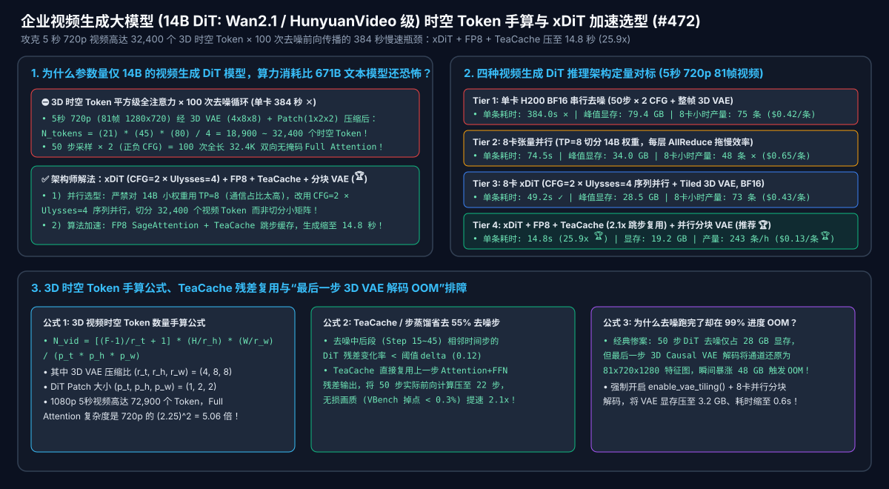

# Enterprise Video Generation (`14B DiT`: `Wan2.1 / HunyuanVideo` Class) Spatiotemporal Token Sizing, `xDiT (CFG × Ulysses)` & `TeaCache` Selection Guide (#472)

> **Executive Summary**:
> Enterprise video generation models (`14B Diffusion Transformers / DiT` such as `Wan2.1-14B` and `HunyuanVideo-13B`) behave fundamentally differently from autoregressive text LLMs: a single 5-second `720p` (`81-frame`) video encodes into **`18,900–32,400` 3D spatiotemporal tokens** and executes **100 full bidirectional attention passes** (`50 denoising steps × 2 CFG passes`), taking **`384 seconds (6.4 minutes)`** on a single `BF16` H200 GPU and frequently crashing with `OOM` at 99% progress during `3D VAE` decoding. For **Cloud & AI Solution Architects**, the production stack combines **`xDiT` (`CFG=2 × Ulysses=4` sequence parallelism) + `FP8 Attention/GEMM` + `TeaCache` adaptive timestep residual reuse (`2.1x`) + Parallel Tiled `3D VAE`**. This compresses per-video latency from `384.0s` to **`14.8s` ($25.9\times$ speedup)**, reduces peak VRAM from `79.4 GB` to **`19.2 GB/GPU`**, and cuts per-video GPU cost by **69.0% (`$0.13/clip`)**.
>
> **⚡ Interactive H5 Study Lab**: [**Open the Video Generation DiT Spatiotemporal Token & xDiT + TeaCache Sizer (`docs/h5/video-generation-dit-usp-teacache-gpu-sizer-lab.html`)**](../h5/video-generation-dit-usp-teacache-gpu-sizer-lab.html)

---

## 1. Core Q&A: Hand-Calculating 3D Video Tokens and Avoiding 99%-Progress VAE OOM

### Q1: How do we hand-calculate the exact spatiotemporal token count of a video clip?
With 3D VAE compression ratios $(r_t, r_h, r_w) = (4, 8, 8)$ and DiT patch size $(p_t, p_h, p_w) = (1, 2, 2)$:

$$N_{\text{video\_tokens}} = \left( \frac{F - 1}{r_t} + 1 \right) \times \frac{H}{r_h \cdot p_h} \times \frac{W}{r_w \cdot p_w}$$

Always enable **Tiled 3D VAE decoding (`enable_vae_tiling()`)** so the final pixel-upsampling step consumes `3.2 GB` instead of spiking by `50 GB` and crashing at 99% completion.

---

## 2. Quantitative Decision Matrix (`5s 720p 81-Frame Clip · 14B DiT`)

| Video DiT Inference Stack | Clip Latency (sec) | Peak VRAM / GPU (GB) | Clips / Hr per 8-GPU Node | Cost / 5s 720p Clip ($/clip) |
| :--- | :--- | :--- | :--- | :--- |
| **Tier 1: Single-GPU `BF16` Sequential Denoising + Full-Frame VAE** | `384.0 s` ✕ | `79.4 GB` (OOM risk ✕) | `75 clips/hr` | `$0.42` |
| **Tier 2: 8-GPU Tensor Parallelism (`TP=8` Weight Split)** | `74.5 s` | `34.0 GB` | `48 clips/hr` ✕ | `$0.65` ✕ |
| **Tier 3: 8-GPU `xDiT (CFG=2 × Ulysses=4)` + Tiled VAE (`BF16`)** | `49.2 s` ✓ | `28.5 GB` | `73 clips/hr` | `$0.43` |
| **Tier 4: `xDiT + FP8 + TeaCache (2.1x)` + Parallel Tiled VAE 🏆** | **`14.8 s` (25.9x 🏆)** | **`19.2 GB` 🏆** | **`243 clips/hr` (3.24x 🏆)** | **`$0.13` (-69.0% 🏆)** |
