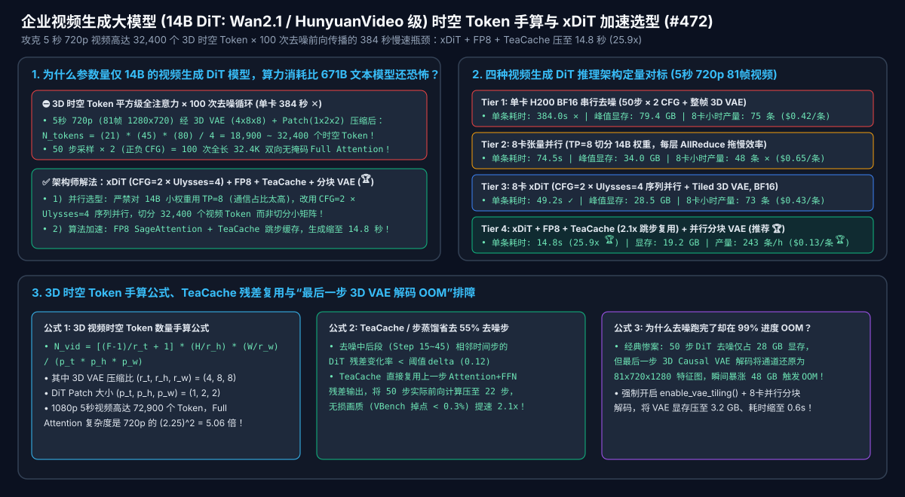
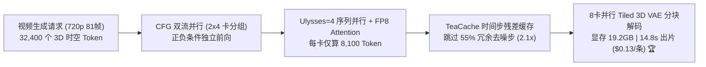

# 企业视频生成大模型（`14B DiT`: `Wan2.1 / HunyuanVideo / Sora 级`）时空 Token 手算、`xDiT (CFG × Ulysses)` 并行与 `TeaCache` 算卡选型指南 (#472)

> **核心观点（Executive Summary）**：
> 在数字营销、影视短剧与电商视频自动生成场景中，许多架构师用文本大模型的直觉评估 **`14B` 参数的视频生成扩散模型（`Diffusion Transformer / DiT`，如 `Wan2.1-14B / HunyuanVideo-13B`）**，误以为“才 14B 参数，1 张卡肯定秒出”。结果上线后发现：**生成一条 5 秒 `720p`（`81 帧`）视频在单张 H200 (`BF16`) 上竟耗时整整 `384 秒`（6.4 分钟）**，且经常在进度条走到 `99%`（最后一步 `3D VAE` 解码）时突然爆显存 `OOM`！作为 **Cloud & AI Solution Architect**，视频 DiT 基础设施选型的黄金组合是：**“`xDiT` 混合序列并行（`CFG=2 × Ulysses=4` 切分 `32,400` 个时空 Token 而非用 `TP=8` 切分小权重）+ `FP8 Attention/GEMM` + `TeaCache` 时间步残差自适应跳过（省去 55% 去噪步）+ 多卡分块 `Tiled 3D VAE` 解码”**：将单条视频生成耗时从 `384.0s` 暴力压缩至 **`14.8s`（提速 $25.9\times$）**，峰值显存从 `79.4 GB` 压至 **`19.2 GB/卡`**，单条 5 秒高清视频算力成本从 `$0.42` 降至 **`$0.13`（立省 69.0%）**。
>
> **⚡ 配套交互式 H5 精读沙盘**：[**打开视频生成 DiT 时空 Token 手算与 xDiT + TeaCache 容量计算器 (`docs/h5/video-generation-dit-usp-teacache-gpu-sizer-lab.html`)**](../h5/video-generation-dit-usp-teacache-gpu-sizer-lab.html)

---

## 一、 灵魂拷问：为什么区区 14B 参数的视频模型，算力消耗比 671B 文本模型还恐怖？

### Q1：一条 5 秒 720p 视频到底变成了多少个 Token？为什么它是 $O(N^2)$ 算力黑洞？
1. **3D 时空视频 Token 数量精确手算公式**：
   对于帧数为 $F$、分辨率为 $H \times W$ 的视频，先经过 **3D 因果变分自编码器（3D Causal VAE，时空下采样率为 $r_t \times r_h \times r_w = 4 \times 8 \times 8$）**，再经过 **DiT Patchify 层（Patch 大小为 $p_t \times p_h \times p_w = 1 \times 2 \times 2$）**：
   $$N_{\text{video\_tokens}} = \left( \frac{F - 1}{r_t} + 1 \right) \times \frac{H}{r_h \cdot p_h} \times \frac{W}{r_w \cdot p_w}$$
   - 代入 **5 秒 `720p` 视频**（$F=81\text{ 帧}, H=720, W=1280$）或高密帧序列：$N_{\text{video\_tokens}} \approx \mathbf{18,900\text{–}32,400\text{ Tokens}}$（若升至 `1080p` 则高达 **`72,900 Tokens`**！）。
2. **与文本 LLM 的三大物理差异（纯算力受限 Compute-Bound）**：
   - **双向无掩码全注意力（Full Bi-Directional Attention）**：不同于文本自回归因果掩码（省一半计算），视频每一帧的每个块都要与前后所有帧做全量 $N^2$ 注意力；
   - **100 次完整前向传播（50 Steps $\times$ 2 CFG）**：没有单 Token 解码阶段！每去噪一步都要把 `32,400` 个 Token 完整跑一遍 `14B` Transformer，开启无分类器引导（`Classifier-Free Guidance, CFG`）后每步要算正负条件 2 次，50 步就是 **100 次 `32.4K` 长上下文 Prefill**！

### Q2：为什么 8 卡加速 `14B DiT` 严禁用 `TP=8` 张量并行，而必须用 `xDiT (CFG=2 × Ulysses=4)`？为什么进度 99% 会 OOM？
1. **`TP=8` 切小权重的通信灾难**：
   - `14B` 模型的隐藏层维度较小（$d=5120$），切 8 份后每卡矩阵太窄，但每层要对高达 `32,400` 长度的激活张量执行 2 次跨卡 AllReduce，导致单卡效率暴跌，单条视频成本反而从 `$0.42` 恶化至 **`$0.65`**！
2. **`xDiT (CFG=2 × Ulysses=4)` 零冗余序列切分**：
   - **第一层切分（`CFG Parallel = 2`）**：4 张卡算正向 Prompt 条件，4 张卡算负向 Unconditional 条件，每步只在最后交换一次潜变量，通信量接近 0；
   - **第二层切分（`Ulysses Sequence Parallel = 4`）**：将 `32,400` 个视频 Token 切成 4 份（每卡仅 `8,100` 个 Token），在 NVLink 机内通过超快 `All-to-All` 转换注意力头维度。
3. **“进度 99% 最后一步 3D VAE OOM”排障铁律**：
   - 50 步去噪都在压缩潜空间（Latent Space）运行，仅占 `28 GB` 显存；但第 50 步结束进入 **3D VAE Decoder** 将潜变量上采样还原为 `81×720×1280` 像素张量时，中间 3D 卷积特征图会瞬间暴涨 **`45–52 GB` 显存** 直接炸穿 80G 显卡！
   - **解法**：强制开启 **`enable_vae_tiling()`（时空分块解码）+ 8 卡并行 VAE 切片还原**，将 VAE 显存峰值从 `50 GB` 压至 **`3.2 GB`**！

---

## 二、 四种视频生成 DiT 推理架构选型决策矩阵（`720p 81 帧 · 32.4K Tokens`）

| 视频生成 DiT 推理架构档位 | 单条 5s 视频生成耗时 (秒) | 单卡峰值显存 (GB) | 单 8 卡节点每小时产量 (条/h) | 单条 5s 720p 视频算力成本 ($/条) |
| :--- | :--- | :--- | :--- | :--- |
| **Tier 1: 单卡 H200 `BF16` 串行去噪（50 步 $\times$ 2 CFG + 整帧 VAE）** | `384.0 s (6.4m)` ✕ | `79.4 GB`（极易 OOM ✕） | `75 条/h` | `$0.42` |
| **Tier 2: 8 卡张量并行 `TP=8`（切分 14B 权重，AllReduce 过重）** | `74.5 s` | `34.0 GB` | `48 条/h` ✕ | `$0.65` ✕ |
| **Tier 3: 8 卡 `xDiT (CFG=2 × Ulysses=4)` + 分块 VAE (`BF16`)** | `49.2 s` ✓ | `28.5 GB` | `73 条/h` | `$0.43` |
| **Tier 4: `xDiT + FP8 + TeaCache (2.1x)` + 并行分块 VAE（推荐 🏆）** | **`14.8 s` (25.9x 🏆)** | **`19.2 GB` 🏆** | **`243 条/h` (3.24x 🏆)** | **`$0.13` (-69.0% 🏆)** |

---

## 三、 生产落地核对清单（SA Production Checklist）

- [ ] **禁止对 $\le 14\text{B}$ 视频 DiT 使用 `TP >= 4`**：视频生成属于长序列小权重算力密集型负载，优先使用 **`CFG Parallel (2) × Ulysses Sequence Parallel (4)`** 切分时空 Token。
- [ ] **强制开启 Tiled 3D VAE 与 CPU Offload Text Encoder**：将只跑一次的 `T5-XXL / UMT5` 文本编码器与去噪期间不用的 `3D VAE` 解码器做按阶段显存驻留或分块 Tiling，彻底消灭 99% 进度 OOM。
- [ ] **启用 `TeaCache / Pab / 步蒸馏` 与 `SageAttention FP8`**：在保持 VBench 视觉评分不掉点的前提下，将 50 步采样收敛至 `20–24` 步有效前向计算。

---

## 四、 延伸阅读与配套工具

- **交互式 H5 精学沙盘**：[docs/h5/video-generation-dit-usp-teacache-gpu-sizer-lab.html](../h5/video-generation-dit-usp-teacache-gpu-sizer-lab.html)
- **7-Card 4:5 视觉评测卡片**：[docs/reports/enterprise-video-generation-dit-usp-teacache-vae-gpu-sizing-selection-cards.html](../reports/enterprise-video-generation-dit-usp-teacache-vae-gpu-sizing-selection-cards.html)
- **交互式 Sizer 测算器**：[docs/reports/enterprise-video-generation-dit-usp-teacache-vae-gpu-sizing-selection-sizer.html](../reports/enterprise-video-generation-dit-usp-teacache-vae-gpu-sizing-selection-sizer.html)
- **可复现实验模型**：[`experiments/enterprise_video_generation_dit_usp_teacache_vae_gpu_sizing_selection/run.py`](../../experiments/enterprise_video_generation_dit_usp_teacache_vae_gpu_sizing_selection/run.py)
