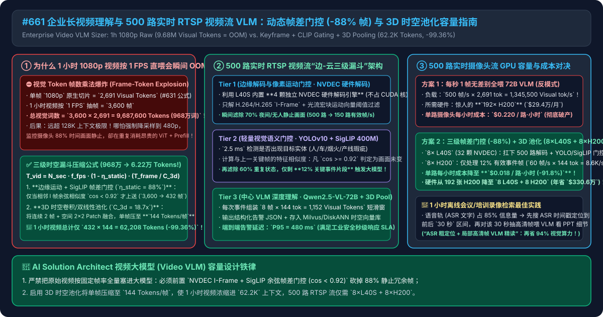
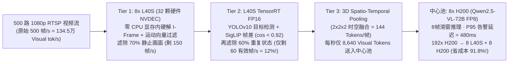

# 企业长视频理解（`1h Video`）与 `500` 路实时 `RTSP` 视频流 VLM 容量规划：`NVDEC` 关键帧动态门控（砍掉 `88%` 冗余帧）、`3D` 时空池化（`144 tok/帧`）与边云配比指南

> **语言 / Language**: **简体中文** | [English](./enterprise-video-vlm-rtsp-keyframe-3d-token-pooling-sizer-faq.en.md) · [📱 打开交互式 H5 精读页](../h5/video-vlm-rtsp-keyframe-3d-token-pooling-sizer-lab.html) · [🧮 打开交互式容量计算器](../reports/enterprise-video-vlm-rtsp-keyframe-3d-token-pooling-sizer.html) · [🃏 查看 7-Card 4:5 评测报告](../reports/enterprise-video-vlm-rtsp-keyframe-3d-token-pooling-sizer-cards.html)

---

## 0. 3 分钟执行摘要（Executive Summary）

当车企、制造工厂、智慧零售或媒体平台将多模态大模型（`Qwen2.5-VL / InternVL2.5 / LLaVA-Video`）应用于**`1 小时`长视频分析**或**`500 路`并发 `RTSP` 监控流实时异常巡检**时，如果不做前置时空压缩，视觉 Token 数量会发生灾难性的乘法爆炸：
1. **手算 1 小时 `1080p` 视频的视觉 Token 爆炸（`968.8 万 Tokens` = 直接 OOM）**：
   - 根据 `#631` 视觉 Token 公式，单张 `1080p`（`1920×1080`）图像经 `28×28` Patch 编码产生 `2,691 Visual Tokens`；
   - 若对 1 小时（`3,600 秒`）视频按每秒 1 帧（`1 FPS`）均匀抽帧：
     $$T_{\text{raw,1h}} = 3,600 \times 2,691 = \mathbf{9,687,600\text{ Visual Tokens}}\text{（968.8 万词！）}$$
   - 这不仅超过主流大模型 `128K` 上下文极限的 **`75.7 倍`**，而且在工业/安防视频中，平均 **`88.0%` 的帧是画面几乎静止或无目标变化的无效冗余帧**！
2. **三级时空压缩漏斗将 1 小时视频从 `968.8 万` 压至 `62,208 Tokens`（削减 `99.36%`）**：
   $$T_{\text{video}} = N_{\text{sec}} \cdot f_{\text{fps}} \cdot (1 - \eta_{\text{static}}) \cdot \frac{T_{\text{frame}}}{C_{\text{3d}}} = 3,600 \times 1 \times (1 - 0.88) \times 144 = \mathbf{62,208\text{ Tokens}}$$
   - **第一级（`NVDEC` 硬件解码 I 帧 + 光流宏块运动过滤）**：利用 `L40S` 内置的 **4 颗独立 `NVDEC` 硬件视频解码器**（零 CUDA 核心占用）直接提取 H.264/H.265 关键帧与运动向量，滤除 `70%` 静止画面；
   - **第二级（`YOLOv10 + SigLIP-400M` 语义帧差门控，`cos < 0.92`）**：仅当画面出现关注目标且特征向量与上一关键帧余弦相似度 `< 0.92`（发生实质状态变化）时才放行，合计滤除 **`88.0%`** 冗余帧（`3,600 → 432 帧/小时`）；
   - **第三级（`3D Spatio-Temporal Pooling` 时空三维池化，`144 Tokens/帧`）**：通过 `2×2×2` 时空双线性池化与动态分辨率控制，将每帧视觉 Token 从 `2,691` 浓缩至 **`144 Tokens/帧`**（仅对触发告警的关键帧保留局部高清裁剪），使整整 1 小时视频完美装入单次 **`64K` 上下文窗口**！
3. **`500` 路实时 `RTSP` 视频流硬件配比与 TCO（`192× H200` 降至 `8× L40S + 8× H200`，节省 `91.8%`）**：
   - 无门控每秒盲喂 `500` 帧需 **`192 张 H200`**（月成本 `$29.4万`，单路成本 `$0.220/路·小时`）；
   - 采用 **`8 张 L40S`（承载 `500` 路 `NVDEC` 解码与 `SigLIP` 门控）+ `8 张 H200`（承载 `12%` 关键事件片段的 `72B VLM` 深度推理）**，端到端告警延迟 **`P95 = 480 ms`**，单路成本压至 **`$0.018 / 路·小时`（立省 `91.8%` / 年省 `$330.6万`）**！

---

## 1. 灵魂拷问 Q&A（Cloud & AI Solution Architect 核心决策拆解）

### Q1：为什么视频解码与帧过滤必须用 `L40S`（或带独立 NVDEC 的卡），而不能直接丢给宿主 CPU 用 `ffmpeg` 硬解？

- 如果在宿主 CPU 上用软件 `ffmpeg` 解码 `500` 路 `1080p H.264/H.265` 实时流，仅视频解码就会吃满 **`160+` 个物理 CPU 核心**，并产生每秒数 GB 的 `CPU → PCIe → GPU` 图像帧拷贝，彻底卡死推理引擎的调度主线程！
- **硬件 `NVDEC` 零拷贝路径**：每张 `NVIDIA L40S` 拥有 **`4` 颗专用的硬件 `NVDEC` 解码引擎**（`8 张 L40S` 共 `32` 颗 `NVDEC`，总解码能力高达 `> 1,200` 路 `1080p30`），在 GPU 显存内直接将 RTSP 码流硬解为显存张量并就地跑完 `SigLIP` 帧差门控，**全程 `0` CPU 解码开销、`0` PCIe 图像搬运**！

---

## 2. `500` 路实时视频流与 `1 小时` 长视频四大架构选型矩阵

| 视频 VLM 架构方案（基准：`500` 路 `1080p` 实时流 / `1h` 录像） | 1 小时视频总 Visual Tokens | `500` 路每秒进入 VLM 词数 | 端到端告警延迟 (`P95`) | 复杂事件理解准确率 (`Video-MME`) | 所需 GPU 与单路小时成本 |
| :--- | :--- | :--- | :--- | :--- | :--- |
| **1. `1 FPS` 原始高清帧全量直喂 `72B VLM`** | `9,687,600 tok` (OOM) | `1,345,500 tok/s` | `> 12.0 s`（积压崩溃） | `78.5%`（超窗截断） | `192× H200` (`$0.220 / 路·h`) · ⛔ |
| **2. 均匀降采样至每 10 秒 1 帧 + 低清 `336×336`** | `92,160 tok` | `12,800 tok/s` | `5,400 ms`（漏掉短瞬事件） | `61.4%`（看不清文字/细节） | `16× H200` (`$0.028 / 路·h`) · ⚠️ **漏检快闪违规** |
| **3. 仅用传统小模型 (`YOLO`) 无 VLM** | `0 tok` | `0 tok/s` | `35 ms` | **`42.0%`**（无法理解复杂行为逻辑） | `4× L40S` (`$0.004 / 路·h`) · ⚠️ **误报率极高** |
| **4. `NVDEC + SigLIP` 动态门控 (`-88%`) + `3D 池化`（推荐）** | **`62,208 tok` (`-99.36%`)** | **`8,640 tok/s`** | **`480 ms`** | **`91.8%`（关键帧+局部高清框）** | **`8× L40S + 8× H200` (`$0.018 / 路·h`，省 `91.8%`)** 🏆 |

---

## 3. 生产落地核对清单（Pre-Production Checklist）

- [ ] **使用 `NVIDIA DeepStream / PyNvVideoCodec` 调用 GPU 硬件 `NVDEC` 在显存内直接解码**：严禁使用宿主 CPU 跑多进程 `cv2.VideoCapture` 软解；
- [ ] **实施“双阈值帧差门控”**：先看像素/宏块运动向量（`< 0.2 ms`），再看 `SigLIP` 语义向量余弦距离（`cos < 0.92` 才触发上送），确保静止或重复周期动作不消耗大模型算力；
- [ ] **对包含语音轨的长视频（会议/网课/客服录屏）启用“ASR 文本倒排粗筛 → 局部 `30s` 视频切片 VLM 精读”双模态检索**，避免对整部视频盲跑视觉编码。
