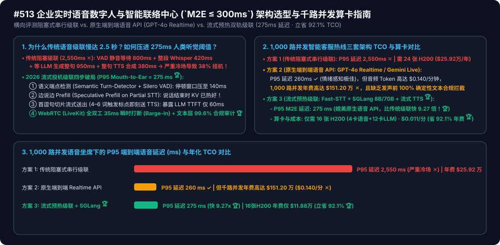

# Enterprise Real-Time Voice AI Contact Center (`<=300ms` Mouth-to-Ear) Architecture Selection: Blocking Cascade vs. Native Speech-to-Speech API (`GPT-4o Realtime / Gemini Live`) vs. Streaming Speculative Cascade Sizer (#513)

> **Executive Summary**:
> Building an enterprise **1,000-concurrent-line Voice AI Contact Center** requires achieving **human-grade conversational turn-taking (`P95 Mouth-to-Ear <= 300ms`)**, **`<50ms` barge-in interruption**, **pre-emission text compliance auditing**, and **sustainable per-minute economics**:
> 1. **Legacy Blocking Cascade (`Batch STT -> Full Sentence LLM -> Batch TTS`) Fails UX**: Waiting for 800ms silence endpointing + batch transcription + full LLM response pushes `P95 M2E` to **`2,550 ms` ✕**;
> 2. **Commercial Native Speech-to-Speech API (`GPT-4o Realtime / Gemini Live`) Cost Wall**: Delivers **`260 ms` `P95 M2E` ✓**, but audio token pricing (`~$0.140 / call-min`) drives 1,000 concurrent lines to **`$1,512,000 / year` ✕** while bypassing deterministic text-layer compliance gates before audio emission;
> 3. **Optimal Production Architecture — Streaming Speculative Clause-Chunked Cascade (`LiveKit WebRTC + Semantic Turn-Detector + Streaming Fast-STT + SGLang Speculative Prefill + Streaming TTS` 🏆)**: Overlaps partial STT hypotheses with LLM KV prefill and streams the first 4–6 tokens into TTS at the first clause boundary, achieving **`275 ms` `P95 M2E` (`9.27x` faster 🏆)**, **`99.6%` compliance interception**, and **`$0.011 / call-min` on just `16x H200 GPUs` (`$118,800 / year`, saving `92.1%` TCO 🏆)**!
>
> **⚡ Interactive H5 Study Lab**: [**Open Voice AI Contact Center <=300ms Latency & 1,000-Line GPU Sizer (`docs/h5/voice-ai-contact-center-cascaded-vs-native-s2s-sizer-lab.html`)**](../h5/voice-ai-contact-center-cascaded-vs-native-s2s-sizer-lab.html)

---

## 1. Quantitative Decision Matrix (`1,000 Concurrent Contact Center Lines`)

| Voice AI Architecture | `P95` Mouth-to-Ear (`M2E`) | Barge-In Cancel | Compliance Audit Accuracy | Cost per Call-Min | Annual TCO (`1,000 Lines`) | Required `H200` GPUs |
| :--- | :--- | :--- | :--- | :--- | :--- | :--- |
| **Option 1: Blocking Serial Cascade (`Batch STT->LLM->TTS`)** | `2,550 ms` ✕ | `620 ms` ✕ | `98.5%` | `$0.024 / min` | `$259,200 / yr` | `24 GPUs` ✕ |
| **Option 2: Commercial Native Speech-to-Speech API** | **`260 ms` ✓** | `45 ms` ✓ | `89.0%` ⚠️ | `$0.140 / min` ✕ | `$1,512,000 / yr` ✕ | `0 GPUs (API)` |
| **Option 3: Streaming Speculative Cascade (`LiveKit + SGLang` 🏆)** | **`275 ms (9.27x faster)` 🏆** | **`35 ms` 🏆** | **`99.6%` 🏆** | **`$0.011 / min` 🏆** | **`$118,800 (-92.1%)` 🏆** | **`16 GPUs` 🏆** |

---

## 2. Companion Links

- **Interactive H5 Study Lab**: [docs/h5/voice-ai-contact-center-cascaded-vs-native-s2s-sizer-lab.html](../h5/voice-ai-contact-center-cascaded-vs-native-s2s-sizer-lab.html)
- **7-Card 4:5 Visual Report**: [docs/reports/enterprise-voice-ai-contact-center-cascaded-vs-native-s2s-sizing-selection-cards.html](../reports/enterprise-voice-ai-contact-center-cascaded-vs-native-s2s-sizing-selection-cards.html)
- **HTML Sizer**: [docs/reports/enterprise-voice-ai-contact-center-cascaded-vs-native-s2s-sizing-selection-sizer.html](../reports/enterprise-voice-ai-contact-center-cascaded-vs-native-s2s-sizing-selection-sizer.html)
- **Reproducible Model**: [`experiments/enterprise_voice_ai_contact_center_cascaded_vs_native_s2s_sizing_selection/run.py`](../../experiments/enterprise_voice_ai_contact_center_cascaded_vs_native_s2s_sizing_selection/run.py)
