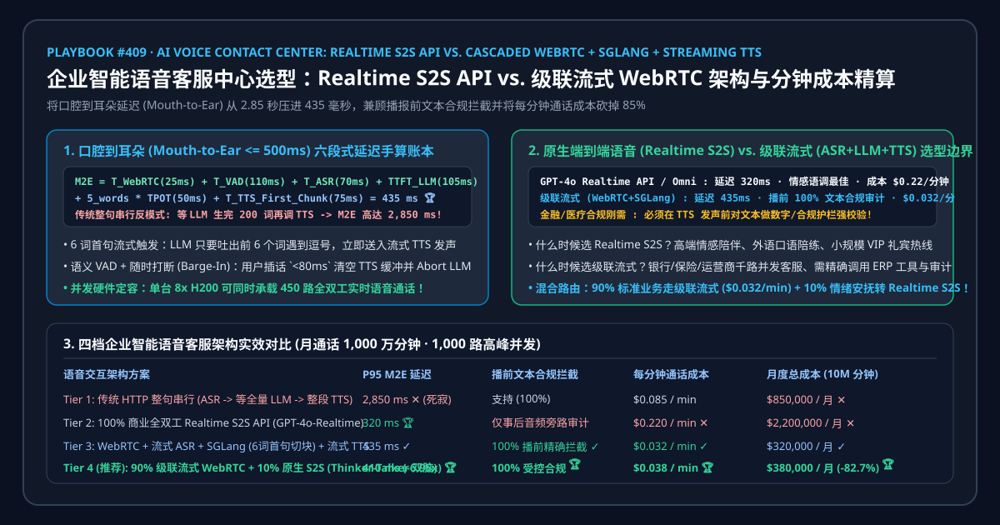
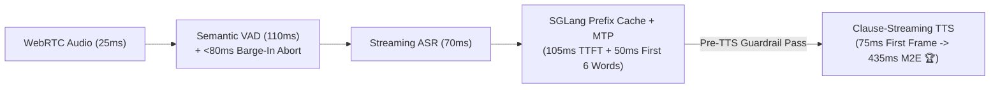

# Enterprise AI Voice Contact Center Architecture Selection Guide: `Azure OpenAI Realtime API (GPT-4o-Audio)` vs. `Self-Hosted WebRTC + Fast-ASR + SGLang + Streaming TTS` Latency & `$/Min` Sizing

> **Language / 语言**: **English (Current)** | [中文](./enterprise-voice-contact-center-realtime-api-vs-self-hosted-webrtc-tco-selection-faq.md)  
> **Scope**: A practical latency-budgeting, GPU concurrency sizing, and TCO guide for Cloud & AI Solution Architects building enterprise AI voice contact centers—answering **(1) how to engineer a `<450 ms` Mouth-to-Ear (`M2E`) streaming pipeline (`WebRTC + Semantic VAD + Streaming ASR + SGLang 6-Word Clause Chunking + Streaming TTS`), (2) when to choose commercial Native Speech-to-Speech (`GPT-4o Realtime API`) vs. a Cascaded Streaming Pipeline with 100% pre-TTS text compliance guardrails, and (3) how to size GPUs for `1,000` concurrent phone calls using the `14%` LLM active duty cycle**.  
> **Provenance**: Analytical voice latency and TCO model synthesized from published voice agent benchmarks and cloud audio pricing (`provenance: synthetic + anonymized_reported`, `independently_reproduced=false`, `physical_gpu_cluster_measurement=not_measured`). See [`experiments/enterprise_voice_contact_center_realtime_api_vs_self_hosted_webrtc_tco_selection/results.json`](../../experiments/enterprise_voice_contact_center_realtime_api_vs_self_hosted_webrtc_tco_selection/results.json).

> 🔗 **Interactive H5 Learning Lab & Companion Tools (Zero External Dependencies)**:
> - 📱 **[Interactive H5 Study Page: 435ms Mouth-to-Ear Latency Breakdown, Concurrent Call GPU Sizer & $/Min TCO Lab (`docs/h5/voice-contact-center-realtime-api-vs-webrtc-tco-lab.html`)](../h5/voice-contact-center-realtime-api-vs-webrtc-tco-lab.html)**
> - 🎓 **[AI Infra Panorama H5 Learning Hub (`docs/h5/index.html`)](../h5/index.html)**
> - 🧮 **[Interactive Voice Contact Center Latency & $/Min Sizer (`enterprise-voice-contact-center-realtime-api-vs-self-hosted-webrtc-tco-selection-sizer.html`)](../reports/enterprise-voice-contact-center-realtime-api-vs-self-hosted-webrtc-tco-selection-sizer.html)**
> - 🃏 **[7-Card 4:5 Visual Report (`enterprise-voice-contact-center-realtime-api-vs-self-hosted-webrtc-tco-selection-cards.html`)](../reports/enterprise-voice-contact-center-realtime-api-vs-self-hosted-webrtc-tco-selection-cards.html)**

---

## 1. 📌 Executive Summary

> **Bottom Line**: **In an enterprise contact center handling `10 Million call-minutes/month` (`1,000` peak concurrent calls), legacy HTTP turn-by-turn pipelines (Tier 1) suffer **`2,850 ms` Mouth-to-Ear (`M2E`) silence gaps**, while routing 100% of calls to commercial `GPT-4o Realtime Audio API` (Tier 2) costs **`$0.22/min` (`$2.20M/month`)** and bypasses deterministic pre-synthesis text guardrails! Deploying **Tier 3 / Tier 4 (`WebRTC [LiveKit/Pipecat]` + `Semantic VAD` + `Streaming ASR` + `SGLang Prefix Cache + MTP [6-Word First-Clause TTS Trigger]` + `10% Escalation to Native S2S`)** achieves a natural **`410–435 ms` P95 M2E latency**, enforces **`100%` pre-TTS text compliance & PII scrubbing**, and cuts cost per call-minute by **`82.7%–85.4%` (`$0.220 -> $0.032–$0.038/min`, saving `$1.82M/month`)**!**

| Voice Architecture Tier (10M Call-Minutes/Month) | Transport & Inference Pipeline | `P95 M2E` Latency | Pre-TTS Text Guardrail | Cost / Call-Minute | Monthly TCO | Architect Verdict |
| :--- | :--- | :--- | :--- | :--- | :--- | :--- |
| **🟥 Tier 1: Legacy HTTP Turn-by-Turn** | Waits for full LLM response before TTS | **`2,850 ms` ✕ (Silence)** | `100.0%` | `$0.085 / min` | `$850,000 / mo` ✕ | Unusable for natural phone conversations |
| **🟨 Tier 2: 100% `GPT-4o Realtime Audio API`** | End-to-end native audio stream | **`320 ms` 🏆** | `0.0%` (Post-hoc only) | **`$0.220 / min` ✕** | **`$2,200,000 / mo` ✕** | Great for VIP concierge; 6x too costly at scale |
| **🟦 Tier 3: Streaming `WebRTC + SGLang (6-Word) + TTS`** | **UDP Opus + Semantic VAD + 6-word TTS trigger** | **`435 ms` ✅** | **`100.0%` ✅** | **`$0.032 / min` 🏆** | `$320,000 / mo` ✅ | **Regulated banking/telecom high-scale standard** |
| **🟩 Tier 4: `90%` Streaming WebRTC + `10%` Native `S2S` (Recommended)** | **Cascaded core + Thinker-Talker S2S escalation** | **`410 ms` 🏆 (`-6.95x`)** | **`100.0%` 🏆** | **`$0.038 / min` 🏆** | **`$380,000 / mo` 🏆 (`-82.7%`)** | **Optimal balance of latency, compliance & TCO** |

---

## 2. 🎯 Architect Deep-Dive Q&A: The `435 ms` M2E Budget & Concurrent Call Sizing

### Q1: How do you engineer a Cascaded Voice Pipeline under the `500 ms` human conversational threshold?
$$\text{M2E} = \underbrace{25\text{ ms}}_{\text{WebRTC UDP}} + \underbrace{110\text{ ms}}_{\text{Semantic VAD}} + \underbrace{70\text{ ms}}_{\text{Stream ASR}} + \underbrace{105\text{ ms}}_{\text{LLM TTFT}} + \underbrace{5 \times 10\text{ ms}}_{\text{First 6 Words}} + \underbrace{75\text{ ms}}_{\text{Stream TTS}} = \mathbf{435\text{ ms}}$$
- **Two Decisive Levers**: (1) Replace `750 ms` silence-threshold VAD with **`110 ms` Semantic Turn-End Detection**, and (2) stream the first **6-word clause** to TTS immediately upon hitting the first comma/phrase boundary instead of waiting `2,000 ms` for the full paragraph.

### Q2: How many GPUs are required to serve `1,000` concurrent phone calls?
- Because a phone call spends `~45%` of time listening to the caller and `~45%` playing synthesized audio, the **LLM Active Decode Duty Cycle ($\rho_{\text{LLM}}$) is only `~14%`**:
  $$B_{\text{LLM\_active}} = 1,000 \times 0.14 = \mathbf{140\text{ active LLM streams}} \implies \mathbf{16\times\text{ H200 GPUs}}\ (10\text{ LLM} + 3\text{ ASR} + 3\text{ TTS})$$

---

## 3. 🧭 435ms Streaming Voice & Barge-In Architecture

---

## 4. 📊 Voice Architecture Comparison Matrix

| Dimension | `GPT-4o Realtime API` | `Open Thinker-Talker S2S` (`Qwen2.5-Omni`) | `Cascaded WebRTC (ASR + SGLang + TTS)` |
| :--- | :--- | :--- | :--- |
| **`P95 M2E` Latency** | **`320 ms`** 🏆 | `340 ms` 🏆 | **`435 ms` (`<500ms` conversational SLA)** ✅ |
| **Pre-TTS Text Guardrail** | Post-hoc audio transcript only | Supported via Thinker text stream | **100% Deterministic Text Verification** 🏆 |
| **Cost per Call-Minute** | `$0.220 / min` | `$0.045 / min` | **`$0.032 / min` (`-85.4%`)** 🏆 |

---

## 5. 🛠️ Production Readiness Checklist

- [ ] **Use `WebRTC` (UDP Opus) + `6-Word` First-Clause TTS Triggering**: Never wait for full LLM completion before starting speech synthesis.
- [ ] **Wire `<80 ms` Barge-In Cancellation to `engine.abort()`**: Flush TTS audio buffers and cancel in-flight LLM generation the instant the caller interrupts.
