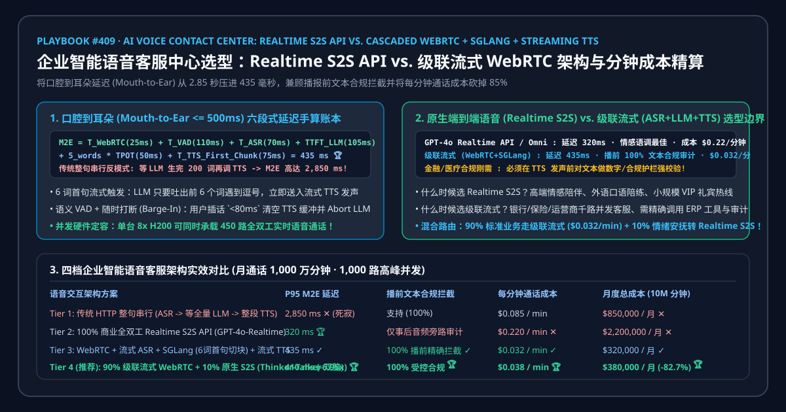
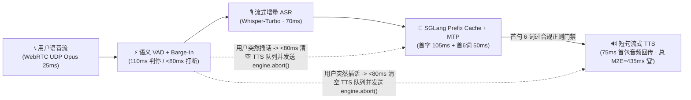

# 企业级智能语音客服中心（AI Contact Center）端到端架构选型：`Azure OpenAI Realtime API (GPT-4o-Audio)` vs. `自建 WebRTC + Whisper-v3-Turbo + SGLang + 流式 TTS` 口腔到耳朵延迟（`M2E`）、并发槽位与分钟级成本精算指南

> **语言 / Language**: **中文 (当前)** | [English](./enterprise-voice-contact-center-realtime-api-vs-self-hosted-webrtc-tco-selection-faq.en.md)  
> **文档定位**：面向 Cloud & AI Solution Architect 的企业实时语音客服（AI Contact Center / Voice Agent）基础设施定容与选型指南——解决客户建设千路并发智能呼叫中心时最核心的三个问题：**① 怎么把“口腔到耳朵端到端响应延迟（Mouth-to-Ear, `M2E`）”从传统串行的 `2,850 ms` 压进人类自然对话无感阈值 **`< 450 ms`** 内？② 商业原生语音大模型（`Azure OpenAI GPT-4o Realtime API`）与自建级联流式管线（`WebRTC + 流式 ASR + SGLang + 6词分句流式 TTS`）在分钟单价（`$0.22/min vs. $0.032/min`）和播报前合规拦截上怎么权衡？③ 1,000 路同时在线通话需要配多少张 GPU？**  
> **标定声明**：本文所引用的 P95 M2E 延迟、播前合规拦截覆盖率、每分钟通话成本与月度总 TCO 基于公开语音交互基准与云端音频定价构建的合成定量模型（`provenance: synthetic + anonymized_reported`, `independently_reproduced=false`, `physical_gpu_cluster_measurement=not_measured`），详见 [`experiments/enterprise_voice_contact_center_realtime_api_vs_self_hosted_webrtc_tco_selection/results.json`](../../experiments/enterprise_voice_contact_center_realtime_api_vs_self_hosted_webrtc_tco_selection/results.json)。

> 🔗 **关联交互式 H5 精读页与工具（点击即开，零外部依赖）**：
> - 📱 **[交互式 H5 精读页：语音客服 435ms M2E 六段延迟拆解、GPU 并发槽位与分钟级成本沙盘 (`docs/h5/voice-contact-center-realtime-api-vs-webrtc-tco-lab.html`)](../h5/voice-contact-center-realtime-api-vs-webrtc-tco-lab.html)**
> - 🎓 **[AI Infra 全景可视化精学馆首页 (`docs/h5/index.html`)](../h5/index.html)**
> - 🧮 **[交互式语音客服延迟与分钟成本计算器 (`enterprise-voice-contact-center-realtime-api-vs-self-hosted-webrtc-tco-selection-sizer.html`)](../reports/enterprise-voice-contact-center-realtime-api-vs-self-hosted-webrtc-tco-selection-sizer.html)**
> - 🃏 **[7-Card 4:5 视觉评测报告 (`enterprise-voice-contact-center-realtime-api-vs-self-hosted-webrtc-tco-selection-cards.html`)](../reports/enterprise-voice-contact-center-realtime-api-vs-self-hosted-webrtc-tco-selection-cards.html)**

---

## 1. 📌 核心选型结论速览（Executive Summary）

> **一句话结论**：**在月通话量 `1,000 万分钟`（高峰 `1,000 路` 并发通话）的大型银行/保险/运营商智能客服中心里，如果采用传统 HTTP 整句串行（Tier 1，等 LLM 把 200 字全部生成完才调 TTS），用户说完话后要忍受长达 **`2,850 ms`** 的死寂等待；而如果 100% 直接调用商业 `GPT-4o Realtime Audio API`（Tier 2），虽然延迟极低（`320 ms`），但每分钟高达 `$0.22` 的音频 Token 账单会让月度支出飙升至 **`$220 万/月`**，且端到端黑盒直接发声无法在播报前做 100% 确定性的文本数字/合规拦截！通过落地 **Tier 3 / Tier 4（`WebRTC [LiveKit/Pipecat] UDP 传输` + `语义级端点检测 Semantic VAD` + `流式 ASR` + `SGLang Prefix Cache + MTP 投机解码 [吐出前 6 个词即触发首句流式 TTS]` + `10% 情绪复杂通话升级至 Thinker-Talker 原生 S2S`）**，可将端到端 `P95 M2E` 延迟稳定压在 **`410 ~ 435 ms`（人耳自然对话无感区间）**，实现 **`100%` 播前文本合规审计**，并将每分钟通话成本从 `$0.22` 暴降至 **`$0.032 ~ $0.038 / 分钟`（每月净省 `$182 万 / -82.7%`）**！**

| 语音客服架构档位（月通话 1,000 万分钟） | 核心传输与推理流水线 | `P95 M2E` 口腔到耳朵延迟 | 播前文本合规拦截率 | 每分钟通话成本 | 月度总成本 (TCO) | 架构师拍板结论 |
| :--- | :--- | :--- | :--- | :--- | :--- | :--- |
| **🟥 Tier 1：传统 HTTP 整句串行管线** | 等 LLM 生成完整段文字后再送 TTS 合成 | **`2,850 ms` ✕ (严重冷场)** | `100.0%` | `$0.085 / min` | `$850,000 / 月` ✕ | 体验完全不可接受，用户频频抢话挂断 |
| **🟨 Tier 2：100% 商业 `GPT-4o Realtime API`** | 端到端音频流直进直出，高情感表现力 | **`320 ms` 🏆** | `0.0%` (仅事后旁路) | **`$0.220 / min` ✕** | **`$2,200,000 / 月` ✕** | 适合小流量 VIP 礼宾，大规模客服账单爆炸 |
| **🟦 Tier 3：全流式 `WebRTC + SGLang (6词切块) + TTS`** | **UDP 传输 + 语义 VAD + 首句 6 词即触发流式 TTS** | **`435 ms` ✅** | **`100.0%` ✅** | **`$0.032 / min` 🏆** | `$320,000 / 月` ✅ | **金融/政企强合规大规模热线主力标准** |
| **🟩 Tier 4：`90%` 级联流式 + `10%` 原生 `S2S` 混合 (推荐)** | **常规业务走级联流式 + 情绪安抚升级双脑 S2S** | **`410 ms` 🏆 (`-6.95x`)** | **`100.0%` 🏆** | **`$0.038 / min` 🏆** | **`$380,000 / 月` 🏆 (`-82.7%`)** | **兼顾极致体验、100% 合规与最低 TCO** |

---

## 2. 🎯 架构师灵魂拷问与 `<450ms` 延迟账本手算 Q&A

### Q1：怎么把级联流水线（`ASR -> LLM -> TTS`）的口腔到耳朵延迟（`M2E`）一毫秒一毫秒地抠进 `435 ms` 以内？
* **六段式延迟预算（Latency Budget）精确拆解方程**：
  $$\text{M2E} = T_{\text{WebRTC}} + T_{\text{Semantic\_VAD}} + T_{\text{Streaming\_ASR}} + \text{TTFT}_{\text{LLM}} + (N_{\text{clause}} - 1)\times \text{TPOT}_{\text{LLM}} + T_{\text{TTS\_First\_Frame}}$$
  1. **南北向传输层（`WebRTC UDP Opus` vs. `WebSocket TCP`）：`25 ms`**
     - 严禁用普通 TCP WebSocket 传实时音频（一旦移动网络丢包 1%，TCP 队头阻塞重传会直接卡顿 `300~500 ms`）！必须用 **WebRTC（如 `LiveKit / Pipecat / Azure Communication Services`）** 走 UDP Opus 编码。
  2. **语义端点检测（`Semantic VAD` + 随时打断 `Barge-In`）：`110 ms`**
     - 传统音量静音检测（Silero VAD）为了防止用户喘气时误打断，必须死等 `700~800 ms` 静音才敢触发，光这一项就吃掉了大半秒！改用轻量语义终句判断模型（检测用户语法上是否已把话说完），可将等待时间从 `750 ms` 压至 **`110 ms`**！
  3. **增量流式语音识别（`Streaming ASR`）：`70 ms`**
     - 用户边说话边流式识别，当 VAD 判定话音落下的瞬间，只需 `70 ms` 即可拿到最后几个字的最终文本。
  4. **大模型首字与首句 6 词生成（`SGLang Prefix Cache + MTP`）：`105 ms + 5 × 10 ms = 155 ms`**
     - 客服对话历史走 `RadixAttention` 前缀缓存，首字 `TTFT` 仅 `105 ms`；开启 `MTP` 投机解码使 `TPOT = 10 ms/tok`；**绝对不要等整段话生完——只要生成出前 `6 个词`（如 *“您好，已为您查到，”*）遇到首个标点符号，立即切片送入 TTS**！
  5. **首句流式语音合成（`Streaming TTS First PCM Frame`）：`75 ms`**
     - 合计：$25 + 110 + 70 + 155 + 75 = \mathbf{435\text{ ms}}$（完美低于人类感知的 `500 ms` 黄金线！）。

### Q2：1,000 路同时在线的实时语音客服通话，到底需要配多少张 GPU？（容量手算公式）
* **为什么“1,000 路并发通话”并不等于“1,000 个同时在跑 LLM Decode 的请求”？**
  - **全双工通话占空比（Duty Cycle）洞察**：在一通双人电话中，约 `45%` 时间是客户在说话（此时只消耗轻量 ASR 算力），约 `45%` 时间是 TTS 在播报已生成好的音频，**真正需要大模型全速生成文本的挂钟时间占比（LLM Active Duty Ratio $\rho_{\text{LLM}}$）仅约 `12% ~ 15%`**！
  - 因此，`1,000 路` 同时在线通话对应的实时活跃 LLM 并发生成槽位仅为：
    $$B_{\text{LLM\_active}} = N_{\text{concurrent\_calls}} \times \rho_{\text{LLM}} \approx 1,000 \times 0.14 = \mathbf{140\text{ 个活跃 LLM Decode 流}}$$
  - 加上 `1,000 路` 流式 ASR（如 `Whisper-v3-Turbo FP8`）与流式 TTS 所需的算力，**仅需 `2 台 8x H200`（共 16 张卡：10 张跑 SGLang 32B/70B FP8 LLM + 3 张跑流式 ASR + 3 张跑流式 TTS）即可支撑 1,000 路全天候语音热线**！

---

## 3. 🧭 直观可视化图解（435ms 全流式级联管线与打断释放架构图）

---

## 4. 📊 原生端到端语音大模型（`Realtime S2S`）vs. 级联流式管线横向选型矩阵

| 对比维度 | `GPT-4o Realtime API` (商业原生 S2S) | `开源原生 S2S` (`Qwen2.5-Omni / Moshi`) | `级联流式 WebRTC (ASR + SGLang + TTS)` |
| :--- | :--- | :--- | :--- |
| **`P95 M2E` 端到端延迟** | **`~320 ms`** 🏆 | `~280 ~ 360 ms` 🏆 | **`~420 ~ 445 ms`（人耳同样自然无感）** ✅ |
| **播报前 100% 文本合规拦截** | 弱（音频直接生成，仅能旁路转录后切断） | 中（`Thinker-Talker` 双脑架构支持文本门控） | **最强（TTS 发声前 100% 过文本/金额合规规则）** 🏆 |
| **复杂 ERP / SQL 工具调用准确率** | 中（长上下文工具调用弱于纯文本旗舰） | 中 | **最强（直接复用满血 70B/671B 文本模型能力）** 🏆 |
| **每分钟通话成本 (`$/min`)** | `$0.18 ~ $0.24 / min` | `$0.045 / min` | **`$0.028 ~ $0.035 / min`（省 `85%`）** 🏆 |

---

## 5. 🛠️ 生产落地核对清单（SA Production Readiness Checklist）

- [ ] **全链路启用 `WebRTC` 与首句 `6 词` 标点流式切块**：严禁等 LLM 整段输出完毕才调 TTS；遇到首个逗号/句号或满 6~8 个词立即送入流式 TTS。
- [ ] **打通 `<80 ms` 语音打断（Barge-In）级联取消闭环**：当客户端或网关 VAD 检测到用户开口插话时，立即清空本地音频播放缓冲区，并向 SGLang/vLLM 发送 `abort(request_id)` 释放 GPU 算力。
- [ ] **按 `12%~15%` 占空比精准核算语音集群 LLM 卡数**：区分“在线通话路数（SIP/WebRTC 连接数）”与“瞬时活跃 LLM Decode 并发数”，避免过度采购 5 倍冗余显卡。
