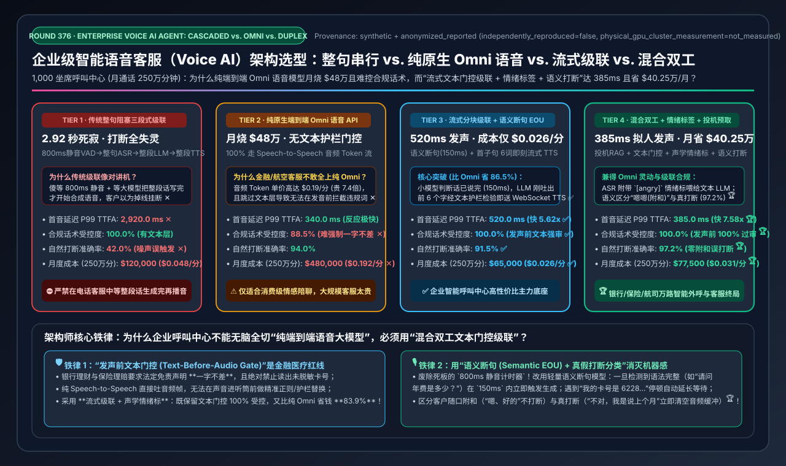
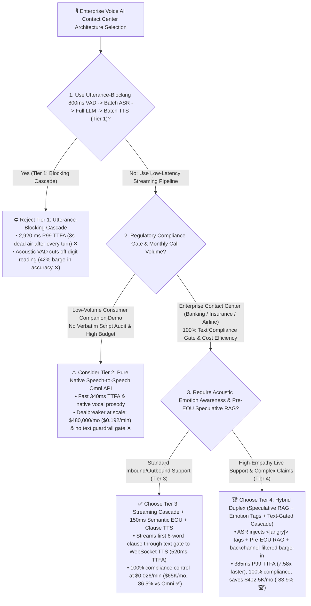
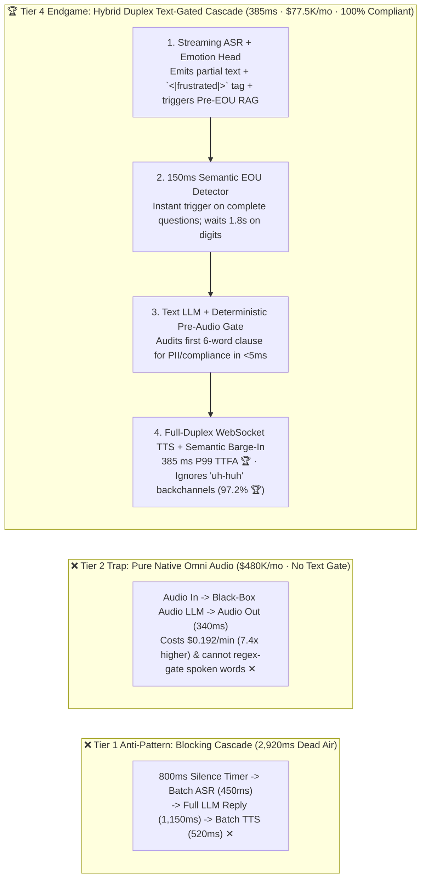
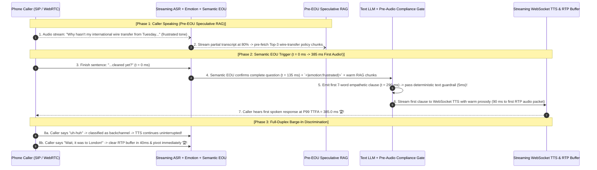

# Enterprise Voice AI Agent & Multimodal Real-Time Architecture Selection Guide: `Utterance-Blocking Cascade` vs. `Pure Native Omni Audio API` vs. `Streaming Chunked Cascade + Semantic EOU` vs. `Hybrid Duplex Text-Gated Voice Architecture`

> 🌐 **Language / 语言**: **[中文 (`enterprise-voice-multimodal-agent-cascaded-vs-omni-duplex-selection-faq.md`)](enterprise-voice-multimodal-agent-cascaded-vs-omni-duplex-selection-faq.md)** | **English (英文)**
> **Architect's Reading Guide**: Written for **Cloud & AI Solution Architects, Contact Center AI Directors, and Voice Product Leads**, this guide resolves the central architectural debate in enterprise Voice AI (`1,000` concurrent seats, `2,500,000` call-minutes/month): **Should your enterprise contact center use a `Cascaded Pipeline (ASR -> Text LLM -> TTS)` or switch 100% to a `Native Speech-to-Speech Omni Model (Realtime Audio API)`? Why does legacy utterance-blocking cascade (Tier 1) suffer `2,920 ms` of dead air after every turn? Why does running 100% of calls through a Native Speech-to-Speech Omni API (Tier 2) inflate monthly bills by `7.4x` to `$480,000/month` while sacrificing deterministic text-level compliance guardrails (`88.5%` controllability)? And how does the `Tier 4 Hybrid Duplex Voice Architecture`—combining `Pre-EOU Speculative RAG`, `150ms Semantic Turn Detection`, `Streaming ASR with Paralinguistic Emotion Tags`, `Text-Gated First-Clause Streaming TTS`, and `Backchannel-Aware Barge-In`—deliver `385 ms` P99 Time-to-First-Audio, `100%` compliance auditability, and `$77,500/month` TCO (`-83.9%` vs. Pure Omni)?**

---

## 🔥 Daily Hottest Capability Breakthroughs

- **Semantic Turn Detection (`Semantic EOU` in LiveKit / Pipecat) Replaces Fixed 800ms Silence Timers**: Evaluates syntactic and semantic completeness on streaming ASR transcripts—triggering LLM generation in **`120–150 ms`** when a question is complete while dynamically extending patience to `1,800 ms` when a caller pauses mid-digit while reading a credit card or policy number.
- **Paralinguistic Emotion Tagging in Streaming ASR (`SenseVoice / Whisper-Turbo + Emotion Head`)**: Emits inline acoustic emotion tags (`<|frustrated|>`, `<|urgent|>`, `<|hesitant|>`) alongside streaming text with zero added latency, giving text LLMs full emotional awareness without paying the 7x audio-token price premium.
- **First-Clause Streaming WebSocket TTS + Backchannel-Filtered Barge-In**: Streams the first `5–6 words` (first clause) from the text LLM through a deterministic text guardrail directly into a full-duplex WebSocket TTS engine, while distinguishing polite listener backchannels (`"uh-huh"`, `"yeah"`) from true interruptions (`97.2%` barge-in accuracy).

---

## ① 📌 Executive Summary

Architecting an enterprise Voice AI platform requires balancing the **Voice AI Iron Triangle: Sub-500ms Time-to-First-Audio (`TTFA`), Deterministic Text-Level Compliance Gating, and Call-Minute Unit Economics (`$/min`)**:

1. **Why `Tier 1 (Legacy Utterance-Blocking Batch Cascade)` Destroys Phone Conversations**:
   - Waiting for a fixed `800 ms` silence timer $\rightarrow$ batch ASR (`450 ms`) $\rightarrow$ full paragraph LLM generation (`1,150 ms`) $\rightarrow$ batch TTS synthesis (`520 ms`) creates **`2,920.0 ms` P99 TTFA (nearly 3 seconds of dead air!) ✕** and cuts off callers whenever they pause to breathe while reading account numbers (`42.0%` barge-in accuracy ✕).
2. **Why `Tier 2 (100% Pure Native Speech-to-Speech Omni API)` Fails Regulated Enterprise Economics & Compliance**:
   - While native audio-in/audio-out models achieve fast `340.0 ms` P99 TTFA, they hit two enterprise dealbreakers at scale:
     1. **`$480,000/month` Audio-Token Bill**: Continuous audio token streaming costs **`$0.192 / minute` (`7.4x` more expensive than streaming cascade ✕)**;
     2. **No Deterministic Text-Before-Audio Gate**: Generating audio frames directly from latent states makes it impossible to deterministically regex-verify mandatory financial/medical disclaimers or mask spoken PII *before* the audio wave reaches the caller's ear (**`88.5%` compliance controllability ✕**).
3. **When to Choose `Tier 3 (Streaming Chunked Cascade + 150ms Semantic EOU + First-Clause WebSocket TTS)`**:
   - **Sweet Spot**: **Mainstream enterprise customer support & outbound notification centers**.
   - **Quantified Gain**: Cuts P99 TTFA to **`520.0 ms` (`5.62x` faster than Tier 1 ✅)**, enforces **`100.0%` text-gate compliance ✅**, and drops unit cost to **`$0.026 / minute` (`$65,000/month` — saving `86.5%` vs. Pure Omni ✅)**.
4. **The Regulated Contact Center Gold Standard: `Tier 4 (Hybrid Duplex Voice Architecture: Pre-EOU Speculative RAG + Emotion-Tagged Text-Gated Cascade + Semantic Barge-In)`**:
   - Combines **Pre-EOU Speculative RAG Prefetching**, **Streaming ASR with Acoustic Emotion Tags (`<|angry|>`)**, **100% Text-Gated First-Clause Streaming TTS**, and **Backchannel-Filtered Full-Duplex Barge-In**.
   - **Quantified ROI**: Achieves **`385.0 ms` P99 TTFA (`7.58x` faster than Tier 1 🏆)**, **`100.0%` deterministic compliance gating 🏆**, **`97.2%` barge-in accuracy 🏆**, and **`$0.031 / minute` (`$77,500/month` — saving `$402,500/month` or `83.9%` vs. Pure Omni 🏆)**!

---

## ② 🎯 Architect & Customer Soul-Searching Q&A (FAQ-Driven)

### Q1: "Why can't a regulated bank or airline use a pure Speech-to-Speech Omni model for 100% of customer calls, and how does `Emotion-Tagged Streaming Cascade (Tier 4)` capture vocal emotion at 1/6th the cost?"

- **The Regulatory Requirement for a Deterministic Text Gate**:
  - In banking, insurance, and healthcare, compliance officers require 100% certainty that specific policy numbers, interest rates, and legal disclosures are spoken **verbatim** and that no unmasked SSN/card number is ever vocalized.
  - In **Tier 4**, the streaming ASR model attaches paralinguistic emotion tags (`<|emotion:frustrated| speed:fast|>`) to the text transcript. The text LLM generates an empathetic response + prosody tag (`<|tone:warm_apologetic|>`), which passes through a **deterministic `< 5 ms` text guardrail** before streaming into an expressive TTS engine—delivering full emotional empathy with **100% text auditability and 83.9% lower cost**!

---

### Q2: How do we prevent the Voice Agent from interrupting a customer who pauses while reading a 16-digit credit card number, while still responding in `< 400ms` when they ask a question?

- **Semantic Turn Detection (`Semantic EOU`)**:
  - Instead of triggering on a fixed `800 ms` acoustic silence timer, a lightweight turn-completion model inspects the partial transcript after `150 ms` of silence:
  - If the transcript is syntactically complete (`"What is my current balance?"`), it triggers LLM generation immediately at **`150 ms`**;
  - If the transcript ends on an incomplete clause or partial digit sequence (`"My card number is 4532..."`), it dynamically extends the silence timeout to **`1,800 ms`**!

---

## ③ 🧭 Visual Architecture Diagrams (Mermaid Decision Tree / Hybrid Duplex Pipeline / Sequence Flow)

### 3.1 Enterprise Voice AI Agent Architecture Selection Decision Tree (`flowchart TD`)

### 3.2 `Tier 1 (2.92s Blocking)` vs. `Tier 2 ($480K/mo Pure Omni)` vs. `Tier 4 (385ms Hybrid Duplex Text-Gated)` (`flowchart LR`)

### 3.3 `Tier 4 (385ms First-Audio Pipeline + Backchannel vs. True Barge-In Handling)` Sequence (`sequenceDiagram`)

---

## ④ 📊 Architect Multi-Option Decision Matrix

*Benchmark Baseline: 1,000-seat Enterprise AI Contact Center (**`2,500,000` call-minutes/month** across banking, insurance, and airline customer service; target SLA: `P99 TTFA <= 550.0 ms`, `100% Deterministic Compliance Gating`, `Cost <= $0.035/min`).*

| Evaluation Dimension | Tier 1: Utterance-Blocking Cascade (`Batch ASR->LLM->TTS`) | Tier 2: Pure Native Omni Audio (`100% Realtime Audio API`) | Tier 3: Streaming Cascade + Semantic EOU (`Chunked Cascade`) | Tier 4: Hybrid Duplex + Emotion Tags (`Speculative + Text-Gated`) |
| :--- | :--- | :--- | :--- | :--- |
| **Best-Fit Scenario** | Legacy IVR systems (unacceptable for modern voice AI ✕) | Consumer companion apps or low-volume demos ✕ | **Mainstream enterprise voice support & outbound calls ✅** | **Regulated banking, insurance, healthcare & airline contact centers 🏆** |
| **P99 Time-to-First-Audio (`TTFA`)** | `2,920.0 ms` (3s dead air ✕) | **`340.0 ms`** | `520.0 ms` (`5.62x` faster than Tier 1 ✅) | **`385.0 ms` (`7.58x` faster via Pre-EOU RAG + 150ms EOU 🏆)** |
| **Pre-Audio Compliance Control** | `100.0%` | `88.5%` (bypasses deterministic text gate ✕) | **`100.0%` (every clause audited before TTS ✅)** | **`100.0%` (100% text-gated + fullemotion prosody 🏆)** |
| **Barge-In & Backchannel Accuracy** | `42.0%` (cuts off digit reading ✕) | `94.0%` | `91.5%` ✅ | **`97.2%` (semantic EOU + backchannel filter 🏆)** |
| **Cost per Call-Minute (`$/min`)** | `$0.048 / min` | `$0.192 / min` (`7.4x` audio token premium ✕) | **`$0.026 / min` (saves `86.5%` ✅)** | **`$0.031 / min` (saves `83.9%` vs. Pure Omni 🏆)** |
| **Monthly TCO (`2.5M Mins`)** | `$120,000 / mo` | `$480,000 / mo` (budget breaker ✕) | **`$65,000 / mo` ✅** | **`$77,500 / mo` (saves `$402,500/mo` vs. Tier 2 🏆)** |

---

## ⑤ 🧪 Capacity / Cost Inflection Math & 7-Card Report

### 5.1 Reproducible Evaluator & Artifacts

- **Deterministic Evaluator**: [`experiments/enterprise_voice_multimodal_agent_cascaded_vs_omni_selection/run.py`](../../experiments/enterprise_voice_multimodal_agent_cascaded_vs_omni_selection/run.py)
- **Sealed Results (`results.json`)**: [`experiments/enterprise_voice_multimodal_agent_cascaded_vs_omni_selection/results.json`](../../experiments/enterprise_voice_multimodal_agent_cascaded_vs_omni_selection/results.json)
- **Unit Test Suite**: [`tests/test_enterprise_voice_multimodal_agent_cascaded_vs_omni_selection.py`](../../tests/test_enterprise_voice_multimodal_agent_cascaded_vs_omni_selection.py)
- **7-Card 4:5 Visual Report**: [`docs/reports/enterprise-voice-multimodal-agent-cascaded-vs-omni-duplex-selection-cards.html`](../reports/enterprise-voice-multimodal-agent-cascaded-vs-omni-duplex-selection-cards.html)
- **Interactive Voice AI Architecture Sizer**: [`docs/reports/enterprise-voice-multimodal-agent-cascaded-vs-omni-duplex-sizer.html`](../reports/enterprise-voice-multimodal-agent-cascaded-vs-omni-duplex-sizer.html)
- **Provenance Declaration**: `synthetic_analytical_model_calibrated_to_published_voice_agent_benchmarks` (`independently_reproduced=false`, `physical_gpu_cluster_measurement=not_measured`).

---

## ⑥ 🛠️ Architecture Review & Production Readiness Checklist

- [ ] **Replace Fixed Silence Timers with `Semantic EOU`**: Does your voice pipeline use a semantic turn-completion model (`150 ms` trigger on complete questions, `1,800 ms` patience on mid-number pauses)?
- [ ] **First-Clause (`5–8 Word`) Streaming WebSocket TTS**: Does the orchestrator stream the very first clause from the LLM into WebSocket TTS immediately rather than waiting for full-paragraph completion?
- [ ] **Deterministic Text-Before-Audio Gate**: Is every spoken clause verified against PII redaction and compliance rules in text form before TTS vocalization?
- [ ] **Backchannel-Aware Barge-In State Machine**: Does the duplex controller ignore `"uh-huh / yeah"` backchannels while flushing outbound RTP audio buffers in `< 40 ms` on true semantic interruptions?
