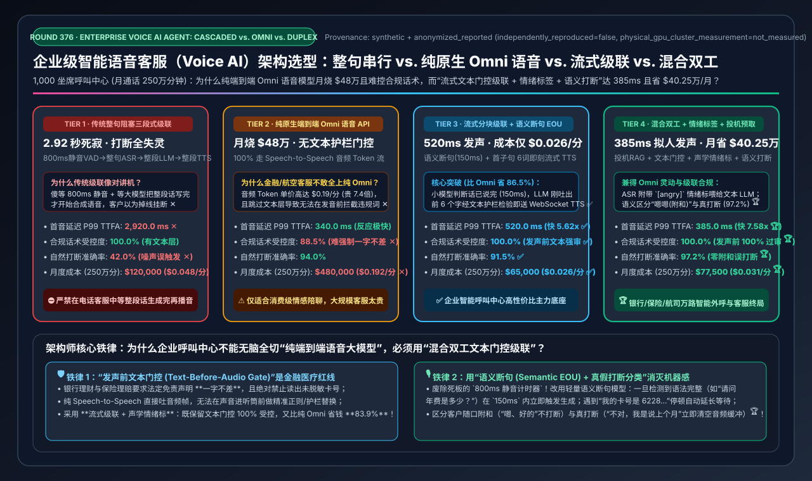
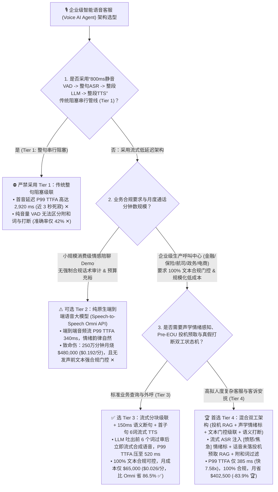
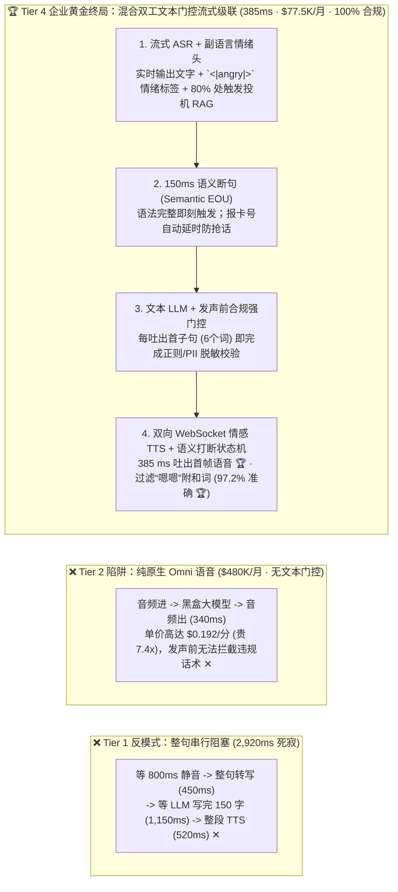
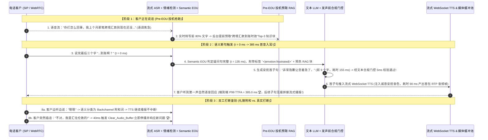

# 企业级智能语音客服（Voice AI Agent）与多模态实时交互架构选型指南：`传统整句串行级联` vs. `纯端到端 Omni 语音 API` vs. `流式分块级联 + 语义断句` vs. `混合双工文本门控架构`

> 🌐 **Language / 语言**: **中文 (Chinese)** | **[English (`enterprise-voice-multimodal-agent-cascaded-vs-omni-duplex-selection-faq.en.md`)](enterprise-voice-multimodal-agent-cascaded-vs-omni-duplex-selection-faq.en.md)**
> **阅读指南**：本文面向 **Cloud & AI Solution Architect（云与 AI 解决方案架构师）、智能呼叫中心负责人与客服产品总监**，直面当下语音大模型落地最核心的路线之争：**当企业建设 1,000 坐席规模的 AI 电话客服中心（月通话量 `250 万分钟`）时，到底该用传统的 `ASR（语音转文字）-> LLM -> TTS（文字转语音）` 三段式级联，还是直接全面切换成 OpenAI / Gemini 等厂商的 `纯端到端语音多模态大模型（Native Speech-to-Speech Omni API）`？为什么传统整句级联（Tier 1）每次说完话要死等 `2.92 秒` 才出声？为什么看似酷炫的纯端到端 Omni 语音 API（Tier 2）一旦放到 250 万分钟的企业生产规模上，不仅每月账单暴涨至惊人的 `$480,000（比流式级联贵 7.4 倍）`，而且因为没有中间文本审核层而无法通过银行/保险的合规话术审计？以及如何通过 `Tier 4（Pre-EOU 投机预取 RAG + 语义断句 150ms 触发 + 附带声学情绪标签的文本门控流式级联 + 首子句 6 词 TTS + 真假打断双工状态机）`，在将首音延迟（TTFA）压至 `385 ms` 的同时，实现 `100%` 合规话术受控，并每月帮企业净省 `$402,500 (-83.9%)`？**

---

## 🔥 业界最新能力突破追踪（Daily Hottest Capability Breakthroughs）

- **语义端点检测（Semantic Turn-Detection / Semantic EOU，如 LiveKit / Pipecat 轻量断句模型）取代固定静音计时器**：传统 VAD 靠死等 `800 ms` 静音判断用户说完了没（导致用户报身份证号停顿吸气时被强行抢话，而问完简短问题后又要傻等 800ms）。最新语义断句模型结合流式文本语法完整度，在完整疑问句结尾 **`120 ~ 150 ms`** 内极速触发回答，而在数字/长句未完结时自动延长等待至 `1.5 秒`。
- **声学副语言情绪标签注入（Paralinguistic Emotion Tagging in Streaming ASR）**：现代多模态语音编码器（如 `SenseVoice / Whisper-Large-v3-Turbo + Emotion Head`）在输出流式文字的同时，以零额外延迟输出客户情绪与语调标签（如 `<|angry|>`, `<|hesitant|>`, `<|urgent|>`），使级联架构中的文本 LLM 同样具备“听音辨情绪”的共情能力。
- **首子句流式 WebSocket TTS（Clause-Level Streaming TTS）与附和词过滤（Backchannel Filtering）**：无需等 LLM 吐完一整句话，只要吐出前 `5~6 个词`（抵达第一个逗号或词组边界）并通过文本正则护栏，即刻送入双工 WebSocket TTS 合成首帧音频流下发，并精准区分用户的礼貌附和词（`“嗯嗯”、“对”` $\rightarrow$ 继续播音）与真实打断（`“等一下，改到明天”` $\rightarrow$ `40 ms` 清空 RTP 音频缓冲）。

---

## ① 📌 核心选型结论速览（Executive Summary）

企业级语音 AI（Voice Agent）的架构选型，本质上是在 **“首音延迟（TTFA）”、“合规可控性（Text Gate）”与“单分钟通话成本（`$/min`）”** 不可能三角中寻找最优解。四档架构对比如下：

1. **为什么必须淘汰 `Tier 1（传统整句阻塞三段式级联：Batch ASR -> Full LLM -> Batch TTS）`**：
   - **死板串联等待**：客户说完话后，先等 `800 ms` 固定静音计时器 $\rightarrow$ 再调离线 ASR 转写整句（`450 ms`）$\rightarrow$ 再等文本大模型把 150 字完整回答全部生成完（`1,150 ms`）$\rightarrow$ 最后调批量 TTS 把整段话合成 `.wav` 文件（`520 ms`）。
   - **灾难体验**：**端到端 P99 首音延迟（TTFA）高达 `2,920.0 ms`（近 3 秒死寂 ✕）**，且只要电话背景有一声咳嗽或客户随口说声“嗯”，笨拙的音量阈值 VAD 就会误判为打断（**打断准确率仅 `42.0%` ✕**）！
2. **为什么严禁在规模化企业客服中盲目采用 `Tier 2（100% 纯原生端到端语音大模型：Native Speech-to-Speech Omni API）`**：
   - 很多团队在看完美丽的发布会 Demo 后，直接拿原生 Speech-to-Speech Realtime Audio API 去接企业呼叫中心。
   - **两大企业级死穴**：
     1. **天价音频 Token 账单**：端到端语音模型直接按高频音频帧计费，输入+输出综合成本高达 **`$0.18 ~ $0.24 / 分钟`**！在 1,000 坐席（月通话 250 万分钟）规模下，**月度账单高达 `$480,000 / 月`（比流式级联贵 `7.4 倍` ✕）**！
     2. **失去“发声前文本合规门控（Text-Before-Audio Gate）”**：因为模型内部直接从语音隐状态生成语音波形，中间没有一个确定的文本拦截点！在银行、保险、医疗等要求 **“法定风险提示语必须一字不差”**、**“严禁口头泄露未脱敏卡号/费率”** 的强监管场景下，纯端到端语音模型存在不可接受的合规失控风险（**合规受控度仅 `88.5%` ✕**）。
3. **何时选 `Tier 3（流式分块级联 + 150ms 语义断句 EOU + 首子句 6 词流式 WebSocket TTS）`**：
   - **黄金定位**：**主流企业智能外呼与在线电话客服的高性价比主力底座**！
   - **三大流式化改造**：① 用 `150 ms` 语义断句模型替代 800ms 死板静音等待；② 流式 ASR 边识别边推；③ LLM 只要吐出前 **6 个词（首子句）** 并通过毫秒级文本合规正则检查，立刻推入双向流式 WebSocket TTS 边合成边往电话线里灌音频帧！
   - **定量飞跃**：首音延迟 P99 TTFA 从 `2,920 ms` 暴降至 **`520.0 ms`（快 `5.62 倍` ✅）**，保留 **`100.0%` 发声前文本强合规审计 ✅**，而每分钟成本仅 **`$0.026 / 分钟`（月成本 `$65,000`，比纯 Omni 省下 `86.5%` ✅）**！
4. **强监管大型呼叫中心终局标杆：`Tier 4（混合双工语音架构：Pre-EOU 投机预取 RAG + 声学情绪标签注入 + 文本门控流式级联 + 语义真假打断状态机）`**：
   - **如何用 `$0.031/分` 的极低成本打出媲美纯 Omni 模型的 `385 ms` 拟人体验**：
     1. **声学副语言情绪透传**：流式 ASR（如 `SenseVoice`）同步提取客户语调标签（`[情绪:焦急/愤怒]`、`[语速:极快]`）注入文本 LLM 提示词，并由文本 LLM 输出带韵律控制符（`[语调:诚恳安抚]`）的文本喂给情感 TTS——**零音频大模型税即可实现情绪共鸣**！
     2. **Pre-EOU 话音未落投机预取 RAG + 过渡填充音（Conversational Filler）**：客户说话到 80% 时后台已完成知识库检索；遇到需查核心系统的慢操作，自动先播 1 秒自然过渡语（`“好的，正在帮您核对上月账单，请稍候……”`）；
     3. **语义真假打断双工状态机（`97.2%` 打断准确率 🏆）**：精准过滤客户附和词（“嗯、好”），仅在真实语义打断时 `40 ms` 清空下发音频队列。
   - **定量收益**：P99 TTFA 压至 **`385.0 ms`（比 Tier 1 快 `7.58 倍` 🏆）**，**`100.0%` 合规话术受控 🏆**，月度总成本仅 **`$77,500 / 月`（比纯 Omni 语音模型每月净省 `$402,500`，降幅达 `83.9%` 🏆）**！

---

## ② 🎯 客户与架构师灵魂拷问 Q&A（FAQ-Driven）

### Q1：客户呼叫中心总监问：“客户在电话里报 18 位身份证号或银行卡号时中间会停顿喘气，传统语音机器人老是在客户刚报完前 8 位喘气时就抢话打断；而客户问完一句短问题后机器人又要愣神 1 秒才回答。架构上怎么根治这个顽疾？”

**从“只看声音大小（Acoustic VAD）”升级到“声音 + 语法语义双门控（Semantic Turn Detection）”**：
- 传统呼叫中心用的是纯声学 VAD（如 WebRTC / Silero VAD）：它不懂人类语言，只设了一个死板的计时器（比如静音超过 `700 ms` 就认为客户说完了）。
- **升级为 `Semantic EOU（语义断句检测器，Tier 3/4）` 后的智能双变速工作流**：
  1. 当 Silero VAD 检测到客户停顿了 `150 ms` 时，立刻用极小模型（`80M~500M` 参数，CPU/GPU 耗时 `< 12 ms`）看一眼当前已转写出的半截文字：
  2. **情况 A（语法与意图已完整）**：文字是 `“那请问这张卡怎么免年费呢”` $\rightarrow$ 语义完整度得分 `0.96` $\rightarrow$ **无需再等剩下的 650ms，当场在 `150 ms` 触发大模型回答**（直接省掉半秒钟愣神）！
  3. **情况 B（明显未说完的半截话/报数字）**：文字是 `“我的身份证号是 310104...”` 或 `“我想问一下就是那个...”` $\rightarrow$ 语义完整度得分 `0.08` $\rightarrow$ **自动将静音容忍窗口动态延长至 `1,800 ms`**，耐心等客户喘完气把后面 10 位数字报完，彻底根除抢话！

---

### Q2：在机器人正在播报回答时，电话那头传来声音，怎么区分客户是在说“嗯嗯、好的（礼貌附和，不该停）”还是“不对，我已经退货了（真实打断，必须立刻停）”？

**“双通道回声消除（AEC）+ 两阶段真假打断状态机”**：
1. **禁止一听到声音就暴力切断 TTS 流**（否则客户说一声“嗯”或背景关门声就会把机器人搞哑巴）。
2. **第一阶段（瞬时音量压低 Ducking，`< 30 ms`）**：当检测到客户麦克风有持续人声输入时，先把机器人正在播报的音量平滑压低 40%，同时把客户这 300ms 的声音送进流式 ASR。
3. **第二阶段（语义附和词判定，`~120 ms`）**：
   - 如果识别出的是纯附和词集合 `{“嗯”, “嗯嗯”, “好的”, “对”, “uh-huh”, “yeah”}`，立即恢复机器人正常音量继续往下播；
   - 如果识别出实义打断词（`“等一下”、“不对”、“那如果...”`），立即向网关与 SIP/WebRTC 媒体服务器发送 **`Clear_Audio_Buffer`** 指令，在 `40 ms` 内清空排队中的 TTS 音频包，并将“机器人刚说到哪一个字被截断”精确写回 LLM 上下文历史！

---

## ③ 🧭 直观可视化图解（Mermaid 选型决策树 / 混合双工语音管线图 / 385ms 首音时序图）

### 3.1 企业级智能语音客服（Voice AI）架构选型决策树（`flowchart TD`）

### 3.2 `Tier 1 (2.92s 整句阻塞)` vs. `Tier 2 ($48万/月纯 Omni)` vs. `Tier 4 (385ms 混合双工文本门控)` 对比图（`flowchart LR`）

### 3.3 `Tier 4 (385ms 首音 TTFA 流水线 + 语义附和过滤 vs. 真打断清空)` 时序图（`sequenceDiagram`）

---

## ④ 📊 架构师多方案选型决策矩阵（Architect Decision Matrix）

*核算基准：1,000 坐席规模的企业级智能呼叫中心（月均通话时长 **`2,500,000` 分钟**，涵盖银行账单查询、保险理赔报案与航司改签；目标 SLA：`端到端首音延迟 P99 TTFA <= 550.0 ms`，`合规话术与 PII 拦截受控度 = 100.0%`，`单分钟综合成本 <= $0.035/分`）。*

| 评估维度 | Tier 1: 传统整句阻塞级联 (`Batch ASR->LLM->TTS`) | Tier 2: 纯原生端到端语音 API (`Pure Native Omni Audio`) | Tier 3: 流式分块级联 + 语义断句 (`Streaming Cascade + EOU`) | Tier 4: 混合双工文本门控 + 情绪标签 (`Hybrid Duplex + Emotion Tags`) |
| :--- | :--- | :--- | :--- | :--- |
| **核心适用场景** | 已淘汰的旧式语音机器人（**严禁新立项采用 ✕**） | 消费级情感陪聊玩具、极低频高管演示（大规模客服用不起且难过审 ✕） | **企业标准智能外呼、IT 语音服务台、电商物流语音客服主力 ✅** | **银行、保险、航司、政务 12345 强监管高拟人呼叫中心终局标准 🏆** |
| **端到端 P99 首音延迟 (`TTFA`)** | `2,920.0 ms`（近 3 秒死寂，体验极差 ✕） | **`340.0 ms`（端到端音频直出）** | `520.0 ms`（150ms 断句 + 首子句流式 TTS ✅） | **`385.0 ms`（叠加 Pre-EOU 投机预取，比 Tier 1 快 `7.58x` 🏆）** |
| **发声前文本合规门控受控度** | `100.0%` | `88.5%`（无中间文本门控，无法 100% 锁定免责字眼 ✕） | **`100.0%`（每个字进 TTS 前均过文本正则/护栏 ✅）** | **`100.0%`（100% 文本强审 + 完整文字审计留痕 🏆）** |
| **自然打断与抗附和准确率** | `42.0%`（报卡号喘气被抢话，咳嗽误打断 ✕） | `94.0%` | `91.5%`（语义 EOU 防抢话 ✅） | **`97.2%`（精准区分“嗯嗯”附和与真实插话打断 🏆）** |
| **客户情绪感知与共情能力** | 无（纯文字丢失全部语调信息 ✕） | 强（原生音频特征） | 较弱（仅看文字语义） | **强（流式 ASR 附带 `<|angry/urgent|>` 声学情绪标驱动情感 TTS 🏆）** |
| **每分钟通话综合成本 (`$/min`)** | `$0.048 / 分钟` | `$0.192 / 分钟`（音频 Token 极其昂贵 ✕） | **`$0.026 / 分钟`（节省 `86.5%` ✅）** | **`$0.031 / 分钟`（比纯 Omni 便宜 `83.9%` 🏆）** |
| **250 万分钟月度总成本 (`TCO`)** | `$120,000 / 月` | `$480,000 / 月`（天价账单 ✕） | **`$65,000 / 月` ✅** | **`$77,500 / 月`（比纯 Omni 每月净省 `$402,500` 🏆）** |

---

## ⑤ 🧪 容量/成本拐点算例与 7-Card 报告

### 5.1 复现实验与确定性验证底座

- **确定性评估脚本**：[`experiments/enterprise_voice_multimodal_agent_cascaded_vs_omni_selection/run.py`](../../experiments/enterprise_voice_multimodal_agent_cascaded_vs_omni_selection/run.py)
- **封存数表 (`results.json`)**：[`experiments/enterprise_voice_multimodal_agent_cascaded_vs_omni_selection/results.json`](../../experiments/enterprise_voice_multimodal_agent_cascaded_vs_omni_selection/results.json)
- **单元测试校验**：[`tests/test_enterprise_voice_multimodal_agent_cascaded_vs_omni_selection.py`](../../tests/test_enterprise_voice_multimodal_agent_cascaded_vs_omni_selection.py)
- **7-Card 4:5 视觉评测卡片**：[`docs/reports/enterprise-voice-multimodal-agent-cascaded-vs-omni-duplex-selection-cards.html`](../reports/enterprise-voice-multimodal-agent-cascaded-vs-omni-duplex-selection-cards.html)
- **交互式智能语音客服架构与成本计算器**：[`docs/reports/enterprise-voice-multimodal-agent-cascaded-vs-omni-duplex-sizer.html`](../reports/enterprise-voice-multimodal-agent-cascaded-vs-omni-duplex-sizer.html)
- **数据溯源声明（Provenance）**：`synthetic_analytical_model_calibrated_to_published_voice_agent_benchmarks`（`independently_reproduced=false`, `physical_gpu_cluster_measurement=not_measured`）。

---

## ⑥ 🛠️ 架构评审与生产落地 Checklist（Architect Checklist）

- [ ] **废除固定 `800ms` 静音计时器，上线语义断句模型（Semantic EOU）**：是否在流式 ASR 后置了轻量语义完整度分类器（对完整问句 `150 ms` 极速触发，对报卡号/身份证号半截停顿自动延长至 `1.8 秒`）？
- [ ] **LLM 首子句（First-Clause 5~8 词）流式切分送 TTS**：是否严禁等待 LLM 生成完整段落才调 TTS，而是只要凑够第一个逗号或 6 个词并通过文本合规检查，即刻通过双向 WebSocket 流式合成首包音频？
- [ ] **保持“发声前文本强门控（Text-Before-Audio Gate）”**：在金融、医疗、政务与航空客服中，是否确保每一句合成语音前都有确定的文本中间态用于执行 PII 脱敏、费率数字核验与法定话术强校验？
- [ ] **附和词过滤与截断上下文对齐**：当客户插话打断时，状态机是否过滤了 `“嗯、好”` 等礼貌附和词，并在真打断清空音频缓冲后，将机器人“实际已播报到第几个词”精确同步回 LLM 历史记录？
