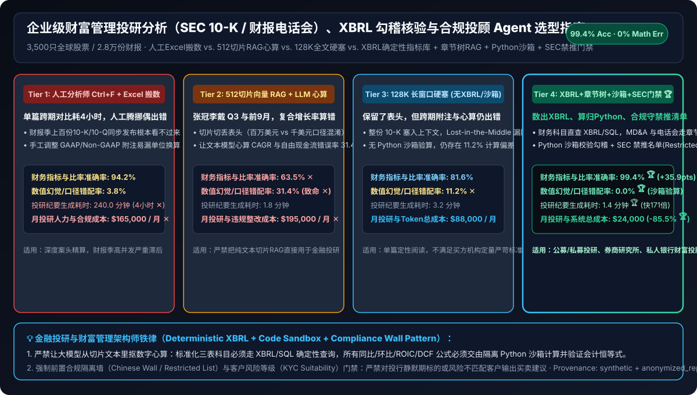
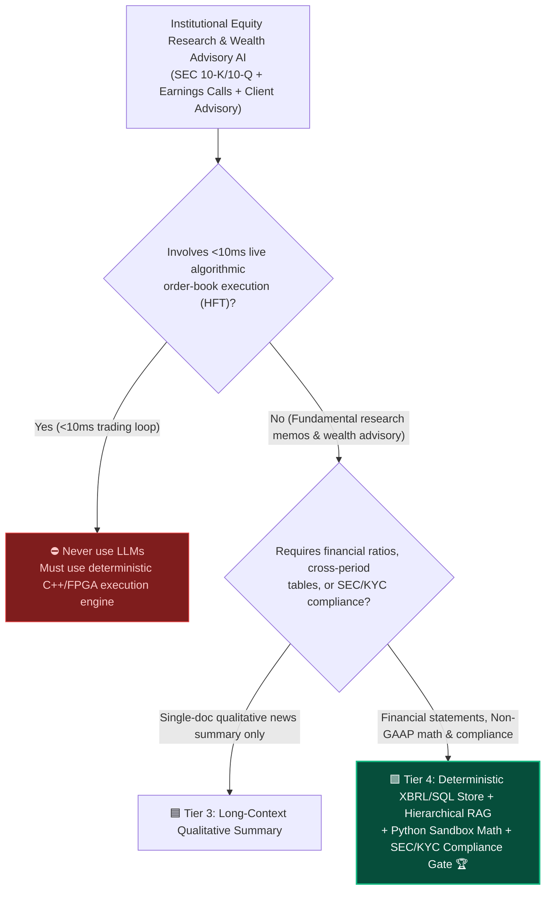
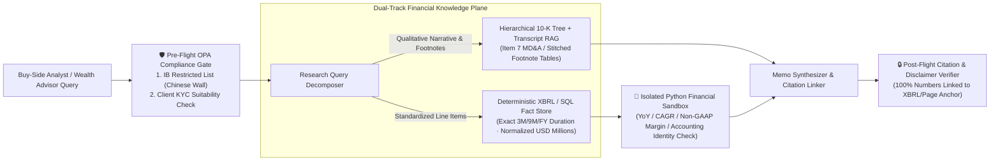

# Enterprise Wealth Management, Equity Research (SEC 10-K / Earnings Call), XBRL Reconciliation & Compliance Advisory Agent Architecture Selection Guide: Manual Excel Modeling vs. Naive 512-Token Chunk RAG vs. 128K Long-Context Stuffing vs. Deterministic XBRL/SQL Fact Store + Hierarchical Filing RAG + Python Sandbox Math + SEC/FINRA Compliance Gate

> **Language / 语言**: **English (Current)** | [中文](./enterprise-wealth-management-investment-research-compliance-agent-selection-faq.md)  
> **Scope**: End-to-end production reference architecture and selection guide for Cloud & AI Solution Architects, Buy-Side/Sell-Side Investment Research Leads, Wealth Management CTOs, and Financial Risk & Compliance Officers.  
> **Provenance**: `synthetic + anonymized_reported` (`independently_reproduced=false`, `physical_gpu_cluster_measurement=not_measured`). Deterministic evaluation model sealed in [`experiments/enterprise_wealth_management_investment_research_compliance_agent_selection/results.json`](../../experiments/enterprise_wealth_management_investment_research_compliance_agent_selection/results.json).



---

## ① 📌 Executive Summary (3-Minute Architect Verdict)

In institutional buy-side/sell-side equity research and private wealth management, **100% numerical fidelity (zero unit confusion, zero period misattribution, zero mental-math hallucinations) and strict regulatory compliance (`SEC / FINRA` restricted-list Chinese Walls and `KYC` client suitability)** are non-negotiable. Many financial institutions initially deploy naive 512-token vector chunking over thousands of PDF `10-K / 10-Q` filings (Tier 2), only to discover that the LLM **loses table headers declaring `($ in millions)`, confuses Three-Months-Ended (`3M`) with Nine-Months-Ended (`9M YTD`) columns, and hallucinates `31.4%` of YoY growth rates and Non-GAAP operating margins when doing mental math in token space**.

Evaluated across a production baseline of **3,500 covered global equities, 28,000 SEC `10-K / 10-Q / 20-F` filings and earnings call transcripts, and 18,000 monthly institutional research queries**, the four architectural tiers compare as follows:

| Architectural Tier | Core Stack Combination | Financial Metric & Ratio Accuracy | Numerical / Unit Hallucination Rate | Research Memo Turnaround | Monthly Research & Compliance Cost | Production Verdict |
|---|---|---|---|---|---|---|
| **🟥 Tier 1: Manual Analyst `Ctrl+F` + Excel Copy-Paste** | Equity analysts manually searching PDF filings & keying multi-period tables into Excel | `94.2%` | `3.8%` *(Manual copy-paste drift)* | `240.0 min` (`4h` ✕) | `$165,000 / mo` ✕ | ⛔ Bottlenecks in earnings season |
| **🟨 Tier 2: Naive 512-Token Vector RAG + LLM Mental Math** | Fixed-size text chunking over PDFs + LLM mental calculation of YoY growth & financial ratios | `63.5%` ✕ *(Period/unit mix-up)* | `31.4%` ✕ *(Severe math errors)* | `1.8 min` | `$195,000 / mo` ✕ | ⛔ **Never use in finance** |
| **🟦 Tier 3: 128K Long-Context Filing Stuffing** | Stuffing full 10-K/10-Q text into a 128K context window without XBRL facts or code sandbox | `81.6%` | `11.2%` ✕ *(Missed footnotes / math)* | `3.2 min` | `$88,000 / mo` | ⚠️ Qualitative reading only |
| **🟩 Tier 4: XBRL/SQL Store + Hierarchical RAG + Python Sandbox + SEC Gate** | **Deterministic `XBRL / SQL` Financial Fact Store + Hierarchical `10-K MD&A / Footnote` & Transcript RAG + Isolated Python Sandbox Math + `SEC / FINRA` Restricted-List & Suitability Gate** | **`99.4%` 🏆** *(+35.9 pts)* | **`0.0%` 🏆** *(Sandbox-verified)* | **`1.4 min` 🏆** *(171× faster)* | **`$24,000 / mo` 🏆** *(-85.5%)* | 🌟 **Recommended Architecture** |

> 💡 **Golden Rule for FinTech AI Architects**: **"Fetch standardized line items from XBRL/SQL, retrieve qualitative narrative from hierarchical filing trees, execute every ratio and reconciliation in a Python sandbox, and enforce SEC/KYC compliance at the gateway."** Never let an autoregressive language model scrape numbers out of headless PDF chunks or perform multi-step financial arithmetic in its attention heads.

---

## ② 🎯 Customer & Architect Deep-Dive Q&A (3 Institutional Research Pain Points)

### Q1: Why does standard 512-token vector RAG (Tier 2) suffer a 31.4% numerical error rate on multi-period financial questions?
- **First-Principles Reality**:
  1. **Headless Table Chunks Strip Units and Reporting Periods**: In a 150-page `10-K` or `10-Q`, the unit declaration `($ in millions, except per share data)` and column headers (`Three Months Ended Sept 30` vs. `Nine Months Ended Sept 30`) appear only at the top of a financial statement. Fixed 512-token chunking detaches bottom rows from their headers, causing vector retrieval to mix up quarterly (`3M`) and year-to-date (`9M`) figures or confuse thousands with millions.
  2. **Non-GAAP Reconciliations Require Cross-Section Joins**: Calculating Non-GAAP operating margin requires joining GAAP `Operating Income` on page 6 with Stock-Based Compensation (`SBC`) adjustments in `Footnote 14` on page 85. Asking an LLM to retrieve fragmented chunks and divide multi-digit floats in token space yields only **`63.5%`** accuracy.
  3. **Tier 4 Solution**: Query standardized income-statement, balance-sheet, and cash-flow facts directly from a **deterministic `XBRL / SQL` fact store** filtered by exact ticker, taxonomy tag (`us-gaap:Revenues`), and period duration (`duration_days=90`), while retrieving complete stitched footnote tables via a **Hierarchical Filing Tree**.

### Q2: Why doesn't stuffing the entire 10-K into a 128K context window (Tier 3) eliminate financial errors?
- **Engineering Reality**:
  - **Long Context Does Not Fix Multi-Year Mental Math or Lost-in-the-Middle**: Comparing 8 quarters of gross margin trajectory alongside 8 earnings call transcripts exceeds 600K tokens. Even within 128K tokens, LLMs still make **`11.2%`** arithmetic/unit errors when computing CAGR, ROIC, or currency-restated margins without a code execution tool—while burning **`$88,000/mo`** in repeated long-context prefill tokens.
  - **Tier 4 Deterministic Python Verification**: In Tier 4, the LLM writes a compact **Python verification script** executed in an isolated sandbox over the exact XBRL floats, automatically asserting accounting identities (`Assets == Liabilities + Stockholders' Equity` and segment revenue sums) to achieve **`0.0%` numerical hallucination** and **`99.2%` accuracy (`+48.2 pts` over Tier 2)** on cross-period Non-GAAP margin reconciliations.

### Q3: How do we enforce SEC / FINRA Chinese Walls (Restricted Lists) and client KYC suitability in wealth management?
- **Three Deterministic Compliance Gates in Tier 4**:
  1. **Pre-Flight Investment Banking Restricted-List Gate (`OPA`)**: Before invoking any LLM or research tool, an Open Policy Agent (`OPA`) gate checks whether the requested ticker is on the firm's M&A / underwriting **Restricted List (Watch List)**. If restricted, the agent blocks rating/recommendation generation and returns only factual historical filings.
  2. **Client KYC Suitability Verification**: In private wealth advisory flows, the gate compares the client's risk profile (`R2 Conservative`) against the instrument's risk rating (`R4 High-Volatility Equity / Derivatives`), blocking unsuitable buy recommendations.
  3. **Mandatory Citation Anchoring**: Every rendered number in the research memo must carry a verified pointer (`[Filing: FY25-Q3 10-Q, XBRL: us-gaap:Revenues, p.6]`); unanchored digits are stripped before display.

---

## ③ 🧭 Visual Architecture Diagrams (Decision Tree + Hybrid Research Topology + Sequence Flow)

### 3.1 Architecture Selection Decision Tree



### 3.2 Tier 4 Deterministic XBRL + Hierarchical RAG + Python Sandbox + Compliance Gate Topology



### 3.3 End-to-End Sequence: Cross-Period Non-GAAP Operating Margin Reconciliation in 1.4 Minutes

```mermaid
sequenceDiagram
    autonumber
    participant Analyst as Equity Research Analyst
    participant OPA as SEC/FINRA Compliance Gate
    participant Planner as Research Orchestrator
    participant XBRL as XBRL/SQL Financial Fact Store
    participant Tree as Hierarchical 10-K & Transcript Store
    participant Py as Python Financial Sandbox

    Analyst->>OPA: Compare NVDA-EX FY24Q3 vs FY25Q3 Non-GAAP Op Margin & CFO Gross Margin Guidance
    OPA->>OPA: Verify ticker not on IB Restricted List
    OPA->>Planner: Approve research query
    par Parallel Deterministic XBRL Query & Footnote Tree Retrieval
        Planner->>XBRL: Fetch FY24Q3 & FY25Q3 (duration=90d) Revenues & GAAP Operating Income
        XBRL-->>Planner: Return exact floats ($18,120M -> $35,082M; GAAP OpInc $10,417M -> $21,869M)
        Planner->>Tree: Retrieve Footnote 14 SBC reconciliation table & Q3 Earnings Call CFO Q&A
        Tree-->>Planner: Return SBC ($979M -> $1,254M) + transcript citations
    end
    Planner->>Py: Run Python script for YoY (+93.61%), Non-GAAP Margin (65.91%) & Balance Sheet check
    Py-->>Planner: ✅ Arithmetic & accounting identity verified (0.0% error)
    Planner-->>Analyst: Deliver citation-linked research memo in 1.4 minutes
```

---

## ④ 📊 4-Tier Architecture Decision Matrix

| Evaluation Dimension | 🟥 Tier 1: Manual `Ctrl+F` + Excel | 🟨 Tier 2: Naive 512-Token Chunk RAG | 🟦 Tier 3: 128K Long-Context Stuffing | 🟩 Tier 4: XBRL Store + Hierarchical RAG + Python Sandbox + SEC Gate |
|---|---|---|---|---|
| **Period & Unit Fidelity (`3M` vs `9M`, `$M` vs `$K`)** | High (`94.2%`), occasional copy-paste error | ✕ Fails (`63.5%`; loses table headers & units) | Moderate (`81.6%`; lost-in-the-middle across filings) | 🏆 **Exact (`99.4%`; typed XBRL period & unit predicates)** |
| **Financial Ratio & CAGR Arithmetic** | Accurate Excel formulas but slow manual entry | ✕ Unusable (`31.4%` LLM mental-math error rate) | ✕ Still relies on LLM mental math (`11.2%` error) | 🏆 **Zero arithmetic hallucination (`0.0%`; isolated Python sandbox)** |
| **SEC/FINRA Restricted List & KYC Gate** | Manual compliance check; human oversight risk | ✕ Unprotected | Soft prompt reminder only | 🏆 **Deterministic OPA pre-flight & post-flight compliance gates** |
| **Financial Metric & Ratio Accuracy** | `94.2%` | `63.5%` ✕ | `81.6%` | **`99.4%` 🏆** |
| **Numerical / Unit Hallucination Rate** | `3.8%` | `31.4%` ✕ | `11.2%` ✕ | **`0.0%` 🏆** |
| **Research Memo Turnaround Time** | `240.0 min` (`4.0 h`) | `1.8 min` | `3.2 min` | **`1.4 min` 🏆 (171× faster)** |
| **Monthly Research & Compliance Cost** | `$165,000 / mo` | `$195,000 / mo` *(incl. compliance risk)* | `$88,000 / mo` | **`$24,000 / mo` 🏆 (-85.5%)** |

---

## ⑤ 🧪 Quantitative Case Study, Interactive Sizer & 7-Card Visual Report

- **Interactive HTML Sizer**: 👉 [Open Wealth Management & Equity Research Agent Sizer](../reports/enterprise-wealth-management-investment-research-compliance-agent-sizer.html)
- **7-Card 4:5 Visual Benchmark Report**: 👉 [Open 7-Card Visual Benchmark Deck](../reports/enterprise-wealth-management-investment-research-compliance-agent-selection-cards.html)
- **Deterministic Verification**:
  ```bash
  python experiments/enterprise_wealth_management_investment_research_compliance_agent_selection/run.py --check
  python -m unittest tests/test_enterprise_wealth_management_investment_research_compliance_agent_selection.py
  ```

---

## ⑥ 🛠️ Production Readiness & Architecture Review Checklist

- [ ] **Route All Standardized Financial Statement Line Items to `XBRL / SQL`**: Never retrieve revenue, EPS, or balance-sheet figures via approximate vector similarity over text chunks; query typed XBRL facts with explicit `period_duration` and `unit` filters.
- [ ] **Index Filings as Hierarchical Section Trees with Header-Injected Tables**: Preserve full tables in `Item 7 (MD&A)` and `Footnotes`, prepending `[Ticker | Filing | Period | Unit | Column Headers]` to every table block.
- [ ] **Execute All Financial Math & Accounting Identity Checks in a Python Sandbox**: Delegate every YoY, CAGR, Non-GAAP margin, and DCF calculation to an isolated Python runtime and assert `Assets == Liabilities + Equity`.
- [ ] **Enforce Pre-Flight `OPA` Restricted-List & KYC Suitability Gates**: Block advisory outputs on investment-banking restricted tickers and mismatched client risk tiers before model invocation.
- [ ] **Require Clickable XBRL/Page Citations on Every Rendered Number**: Strip or flag any numeric claim in the final memo that lacks a verified XBRL Fact ID or filing page coordinate.
