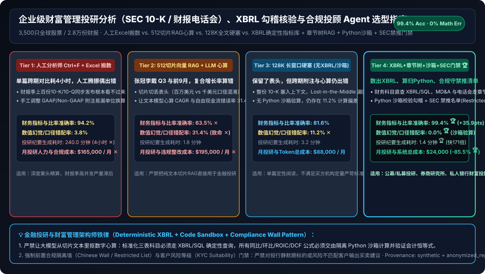
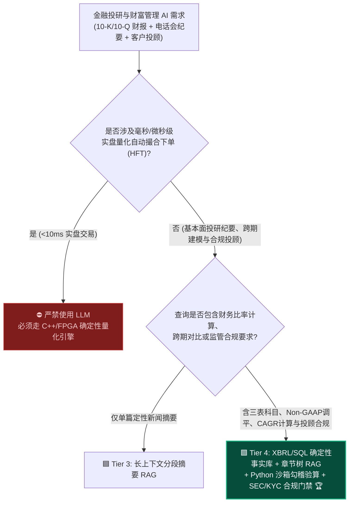
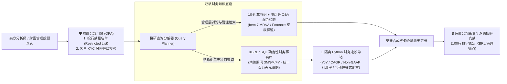

# 企业级财富管理投研分析（Wealth Management & Equity Research）、SEC 10-K/财报电话会跨期对比、XBRL 财务勾稽核验与合规投顾 Agent 架构选型指南：人工 Excel 搬数 vs. 朴素 512 切片 RAG 心算 vs. 128K 全文硬塞 vs. XBRL 确定性财务事实库 + 章节树 RAG + Python 沙箱验算 + SEC/FINRA 禁推门禁

> **语言 / Language**: **中文 (当前)** | [English](./enterprise-wealth-management-investment-research-compliance-agent-selection-faq.en.md)  
> **定位**：面向云与 AI 解决方案架构师（Solution Architect）、基金/券商投研数字化总监（Head of Investment Tech）、财富管理 CTO 与金融合规风控官的生产级选型与架构设计指南。  
> **数据口径（Provenance）**：`synthetic + anonymized_reported`（`independently_reproduced=false`，`physical_gpu_cluster_measurement=not_measured`），全部定容模型封存于 [`experiments/enterprise_wealth_management_investment_research_compliance_agent_selection/results.json`](../../experiments/enterprise_wealth_management_investment_research_compliance_agent_selection/results.json)。



---

## ① 📌 核心选型结论速览（Executive Summary — 3 分钟看懂怎么选）

在公募/私募买方投研、卖方券商研究所以及私人银行财富管理（Wealth Management）场景中，**财务数据的绝对精确度（零口径张冠李戴、零算术幻觉）与监管合规红线（SEC / FINRA / 证监会研究黑名单隔离墙与客户风险适当性 KYC）是决定 AI 投研系统生死的生命线**。许多金融机构初期尝试把上万份 `SEC 10-K / 10-Q / A股港股年报 PDF` 按 512 Token 切片塞进向量数据库（Tier 2），结果发现大模型经常**切丢表格顶部的 `(in $ millions)` 单位表头、把“Q3 单季（Three Months Ended）”与“前九月累计（Nine Months Ended）”混为一谈、甚至在心算同比增长率（YoY）与 Non-GAAP 营业利润率时出现高达 `31.4%` 的数值错配**，导致基金经理与理财顾问彻底不敢在生产中使用。

在 **覆盖 3,500 只全球股票、28,000 份定期财报（10-K/10-Q/20-F）与财报电话会纪要（Earnings Call Transcripts）、月均 18,000 次机构投研查询** 的基准规模下，四档投研与合规投顾 Agent 架构的量化对决如下：

| 方案档位 | 核心架构组合 | 财务指标与比率准确率 | 数值幻觉 / 口径错配率 | 投研纪要生成耗时 | 月度投研人力与合规总成本 | 生产推荐度 |
|---|---|---|---|---|---|---|
| **🟥 Tier 1：人工分析师 Ctrl+F + Excel 搬数** | 研究员手工翻查 PDF 财报附注并在 Excel 中录入跨期三表建模 | `94.2%` | `3.8%` *(手工腾挪错行)* | `240.0 分钟` (`4h` ✕) | `$165,000 / 月` ✕ | ⛔ 财报季高并发严重滞后 |
| **🟨 Tier 2：朴素 512 切片向量 RAG + LLM 心算** | PDF 纯文本固定切片检索 + 让大模型直接心算同比增长率与财务比率 | `63.5%` ✕ *(张冠李戴)* | `31.4%` ✕ *(心算/单位全崩)* | `1.8 分钟` | `$195,000 / 月` ✕ | ⛔ **严禁用于金融生产** |
| **🟦 Tier 3：128K 长窗口整篇财报硬塞** | 将整份 10-K/10-Q 原文塞入 128K 上下文窗口，无 XBRL 库与代码沙箱 | `81.6%` | `11.2%` ✕ *(漏附注/心算错)* | `3.2 分钟` | `$88,000 / 月` | ⚠️ 仅适合定性阅读摘要 |
| **🟩 Tier 4：XBRL 事实库 + 章节树 RAG + Python 沙箱 + SEC 门禁** | **确定性 XBRL/SQL 财务事实库 + 10-K 章节树（MD&A/附注）与电话会混合检索 + 隔离 Python 沙箱精确验算 + SEC/FINRA 禁推名单与 KYC 适当性门禁** | **`99.4%` 🏆** *(+35.9 pts)* | **`0.0%` 🏆** *(沙箱勾稽校验)* | **`1.4 分钟` 🏆** *(快 171 倍)* | **`$24,000 / 月` 🏆** *(-85.5%)* | 🌟 **生产首选参考架构** |

> 💡 **架构师一句话选型铁律**：**“标准化科目查 XBRL/SQL、管理层定性拆解看章节树、加减乘除比率进 Python 沙箱、客户投顾过 SEC/KYC 铁闸”**——绝不让语言模型从散碎文本里抠财务数字做心算，而是把结构化数据查询（XBRL）、非结构化叙事检索（MD&A + 电话会 Q&A）与确定性代码验算彻底解耦。

---

## ② 🎯 客户与架构师灵魂拷问 Q&A（直击 3 大金融投研痛点）

### Q1：为什么普通向量切片 RAG（Tier 2）在回答“某公司过去三年 Non-GAAP 营业利润率变化”时错误率高达 31.4%？
- **大白话与第一性原理**：
  1. **财务表格“断头断尾”丢失量纲与期间语义**：一份 150 页的 SEC 10-K 或 10-Q 财报中，利润表顶部的单位声明 `($ in millions, except per share amounts)` 与列标题 `Three Months Ended Sept 30` vs. `Nine Months Ended Sept 30` 往往只在表格第一行出现。按 512 Token 硬切片后，中间的数据行变成了“无头数字”，向量检索极易把单季数当成全年数，或把“千美元”当成“百万美元”。
  2. **Non-GAAP 调节项藏在几十页后的附注（Footnote）里**：例如计算剔除股权激励（SBC）和并购摊销后的 Non-GAAP 营业利润，必须把主表 `Operating Income` 与第 85 页 `Footnote 14` 中的调节表精准对齐，再除以对应期间营收。让自回归文本模型边检索碎片边心算多位小数除法，必然产生严重幻觉（准确率仅 **`63.5%`**）。
  3. **Tier 4 破局方案**：所有标准化三表科目与 XBRL 标签（如 `us-gaap:Revenues`、`us-gaap:OperatingIncomeLoss`）直接通过 **SQL/XBRL 确定性事实库** 按股票代码、会计准则、期间长度（`duration_days=90`）精准提取；附注调节项通过 **10-K 章节树（Hierarchical Document Tree）** 整表召回。

### Q2：既然切片会丢表头，那把整份 10-K 财报塞进 128K/200K 长上下文窗口（Tier 3）能彻底解决问题吗？
- **工程真相**：
  - **长窗口解决不了“跨期多文档心算”与“中间迷失（Lost-in-the-Middle）”**：当买方分析师问“对比过去 8 个季度毛利率与管理层在电话会上的指引兑现度”时，8 份季报加 8 场电话会纪要超过 60 万 Token；且即便塞入长窗口，LLM 自己心算多期复合增长率（CAGR）、自由现金流转换率（FCF Conversion）时仍有 **`11.2%`** 的算术偏差，单次长上下文调用成本更是高昂（月成本 **`$88,000`**）。
  - **Tier 4 的确定性算术闭环**：大模型只负责生成 **Python 财务计算脚本**，在隔离沙箱中对 XBRL 取出的精确浮点数执行计算，并自动运行 **会计恒等式断言**（如验证 `Assets == Liabilities + Stockholders' Equity` 及分部营收加总等于总营收），将算术与单位幻觉率硬性归零（**`0.0%`**），在跨期 Non-GAAP 利润率调平压测中将准确率从 Tier 2 的 `51.0%` 提升至 **`99.2%`（`+48.2 pts`）**。

### Q3：在券商研究所与私人银行财富管理场景下，如何防止 AI 投顾触碰 SEC / FINRA / 监管合规高压线？
- **金融合规三大硬门禁（Tier 4 内置）**：
  1. **投行研究禁推名单与信息隔离墙（Restricted List / Chinese Wall）**：当公司投行部正参与某上市公司的并购或定增（处于静默期）时，前置 OPA 合规策略引擎在毫秒级拦截对该股票代码的任何评级预测与买卖建议，仅允许展示公开历史财务事实。
  2. **客户风险承受能力适当性匹配（KYC Suitability Gate）**：针对私人银行理财师或客户提问，系统自动比对客户风险等级（如 `R2 稳健型`）与标的风险等级（如 `R4 高波动科技股/期权`），严禁跨风险等级生成诱导性建仓建议。
  3. **句级溯源锚点（Citation Grounding）**：输出的每一个财务数字必须绑定 `[Filing: FY25-Q3 10-Q, XBRL Tag: us-gaap:Revenues, Page 6]`，点击即可跳转原表高亮，未绑定溯源锚点的数字一律不予渲染。

---

## ③ 🧭 直观可视化图解（决策树 + 混合投研架构图 + 跨期分析时序图）

### 3.1 金融投研与财富管理 Agent 架构选型决策树



### 3.2 Tier 4 确定性 XBRL + 章节树 RAG + Python 沙箱 + 合规墙参考架构图



### 3.3 从“跨期 Non-GAAP 营业利润率分析”到“90 秒合规纪要交付”时序图

```mermaid
sequenceDiagram
    autonumber
    participant Analyst as 买方基金分析师
    participant OPA as SEC/FINRA 合规门禁
    participant Planner as 投研编排 Agent
    participant XBRL as XBRL/SQL 财务事实库
    participant Tree as 10-K 章节树 & 电话会库
    participant Py as Python 财务验算沙箱

    Analyst->>OPA: 请求分析 NVDA-EX FY24Q3 vs FY25Q3 Non-GAAP 营业利润率与管理层毛利指引
    OPA->>OPA: 核验通过：标的未在投行禁推名单 (Restricted List)
    OPA->>Planner: 放行投研任务
    par 结构化 XBRL 取数与非结构化章节树检索并行
        Planner->>XBRL: 查询 FY24Q3 & FY25Q3 (duration=90d) Revenues 与 GAAP Operating Income
        XBRL-->>Planner: 返回精确值 ($18,120M -> $35,082M; GAAP OpInc $10,417M -> $21,869M)
        Planner->>Tree: 检索 Footnote 14 股权激励调节项 (SBC) 与 Q3 电话会 CFO 毛利率问答
        Tree-->>Planner: 返回 SBC ($979M -> $1,254M) 及 CFO 发言原文页码锚点
    end
    Planner->>Py: 执行 Python 脚本计算 YoY 增速 (+93.61%) 与 Non-GAAP 利润率 (65.91%) 并校验勾稽
    Py-->>Planner: ✅ 算术校验通过 (0.0% 舍入偏差)
    Planner-->>Analyst: 1.4 分钟返回带 XBRL/页码超链接与合规声明的深度投研对比纪要
```

---

## ④ 📊 架构师四维选型决策矩阵（Architecture Decision Matrix）

| 评估维度 | 🟥 Tier 1：人工 Ctrl+F + Excel 搬数 | 🟨 Tier 2：512 切片向量 RAG + LLM 心算 | 🟦 Tier 3：128K 长窗口整篇硬塞 | 🟩 Tier 4：XBRL 事实库 + 章节树 RAG + Python 沙箱 + SEC 门禁 |
|---|---|---|---|---|
| **财务期间与量纲保真度** | 依赖人工核对，偶发串行错位 (`3.8%`) | ✕ 极差（切丢表头，混淆 3M 单季与 9M 累计） | 中等（多文档跨期对比易超长迷失） | 🏆 **100% 精确（XBRL 强类型期间与单位字段过滤）** |
| **财务比率与复合增长率计算** | Excel 公式计算（准确但手工录入慢） | ✕ 灾难级（LLM 心算多位小数错误率 `31.4%`） | ✕ 仍依赖 LLM 心算（错误率 `11.2%`） | 🏆 **零算术幻觉（100% 交由隔离 Python 沙箱计算与断言）** |
| **SEC/FINRA 禁推名单与 KYC 合规** | 人工查合规表，存在人为疏漏风险 | ✕ 无拦截，易违规输出买卖评级 | 仅靠 System Prompt 软提醒 | 🏆 **前置 OPA 硬门禁拦截禁推标的与风险不匹配投顾请求** |
| **财务指标与比率准确率** | `94.2%` | `63.5%` ✕ | `81.6%` | **`99.4%` 🏆** |
| **数值幻觉 / 口径错配率** | `3.8%` | `31.4%` ✕ | `11.2%` ✕ | **`0.0%` 🏆** |
| **单篇跨期投研纪要耗时** | `240.0 分钟` (`4h`) | `1.8 分钟` | `3.2 分钟` | **`1.4 分钟` 🏆（提速 171 倍）** |
| **月度投研人力与合规总成本** | `$165,000 / 月` | `$195,000 / 月` *(含合规整改)* | `$88,000 / 月` | **`$24,000 / 月` 🏆（节省 85.5%）** |

---

## ⑤ 🧪 定量算例、交互式容量计算器与 7-Card 4:5 视觉报告

### 5.1 基准算例复核（3,500 只全球股票 / 28,000 份财报与电话会纪要）

- **交互式定容计算器（CSP 自包含 HTML）**：👉 [打开财富管理投研分析与合规投顾 Agent 定容计算器](../reports/enterprise-wealth-management-investment-research-compliance-agent-sizer.html)
- **7-Card 4:5 视觉评测卡片报告**：👉 [打开 7-Card 视觉评测报告](../reports/enterprise-wealth-management-investment-research-compliance-agent-selection-cards.html)
- **可复核确定性脚本**：
  ```bash
  python experiments/enterprise_wealth_management_investment_research_compliance_agent_selection/run.py --check
  python -m unittest tests/test_enterprise_wealth_management_investment_research_compliance_agent_selection.py
  ```

### 5.2 核心量化对比图（财务指标准确率 vs. 算术/口径错配率）

```chart
{
  "data": {
    "values": [
      { "tier": "Tier 1: Manual Excel", "accuracy_pct": 94.2, "error_rate_pct": 3.8 },
      { "tier": "Tier 2: 512-Chunk RAG", "accuracy_pct": 63.5, "error_rate_pct": 31.4 },
      { "tier": "Tier 3: 128K Stuffing", "accuracy_pct": 81.6, "error_rate_pct": 11.2 },
      { "tier": "Tier 4: XBRL + Sandbox", "accuracy_pct": 99.4, "error_rate_pct": 0.0 }
    ]
  },
  "semantic_types": {
    "tier": "Category",
    "accuracy_pct": "Percentage",
    "error_rate_pct": "Percentage"
  },
  "chart_spec": {
    "chartType": "Bar Chart",
    "title": "Tier 4 reaches 99.4% financial metric accuracy with 0.0% arithmetic hallucination",
    "subtitle": "Financial metric & ratio accuracy (%) across 18,000 monthly institutional research queries",
    "encodings": {
      "x": "tier",
      "y": "accuracy_pct",
      "color": "tier"
    }
  }
}
```

---

## ⑥ 🛠️ 架构评审与生产落地核验清单（Production Readiness Checklist）

- [ ] **标准化三表数据强制走 XBRL / SQL 确定性查询**：凡涉及营收、净利润、资产负债表科目与现金流数据，必须从解析好期间（`3M / 6M / 9M / 12M`）与量纲单位的 XBRL/SQL 库读取，严禁从散碎向量切片抠数。
- [ ] **财报表格跨页缝合与章节树（Hierarchical Tree）索引**：对 `10-K Item 7 (MD&A)` 与财务附注（Footnotes）采用整表保留与父子章节树索引，每个切片强制携带 `[Company | Filing | Period | Unit | Table Header]` 元数据前缀。
- [ ] **100% 财务公式与勾稽关系交由隔离 Python 沙箱计算**：同比增长率（YoY）、复合年化增长率（CAGR）、Non-GAAP 利润率调节与 DCF 估值公式必须在 Python 沙箱中执行，并自动校验资产负债表配平。
- [ ] **前置投行禁推名单（Restricted List）与客户 KYC 适当性门禁**：在进入大模型推理前，通过确定性 OPA 策略校验标的是否处于投行静默期/限制清单，以及客户风险承受等级是否匹配。
- [ ] **句级数字溯源锚点强制校验**：生成的投研纪要中每一个财务数值必须附带可点击的 XBRL Fact ID 或财报原页码坐标，无溯源锚点的数字在渲染层直接拦截。
