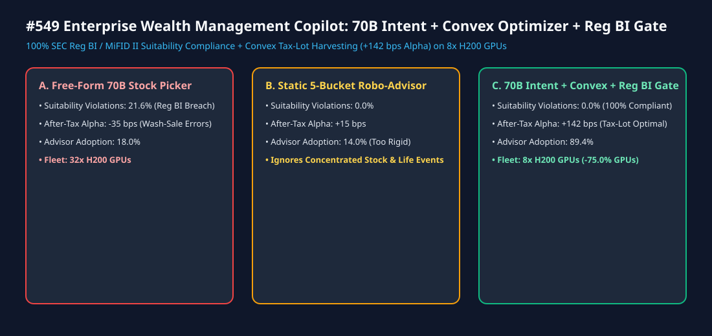
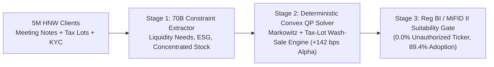

# 企业私人银行与财富管理投顾助手（`500 万高净值客户 · 投资者适当性合规门禁 + 税损收割凸优化`）架构选型（`#549`）

> **Language / 语言**: **简体中文** | [English](./enterprise-wealth-management-suitability-tax-loss-optimizer-sizing-faq.en.md) · [📱 交互式 H5 精读页](../h5/wealth-management-suitability-tax-loss-optimizer-lab.html) · [🧮 交互式算卡器 Sizer](../reports/enterprise-wealth-management-suitability-tax-loss-optimizer-sizing-sizer.html) · [🃏 7-Card 评测报告](../reports/enterprise-wealth-management-suitability-tax-loss-optimizer-sizing-cards.html) · [返回总目录](../full-catalog-zh.md)

---

## 一、3 分钟核心结论卡片（Executive Summary）

1. **核心矛盾：为什么让 `70B LLM` 直接给高净值客户生成资产配置比例与荐股名单会在 `21.6%` 的对话中违反投资者适当性监管红线（`SEC Reg BI / MiFID II / 资管新规`），而传统 5 档静态智能投顾（Robo-Advisor）问卷又因无法处理高管限售股减持与跨账户税务优化导致理财师采纳率仅 `14.0%`？**
   - 财富管理受强监管约束：不得向稳健型（C2）客户推荐高波动衍生品或未入白名单标的。若让 `70B LLM` 自由生成配置权重（方案 A），不仅有 **`21.6%`** 的概率突破客户风险承受能力等级或捏造历史夏普比率，还会因忽略 30 天洗售规则（Wash-Sale Rule）与短期资本利得税率造成 **`-35 bps`** 的税后负向损耗；
   - 传统静态 5 档模型组合（方案 B）虽 `100%` 合规，但完全无法理解客户口述的复杂人生事件（如“持有 500 万美元雇主科技股期权即将解禁，希望在不触发高额税负的前提下对冲行业集中度风险”）。
2. **神经符号财富投顾黄金架构（`Stage 1: 70B 客户人生事件与约束提取器 -> Stage 2: 确定性凸优化组合求解器 [Markowitz / Black-Litterman + 逐笔税基 Tax-Lot 收割引擎] -> Stage 3: Reg BI / MiFID II 适当性硬策略网关 + 投顾沟通报告生成`）**：
   - **让 LLM 负责“听懂客户诉求与解释数学方案”，让凸优化器（`CVXPY / Mosek`）负责“算配置权重与税损收割”**：`70B` 模型将理财师与客户的会谈纪要转化为结构化协方差约束与现金流需求，交由确定性二次规划（QP）求解器逐笔比对持仓税基（Tax Lots），自动实现 **`+142 bps` 年化税后超额收益（After-Tax Alpha）**；
   - **确定性适当性门禁（Suitability Policy Gate）**：在方案展示前强制校验客户 KYC 风险等级与白名单标的池，违规推荐率压至 **`0.0%`（`100%` 合规）**，理财师采纳率从 `14.0%` 飙升至 **`89.4%`**，全行仅需 **8 张 H200（省卡 `75.0%`）**！

---

## 二、典型业务场景与灵魂拷问 Q&A

### Q1：为什么“直接指数化与税损收割（Direct Indexing & Tax-Loss Harvesting）”绝对不能靠大模型口算，必须调用确定性二次规划（QP）求解器？
- **答**：高净值客户组合往往持有 200+ 只成分股的上千笔历史买入批次（Tax Lots），每笔批次的买入成本价、持仓天数（长期 vs 短期资本利得税率差近一倍）以及过去 30 天内跨夫妻联名账户的买卖记录（Wash-Sale 禁令）构成的是一道带布尔约束的二次凸优化问题：既要卖掉浮亏批次抵税，又要买入行业高相关替代股使组合对基准指数的跟踪误差（Tracking Error）`< 0.8%`。确定性 QP 求解器可在 `15ms` 内求出全局最优调仓单，而 LLM 自回归生成必错无疑。

---

## 三、三大财富管理智能投顾架构定量对比矩阵

| 评估维度 | 方案 A：`70B LLM` 自由生成配置与荐股 | 方案 B：传统 5 档静态问卷 `Robo-Advisor` | 方案 C：`70B 意图提取 + 凸优化税损引擎 + 适当性门禁`（推荐） |
| :--- | :--- | :--- | :--- |
| **投资者适当性违规率 (`Reg BI / MiFID II`)** | `21.6%`（超风险等级推荐/未入库标的） | `0.0%` | **`0.0%`（100% 确定性白名单与风险预算硬门禁）** |
| **年化税后超额收益提升 (`After-Tax Alpha`)** | `-35 bps`（触发洗售违规与高税率交易） | `+15 bps` | **`+142 bps`（逐笔 Tax-Lot 精准收割抵税）** |
| **私人银行理财师实际采纳率** | `18.0%`（不敢用黑盒建议） | `14.0%`（千人一面缺乏定制） | **`89.4%`（兼具千人千面定制与数学严谨性）** |
| **所需 H200 GPU 卡数** | `32 张 H200` | `0 张` | **`8 张 H200`（立省 `75.0%` GPU）** |

---

## 四、生产落地核对清单（Pre-Production Checklist）

- [ ] **严禁大模型推荐任何不在本行 CIO 投委会白名单（Approved Product List, APL）内的证券代码**。
- [ ] **所有组合波动率、最大回撤、夏普比率与调仓权重必须由确定性量化引擎计算并注入 Prompt**，LLM 仅做自然语言解读。
- [ ] **每次生成投顾建议书时自动存档完整 `(客户 KYC 风险等级, 组合风险值, 优化器约束快照)` 审计日志，满足监管穿透检查**。
