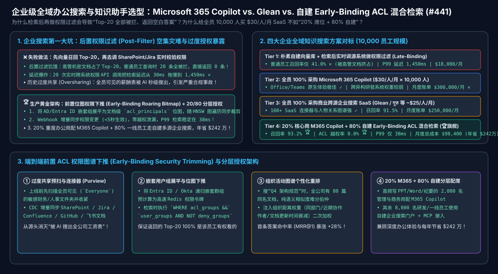

# Enterprise Workplace Search, Early-Binding ACL Security Trimming & Stratified Copilot Selection Guide: `Microsoft 365 Copilot` vs. `Glean` vs. `20/80 Hybrid + Early-Binding ACL Graph`

> **Language / 语言**: [简体中文](./enterprise-workplace-search-m365-copilot-glean-hybrid-acl-selection-faq.md) | **English**  
> **Companion Interactive Study & Sizing Tools**: [📱 Interactive H5 Study Lab](../h5/workplace-search-m365-copilot-glean-hybrid-acl-lab.html) · [🧮 HTML Sizer](../reports/enterprise-workplace-search-m365-copilot-glean-hybrid-acl-selection-sizer.html) · [🃏 7-Card Visual Deck](../reports/enterprise-workplace-search-m365-copilot-glean-hybrid-acl-selection-cards.html) · [📊 Reproducible Model](../../experiments/enterprise_workplace_search_m365_copilot_glean_hybrid_acl_selection/) · [🎓 Back to AI Infra H5 Hub](../h5/index.html)

---

## 1. Executive Summary (3-Minute Takeaway)

> **Bottom-Line Recommendation**: Never use post-retrieval API permission checks (`Late-Binding Post-Filtering`, which suffers from **`41.0%` recall starvation** when top-K slots are consumed by restricted executive files and `1,450 ms` P99 latency), and avoid wall-to-wall `$30/user/mo` SaaS seats for 100% of employees when 80% primarily need cross-source Q&A rather than heavy Office document authoring.
> - **Recommended Production Architecture (`Tier 4: Stratified 20% M365 Copilot Seats for Heavy Office Authors + 80% Self-Hosted Early-Binding Roaring-Bitmap ACL Hybrid Search [Azure AI Search / Vespa / Qdrant] + Org-Graph Reranking`)**:
>   1. **Achieves `93.2%` Permission-Aware Recall@5 at `38 ms` P99 Latency** with **`0.0%` ACL leakage** by pushing flattened `Entra ID / Okta` group bitsets (`acl_allow && user_groups AND NOT acl_deny`) directly into HNSW/BM25 index traversal;
>   2. **Saves `$2.42M/year` (`-67.2%`)** across a 10,000-employee enterprise (`$98,400/mo` vs. `$300,000/mo` for 100% wall-to-wall seats).

| Dimension | `Tier 1: Late-Binding Post-Filter` | `Tier 2: 100% M365 Copilot ($30/u)` | `Tier 3: 100% Commercial Glean (~$25/u)` | `Tier 4: 20% M365 + 80% Early-Binding ACL Hybrid (🏆)` |
|---|---|---|---|---|
| **Permission-Aware Recall@5** | **`41.0%` ✕ (Top-K starvation)** | `89.0%` ✓ | `91.5%` ✓ | **`93.2%` (Early-Binding ACL + Org-Graph)** 🏆 |
| **P99 Search + Auth Latency** | `1,450 ms` ✕ | `62 ms` ✓ | `48 ms` ✓ | **`38 ms` (In-index Roaring Bitmap)** 🏆 |
| **ACL Leakage Risk** | `3.8%` ✕ | `0.0%` ✓ | `0.0%` ✓ | **`0.0%` (<5s webhook revocation)** 🏆 |
| **Monthly Total TCO (10,000 Users)** | `$18,000 / mo` | `$300,000 / mo` ✕ | `$250,000 / mo` | **`$98,400 / mo` (Saves $2.42M/yr)** 🏆 |

---

## 2. Provenance & Reproducibility

- **Provenance**: `synthetic + anonymized_reported (independently_reproduced=false)` — verified via [`experiments/enterprise_workplace_search_m365_copilot_glean_hybrid_acl_selection/run.py`](../../experiments/enterprise_workplace_search_m365_copilot_glean_hybrid_acl_selection/run.py).
