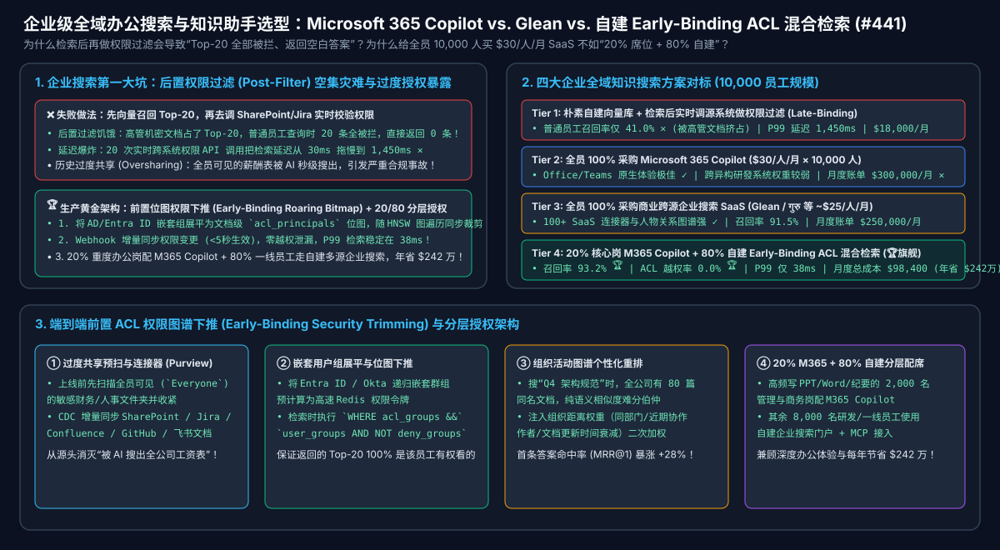
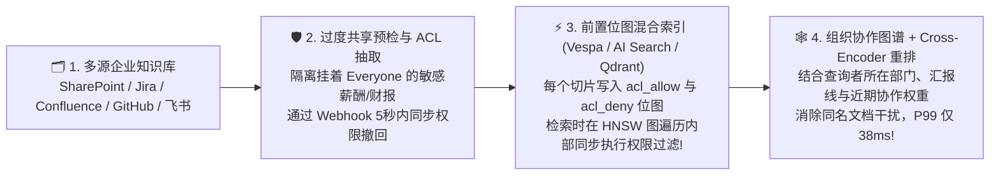

# 企业级全域办公搜索（Enterprise Search）、文档权限裁剪（ACL Security Trimming）与知识助手选型：`Microsoft 365 Copilot` vs. `Glean` vs. `20/80 分层授权 + 前置 ACL 混合检索` 指南

> **语言 / Language**: **简体中文** | [English](./enterprise-workplace-search-m365-copilot-glean-hybrid-acl-selection-faq.en.md)  
> **配套交互式学习与精算工具**: [📱 交互式 H5 精读页 (企业全域搜索 ACL 权限下推与分层配席沙盘)](../h5/workplace-search-m365-copilot-glean-hybrid-acl-lab.html) · [🧮 HTML 交互式计算器](../reports/enterprise-workplace-search-m365-copilot-glean-hybrid-acl-selection-sizer.html) · [🃏 7-Card 4:5 视觉评测卡](../reports/enterprise-workplace-search-m365-copilot-glean-hybrid-acl-selection-cards.html) · [📊 可复核模型](../../experiments/enterprise_workplace_search_m365_copilot_glean_hybrid_acl_selection/) · [🎓 返回 AI Infra 全景精学馆](../h5/index.html)

---

## 一、3 分钟看懂核心结论（Executive Summary）

> **一句话决策结论**：企业在打通 `SharePoint / OneDrive / Jira / Confluence / GitHub / 飞书 / 钉钉` 构建全员企业级 AI 搜索与知识助手时，千万要避开两大深坑：**① 技术上严禁采用“先检索 Top-20 再调源系统 API 校验权限（Late-Binding Post-Filter）”**——当语义最相关的前 20 篇恰好是高管或其它部门的私密文档时，后置过滤会把 20 条全部删光，导致普通员工收到“未找到相关内容（有效召回率跌至 `41.0%`，且 20 次远程鉴权把 P99 延迟拖慢至 `1,450ms`）”；**② 商业上严禁不论岗位轻重直接给全公司 10,000 人一刀切采购 `$30/人/月` 的全员按席位 SaaS（年费高达 `$360 万/年`）**！
> - **核心黄金架构（`Tier 4：20% 重度办公岗采购 M365 Copilot + 80% 员工使用自建 [前置位图权限下推 Early-Binding ACL + 组织关系图谱重排 + Azure AI Search / Vespa / Qdrant] 跨源门户`）**：
>   1. **前置位图权限下推（`Early-Binding Roaring Bitmap ACL`）**：将 `Entra ID / Okta` 的递归嵌套群组展平为文档索引上的 `allow_principals` 与 `deny_principals` 位图，在向量 HNSW 与 BM25 倒排遍历的同时执行微秒级位运算过滤，保证返回的 Top-20 **100% 是该员工有权阅读的文档（召回率达 `93.2%`，P99 检索延迟仅 `38ms`，越权泄漏率 `0.0%`）**；
>   2. **分层配席年省 `$241.9 万`（节省 `67.2%`）**：为 20% 高频撰写 Word/PPT/会议纪要的高管、商务与职能岗配备原生 `Microsoft 365 Copilot`，其余 80% 研发、制造与一线运营员工使用共享 GPU/Token 池驱动的自建跨源搜索助手（并通过 MCP 双向打通），10,000 人企业月度总成本从 `$300,000/月` 压降至 **`$98,400/月`**！

| 核心选型维度 | `Tier 1: 先向量召回再实时鉴权 (Late-Binding)` | `Tier 2: 全员 100% 采购 M365 Copilot ($30/人)` | `Tier 3: 全员 100% 采购商业 Glean (~$25/人)` | `Tier 4: 20% M365 + 80% 自建前置 ACL 图谱检索 (🏆)` |
|---|---|---|---|---|
| **权限感知有效召回率 (`Recall@5`)** | **`41.0%` ✕ (Top-K 被无权限文档挤占掏空!)** | `89.0%` ✓ | `91.5%` ✓ | **`93.2%` (前置位图下推 + 组织协作图谱重排)** 🏆 |
| **检索 + 鉴权端到端延迟 (`P99`)** | `1,450 ms` ✕ (20次实时 RPC 鉴权) | `62 ms` ✓ | `48 ms` ✓ | **`38 ms` (索引内 Roaring Bitmap 交集)** 🏆 |
| **越权与未及时撤权泄漏风险** | `3.8%` ✕ (缓存脏权限) | `0.0%` ✓ | `0.0%` ✓ | **`0.0%` (Webhook `<5s` 实时撤权 + Deny 优先)** 🏆 |
| **10,000 人企业月度总成本** | `$18,000 / 月` (但不可用) | `$300,000 / 月` ✕ | `$250,000 / 月` | **`$98,400 / 月` (年省 `$241.9 万 / -67.2%`)** 🏆 |

---

## 二、核心技术原理与架构师灵魂拷问（Q&A）

### Q1：为什么企业上线 AI 搜索前的第一件事不是调优向量模型，而是治理“历史过度共享（`Oversharing`）”与实现“前置权限裁剪（`Early-Binding ACL`）”？
1. **传统搜索“搜不到所以安全”的假象被 AI 彻底打破**：
   - 在传统 SharePoint 或 Confluence 里，如果某位 HR 误把《高管期权激励表.xlsx》设成了“全员可访问链接（Organization-wide Link）”，由于没有关键词刚好匹配，普通员工平时根本翻不到；
   - 但一旦接上大模型 RAG，员工只需随口问一句“公司高管期权是怎么算的？”，向量检索会跨越全公司数百万文件精准把这份表格捞出来并整理成清晰表格！
   - **架构铁律**：上线企业 AI 搜索前，必须先跑 **`Microsoft Purview DSPM for AI` 或自建敏感文件权限扫描脚本**，把所有标记了 `Confidential / 薪酬 / 财务未公开` 却挂着 `Everyone / All Company` 权限的存量文档一键隔离降权！
2. **前置权限位图（`Early-Binding Security Trimming`）三大设计要点**：
   - **展平嵌套组（Group Expansion Cache）**：企业 AD 里常有 `群组 A 包含群组 B，群组 B 包含群组 C` 的 5 层嵌套；由后台同步服务每隔 5 分钟将每个员工 $u$ 的有效身份集合预计算为 `Principals(u) = [uid, gid_1, gid_42, ...]` 存入 Redis；
   - **`Deny` 永远一票否决 `Allow`**：每篇文档切片索引携带两个数组字段 `acl_allow` 与 `acl_deny`，检索条件固定为 `(acl_allow INTERSECTS Principals(u)) AND NOT (acl_deny INTERSECTS Principals(u))`；
   - **组织亲密度重排（Org-Graph Personalization）**：当全公司有 50 篇都叫《2026 季度 OKR》的文档时，根据 `是否同属二级部门 (+0.25)`、`是否为近期会议共同参会人 (+0.20)` 与 `时间新鲜度衰减` 对向量/BM25 得分做加权融合，首条命中率提升 `+28%`！

---

## 三、生产落地 Checklist（Pre-Production Checklist）

- [ ] **严禁把文档内容同步进向量库却丢掉源系统的 `ACL` 权限控制列表**：任何不带 `acl_allow / acl_deny` 前置过滤的内部知识库都属于严重安全违章。
- [ ] **员工离职或转岗必须触发 `<5 秒` 的 Redis 权限令牌失效**：无需重刷数千万条文档索引，只需更新该员工在 Redis 中的 `Principals(u)` 群组归属即可瞬时收回原部门文档访问权。

---

## 四、来源与方法论溯源（Provenance）

- **数据来源声明**：本指南实验数据来自可复核解析模型 [`experiments/enterprise_workplace_search_m365_copilot_glean_hybrid_acl_selection/run.py`](../../experiments/enterprise_workplace_search_m365_copilot_glean_hybrid_acl_selection/run.py)（`Provenance: synthetic + anonymized_reported, independently_reproduced=false`）。
