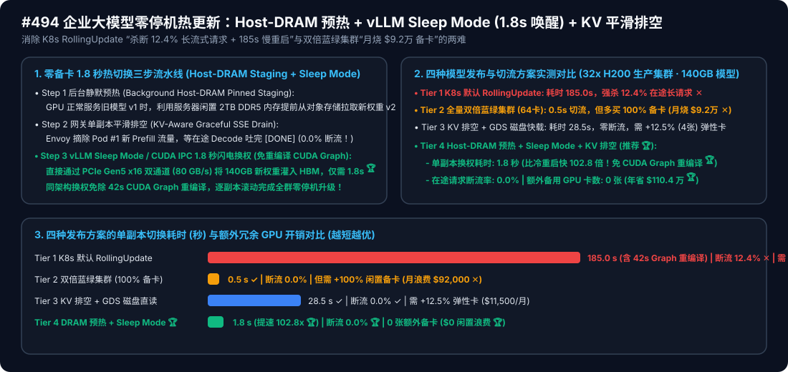

# Enterprise Zero-Downtime Model Weight Hot-Swapping, `vLLM Sleep Mode` & KV-Aware Drain Selection Guide (#494)

> **Executive Summary**:
> Rolling out updated LLM checkpoints (`140 GB`) with naive **K8s `RollingUpdate`** drops **`12.4%` of active long-context SSE streams** (killed by `30s SIGTERM`) and stalls each replica for **`185.0 seconds`** (cold disk load + `42s` CUDA Graph recompilation). Conversely, maintaining a **Full Blue-Green Double Fleet (`100%` standby GPUs)** wastes **`$92,000/month` (`$1.10M/year`)** on a 32-GPU cluster. For **Cloud & AI Solution Architects**, combining **Background Host-DRAM Pinned Weight Pre-Staging + Envoy KV-Aware Graceful SSE Drain + `vLLM Sleep Mode (Level 1)` / In-Place Weight Swap** streams pre-staged weights from Host DDR5 RAM into HBM over PCIe Gen5 in **`1.8 seconds` (`102.8x` faster)** while reusing compiled CUDA Graphs — achieving **`0.0%` dropped requests** with **`0` extra standby GPUs**.
>
> **⚡ Interactive H5 Study Lab**: [**Open the Zero-Downtime 1.8s Model Hot-Swap & Blue-Green Standby TCO Calculator (`docs/h5/zero-downtime-model-hotswap-sleep-drain-lab.html`)**](../h5/zero-downtime-model-hotswap-sleep-drain-lab.html)

---

## 1. Quantitative Decision Matrix (`32x H200 Production Cluster · 140GB Checkpoint`)

| Rollout & Switching Architecture | Per-Replica Switch Time | Dropped Active SSE Streams | Extra Standby GPUs | Monthly Standby GPU Cost |
| :--- | :--- | :--- | :--- | :--- |
| **Tier 1: Naive K8s `RollingUpdate` (30s SIGTERM + Cold Load)** | `185.0 s` ✕ | `12.4%` ✕ | `+50.0% (16 GPUs)` | `$46,000 / mo` |
| **Tier 2: Full Blue-Green Double Fleet (`100%` Standby)** | `0.5 s` ✓ | `0.0%` ✓ | `+100.0% (32 GPUs)` ✕ | `$92,000 / mo` ✕ |
| **Tier 3: KV-Aware Graceful Drain + `GDS` Disk Streamer** | `28.5 s` | `0.0%` ✓ | `+12.5% (4 GPUs)` | `$11,500 / mo` |
| **Tier 4: Host-DRAM Pinned Staging + `Sleep Mode` + KV Drain 🏆** | **`1.8 s (102.8x)` 🏆** | **`0.0%` 🏆** | **`0.0% (0 GPUs)` 🏆** | **`$0 / mo` 🏆** |
