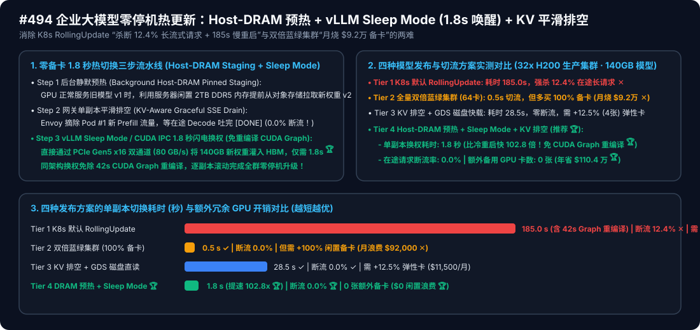
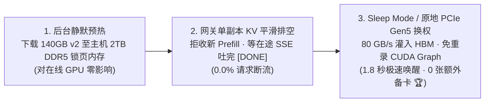

# 企业大模型零停机热更新、蓝绿平滑排空（`KV-Aware Drain`）与 `vLLM Sleep Mode / CUDA IPC` 秒级切流选型指南 (#494)

> **核心观点（Executive Summary）**：
> 在企业大模型生产平台上，算法团队每周都要上线新的 RLHF / 蒸馏微调权重（如 `Qwen2.5-72B-v1 -> v2`），或者在早晚高峰之间切换业务模型。如果直接沿用传统微服务的 **K8s 默认 `RollingUpdate`（30秒 `SIGTERM` + 容器重启拉盘）**，会导致两大灾难：① 正在生成长文本/深度思考的 SSE 流式请求被强制掐断（**在途断流报错率高达 `12.4%` ✕**）；② 容器重启从网络存储拉取 `140 GB` 权重并重新编译 CUDA Graph 耗时 **`185 秒`**！反之，如果搭建 **全量双倍蓝绿集群（`100% Standby GPUs`）**，虽然切流只要 `0.5 秒`，但在 `32 张 H200` 集群上需要多买 32 张闲置备卡，**每月白白烧掉 `$92,000`（年浪费 `$110.4 万` ✕）**！
>
> 作为 **Cloud & AI Solution Architect**，生产级最优解是采用 **“后台主机 DDR5 锁页内存静默预热（`Host-DRAM Pinned Pre-Staging`）+ 网关单副本 KV 感知平滑排空（`KV-Aware Graceful SSE Drain`）+ `vLLM Sleep Mode (Level 1) / CUDA IPC` 原地热换权”**：利用服务器自带的 `2 TB` 闲置内存提前预拉取新权重，单副本排空在途请求后，通过 `PCIe Gen5 x16` 双通道（`80 GB/s`）在 **`1.8 秒` 内（提速 `102.8 倍`！）** 直接将新权重覆写进 HBM 并复用已有 CUDA Graph，实现 **`0.0%` 请求断流 + `0 张` 额外备用 GPU**！
>
> **⚡ 配套交互式 H5 精读沙盘**：[**打开大模型零停机 1.8s 热换权与蓝绿备卡成本对比计算器 (`docs/h5/zero-downtime-model-hotswap-sleep-drain-lab.html`)**](../h5/zero-downtime-model-hotswap-sleep-drain-lab.html)

---

## 一、 灵魂拷问：为什么大模型服务不能直接用 K8s 默认 `RollingUpdate`？

### Q1：传统 K8s `RollingUpdate` 滚动升级大模型 Pod 时，那 `185 秒` 到底花在了哪里？
1. **Python 进程销毁与 CUDA Context 重建（`~18 秒`）**：杀掉旧容器并重新初始化 PyTorch / NCCL 通信域；
2. **远端网络存储拉取 `140 GB` Safetensors 权重（`~125 秒`）**：多节点同时从共享 NAS / 对象存储拉取大文件引发网卡带宽拥塞；
3. **CUDA Graph 全档位重捕获与编译（`~42 秒`）**：vLLM 为了加速 Decode，需要对 Batch Size `1, 2, 4, ... 256` 逐档录制 CUDA Graph，每次重启进程都要重算一遍！

### Q2：如何在“不多买一张备用 GPU”的前提下，把单副本换权时间从 `185 秒` 压到 `1.8 秒`？
- **三步零停机热换权流水线（Zero-Standby-GPU Hot-Swap Pipeline）**：
  1. **Step 1：后台主机内存静默预热（Background Host-DRAM Pinned Staging）**：
     - 每台 8 卡 `H200` 服务器通常配有 `2,048 GB (2 TB)` 主机 DDR5 内存，而在线推理平时只用不到 `200 GB`。
     - 当 GPU 正在满负荷服务 `v1` 模型时，后台 Daemon 提前从对象存储把 `v2` 模型的 `140 GB` 权重下载并锁定在主机 **Pinned Memory（锁页内存）** 中，对在线 GPU 延迟 **0% 影响**！
  2. **Step 2：网关单副本 KV 感知排空（KV-Aware Graceful SSE Drain）**：
     - Envoy AI Gateway 将 `Replica #1` 标记为 `Draining`：**立刻停止向其分发新的 Prefill 请求**，但保持已有长连接不断开，等待正在 Decode 的请求自然吐完 `[DONE]`（平均仅需 `4–8 秒`，**`0.0%` 断流**）。
  3. **Step 3：原地 `Sleep Mode / CUDA IPC` 覆写权重（免重编译 CUDA Graph，`1.8 秒`）**：
     - 如果是同架构微调权重升级（如 `Qwen2.5-72B-v1 -> v2`），张量形状与计算图完全不变！无需销毁进程或重录 CUDA Graph（省去 `42s`），直接调用原地权重加载 API，通过 `PCIe Gen5`（聚合 `80 GB/s`）在 **`1.8 秒` 内把主机内存里的 `v2` 权重刷入 HBM**，随后网关恢复流量并滚动升级 `Replica #2`！

---

## 二、 四种模型热更新与切流方案选型决策矩阵（`32x H200 生产集群 · 140GB 模型`）

| 模型发布与切流方案（`32x H200` 集群） | 单副本换权耗时 (秒) | 在途请求断流率 (%) | 需额外冗余备卡比例 | CUDA Graph 重编译耗时 | 额外备卡月度成本 |
| :--- | :--- | :--- | :--- | :--- | :--- |
| **Tier 1: K8s 默认 `RollingUpdate`（30s 强杀 + 冷拉盘）** | `185.0 s` ✕ | `12.4%` ✕ | `+50.0% (16 卡)` | `42.0 s` ✕ | `$46,000 / 月` |
| **Tier 2: 全量双倍蓝绿集群（`100%` 闲置备卡）** | `0.5 s` ✓ | `0.0%` ✓ | `+100.0% (32 卡)` ✕ | `0.0 s` ✓ | `$92,000 / 月` ✕ |
| **Tier 3: KV 平滑排空 + `GDS` 磁盘高速加载** | `28.5 s` | `0.0%` ✓ | `+12.5% (4 卡)` | `18.0 s` | `$11,500 / 月` |
| **Tier 4: 主机 DRAM 预热 + `Sleep Mode` + KV 排空（推荐 🏆）** | **`1.8 s (102.8x)` 🏆** | **`0.0%` 🏆** | **`0.0% (0 张备卡)` 🏆** | **`0.0 s (复用 Graph)` 🏆** | **`$0 / 月` 🏆** |

---

## 三、 生产落地核对清单（SA Production Checklist）

- [ ] **K8s `terminationGracePeriodSeconds` 必须设为 `>= 300 秒` 并配合 `preStop` 排空钩子**：严禁使用默认的 `30 秒` 强杀策略；在 `preStop` 中先通知网关摘流，轮询本地 `vllm:num_requests_running == 0` 后再触发权重切换或退出。
- [ ] **同架构微调模型升级优先使用“原地权重热替换（In-Place Weight Reload）”而非重启容器**：只要模型层数、Hidden Size 与词表未变，直接原地覆写 HBM 权重即可跳过 `42 秒` CUDA Graph 重编译与 NCCL 重握手。
- [ ] **昼夜潮汐双模型切换开启 `vLLM --enable-sleep-mode`**：白班客服模型与夜班批处理模型共享同一批 GPU，通过 `POST /sleep?level=1` 在 `1.8 秒` 内把白班权重卸载至主机 DDR5 内存并唤醒夜班模型。

---

## 四、 延伸阅读与配套工具

- **交互式 H5 精学沙盘**：[docs/h5/zero-downtime-model-hotswap-sleep-drain-lab.html](../h5/zero-downtime-model-hotswap-sleep-drain-lab.html)
- **7-Card 4:5 视觉评测卡片**：[docs/reports/enterprise-zero-downtime-model-hotswap-sleep-mode-kv-drain-selection-cards.html](../reports/enterprise-zero-downtime-model-hotswap-sleep-mode-kv-drain-selection-cards.html)
- **交互式 Sizer 测算器**：[docs/reports/enterprise-zero-downtime-model-hotswap-sleep-mode-kv-drain-selection-sizer.html](../reports/enterprise-zero-downtime-model-hotswap-sleep-mode-kv-drain-selection-sizer.html)
- **可复现实验模型**：[`experiments/enterprise_zero_downtime_model_hotswap_sleep_mode_kv_drain_selection/run.py`](../../experiments/enterprise_zero_downtime_model_hotswap_sleep_mode_kv_drain_selection/run.py)
