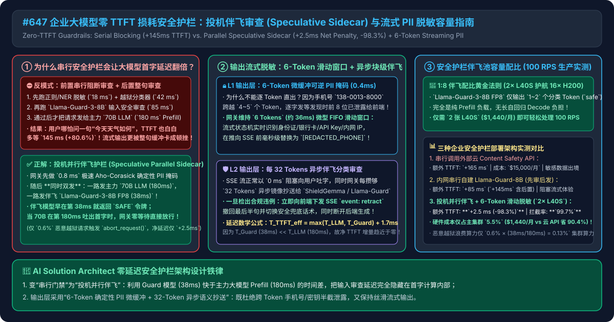

# Enterprise Zero-`TTFT`-Penalty AI Guardrail Architecture: Async Speculative Sidecar Moderation, `6-Token` Streaming PII Redaction & GPU Sizer

> **Language / 语言**: [简体中文](./enterprise-zero-ttft-ai-guardrail-speculative-sidecar-pii-faq.md) | **English** · [📱 Open Interactive H5 Study Lab](../h5/zero-ttft-ai-guardrail-speculative-sidecar-pii-lab.html) · [🧮 Open Interactive Sizer](../reports/enterprise-zero-ttft-ai-guardrail-speculative-sidecar-pii-sizer.html) · [🃏 View 7-Card 4:5 Benchmark Deck](../reports/enterprise-zero-ttft-ai-guardrail-speculative-sidecar-pii-cards.html)

---

## 0. 3-Minute Executive Summary

Running input/output safety guardrails (`Llama-Guard-3-8B / ShieldGemma + NER PII`) synchronously in series before and after a `70B` LLM adds **`+145 ms` to `TTFT` (`+80.6%`)** and stalls streaming output. Cloud & AI Solution Architects eliminate this penalty via **Speculative Parallel Sidecar Moderation + `6-Token` Sliding-Window PII Redaction**:
1. **Speculative Parallel Input Moderation Cuts Net `ΔTTFT` from `+145 ms` to `+2.5 ms` (`-98.3%`)**:
   $$T_{\text{TTFT,spec}} = T_{\text{AC\_Regex}} (0.8\text{ ms}) + \max\big(T_{\text{LLM\_Prefill}} (180\text{ ms}),\; T_{\text{Guard\_8B}} (38\text{ ms})\big) + T_{\text{Gate}} (1.7\text{ ms}) = \mathbf{182.5\text{ ms}}$$
   - Because `Llama-Guard-3-8B FP8` emits only `1–2` classification tokens (`safe` / `unsafe`), it finishes in **`38 ms`** — `142 ms` before the `70B` LLM finishes its `180 ms` Prefill! The gateway holds the first SSE token release gate until the `38 ms` verdict arrives (zero wait at `180 ms`), and immediately aborts the `0.6%` unsafe requests on the main engine (`0.13%` compute waste).
2. **`6-Token` Sliding-Window Streaming PII Redactor + `32-Token` Async Output Chunks**:
   - Buffers a tiny `6-token` (`36 ms`) sliding FIFO window to catch multi-token phone numbers, SSNs, credit cards, and API keys before SSE emission (`0.0%` partial PII leak), while mirroring `32-token` chunks asynchronously to the guardrail sidecar.
3. **`1:8` Sidecar Sizing Rule (`2× L40S` per `16× H200` Main Fleet)**:
   - Costs just **`$1,440/mo`** (`5.5%` of main cluster cost) for `100 RPS` vs. **`$15,000/mo`** for cloud moderation APIs (**saving `90.4%`**).

---

## 1. Quantitative Guardrail Architecture Matrix (`100 RPS` Enterprise Traffic)

| Guardrail Architecture | Net `ΔTTFT` Overhead | Streaming Stall (`ΔITL`) | Jailbreak & Multi-Token PII Catch Rate | Monthly Guardrail Cost | SA Verdict |
| :--- | :--- | :--- | :--- | :--- | :--- |
| **1. Regex Only (No LLM Guardrail)** | `+0.8 ms` | `+0.4 ms` | `41.5%` (fails encoded jailbreaks) | `$100 / mo` | ⛔ **Fails red-team audit** |
| **2. Serial Cloud Moderation API** | `+165.0 ms` | `+120.0 ms` | `98.5%` | `$15,000 / mo` | ⛔ **High latency & data egress** |
| **3. Serial Self-Hosted `Llama-Guard-8B`** | `+145.0 ms` | `+85.0 ms` | `99.4%` | `$2,160 / mo` (`3× L40S`) | ⚠️ **Adds `+80.6%` TTFT tax** |
| **4. Speculative Parallel Sidecar + `6-Tok` Window** | **`+2.5 ms` (`-98.3%`)** | **`+0.4 ms`** | **`99.7%` (`0%` partial PII leak)** | **`$1,440 / mo` (`2× L40S`, `-90.4%`)** | 🏆 **Production Golden Standard** |
