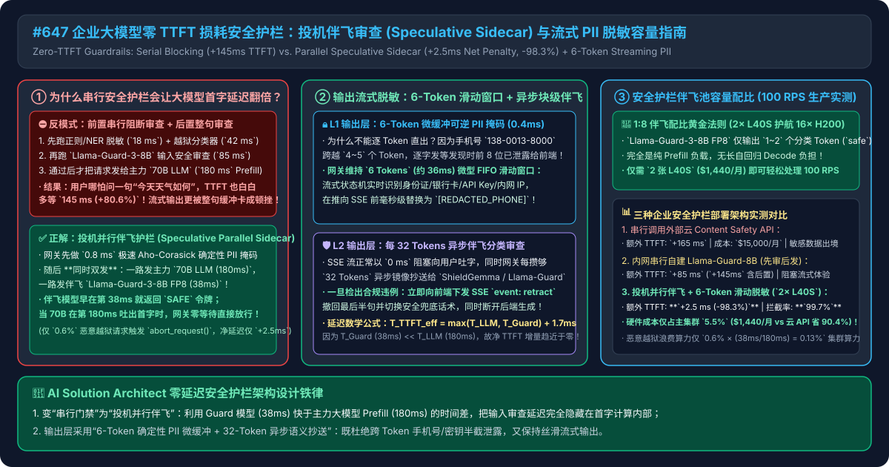
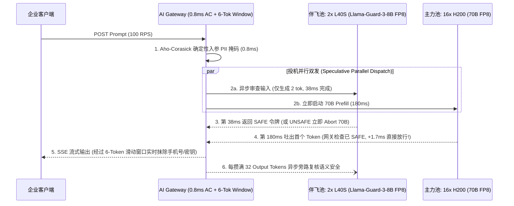

# 企业大模型零 `TTFT` 损耗安全护栏（`AI Safety Guardrails`）：投机并行伴飞审查（`Speculative Sidecar`）、`6-Token` 滑动窗口流式 PII 脱敏与容量选型指南

> **语言 / Language**: **简体中文** | [English](./enterprise-zero-ttft-ai-guardrail-speculative-sidecar-pii-faq.en.md) · [📱 打开交互式 H5 精读页](../h5/zero-ttft-ai-guardrail-speculative-sidecar-pii-lab.html) · [🧮 打开交互式容量计算器](../reports/enterprise-zero-ttft-ai-guardrail-speculative-sidecar-pii-sizer.html) · [🃏 查看 7-Card 4:5 评测报告](../reports/enterprise-zero-ttft-ai-guardrail-speculative-sidecar-pii-cards.html)

---

## 0. 3 分钟执行摘要（Executive Summary）

金融、医疗与政务大模型上线前必须通过严格的安全合规红队测试（防 Prompt 注入越狱、防敏感个人隐私 `PII` 泄露、防涉政/违规言论）。但很多团队上线安全护栏后却遭到业务方强烈投诉：**“加了输入/输出双层安全模型后，首字延迟（`TTFT`）凭空增加了 `145 ms`，流式打字机效果更因为要攒够整句审查而变得一卡一卡！”**
1. **核心突破：用“投机并行伴飞（`Speculative Parallel Sidecar`）”将输入审查净延迟从 `+145 ms` 压至 `+2.5 ms`（`-98.3%`）**：
   - 为什么串行慢？因为 `99.4%` 的正常企业请求原本都是安全的，却被迫先排队跑完 `85 ms` 的 `Llama-Guard-3-8B` 和 `60 ms` 的 NER/越狱分类器，之后才开始跑主力 `70B LLM`（`180 ms` Prefill）；
   - **投机并行伴飞公式**：
     $$T_{\text{TTFT,spec}} = T_{\text{AC\_PII}} (0.8\text{ ms}) + \max\big(T_{\text{LLM\_Prefill}} (180\text{ ms}),\; T_{\text{Guard\_8B}} (38\text{ ms})\big) + T_{\text{Gate}} (1.7\text{ ms}) = \mathbf{182.5\text{ ms}}$$
   - 网关在 `0.8 ms` 完成 Aho-Corasick 确定性正则脱敏后，**同时向主力 `70B` 集群与伴飞 `Llama-Guard-3-8B FP8` 池发起并发请求**；伴飞模型仅需 **`38 ms`** 即产出 `safe` 判定令牌并存入网关内存锁；当主力 `70B` 在第 `180 ms` 算出第 1 个 Token 时，网关检查锁状态已就绪，**零等待直接向客户端释放首包 SSE**！若伴飞模型在第 `38 ms` 判定为 `unsafe`（仅占 `0.6%` 流量），网关立即向主力引擎发送 `abort_request()` 取消计算，仅损耗 `0.6% × (38/180) = 0.13%` 的微不足道算力！
2. **输出层双轨流式护栏：`6-Token` 微滑动窗口 PII 掩码 + `32-Token` 异步块抄送**：
   - 仅维持 **`6 Tokens`（约 `36 ms`）** 的滑动窗口即可 `100%` 拦截跨 Token 拆分的手机号、身份证号、银行卡号与私钥（替换为 `[REDACTED]`），同时每 `32 Tokens` 异步抄送伴飞模型做语义合规检查，彻底告别“整句缓冲卡顿”。
3. **1:8 伴飞硬件配比铁律**：由于 `Llama-Guard-3-8B / ShieldGemma FP8` 只做Prefill 并输出 `1–2` 个分类 Token，每 **`16 张 H200` 主力推理集群仅需配 `2 张 L40S`（月成本 `$1,440`，占比仅 `5.5%`）** 即可扛住 `100 RPS` 全量双向护栏（对比公有云商业审核 API `$15,000/月` 节省 **`90.4%`**）。

---

## 1. 灵魂拷问 Q&A（Cloud & AI Solution Architect 核心决策拆解）

### Q1：为什么输出端流式 PII 脱敏不能“每吐 1 个 Token 检查 1 个 Token”，而必须设计 `6-Token` 滑动微缓冲窗口？

因为大模型 Tokenizer 会把一个 11 位手机号（如 `13800138000`）或 18 位身份证号切分成 **`4 到 6` 个连续的数字子词 Token**（如 `["138", "001", "380", "00"]`）：
- 如果网关每收到 1 个 Token 就立刻通过 SSE 发给前端浏览器，当你收到第 4 个 Token 凑齐手机号正则时，前 9 位数字 `"138001380"` 早就已经显示在用户屏幕上了！
- **网关 `6-Token` 滑动窗口状态机**：网关在内存中扣留最新生成的 `6` 个 Token（在 `TPOT = 6 ms` 下仅增加 `36 ms` 视觉无感延迟）；只有当窗口内未命中任何手机号/卡号前缀状态机时，最老的第 1 个 Token 才被推出窗口发往前端；一旦窗口内匹配完整 PII，直接在缓冲区原地替换为 `<PII_MASKED>`！

---

## 2. 四种企业 AI 安全护栏架构横向选型矩阵（`100 RPS` 主力集群）

| 护栏架构方案 (`100 RPS` · `4,000 In / 500 Out`) | 净增加首字延迟 (`ΔTTFT`) | 流式输出卡顿感 (`ΔITL`) | 越狱与跨 Token PII 拦截率 | 护栏月度成本 (`16× H200` 配套) | 架构师选型裁决 |
| :--- | :--- | :--- | :--- | :--- | :--- |
| **1. 纯正则关键字匹配（无安全小模型）** | `+0.8 ms` | `+0.4 ms` | 仅 `41.5%`（变形/Base64 越狱全漏） | `$100/月` (网关 CPU) | ⛔ **无法通过监管红队测试** |
| **2. 串行调用公有云商业审核 API** | `+165.0 ms` | `+120 ms`（按句缓冲） | `98.5%` | `$15,000/月`（按字符计费） | ⛔ **高延迟、高成本且敏感 Prompt 出网** |
| **3. 内网串行自建 `Llama-Guard-8B`（先审后算）** | `+145.0 ms` | `+85 ms` | `99.4%` | `$2,160/月` (`3× L40S`) | ⚠️ **白白把首字延迟拉长 80.6%** |
| **4. 投机并行伴飞 + `6-Token` 滑动脱敏（推荐）** | **`+2.5 ms` (`-98.3%`)** | **`+0.4 ms`（零顿挫）** | **`99.7%`（含跨 Token PII 零泄露）** | **`$1,440/月` (`2× L40S`，省 `90.4%`)** | 🏆 **企业生产零延迟合规标准架构** |

---

## 3. 生产落地核对清单（Pre-Production Checklist）

- [ ] **网关开启输入端“投机并行双发（Speculative Parallel Guardrailing）”**：伴飞模型返回 `SAFE` 前锁住首包 SSE，一旦返回 `UNSAFE` 立即调用引擎 `abort_request()` 释放 KV Cache；
- [ ] **开启入参“可逆占位符脱敏（Reversible Token Vault）”**：将用户输入的真实姓名/卡号在网关替换为 `<PERSON_1>`、`<CARD_1>` 送入大模型，模型输出后再在网关流式还原，确保大模型权重与日志永不接触明文隐私；
- [ ] **输出端强制启用 `6-Token` 滑动窗口状态机 + 每 `32 Tokens` 异步语义抄送**；
- [ ] **按 `1 张 L40S 伴飞卡 : 8 张 H200 主力卡` 标准配比独立部署护栏池**，并开启 `FP8` 与 Prefix Caching（固定安全宪法分类指令 `100%` 驻留 HBM）。
