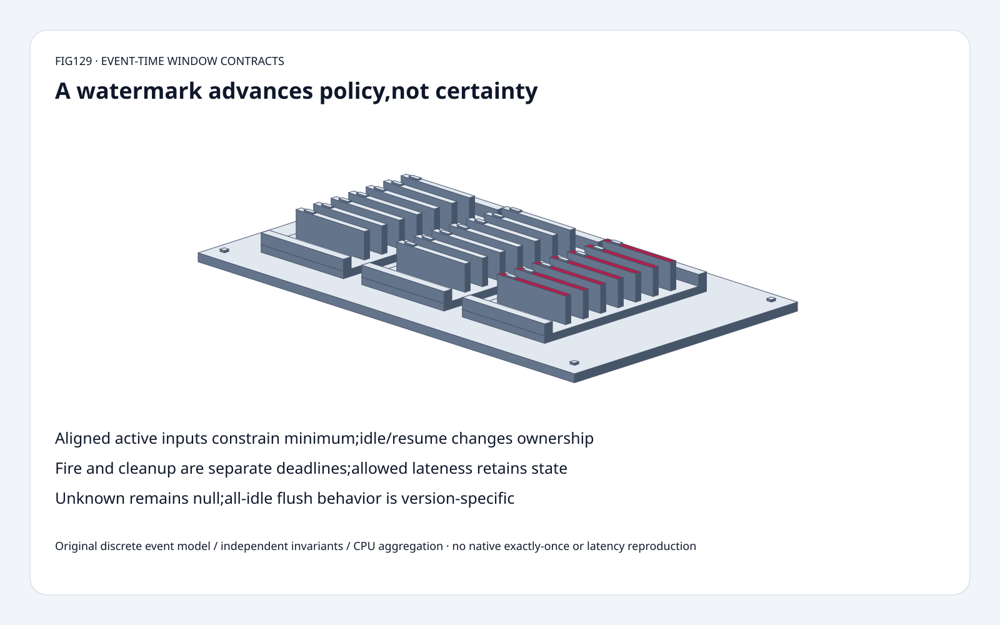
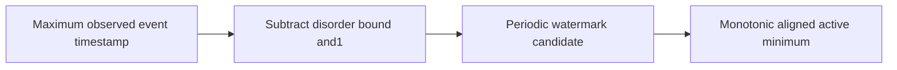
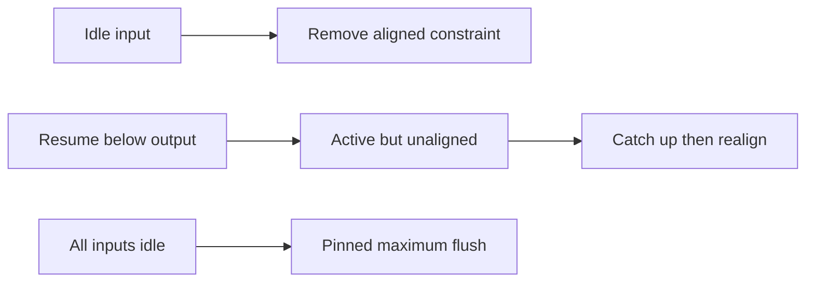
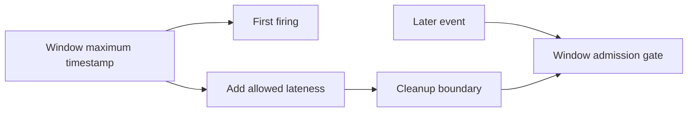

# Streaming feature FAQ: event-time watermarks,idleness,alignment and retained window state

> **Language**: [中文](event-time-watermark-idleness-lateness-cleanup-selection-faq.md) | English
>
> **Round129 · 2026-11-14 · Day round6** · [SVG](../../assets/svg/event-time-watermark-idleness-lateness-cleanup-selection-faq-summary.svg) · [H5](../reports/event-time-watermark-idleness-lateness-cleanup-sizer.html) · [7 cards](../reports/event-time-watermark-idleness-lateness-cleanup-selection-cards.html) · [Data](../../experiments/watermark_lateness_contract_selection/report.json)
>
> **Synthetic, `independently_reproduced=false`.** Original discrete bounded-source/valve/window model,independent boundary/invariant checks and separately measured original CPU aggregation. No native Flink,wall-clock idleness,timers,checkpointing,sinks or exactly-once reproduction.



## 1. Executive summary: a watermark advances a policy,not certainty

Selected partition maxima29 and9,disorder bound2:
periodic watermark candidates are **26** and **6**.
Active aligned inputs initially combine to **6**;
marking the slow input idle permits **26**.
A resumed old6 input is active but unaligned until catching up;
it cannot roll the emitted watermark backward.

Discrete window **[0,10)** has maximum timestamp **9**.
Allowed lateness5 retains state until cleanup **14**.
The same timestamp8 event is accepted as a late update at WM13
but rejected by the window-cleanup gate at WM14.

The pinned valve **flushes maximum known watermark when all inputs
become idle**. Both idle orders finish20 in the selected10/20 fixture;
removing this flush leaves one order at10.
Do not assume older/generalized “all idle always freezes” guidance
describes the exact inspected version.

## 2. Architect Q&A: source assumptions,minimum constraints and late state

### Q1: Why `max_timestamp-B-1` instead of`max_timestamp-B`?

The inspected bounded-disorder generator records maximum seen timestamp,
then emits `maxTimestamp-outOfOrdernessMillis-1` on its **periodic emit**.
The discrete boundary leaves timestamps at`max-B` ahead of the watermark.

Our original function models the candidate value,not a processing-time
schedule. Periodic emit interval,source activity and network/operator
backpressure add latency;B alone is not end-to-end feature latency.
Disorder boundB is a caller assumption,not measured proof that no
older record can arrive.

Before any event,our model preserves unknown as **None/null**,
not zero. Native code uses a carefully initialized Long.MIN_VALUE
sentinel;native integer overflow behavior is not reproduced.

### Q2: Which partition constrains the combined watermark?

Initially all active aligned inputs constrain the minimum.
An active input with unknown watermark blocks a finite minimum.
Explicit idleness removes its aligned constraint and can advance output.

Idleness here is a manual event in the original model,not a guarantee
that a source has ended or a native timeout detector's behavior.
Resuming a partition whose previous watermark is below the emitted
output makes it **active but unaligned**. Its local watermark must
catch up before it rejoins the aligned minimum.

Selected trace: output6→26 after idle;resume old6 leaves26;
other input36 advances output36;resumed35 remains unaligned;
resumed40 realigns,but minimum remains36.
Monotonic output does not make old resumed records on time.
“Aligned” here is valve watermark tracking,not checkpoint-barrier alignment
or source watermark-alignment throttling.

### Q3: What happens when every input is idle?

The pinned `StatusWatermarkValve` explicitly flushes the maximum across
its known subpartition watermarks before emitting idle status.
This makes the eventual watermark independent of idle-transition order.
It does not invent an infinite watermark or advance a wall clock forever.

With known local10/20:

| Idle order | Pinned output trace | Original wrong no-flush control |
| :--- | :--- | :--- |
| 0 then1 | [20,20] | [20,20] |
| 1 then0 | [10,20] | [10,10] |

This behavior was directly read in pinned source.
The history/date query for this valve change failed after TLS timeouts;
no unsupported claim about its introduction date is made.
The November13 tree's latest change concerns savepoint format reporting,
not a new watermark algorithm.

### Q4: Does the first window firing immediately delete all state?

Not with positive allowed lateness under the selected policy.
For discrete interval[start,end),`maxTimestamp=end-1`:
our fire boundary isend-1,and the inspected operator cleanup time is
`maxTimestamp+allowedLateness`.
Window is late for admission when **cleanup<=currentWatermark**.

Window[0,10),lateness5:
first fireWM9,count2;timestamp8 can update retained state to3;
atWM13 another timestamp8 updates count4;
WM14 cleans state and a later timestamp8 is explicitly rejected.
With lateness0,first firing and cleanup share deadline9.

The original model reports admission classification and selected
fire/cleanup transitions,not every native trigger callback or sink update.
Native element-side-output lateness uses a distinct
`event.timestamp+allowedLateness<=watermark` predicate.
Do not equate that predicate with the window-cleanup gate or claim
this toy reproduces actual side-output routing.

### Q5: Does allowed lateness guarantee correctness or exactly-once?

No. It chooses how long some late records may still change retained
windows. Downstream materialized features may need explicit updates,
upserts,retractions or versioning;not all sinks accept revisions.
Checkpoint/recovery and sink transactions are separate mechanisms.
The original model makes **no exactly-once claim**.

Selected64 partitions,10,000 keys,three retained windows/key,
8-byte count: watermark values **512 bytes**,window-count payload
**240,000 bytes**.
These omit keys,window metadata,timers,alignment flags,heap overhead,
backend serialization,checkpoint copies and cleanup scheduling.
They are logical scalar payloads,not measured backend/peak state.

## 3. Visual architecture: periodic source,min constraints and window lifetime







## 4. Selection matrix: trade freshness constraints against late-update policy

| Choice | Good fit | Gate |
| :--- | :--- | :--- |
| Bounded disorder generator | Explicit event-order assumption | Periodic latency and violated bounds |
| Active aligned minimum | Preserve progress constraints | Unknown active input blocks |
| Idleness exclusion | Temporarily silent partitions | Resumed old events can be late |
| Allowed lateness | Retain windows for revisions | State/sink update policy |
| All-idle handling | Exact pinned valve policy | Version-specific maximum flush |
| Exactly-once sink | Separate consistency requirements | Not established by watermarks |

## 5. Hands-on evidence: boundary oracles,alignment and CPU aggregation

```powershell
python -m experiments.watermark_lateness_contract_selection.run --check
python -m unittest discover -s tests -p test_watermark_lateness_contract_selection.py -q
```

Eight tests cover bounded candidates/unknowns,idle/resume alignment,
monotonicity,all-idle order independence,fire/cleanup and late updates,
integer interval enumeration including negative timestamps,
heap/list traces,invalid input,Node parity and sealed medians.

| Active partitions | Original lazy heap (ms) | Original list minimum (ms) |
| :--- | ---: | ---: |
| 16 | 0.057167 | 0.036567 |
| 64 | 0.068533 | 0.073900 |
| 256 | 0.056900 | 0.250533 |
| 1,024 | 0.137267 | 1.068833 |

128 monotonic updates,initialization included. Small16-case heap is
slower;this is not a universal crossover threshold.
Two warmups,seven alternating repeats,three operations/sample,
median repeat means. Heap retains stale entries until needed;
this is not the native indexed priority queue or a memory benchmark.
Native Flink,network,idleness,timers,checkpointing and backend excluded.
Browser visual inspection not performed.

## 6. Sources,provenance and readiness

- [Pinned bounded-disorder generator](https://github.com/apache/flink/blob/cac69274d4e7a6ab4b47454bd1cdc42905f4daca/flink-core/src/main/java/org/apache/flink/api/common/eventtime/BoundedOutOfOrdernessWatermarks.java): periodic max−B−1.
- [Pinned valve](https://github.com/apache/flink/blob/cac69274d4e7a6ab4b47454bd1cdc42905f4daca/flink-runtime/src/main/java/org/apache/flink/streaming/runtime/watermarkstatus/StatusWatermarkValve.java): aligned set,idle/resume,monotonic minimum,all-idle maximum flush.
- [Pinned window operator](https://github.com/apache/flink/blob/cac69274d4e7a6ab4b47454bd1cdc42905f4daca/flink-runtime/src/main/java/org/apache/flink/streaming/runtime/operators/windowing/WindowOperator.java): cleanup/window admission and distinct element-side-output predicate.
- [Apache-2.0 license](https://github.com/apache/flink/blob/cac69274d4e7a6ab4b47454bd1cdc42905f4daca/LICENSE): upstream rights retained.
- [Original experiment](../../experiments/watermark_lateness_contract_selection/README.md): discrete models,oracles,samples and limitations.

No upstream implementation copied. Native latency,backend memory,
model quality and exactly-once remain unmeasured or not reproduced.
