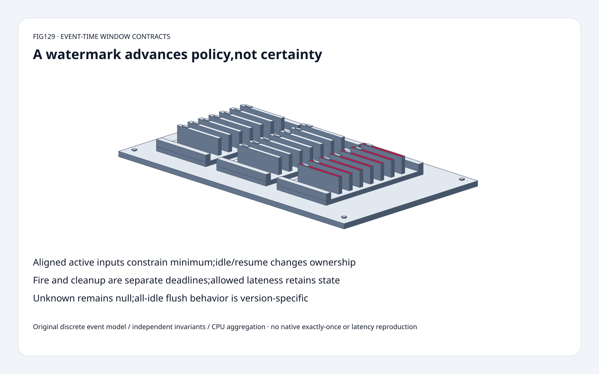
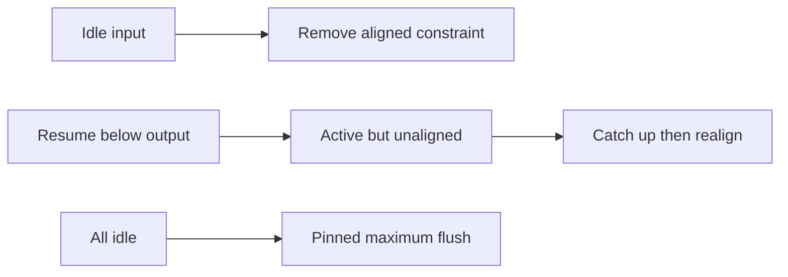
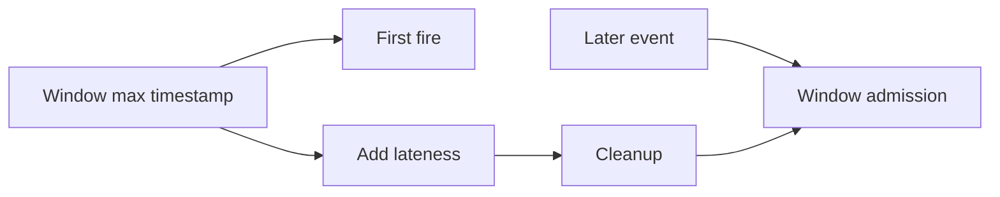

# Streaming Feature FAQ：Event-time Watermark、Idleness、Alignment 与 Cleanup

> **语言**：中文 | [English](event-time-watermark-idleness-lateness-cleanup-selection-faq.en.md)
>
> **Round129 · 2026-11-14 · 白班第6轮** · [SVG](../../assets/svg/event-time-watermark-idleness-lateness-cleanup-selection-faq-summary.svg) · [H5](../reports/event-time-watermark-idleness-lateness-cleanup-sizer.html) · [七卡](../reports/event-time-watermark-idleness-lateness-cleanup-selection-cards.html) · [Data](../../experiments/watermark_lateness_contract_selection/report.json)
>
> **Synthetic，`independently_reproduced=false`。** 原创 discrete source/valve/window、
> 独立 boundary/invariant checks、CPU aggregation；
> 非 native Flink、clock-idleness、timers、checkpoint、sink 或 exactly-once 复现。



## 一、结论速览：Watermark推进Policy，不制造确定性

选定partition maxima29/9、disorderbound2，
periodiccandidates **26/6**，activealignedminimum **6**；
slowinput idle允许 **26**。
旧6resume后active但unaligned，追上前不能回滚globalWM。

Discretewindow **[0,10)** maxTimestamp **9**；
allowedlateness5保留到cleanup **14**。
同timestamp8在WM13可lateupdate，
WM14由windowcleanupgate拒绝。

固定valve **allidle时flush已知maximum**；
local10/20两个idleorder最终都20，
删flush的wrongcontrol一条停10。
不能把泛化的“allidle永远冻结”当当前pinnedbehavior。

## 二、架构师Q&A：Source假设、Minimum与LateState

### Q1：为何是`maxTimestamp-B-1`？

所读generator记录maxobserved，
在 **periodicemit** 输出`max-B-1`，
让离散边界`max-B`仍在WM前方。

原创仅candidatevalue，不模拟processing-timeschedule。
Emitinterval/sourceactivity/network/backpressure也增加latency，
B不是端到端featurelatency。
Bound是callerassumption，非证明未来无旧record。

无event时保留 **None/null**，不造0；
native用Long.MIN_VALUE初始化，
原创不复现nativeintegeroverflow。

### Q2：哪个Partition约束CombinedWM？

初始activealignedinputs取minimum；
unknownactiveinput阻塞finiteprogress。
显式idle移除alignedconstraint，可推进output。

原创idleness是手动control，非source结束或native timeoutdetector。
Resume旧WM低于已输出值时 **active但unaligned**；
localcatchup后才重回minimum。

Selectedtrace：6→idle后26；
resumeold6仍26；
other36推进36；
resumed35仍unaligned；
resumed40realign，但minimum仍36。
Monotonicoutput不代表旧record自动on-time。
这里aligned是valvetracking，
不是checkpointbarrieralignment或sourcealignmentthrottling。

### Q3：AllInputsIdle会怎样？

Pinnedvalve先flush所有knownsubpartitionWM的maximum，
再发idlestatus，使最终WM与idleorder无关；
不是制造infinity或无限推动wallclock。

| IdleOrder | PinnedTrace | WrongNoFlush |
| :--- | :--- | :--- |
| 0再1 | [20,20] | [20,20] |
| 1再0 | [10,20] | [10,10] |

此行为直接读到pinnedsource；
change-datehistory查询因TLS超时不可用，
不虚构引入日期。
11月13日latesttreechange是savepointformatreporting，
非watermark新算法。

### Q4：FirstFire立刻清理所有WindowState吗？

Selectedpositiveallowedlateness下不是。
Discrete[start,end)的maxTimestamp=end−1，
fire=end−1；所读cleanup=`maxTimestamp+allowedLateness`；
**cleanup<=currentWM**时windowadmission视为late。

[0,10)、lateness5：
WM9firstfirecount2；
timestamp8可更新count3；
WM13再timestamp8更新count4；
WM14cleanup后timestamp8显式拒绝。
Lateness0时firstfire/cleanup同deadline9。

原创报告admissionclassification和selectedfire/cleanup，
不执行全部nativetrigger/sinkrevision。
Nativeelementsideoutput另有
`event.timestamp+allowedLateness<=WM`，
不能与windowgate混淆，
不冒充sideoutputrouting复现。

### Q5：AllowedLateness保证Correctness或Exactly-once吗？

不。它决定哪些旧record还能改retainedwindows；
下游features可能需upsert/retraction/versioning，
sink未必支持revision。
Checkpoint/recovery/sinktransaction是独立机制，
原创 **不claimexactly-once**。

选定64partitions、10,000keys、
3retainedwindows/key、8bytecount：
WMvalues **512bytes**、
countpayload **240,000bytes**。
不含key/windowmetadata/timers/flags/heap/backendserialization/
checkpointcopies/cleanuptime；
非backend或peakstate实测。

## 三、三张架构图：PeriodicSource、MinConstraint、WindowLifetime






## 四、选型矩阵：Freshness与LateUpdate成套选

| 选择 | 适合 | Gate |
| :--- | :--- | :--- |
| Boundedgenerator | 明确eventorder假设 | Periodiclatency/violations |
| Alignedactive min | 维持progressconstraint | Unknown会阻塞 |
| Idleness | Temporarilysilentpartitions | Resume旧event可late |
| Allowedlateness | Windowrevision | State/sinkpolicy |
| Allidlepolicy | 精确version | Pinnedmaxflush |
| Exactly-oncesink | 独立一致性需求 | 非watermark证明 |

## 五、动手证据：BoundaryOracle、Alignment与CPU

```powershell
python -m experiments.watermark_lateness_contract_selection.run --check
python -m unittest discover -s tests -p test_watermark_lateness_contract_selection.py -q
```

8tests：bounded/unknown、idle/resume、monotonic、
allidleorder、fire/cleanup/lateupdate、
integerintervalenumeration含negative、
heap/listtrace、invalid/budget、Nodeparity、sealedmedians。

| Partitions | OriginalLazyHeap（ms） | OriginalListMin（ms） |
| :--- | ---: | ---: |
| 16 | 0.057167 | 0.036567 |
| 64 | 0.068533 | 0.073900 |
| 256 | 0.056900 | 0.250533 |
| 1,024 | 0.137267 | 1.068833 |

128monotonicupdates、含initialization；
16caseheap更慢，非universalcrossover。
2warmups、7alternatingrepeats、3ops/sample，
medianrepeatmeans。
Heaplazy保留staleentries，
不是nativeindexedpriorityqueue或memorybenchmark。
排除native/network/idleness/timers/checkpoint/backend，
未做浏览器视觉验收。

## 六、来源、许可、溯源与Readiness

- [固定boundedgenerator](https://github.com/apache/flink/blob/cac69274d4e7a6ab4b47454bd1cdc42905f4daca/flink-core/src/main/java/org/apache/flink/api/common/eventtime/BoundedOutOfOrdernessWatermarks.java)：periodicmax−B−1。
- [固定valve](https://github.com/apache/flink/blob/cac69274d4e7a6ab4b47454bd1cdc42905f4daca/flink-runtime/src/main/java/org/apache/flink/streaming/runtime/watermarkstatus/StatusWatermarkValve.java)：aligned/idleresume/min/maxflush。
- [固定windowoperator](https://github.com/apache/flink/blob/cac69274d4e7a6ab4b47454bd1cdc42905f4daca/flink-runtime/src/main/java/org/apache/flink/streaming/runtime/operators/windowing/WindowOperator.java)：cleanup/admission、独立sideoutputpredicate。
- [Apache-2.0LICENSE](https://github.com/apache/flink/blob/cac69274d4e7a6ab4b47454bd1cdc42905f4daca/LICENSE)：上游权利保留。
- [原创实验](../../experiments/watermark_lateness_contract_selection/README.md)：model/oracles/samples/limitations。

未复制upstreamimplementation；
nativelatency/backendmemory/modelquality/exactly-once保持未测或未复现。
