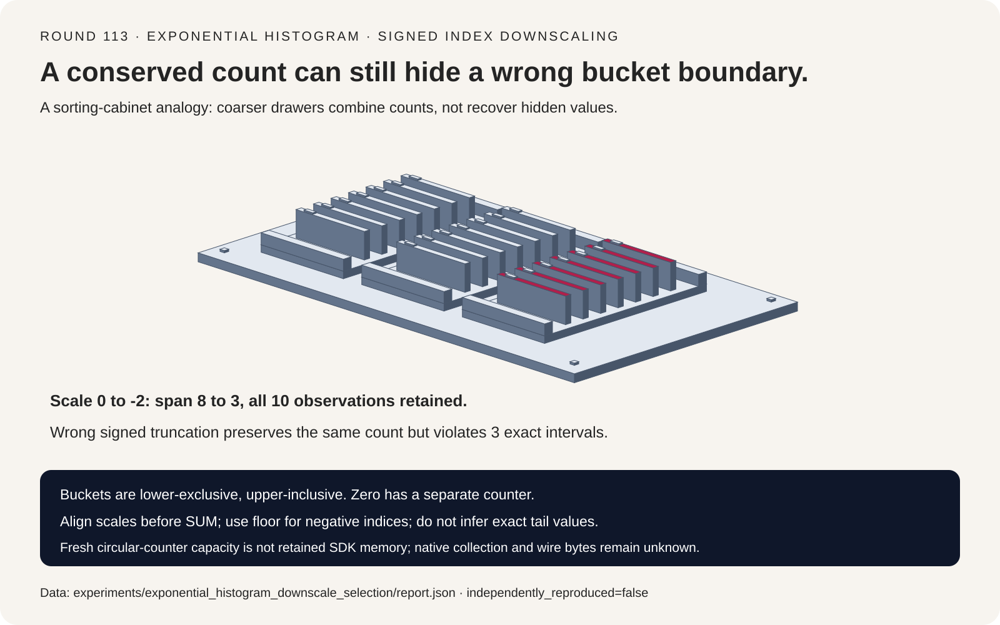
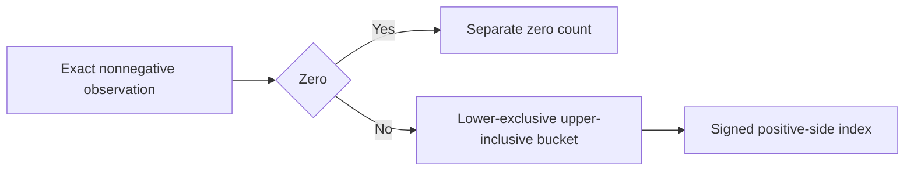
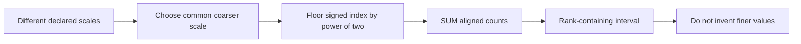
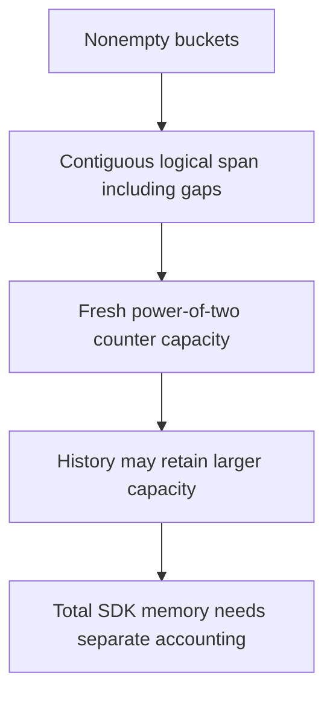

# Exponential histogram FAQ: signed indices, downscaling and retained capacity

> **Language**: [中文](exponential-histogram-signed-index-downscale-selection-faq.md) | English
>
> **Round 113 · 2026-11-14 (twenty-second round of the November 13 night)** · [SVG](../../assets/svg/exponential-histogram-signed-index-downscale-selection-faq-summary.svg) · [7-card report](../reports/exponential-histogram-signed-index-downscale-selection-cards.html) · [H5](../reports/exponential-histogram-signed-index-downscale-sizer.html) · [Sealed report](../../experiments/exponential_histogram_downscale_selection/report.json)
>
> **Synthetic, `independently_reproduced=false`.** Only original exact-rational Python merge/replay algorithms were timed. No native OpenTelemetry SDK, collector, concurrent ingestion, OTLP serialization or production memory measurement.



## 1. Executive summary: conserved counts do not prove correct value intervals

The inspected OpenTelemetry Go source has a **November 9, 2026**
positive/negative bucket-logic deduplication and an **October 30**
fixed-position circular-storage refactor. These are recent implementation
changes, not the invention of exponential histograms or a popularity claim.

For exact observations `[0,1/4,1/2,1,2,3,4,8,16,32]`, fitting a
maximum span of four slots lowers scale **0→−2** and span **8→3**.
All **ten counts** survive. A signed division shortcut also preserves
ten counts, but puts **three observations outside their bucket intervals**.

| Contract | Preserve | Do not infer |
| :--- | :--- | :--- |
| Value boundaries | Lower exclusive, upper inclusive | Exact powers of two belong to the next bucket |
| Signed coarsening | Mathematical floor | Truncation toward zero is equivalent |
| Quantiles | Rank-containing value interval | Counts reveal the original tail observation |
| Capacity | Logical span, allocation and retained history | Occupied buckets equal SDK memory |

The original model supports nonnegative integers/Fractions and scales
−10..0, with zero threshold zero. It is not a full native SDK replica.

## 2. Architect Q&A: which contracts survive downscaling and merging?

### Q1: Where does an exact power of two belong?

At scale `s`, the base is `2^(2^−s)`. Bucket `i` means
`(base^i,base^(i+1)]`: lower-exclusive, upper-inclusive.
At scale zero, value 1 belongs to index −1, value 2 to index 0,
and value 4 to index 1. Assigning the boundary to the next bucket
violates the interval even if the total count is unchanged.

The original implementation finds `ceil(log2(value))` using integer
bit lengths and exact Fraction comparison. It does not evaluate a
floating logarithm or claim parity for native positive-scale rounding.
Zero has its own counter, not a positive-side bucket index.

A negative index in the **positive** buckets means a small positive
value in the selected unit. It is not the native negative-observation
side. Negative observations and a nonzero zero threshold are excluded.

### Q2: Why is floor important when lowering scale?

Coarsening by `delta` levels maps
`new_index=floor(old_index/2^delta)` and adds the old counts.
For example, old index −1 divided by two must become −1, not zero.
Its old interval lies below the unit boundary; truncation would move
its count into a bucket whose lower edge is already 1.

The fixture's scale −2 fit has nonzero indices −1, 0 and 1:
intervals `(1/16,1]`, `(1,16]`, `(16,256]`. Its ten counts, including
one separate zero, are preserved. Wrong truncation keeps the same ten
counts but misplaces 1/4, 1/2 and 1: a **30-point drop in observation
containment agreement** over ten observations.

Count conservation is therefore necessary but insufficient. Tests
must also prove `lower < observation <= upper`, except the separate
zero singleton.

### Q3: Can states at different scales merge or later upscale?

Align to a common scale no finer than any input, then SUM matching
bucket counts and zero counts. Two repartitioned fixture states at
scales 0/−1, plus an empty state, equal direct construction at −2.
Associativity is tested at an explicit common target scale.

Fine-scale distinctions are lost after coarsening. The original model
rejects upscaling rather than inventing counts inside finer intervals.
An empty state is an identity at the declared common scale; arbitrary
coarser scale declarations can still lower the requested resolution.

Native source merging has locks and requires the other state to be
idle; it may mutate aligned inputs. This immutable original model
does not reproduce hot/cold collection, concurrency, mutation or
DELTA/CUMULATIVE timestamp/reset semantics.

### Q4: Does an exact count make p99 exact?

No. The nearest-rank p99 in ten observations has rank ten and exact
value **32**. At scale −2, the counters identify only the interval
**(16,256]**. p50 and p90 both land in `(1,16]`, with exact values
2 and 16 for this fixture.

The original query returns an interval, not a fabricated midpoint,
interpolation or confidence. Native separately recorded min/max can
tighten some bounds; those extrema are deliberately not modeled here.
Counters alone do not certify every SLO decision when an interval
straddles its threshold.

An empty quantile raises explicitly. A requested maximum span of one
cannot fit observations on both sides of the unit boundary within
the supported scale range; the original fit raises without dropping
observations. This is not native underflow/error-handler parity.

### Q5: How is logical bucket span different from allocated memory?

The inspected circular storage uses power-of-two uint64 capacity.
A fresh selected positive span of **160** therefore rounds to
**256** slots; negative span **17** rounds to **32** slots.
Including one selected uint64 zero counter yields:

| Selected counter accounting | Bytes |
| :--- | ---: |
| Logical spans plus zero | 1,424 |
| Fresh rounded capacities plus zero | **2,312** |
| 10,000 streams × two selected live states | **46,240,000** |

These are selected counter payloads, not SDK totals or measured heap
allocation. Live states per stream is a user assumption, not a claim
that two native maps are always fully populated. Zero-count gaps
belong to the logical span; sparse occupied buckets are not the same
thing as contiguous range length.

Clear/downscale can retain earlier circular capacity. Attributes,
maps, sum/extrema, exemplars, snapshots, allocator overhead and OTLP
encoding are excluded. Retained capacity, total memory, wire bytes
and native collection latency remain null.

## 3. Visual architecture: exact boundaries, scale alignment and capacity







## 4. Selection matrix: choose interval correctness before a memory claim

| Choice | Good fit | Gate before adoption |
| :--- | :--- | :--- |
| Aligned exponential counts | Mergeable distribution summaries | Same boundaries, scale and zero semantics |
| Coarser bounded span | Wider dynamic range | Irreversible interval widening |
| Exact raw values | Precise order statistics | Retention/sort/storage budget |
| Fresh counter capacity model | Initial selected payload planning | History and non-counter fields excluded |
| Truncate signed indices | **Not safe** | Violates below-unit intervals |
| Counters called exact p99 | **Not justified** | Report a bounded interval or explicit estimator |

## 5. Hands-on evidence: exact interval oracle and separately measured CPU work

```powershell
python -m experiments.exponential_histogram_downscale_selection.run --check
python -m unittest discover -s tests -p test_exponential_histogram_downscale_selection.py -q
```

Eight focused tests cover an independent interval search, exact
boundaries, downscale containment, repartition/empty/associative merges,
exhaustive short-data quantile intervals, invalid states, infeasible
fit, immutable inputs and Node.js/Python exact capacity parity.

The measured comparison merges eight precomputed states versus
replaying all exact raw observations at the same target scale.
Both return identical complete bucket states:

| Total observations | Align/merge (ms) | Raw replay (ms) |
| :--- | ---: | ---: |
| 256 | 0.031467 | 0.799700 |
| 1024 | 0.034267 | 3.292700 |
| 4096 | 0.037833 | 14.574567 |
| 16384 | 0.035667 | 57.258233 |

Two warmups, seven alternating repeats, three operations per sample;
median repeat means. Initial per-shard histograms are excluded, so
this is not an ingestion speedup. Native SDK atomics, circular storage,
concurrency, collector, encoding and network are not executed.
Browser visual inspection was not performed; prior refusal was respected.

## 6. Sources, provenance and readiness

- [Pinned implementation](https://github.com/open-telemetry/opentelemetry-go/blob/63c5f44275f152fa0a9629463db43474fe7214e2/sdk/metric/internal/aggregate/exponential_histogram.go): signed scale changes, merge alignment, circular capacity and retained storage.
- [Public bucket contract](https://github.com/open-telemetry/opentelemetry-go/blob/63c5f44275f152fa0a9629463db43474fe7214e2/sdk/metric/metricdata/data.go): `Offset+i` and lower-exclusive/upper-inclusive counts.
- [Aggregation configuration](https://github.com/open-telemetry/opentelemetry-go/blob/63c5f44275f152fa0a9629463db43474fe7214e2/sdk/metric/aggregation.go): native max-size/max-scale and optional extrema.
- [November 9 refactor](https://github.com/open-telemetry/opentelemetry-go/commit/63c5f44275f152fa0a9629463db43474fe7214e2) and [October 30 circular-storage change](https://github.com/open-telemetry/opentelemetry-go/commit/54b94d57bbe92612969951f3a8f6c5246bbdf49e): verified chronology, not measured upstream speedups.
- [Apache-2.0 license](https://github.com/open-telemetry/opentelemetry-go/blob/63c5f44275f152fa0a9629463db43474fe7214e2/LICENSE); upstream rights remain with their owners.

All exact-rational mapping, immutable state logic, interval oracle,
synthetic fixtures, budgets and artwork are original. No upstream
implementation, private observations or datasets were copied.
The report is synthetic with `independently_reproduced=false`;
original CPU measurements are separately labeled measured.
